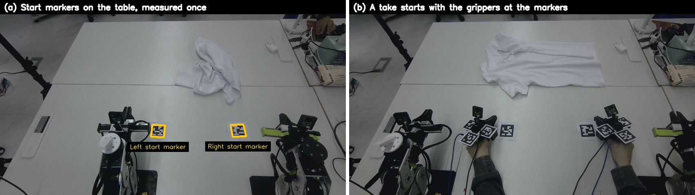

# Egocentric Human Demonstrations for Bimanual Garment Manipulation

Human garment-manipulation demonstrations, recorded with hand-worn parallel-jaw grippers, are converted into
robot-feasible end-effector trajectories and replayed on a two-arm robot, as an end-to-end test of the data before any
policy is trained on it.

[](.github/workflows/ci.yml)
[](LICENSE)
· **[Technical note (PDF)](report/technical_note.pdf)** · [Detailed results](docs/results.md) ·
[Attribution](ATTRIBUTION.md)

> **Update, 27 October 2026.** The replay stage is finished and the project has moved on to **policy training data**:
> 300 successful T-shirt flattening demonstrations, a new pose source (fixed-camera point tracking anchored by the
> markers), quality grades and Cartesian labels taken *before* inverse kinematics. See
> [From replay to policy training data](#from-replay-to-policy-training-data-october-2627). Parts of the original
> pipeline that are no longer used are marked ~~struck through~~.
>
> **Update, 1 November 2026.** First policies fine-tuned on these demos run on the robot but stop short of the cloth.
> The causes were traced to the data (a label clamp, demonstration speed, jaw labels, wrist-camera placement); see
> [First policies on the robot](#first-policies-on-the-robot-and-what-they-exposed-in-the-data-october-28--november-1).
> No success rate is reported yet.

> **Note.** This repository contains a sanitized research overview and selected reproducible components of an ongoing
> bimanual garment-manipulation project. Proprietary code, internal datasets, calibration parameters, robot-specific
> configurations, raw logs and model checkpoints are not included. All data in `examples/` is synthetic. The utilities
> in `src/egogarment/` (command wrappers in `scripts/`) were written for this repository and are generic
> re-implementations of ideas described below, not the project's production code.

**Human demonstration (left) vs. robot replay of the converted trajectory (right).** Same fixed camera, aligned on one
clock, shown at the human's speed; the bar shows the robot jaw commands.


**Contents:** [1. Overview](#1-overview) · [2. System at a glance](#2-system-at-a-glance) ·
[3. Components](#3-components) · [4. Installation](#4-installation) · [5. Pipeline](#5-pipeline) ·
[6. Codebase guide](#6-codebase-guide) · [7. Results](#7-results) ·
[8. Current vs. superseded](#8-current-vs-superseded) · [9. Hardware and attribution](#9-hardware-and-attribution) ·
[10. License, acknowledgements, citation](#10-license-acknowledgements-citation)

---

## 1. Overview

* **Replay as an end-to-end test of the data.** Converted human motion is replayed open loop on the robot, on one clock
  and in one frame, so errors can be attributed to a stage (conversion vs. planning vs. tracking).
* **One world frame, one clock.** Every pose, human or robot, is expressed in the robot base frame, and every stream
  carries host timestamps; no per-recording alignment is needed.
* **Replay result.** Two-arm replay of one 33 s demo is deterministic (≈1 mm between runs) and grasp height matches the
  human; folding by replay does **not** succeed.
* **Training data.** 300 flattening demonstrations are converted into graded, Cartesian-before-IK training labels,
  with a fixed-camera point-tracking pose source that replaced wrist-camera SLAM.
* **First policies on the robot.** Two policies fine-tuned on the GOLD demos reach toward the cloth but stop short;
  the causes were traced to the data (a label clamp, demonstration speed, jaw labels, wrist-camera placement); the
  first three are changed, the camera re-mount is next. No success rate is reported yet.

### Motivation and research question

Folding a T-shirt is long-horizon, bimanual and contact-rich, and the cloth state changes with every grasp. Teleoperated
robot data for such tasks is slow and expensive to collect. Hand-held and hand-worn grippers in the style of UMI let a
person demonstrate with an end-effector that resembles the robot's, without a robot in the loop, so data collection
scales with people rather than robots.

The difficulty moves into the conversion. Every error in calibration, pose recovery, jaw labelling, timing or
kinematic feasibility ends up in the training labels, and a policy trained on those labels inherits it. Policy success
rates are a late and indirect signal for such errors.

**Main question.** *If a robot simply replays the converted human motion, open loop, does it do what the human did?*

Replay is used as an end-to-end test of the data pipeline before policy learning. It has three useful properties:

1. it exercises every stage at once (calibration, pose, jaw state, robotization, IK, timing, control);
2. human, robot command and measured robot motion can be put on one clock and in one frame, so errors can be attributed
   to a stage (conversion vs. planning vs. tracking);
3. it fails visibly and physically (the jaws close above the cloth, or on the empty table).

Subsidiary questions: Where does the pose come from when the hand hides the markers during a grasp? How much does the
human path have to be changed to become feasible for the robot, and how should that be recorded? Which errors are
invisible to model-based checks?

## 2. System at a glance


*Data flow, as of 27 October. A person demonstrates with two hand-worn grippers; wrist fisheye cameras, wrist IMUs and
a fixed RGB-D camera record on one clock. Points on each gripper are tracked in the fixed-camera video, lifted by depth
and fused with the fiducial markers (anchors) and the IMU (only inside tracking gaps) into the jaw-tip pose in one world
frame, the robot base. Each episode is trimmed and graded; the training label is the Cartesian pose before inverse
kinematics. A policy pretrained on public cloth data is fine-tuned on the best-graded demonstrations and runs on the
robot in a receding-horizon loop with online IK and safety checks. The grey box lists parts of the earlier replay
pipeline that are no longer used.* (Figure generated by [`docs/make_architecture.py`](docs/make_architecture.py).)

| component | role |
|---|---|
| 2 × hand-worn gripper (HandUMI) | demonstration tool; each carries four fiducial markers (AprilTags; the fourth, on the back of the wrist camera, since Oct 23), a wrist fisheye camera, an IMU and a **jaw servo** (Feetech STS3215) read with torque off as a passive jaw encoder at ≈100 Hz on the host clock (back since Oct 29; ~~no jaw motor~~ Oct 20–28) |
| Fixed RGB-D camera (Orbbec Gemini 336) | above the table, raised to 113 cm so both hands stay in view; sees the markers and the grippers for point tracking; colour + aligned depth |
| 2 × low-cost 6-DoF arm with parallel jaw (reBot B601-DM) | executes the policy (earlier: open-loop replay target); jaw-opening limit enforced by the robot bridge |
| Host computer | records all streams on one monotonic clock; robot control and online IK |
| Rented GPUs | point tracking, the jaw model and policy training; ~~only for the optional visual-SLAM gap filler~~ |

Two principles run through the system:

* **One world frame.** Every pose, human or robot, is expressed in the robot base frame. The fixed camera is calibrated
  to the robot (again after every camera move, from two fixed table markers and the table plane), and every recording starts with the grippers placed on start markers whose positions in the robot
  frame were measured once. No per-recording alignment (~~no SLAM map~~, no point-cloud registration) is needed.
* **One clock.** Camera frames, IMU samples, the robot's commanded and measured joints all carry host timestamps, so
  human, command and robot can be compared sample by sample and filmed side by side by the same camera without
  synchronization hardware.

## 3. Components

What is in this repository, by pipeline stage (see [§5](#5-pipeline)). Hardware, recorder, real pose fusion, IK, robot
bridge and training code are not included (see the note above).

| Component | Path | Stage | Status | Description |
|---|---|---|---|---|
| io | [`src/egogarment/io/`](src/egogarment/io/) | all | current | trajectory CSV format helpers (`trajio`) |
| pose | [`src/egogarment/pose/`](src/egogarment/pose/) | 3; learning contract | current (generic baseline) | gap filling with per-frame flags (`gap_fill`); relative SE(3) contract and round trip (`relative_se3`) |
| retarget | [`src/egogarment/retarget/`](src/egogarment/retarget/) | 5 | current (illustrative defaults) | continuous warps + per-frame displacement / quality (`robotize`) |
| evaluation | [`src/egogarment/evaluation/`](src/egogarment/evaluation/) | 9 | current | RMSE / p95 / rotation error between two trajectories with lag search (`parity_metrics`) |
| viz | [`src/egogarment/viz/`](src/egogarment/viz/) | 9 | current | figure of a processed trajectory (`plot_example`) |
| scripts | [`scripts/`](scripts/) | – | current | thin wrappers: `python scripts/<module>.py` works without installing |
| examples | [`examples/`](examples/) | – | current | SYNTHETIC bimanual demo + simulated replay (CSV/NPZ) and their generator |
| tests | [`tests/`](tests/) | – | current | pytest checks on the synthetic example (run in CI) |
| docs | [`docs/`](docs/) | – | current | data-flow figure and its generator, [results and metric definitions](docs/results.md), synthetic example figure |
| report | [`report/`](report/) | – | current | short technical note (LaTeX source + PDF) |
| media | [`media/`](media/) | – | current | short clips and photos of the real setup ([media/README.md](media/README.md)) |

Per-module inputs, outputs and entry points: [`src/egogarment/README.md`](src/egogarment/README.md).

## 4. Installation

```bash
python -m pip install -e ".[test]"     # package + console commands (Python >= 3.10)
# or, without installing the package:
python -m pip install -r requirements.txt
```

The only dependencies are numpy, scipy and matplotlib (pytest for the tests).

## 5. Pipeline

The real pipeline as stages, with the reproducible re-implementation in this repository where one exists. The commands
run on the synthetic example; real-data stages that are not in this repository have no command.

### Stage 0 — One world frame for human and robot



*(a) Start markers on the table, measured once in robot coordinates. (b) Every take starts with the grippers there.*

1. **Camera → robot.** The robot moves a marker on its wrist through many poses in front of the fixed camera; this gives the camera pose in the robot base frame. From then on, anything the camera measures is in robot coordinates.
2. **Start markers.** Two AprilTags on the table are measured once with the calibrated camera.
3. **Gripper markers → jaw tip.** A one-time rig calibration relates each gripper's markers to its jaw tip, so the camera gives the jaw-tip pose directly in robot coordinates.
4. **Every take starts at the start markers**, so every demonstration begins at known robot coordinates. No per-take alignment (SLAM map, point-cloud registration) is needed.

### Stages 1–9 — From human motion to robot motion

1. **Record** both hands from a fixed start pose on the start markers, with a spoken protocol marking demo windows.
2. **Reconstruct** the jaw-tip trajectory of each hand in the robot base frame from markers + depth.
3. **Fill gaps** (gyro rotation + interpolation; optional gated SLAM) and flag every filled frame.
4. **Label the jaw** from the wrist video (replay track); demonstrations recorded since 29 October take it from the
   jaw servo's encoder instead (§8).
5. **Robotize** with continuous warps only, never clipping: lateral compression toward each arm's own side with a
   softplus ceiling at the midline, and a softplus floor above the table. Store displacement and quality per frame
   ([`src/egogarment/retarget/robotize.py`](src/egogarment/retarget/robotize.py) shows the idea).
6. **Plan** with joint-limit-aware differential IK (position prioritised over orientation, bounded joint change per
   frame, wrist-roll relaxation about the tool axis, use of the jaw's 180° symmetry, finger-corner clearance), and issue
   jaw commands early by the measured jaw actuation latency.
7. **Check** before anything moves: IK error, joint limits and speed, TCP and link heights above the table, and the
   minimum distance between the two arms. Plans are always computed offline first.
8. **Replay** open loop and log commanded and measured joints on the host clock.
9. **Compare** three levels: A = human (markers), B = robot command (FK of commanded joints), C = robot (FK of
   encoders), plus a side-by-side video from the same camera
   ([`src/egogarment/evaluation/parity_metrics.py`](src/egogarment/evaluation/parity_metrics.py) shows the metric definitions).

Since 26–27 October the stages after pose reconstruction produce **policy training data** instead of a replay (see
[§8](#from-replay-to-policy-training-data-october-2627)).

### Reproducible commands (synthetic data)

| stage | command (wrapper; same as `python -m egogarment.…` or the `egogarment-…` console command) |
|---|---|
| – | `python examples/make_synthetic.py` — regenerate the synthetic data (seed 0) |
| 3 fill gaps | `python scripts/gap_fill.py examples/synthetic_bimanual_demo.csv out/filled.csv --max-gap 1.0` |
| 5 robotize | `python scripts/robotize.py out/filled.csv out/robotized.csv --sep 0.05` |
| 9 compare | `python scripts/parity_metrics.py out/robotized.csv examples/synthetic_robot_replay.csv` |
| learning contract | `python scripts/relative_se3.py out/filled.csv --chunk 1.0` |
| 9 plot | `python scripts/plot_example.py out/robotized.csv out/example.png --robot examples/synthetic_robot_replay.csv` |
| tests | `python -m pytest -q tests` |

```bash
python -m pip install -r requirements.txt
python examples/make_synthetic.py                                     # regenerate the synthetic data (seed 0)
python scripts/gap_fill.py examples/synthetic_bimanual_demo.csv out/filled.csv --max-gap 1.0
python scripts/robotize.py out/filled.csv out/robotized.csv --sep 0.05
python scripts/parity_metrics.py out/robotized.csv examples/synthetic_robot_replay.csv
python scripts/relative_se3.py out/filled.csv --chunk 1.0
python scripts/plot_example.py out/robotized.csv out/example.png --robot examples/synthetic_robot_replay.csv
python -m pytest -q tests
```

Expected parity output on the synthetic data: recovered lag ≈0.2–0.26 s (the generator uses 0.25 s), position RMSE
≈6 mm. Comparing the *unrobotized* human path with the replay instead gives ≈17 mm for the right hand: the difference
is the robotization displacement, the analogue of the "command vs. human" term in the real analysis.


### Pose reconstruction and validation (stages 2–4)

1. **Markers → gripper pose.** In each RGB-D frame the AprilTags are detected and solved individually (planar PnP), and
   the marker distance, the least accurate PnP coordinate at about 1 m, is corrected along the viewing ray by the
   aligned depth. When several tags of one gripper are visible, all their corners are solved jointly for the gripper
   pose. Rotation can additionally be stabilised by the wrist gyroscope anchored to the marker frames.
2. **Gripper → jaw tip in the robot frame.** A one-time rig calibration maps the gripper's markers to its jaw tip; the
   camera-to-robot calibration maps the result into the robot base frame.
3. **Gaps.** Markers disappear exactly when the hand grasps (palm down). Short gaps get the gyro rotation and an
   interpolated position and are flagged as not measured. ~~Wrist-camera SLAM is an *optional* filler, accepted only for
   segments that stay close to the marker path on held-out validation frames.~~ Replaced on 24 October by fixed-camera
   point tracking (§8).
4. **Jaw state.** An ImageNet-pretrained ResNet-18 per hand classifies a crop of the wrist fisheye that shows the jaws,
   with hysteresis on its output. Since 22 October a keypoint model finds the two jaw tips and their distance gives a
   continuous aperture (100 % / 98 % agreement with hand labels on a re-angled take).
5. **Jaw state from the servo (since 29 October).** Each hand-worn gripper again carries its jaw servo, now with torque
   off so it never drives the jaw while a person holds it; it is only read, at ≈100 Hz on the same host clock as the
   cameras. The motor position is mapped through a per-hand calibration (closed … open ticks) to a continuous aperture
   (0 closed … 1 open), then to open/closed events with hysteresis and a minimum dwell. The reading is re-centred per
   recording, because unplugging or power-cycling a servo shifts its whole range; the recorder warns aloud when a servo
   reads outside its calibrated range. The output has the same format as the video labels, so every later stage is
   unchanged. Video- and servo-derived labels are kept apart and never mixed in one comparison.

**Validation is geometric and physical**, not only internal: held-out reprojection for the camera-to-robot calibration,
leave-one-out and an independent pivot test for the jaw-tip rig, a tape measure for the absolute robot jaw position,
and finally the robot itself, filmed by the same camera as the human.

**Reconstructed jaw-tip trajectories** of the same demonstration. Left: the paths projected into the fixed camera, coloured
by the source of each frame: AprilTag markers + depth (green), MASt3R-SLAM gap filler (blue), IMU rotation +
interpolation where markers are hidden (orange). Right: both hands in one world frame (millimetres, offset to the
workspace corner).


## 6. Codebase guide

### The split

* **`src/egogarment/`** — one subpackage per pipeline component: `io` (format), `pose` (gap filling, relative SE(3)),
  `retarget` (robotization), `evaluation` (parity metrics), `viz` (plots). Every tool is a module with a library API
  plus a `main()` command; details in [`src/egogarment/README.md`](src/egogarment/README.md).
* **`scripts/`** — one thin wrapper per module, so the commands above work from a plain checkout.
* **`examples/`** — the synthetic data and its deterministic generator; **`tests/`** — checks on that data.
* **`docs/`, `report/`, `media/`** — results, technical note, figures and clips of the real setup.

### The interface: trajectory CSV

All tools exchange one wide CSV, defined in [`src/egogarment/io/trajio.py`](src/egogarment/io/trajio.py) and documented
with the example data in [`examples/README.md`](examples/README.md). One row per frame, `t` in seconds, then per hand
(`R_` right, `L_` left):

| column | unit | meaning |
|---|---|---|
| `x, y, z` | m | jaw-tip position in the world (robot base) frame: +x forward, +y left, +z up; table plane z = 0 |
| `qx, qy, qz, qw` | – | jaw-tip orientation, unit quaternion |
| `jaw` | – | 1 = open, 0 = closed |
| `visible` | – | 1 = pose measured (markers seen), 0 = not measured (pose is NaN) |

Columns appended by the tools and carried along unchanged by later ones:

| column | written by | meaning |
|---|---|---|
| `filled` | `pose.gap_fill` | 0 measured / 1 interpolated / 2 unfilled (too long or open-ended) |
| `human_x/y/z` | `retarget.robotize` | the path before robotization |
| `disp_mm` | `retarget.robotize` | per-frame robotization displacement, mm |
| `quality` | `retarget.robotize` | 0 / 1 / 2 (default boundaries 20 / 50 mm) |

### Coordinate representation

* **Storage: absolute poses in the world frame.** Each frame stores the jaw-tip pose `T_B(t) ∈ SE(3)` of each hand in
  the robot base frame `B` (+x forward, +y left, +z up), the jaw state, and flags for whether the pose was measured or
  filled. The jaw-tip TCP is defined the same way for the human gripper and the robot gripper (midpoint between the jaw
  tips), so no tool offset has to be guessed later.
* **Learning contract: relative SE(3).** Learning targets are expressed relative to a reference pose `T_0` (e.g. the
  pose at the start of an action chunk):

  `T_rel(t) = T_0^{-1} T(t)`

  so the target does not depend on where in the workspace the motion happens, and the same contract applies to human
  data and to robot data. Absolute storage keeps the option of re-deriving any relative form, and is what the replay
  uses. A reference implementation of the conversion and its round trip is in
  [`src/egogarment/pose/relative_se3.py`](src/egogarment/pose/relative_se3.py) (chunk horizon `--chunk`, default 1.0 s).
* **Per-frame quality.** Robotization stores, for every frame, how far the robot target was moved from the human path,
  and a coarse quality class derived from it; filled frames are flagged separately. These are intended as label weights.

## 7. Results

Measured in October 2026 on one setup with one demonstrator. Full tables and metric definitions:
[docs/results.md](docs/results.md).

| milestone | result |
|---|---|
| Calibration | camera ↔ robot: 0.98 px held-out reprojection (≈1.3 mm lateral); marker rig → jaw tip: 1–4 mm static (leave-one-out 1.8–4.8 mm) |
| Single-arm replay parity | 16/18 translation strokes pass; median per-axis RMSE 5.5–11.6 mm; rotation strokes 0.3–1.6° median error; command vs. human ≤ 3.4 mm, so the residual was robot tracking |
| First cloth grasp from human data | one arm replayed a grasp window of a demonstration and picked up and lifted the T-shirt |
| Full two-arm replay of one 33 s demo | four runs with one unchanged plan repeat within ≈1 mm; whole-demo position RMSE ≈17 mm (right) / ≈30 mm (left) against the robotized path, ≈22 / 32–34 mm against the raw human path |
| Jaw height at grasp | after allowing finger contact, jaws close 14–16 mm (right) / 5–19 mm (left) above the table (human ≈10 mm), within 2–8 mm of the commanded position |
| Folding like the human | **not achieved.** In the best run the jaws caught the shirt edge and dragged it; no success rate is reported |
| Wrist-camera SLAM as pose source | **rejected.** MASt3R-SLAM kept 19–48 % of frames (0–38 % around grasps); ORB-SLAM3 mono-inertial scale diverged |
| Point tracking + markers + IMU (Oct 24–25) | hidden-marker error on held-out takes: median 16 mm (left) / 19 mm (right); markers alone ≈ 42 mm |
| Flattening dataset (Oct 26–27) | 300 successful of 318 demonstrations; of the first 139 graded, 133 GOLD / 5 SILVER / 1 REJECT |
| Labels before vs after IK | IK → FK moves the target by p95 ≈ 58 mm at grasps (53 mm overall); ≈ 1 % of frames truly unreachable |
| Policy | **not yet trained on our data**; a pretrained-only diffusion policy ran on the robot in dry runs without safety violations |

### How to verify (this repository)

The real-system numbers above come from data that is not published. What can be re-run here is the synthetic example:
`python -m pytest -q tests` checks every module against outputs recorded before the code was packaged
([`tests/expected_synthetic.json`](tests/expected_synthetic.json)) and that `examples/make_synthetic.py` reproduces the
committed example files; the synthetic numbers are listed in
[docs/results.md §8](docs/results.md#8-synthetic-example-this-repository).

### What was hard, and what I changed

| problem | decision | why |
|---|---|---|
| Wrist-camera SLAM loses tracking at the moment of grasp (close range, white cloth, fast motion) | **Absolute markers + depth from a fixed camera** as the pose source; SLAM only as a gated filler | SLAM was accurate where it tracked (a few mm) but missing exactly where labels matter. Mono-inertial scale diverged because hand accelerations were below the accelerometer bias |
| Earlier label pipeline (SLAM + body tracking + IMU) passed its own quality checks but was 4–6 cm off | **Measure in the world, not in the model** | A stale camera–IMU rotation, a mis-converged lever arm and a wrong anchor were invisible to internal residuals; they were found against the external camera |
| Robot model errors (tool-centre-point and arm mounting) invisible to FK-vs-FK parity | **Tape, camera and cloth as ground truth**; model corrections applied inside the IK model | Relative parity metrics cancel constant offsets; the robot reached the right shape in the wrong place |
| Jaws closed several cm above the cloth | **Fix the conversion, don't add heuristics**: allow the finger corner to touch the table plane, as human fingers do | Heuristics (tilt the tool, close at the lowest nearby point) were tried and rejected; tilting made the IK fail |
| Hands crossing the midline, targets below the table | **Continuous warps + per-frame quality**, never clipping | Clipping creates jumps and hides how much a label was changed |
| Aligning camera, IMU, robot and video | **One host clock** for everything | Enables per-sample comparison and side-by-side video without sync hardware |
| Arm lag during moving segments did not respond to the proportional gain | **Model the controller**: with an integral-only feed-forward and no gravity model, the moving error scales with the rate of gravity-torque change over the integral gain | Tuning the integral gain reduced stroke RMSE from 25–37 mm to 12–14 mm |

### Limitations

* **No success rate.** Replays were judged by measurement and video; no trials were counted.
* **One demonstration** of one take was replayed in full on both arms. The ≈1 mm repeatability shows determinism, not
  generality across demonstrations, demonstrators or garments.
* **Open loop.** The cloth must start where the human's did; in two runs the shirt lay 15–20 cm away and the jaws closed
  on the empty table.
* **Relative parity metrics hide offsets.** They are computed relative to the start of a window with lag removed;
  absolute placement was checked only by tape and video.
* ~~**Tag-hidden phases** are interpolated (about a fifth of the right-hand frames of the full demo); their error at the
  grasps is not measured.~~ Addressed by point tracking (§8); hidden-marker error is now measured on held-out takes.
* **About a fifth of label frames need a large IK correction** (wrist roll, tool flip, one joint at its limit); they
  are reported by cause and not masked yet.
* **Jaw labels** from the wrist video have no held-out accuracy number on the older demonstrations; on recordings that
  also have the servo, the video classifier agrees with it on only about 70–80 % of frames. A model trained to
  reproduce the servo from the wrist video, for relabelling older demonstrations, is under evaluation and not applied.

## 8. Current vs. superseded

Superseded parts are kept in the text and marked ~~struck through~~ rather than deleted.

### From replay to policy training data (October 26–27)

Open-loop replay showed that the conversion is geometrically sound, but it also showed what a training label must not
contain. The pipeline was rebuilt for learning, on the same calibration, recorder and robot tools.

**What changed**

| part | now | ~~before~~ |
|---|---|---|
| pose source | point tracking (CoTracker3) on the fixed RGB-D camera, lifted by depth, fitted to a rigid gripper model, anchored by the markers; IMU acceleration only inside gaps | markers + IMU interpolation; ~~wrist-camera SLAM filler~~ |
| camera ↔ robot | re-solved after every camera move from two fixed table markers plus the table plane; camera raised so both hands stay in view | one robot-held-marker calibration |
| arm assignment | by the gripper's side of the table | by marker label (the labels were found swapped) |
| episode window | still start and end cut (both hands below 10 cm/s), short one-hand tracking gaps at the edges cut | operator-marked windows |
| label | **Cartesian jaw-tip pose before inverse kinematics**, smoothed; ~~kept above the table~~ (removed Oct 29, see below) | robotized path after IK → FK |
| execution | receding horizon: forward kinematics gives the current pose, the predicted relative motion is composed onto it, then limiter → IK → safety checks, a few steps committed per plan | whole-demo open-loop replay |


*One GOLD flattening demonstration: fused jaw-tip paths coloured by the source of each frame — a gripper marker visible
(green), point tracking only while the markers are hidden (blue), IMU inside a tracking gap (orange). Left: projected
into the fixed camera; right: both hands in the robot base frame. Compare the replay-era figure in §5, where the blue
segments came from wrist-camera SLAM.*

**Data.** 318 flattening demonstrations of a crumpled T-shirt in four colours, **300 successful** (judged on a frame
just before each demo ends). Each demo is graded GOLD / SILVER / REJECT from tracking coverage, gap length, the
fraction of large hidden-marker errors and gaps at grasps; fine-tuning uses GOLD only.

**Why the label is taken before IK.** IK → FK labels contained execution decisions (wrist-roll relaxation, a tool
flip near joint limits, pushes that keep the arms apart) and moved the target most exactly where it matters: at grasps
the IK → FK label differs from the Cartesian one by p95 ≈ 58 mm. Only about 1 % of frames are truly out of reach
(hands lifted far above the table). The IK result and its per-frame diagnostics are kept for QA; IK becomes a checker
offline and the executor online. Labels are stored absolute; the policy learns relative motion inv(T_t)·T_{t+k}.

**Planned training.** (1) A diffusion-transformer policy pretrained on a public robot cloth-folding dataset, then
fine-tuned on the GOLD demos. (2) A VLA base model pretrained on an equal mix of that dataset and two public UMI-style
garment datasets (one domain prompt per source), then fine-tuned the same way. Both are evaluated on the robot with
counted trials.

**Safety lesson.** A bridge restart without the jaw-opening limit let one jaw open to the end of its travel and break
its holder. Deployment now refuses to send commands unless the bridge reports the jaw limits.

### First policies on the robot, and what they exposed in the data (October 28 – November 1)

Both planned policies were fine-tuned on the 281 GOLD demos and run on the robot. No success rate is reported yet.
The arms reach toward the cloth but stop short of it and close the jaws early. Tracing this back pointed at the data rather
than the models:

| finding | change |
|---|---|
| The "kept above the table" step lifted 44 % of label frames, by 27 mm at the median, so the policy never learned to go down to the cloth. | Labels are now the human jaw-tip pose as measured, with no clamp, lift or feasibility edit. Limits belong to deployment, not to training labels. |
| Human demonstrations are faster than the robot can follow (p95 ≈ 0.93 m/s, 127 °/s). | A time-stretched copy of the data set (0.3× speed): pose, jaw events and every camera frame are resampled on one common slower timeline. |
| The jaw label came from a model reading the jaw in the wrist video; it disagreed with the true jaw aperture. | From October 29 the hand-worn grippers carry a servo, and the jaw label of new demonstrations is its encoder reading. Labels from the two sources are kept apart and never mixed in one comparison. |
| The robot's wrist cameras look at the jaws from a different place than the hand-worn ones. | Measured with the table markers: the robot cameras are tilted 11–13° less toward the tool axis and sit 25–44 mm closer to it. Next: re-mount them to the hand-worn geometry. |

### Research directions

1. **Egocentric capture.** Wearable demonstration hardware and a recording protocol that yields synchronized wrist
   video, inertial data and an external view of a full garment task.
2. **Metric wrist-pose recovery in a consistent world frame.** Recovering the 6-DoF jaw-tip pose of both hands, with
   metric scale, in the robot's own base frame, including through contact phases where markers or visual tracking are
   lost.
3. **Cross-embodiment trajectory representation and feasibility.** Turning human hand motion into robot end-effector
   targets: what to keep absolute, what to make relative, how to warp an infeasible path without destroying its intent,
   and how to grade each frame.
4. **Long-horizon garment policy learning.** Comparing an end-to-end policy with a stage-conditioned one (grasp, lift,
   fold, release) trained on the converted labels. *This project has not started policy training yet.*

### Open questions

1. Is the remaining ≈2–3 cm trajectory error (not yet measured at the grasp points themselves) a constant bias (calibration) or varying (needs visual correction at the
   grasp)? A per-grasp error table from the video will tell.
2. ~~Can tag-hidden contact phases be recovered well enough by an offline smoother (markers, IMU, depth, gated SLAM) with
   confidence-weighted labels?~~ Largely yes, with fixed-camera point tracking anchored by markers (§8).
3. Does weighting labels by robotization quality matter for policy learning, and in which phases?
4. End-to-end vs. stage-conditioned policies for long-horizon garment tasks, trained on relative SE(3) labels from
   human data.

### Status and next steps

* **Status (Oct 27):** replay runs end to end and is deterministic; grasp height matches the human; folding by replay
  does not succeed. 300 flattening demonstrations are converted into graded, Cartesian-before-IK training labels.
* **Status (Nov 1):** both policies are fine-tuned on the GOLD demos and run on the robot; they stop short of the cloth
  and close early. Four causes were traced to the data; three are changed and the wrist-camera re-mount is next (§8);
  no success rate yet.
* **Next:** re-mount the robot wrist cameras, retrain on the corrected labels and the servo-labelled demos, and evaluate
  on the robot with counted trials. ~~Per-grasp error analysis; a cloth-placement reference before each replay; an offline smoother for
  tag-hidden phases~~ — replay-track items, parked.

## 9. Hardware and attribution


*The two hand-worn grippers (left / right), each with three fiducial markers (photo from before 23 October; since then
a fourth, smaller marker sits on the back of each wrist camera).*

The hand-worn gripper is **HandUMI**, designed and published by **BrikHMP18** (murobotics-ai) under Apache-2.0:
<https://github.com/murobotics-ai/handumi-hw>. **It is not our design.** We printed and assembled the upstream parts and
made small changes for our use: a wrist IMU instead of VR tracking, several AprilTags per hand on different faces (so at
least one tends to face the external camera; a fourth, smaller one on the back of the wrist camera since 23 October,
whose single-tag planar pose flip is resolved with the IMU), and, between 20 and 28 October, removal of the jaw servo (jaw state was inferred from the wrist video). On 29 October
the servo was put back as a torque-off encoder that records the jaw opening (§5, Pose reconstruction, step 5). HandUMI itself follows the Universal Manipulation Interface (UMI, Chi et al., RSS 2024). See
[ATTRIBUTION.md](ATTRIBUTION.md).

### Visual observations

| view | what it provides |
|---|---|
| **Wrist fisheye** (one per hand) | the jaws themselves (open / closed, continuous aperture from jaw-tip keypoints), contact, and a close-up of the local cloth; ~~also the input of the optional SLAM filler~~. This is the view a robot with wrist cameras would have, and a policy input. |
| **Fixed external RGB-D** | the pose source: point tracking on the grippers + the fiducial markers + metric depth; global scene context (where the garment lies, both hands at once) and a policy input. It is also the camera that films the robot, so human and robot appear in the same image. |

### Previous work

An earlier project, [egocentric-cube-stacking](https://github.com/physical-ai-vla/egocentric-cube-stacking),
collected 349 bimanual human demonstrations, converted them across embodiments into robot trajectories with relative
Cartesian actions, fine-tuned X-VLA on them, analysed the human-to-robot gap, and deployed on a dual-arm robot.

### Related work and attribution

* **UMI** (Chi et al., RSS 2024): hand-held gripper with wrist fisheye; pose from ORB-SLAM3-based monocular-inertial
  SLAM. We keep the UMI-style gripper but take pose from fixed-camera fiducials + depth, and test data by replay.
* **HandUMI** (BrikHMP18 / murobotics-ai, Apache-2.0): the hand-worn gripper hardware we use. Not our design.
* **DexUMI**, **EgoMimic**: human hands / egocentric video as a data source for robot learning.
* **ALOHA**: low-cost bimanual manipulation (teleoperated); **SpeedFolding**, **FlingBot**: learned cloth primitives.
* **AprilTag** (Olson; Wang & Olson), **IPPE**, **SQPnP**, **OpenCV**: fiducial detection and pose.
* **MASt3R-SLAM**, **ORB-SLAM3** (and Basalt, OpenVINS, AirSLAM in an earlier stereo setup): evaluated as pose sources.
* **Pink** on **Pinocchio**: differential IK; **ResNet-18** / **ImageNet**: jaw classifier backbone.

Full references are in the [technical note](report/technical_note.pdf); licences and credits in
[ATTRIBUTION.md](ATTRIBUTION.md).

## 10. License, acknowledgements, citation

**License.** This is a research overview of work in progress, not a product. Numbers are from one setup, one
demonstrator and a small number of runs, and are reported as measured, including failures. Code, documentation and media in this
repository are licensed under the **PolyForm Noncommercial License 1.0.0** ([LICENSE](LICENSE)): free for research,
teaching, personal and other noncommercial use; **commercial use is not permitted** without a separate written
agreement with the author. Third-party designs and methods remain under their own licences
([ATTRIBUTION.md](ATTRIBUTION.md)).

**Acknowledgements.** The hand-worn gripper is HandUMI by BrikHMP18 (murobotics-ai, Apache-2.0), following UMI
(Chi et al., RSS 2024); see [§9](#9-hardware-and-attribution) and [ATTRIBUTION.md](ATTRIBUTION.md).

**Citation.** See [CITATION.cff](CITATION.cff) (GitHub's "Cite this repository").

```bibtex
@misc{lee_egocentric_garment_manipulation,
  author       = {Lee, Jeong Hwan},
  title        = {Egocentric Human Demonstrations for Bimanual Garment Manipulation},
  howpublished = {\url{https://github.com/physical-ai-vla/egocentric-garment-manipulation}}
}
```

**Author.** **Jeong Hwan Lee** — Robotics Engineer, Physical AI / Robot Learning

Interests: learning robot manipulation from human demonstrations; egocentric and wearable data capture;
cross-embodiment action representations; bimanual and deformable-object manipulation; vision-language-action models;
calibration and evaluation methodology for robot-learning data.

GitHub: <https://github.com/physical-ai-vla>
