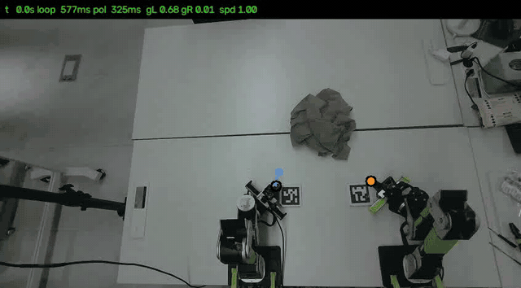
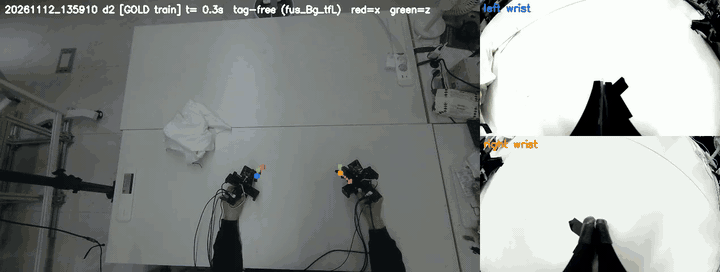
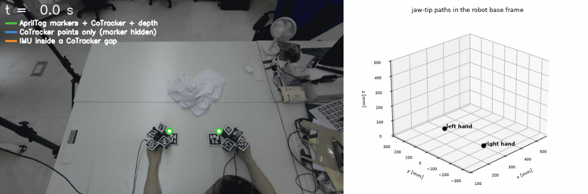
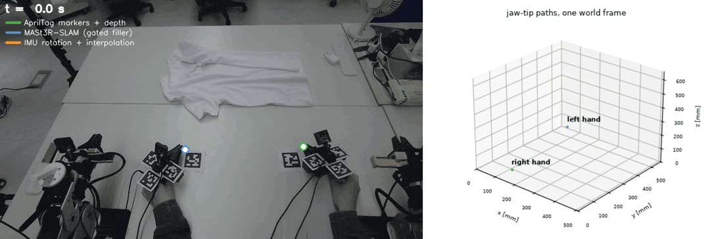
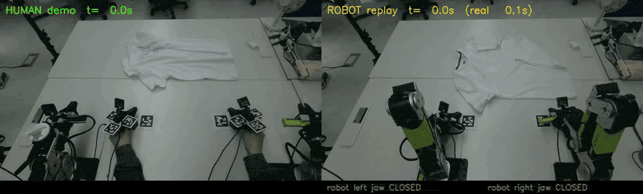
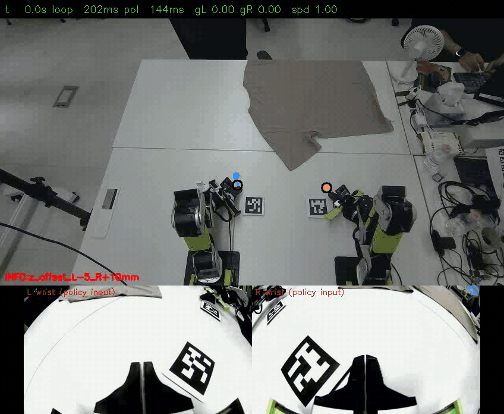
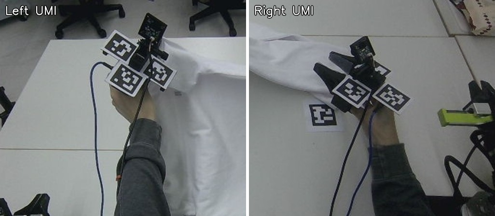

# Egocentric Human Demonstrations for Bimanual Garment Manipulation

Human T-shirt demonstrations, recorded with hand-worn parallel-jaw grippers (HandUMI), are converted into
robot-feasible jaw-tip trajectories and training labels in the base frame of a two-arm robot (**reBot B601-DM**), first
replayed open loop as an end-to-end test of the data and then used to train policies for T-shirt flattening and
folding, so that robot data collection scales with people instead of robots.

Part of **[physical-ai-robot-learning](https://github.com/physical-ai-robot-learning)** — Physical AI / robot learning projects.


[](LICENSE)
· **[Technical Report (PDF, 11-26)](report/report_en.pdf)** ([한국어, 11-02](report/report_ko.pdf)) · [earlier versions](report/archive/)
· [Detailed results](docs/results.md) · [Project history](docs/history.md) · [Pipeline](docs/pipeline.md)
· [한국어 README](README_ko.md) · [Attribution](ATTRIBUTION.md) · [Code availability](#code-availability) · status: 2026-11-26


*Human demonstration (left) vs. robot replay of the converted trajectory (right). Same fixed camera, aligned on one
clock, shown at the human's speed; the bar shows the robot jaw commands.*

## Status (26 November 2026)

> **What works, and how it was measured**
> * **Replay (10-08 → 10-22).** Two-arm replay of one 33 s demo is deterministic (≈1 mm between runs) and the jaws
>   close at the human's height and time; the robot grasps and drags the cloth, but folding by replay does **not**
>   succeed. Measured against the fixed camera, a tape measure and the robot encoders ([results](docs/results.md)).
> * **Training data (10-26/27).** 300 successful flattening demonstrations are converted into graded,
>   Cartesian-before-IK training labels; pose from fixed-camera point tracking anchored by the markers, not wrist SLAM.
> * **First policies on the robot (10-28 → 11-01).** DiT and X-VLA fine-tuned on the 281 GOLD demos approach the cloth,
>   stop short of it and close the jaws early. Recorded causes and the data fixes that followed:
>   [history](docs/history.md#first-policies-on-the-robot-and-what-they-exposed-in-the-data-october-28--november-1).
> * **Pinching (2 November).** In a reduced test (pinch one sleeve with the left hand), a DiT fine-tuned on 197
>   pinching demonstrations (checkpoint at 50 epochs) grasped the sleeve and pulled it. Successful grasps were
>   observed in real-robot trials on 2 November; **trials were not counted**. After a miss the policy grabs elsewhere
>   instead of retrying (the data have no recovery demonstrations).
> * **Flattening after the pinching test (11-02 → 11-05).** FLAT149 (UMI cloth-folding recipe) and, under the camera
>   re-aimed on 3 November, FLAT250 (250 train demos, split by the tracking gaps inside each demo): held-out score
>   72 → 52 mm by epoch 13. Because the jaw servo has no load signal, a wrist-camera classifier estimates per frame
>   whether a closed jaw holds the cloth (p_grasp; 3–5 November). No counted robot trials of these policies yet.
> * **Flattening with p_grasp on the robot (11-05 → 11-07).** FLAT-PGRASP: the FLAT250 recipe on the data of 3–5
>   November (train 301 / val 46 / test 45 demos), p_grasp in the jaw slots of the state. At 0.3× time-stretch the
>   held-out score reached 46.04 / 46.61 mm (val / test, epoch 53). On the robot (6 November) the 0.3× policy looked
>   better than the same recipe at 1.0×, and on 7 November both jaws took the shirt edges and spread it between the arms
>   ([interim report below](#latest-robot-run-interim-report-7-november)); the shirt is not laid flat yet. On the robot,
>   p_grasp comes from the jaw state, not the wrist camera: the human-trained classifier calls the robot's closed empty
>   jaws "held". Robot runs were not counted.
> * **Latency on the robot (11-06).** The robot closed its jaws late. Measured command-to-motion delay: arm 58–64 ms,
>   jaw 171–173 ms; following UMI, commands are now sent ahead by these delays and the state is taken at image capture.
> * **A second policy family: X-VLA on the same data (11-10 →).** Fine-tuned from our SoftFold X-VLA checkpoint (650k)
>   with a new domain id, on 398 and then 416 training demos (tag-free days included). On the same held-out anchors as
>   the DiT, its jaw-tip error 16 rows ahead fell from 49.0 / 48.8 mm (val / test, first run, stuck once the learning rate
>   was near zero) to **36.7 / 36.3 mm** after the schedule was restarted on more data, against 38.5 / 36.8 mm for the
>   DiT and 54.6 / 54.9 mm for holding still; 32 rows ahead 64.9 / 65.6 vs 72.6 / 68.3 mm (11-16).
> * **Offline error did not predict the robot (16 → 18 November).** On the robot the best offline X-VLA checkpoint did not do
>   the human's motions (the left arm did the human right hand's opening move). Swapping its left and right wrist images
>   changed its prediction by 0–1 mm, greying them by 18–62 mm: it uses the wrist views but cannot tell which arm each
>   belongs to; the DiT, probed the same way, changed by 80–109 mm. Next, with 50 deliberate failure-and-repair
>   demonstrations and all data rebuilt at 0.5× (537 training demos), a **wrist-primary flow policy** (each wrist camera
>   bound to its arm, the fixed camera gated and dropped in half the samples, an auxiliary training-only head predicting
>   future wrist-camera features) reached 52.4 / 52.0 mm (val / test, 32-row error) against 83.1 / 81.7 mm for holding
>   still. On the robot (18 November, uncounted) its jaws closed on the cloth, but the hands drifted back as the window
>   light faded (wrist-image brightness −37 %; a per-run gain fixed the drift offline) and the right jaw rarely opened,
>   because the policy reads the jaw from the wrist image and the robot jaw looks closed to it.
>   [Status note 11-18](docs/status_2026-11-18.md).
> * **High-resolution wrist input, a scripted grasp test, and a data restart (23 → 26 November).** A DiT with
>   higher-resolution wrist inputs and a grasp-goal head barely uses the added detail: native vs blurred wrist images
>   56.36 vs 56.39 mm, and blurring a labelled seam moves the predicted path by a median 0.54 mm. Around grasps it catches
>   93 / 90 % of the human's jaw closings (±200 ms) on training anchors but 48 / 54 % on validation, and sampling around
>   grasp moments did not change this: the gap is generalization. With a redone camera-to-robot calibration (about
>   3–7 mm right, 1 cm left), a **scripted grasp at a point clicked by a person** held the cloth in **4 of 9** recorded
>   trials (right 3 of 4, left 1 of 5); this tests the robot side, not a policy. 72 of 100 demos of 25 November failed
>   conversion, so collection changed: fixed camera at 29.9 Hz (was about 12 Hz), wrist video at 1920×1080, and one
>   AprilTag back on each hand unit (jaw-tip distance to the tag measurement 28 → 11 mm left, 40 → 13 mm right, partly
>   circular). Earlier demos are no longer used for training; 103 tagged demos were recorded on 26 November.
>   [Status note 11-26](docs/status_2026-11-26.md).
> * **First robot tests of the 34-D DiT and X-VLA; where the DiT grasps (23 November).** In uncounted deploy tests, a
>   start-state mismatch first kept the right arm away (the deploy read a closed, empty jaw as "holding"; fixed). X-VLA did
>   not approach the shirt although its deploy output equals its offline output, and it is no longer pursued for this
>   task. Offline, the DiT follows the human's grasp point only shortly before the grasp: on 247 validation grasps it
>   closes within a median 17.8 mm of it when starting 0.5 s before, but only 20.2 % of its plans come within 20 mm from
>   1.5 s before. The demonstrations do not grasp one defined seam point (operator marks lie a median 34 px from where the
>   human grasped), and the current wrist features separate a marked seam point from cloth only weakly (AUC 0.585; 0.82
>   from a native-resolution crop). A DiT with higher-resolution wrist inputs and a grasp-goal head is being prepared.
>   [Status note 11-23](docs/status_2026-11-23.md), Secs. 7–9.
> * **The robot table, a 34-dimensional state, and X-VLA repaired (19 → 23 November).** Deploy tests (not scored) found
>   the robot table 24.8 / 22.2 mm above the data's table, and that each arm's own wrist camera decides how far it goes
>   down. A DiT whose state adds the jaw-tip height above the table and the jaw opening, with cross-attention to CLIP
>   patch tokens, trained on a 0.7× rebuild of the data, reaches **75.8 mm** on 574 validation anchors (moving segments,
>   5 integration steps), against 81.0 mm for X-VLA (now with a learned embedding per wrist view, so it binds each wrist
>   camera to its arm), 86.5 mm for an X-VLA fine-tuned from the public folding checkpoint and 123.6 mm for holding still.
>   [Status note 11-23](docs/status_2026-11-23.md).
> * **Collection without markers (11-11 → 11-25; tags back from 11-26).** The policy acts in relative motion, so its labels need a start pose and a
>   heading, not absolute marker poses. All AprilTags were removed (hand units and table start tags); demos start on black
>   L tapes and the pose chain takes its start seed from depth and its heading from the IMU at rest. On a tagged take
>   processed without its tags, the jaw-tip error against the tags is 17 mm (left) and 9–14 mm (right). Training
>   demos without markers: 43 (11-11), 52 (11-12), 18 (11-13).
>
> **What is not shown:** no success rate (no robot trials were counted, for replay or for any policy); one setup, one
> demonstrator; flattening is not finished and folding is not achieved. Details: status notes
> [11-12](docs/status_2026-11-12.md) (11-06 → 11-12), [11-16](docs/status_2026-11-16.md) (X-VLA, 11-13 data) and
> [11-18](docs/status_2026-11-18.md) (robot runs of 16–18 November, wrist-primary policy) and
> [11-23](docs/status_2026-11-23.md) (robot table, 34-D state DiT, repaired X-VLA, robot tests, where the DiT grasps), [11-26](docs/status_2026-11-26.md) (high-res wrist DiT, scripted grasp test, data restart).

### Latest robot run (interim report, 7 November)



*FLAT-PGRASP at 0.3× (checkpoint at epoch 77) on the robot, run 165051, fixed camera, first 97 s, one frame per control
cycle (~1.3 s), shown at about 6×. Starting from a crumpled shirt, both jaws take an edge within about 25 s, spread the
shirt between the arms and keep it spread; later in the run the shirt bunches up again. This is an interim progress
report, not a result: the clip is the clearest of 27 runs that day, and **the runs were not counted or scored**, so it
shows what the policy can do, not how often it does it. Details: [status note](docs/status_2026-11-07.md).*

### Tag-free conversion (12 November)



*A flattening demonstration recorded after all AprilTags were removed (take 20261112_135910, demo 2, graded GOLD, train
split), converted by the tag-free chain. Left: fixed camera with each jaw-tip pose (blue = left, orange = right; red = x,
green = z axis, 5 cm) and its recent path; right: the two wrist cameras. The start pose comes from the black L tapes and the
resting units in depth, the heading from the IMU at rest. About 2× real time. [MP4](media/tagfree_20261112_135910_d02.mp4) ·
[status note](docs/status_2026-11-12.md) §4.*

**Research question.** *If a robot simply replays the converted human motion, open loop, does it do what the human
did?* Replay exercises every stage at once (calibration, pose, jaw state, robotization, IK, timing, control), puts
human, robot command and measured robot motion on one clock and in one frame so that errors can be attributed to a
stage, and fails visibly. The same converted data then become policy training labels.
Motivation and subsidiary questions: [history](docs/history.md#motivation-and-research-question).

## What is in this repository

This public version holds the documentation, the technical report and the media of the project; the source code is not
published here (see [Code availability](#code-availability)).

| path | what |
|---|---|
| `README.md`, `README_ko.md` | status, pipeline, results, decision log, hardware and attribution |
| [`report/`](report/README.md) | technical report (English 26 November, Korean 2 November) and earlier versions, PDF |
| [`docs/`](docs/) | [pipeline](docs/pipeline.md), [history](docs/history.md), [details](docs/details.md), [results](docs/results.md), [provenance](docs/provenance.md), status notes [11-05](docs/status_2026-11-05.md) / [11-07](docs/status_2026-11-07.md) / [11-12](docs/status_2026-11-12.md) / [11-16](docs/status_2026-11-16.md) / [11-18](docs/status_2026-11-18.md) / [11-23](docs/status_2026-11-23.md), [11-26](docs/status_2026-11-26.md) |
| [`media/`](media/README.md) | GIFs, videos and photos of the real setup, the converted data and the robot |
| [`hardware/umihand/`](hardware/umihand/README.md) | HandUMI build copy (BrikHMP18's design, Apache-2.0) and our modified parts |

## Code availability

Source code is not publicly released. Research access may be considered upon reasonable request (please open an issue in this repository). The code comprises the recorder and
calibration, the pose pipeline (fixed-camera point tracking, markers, IMU; tag-free mode), servo-encoder jaw labels, the
grasp-probability labeller, the label and dataset builders, DiT and X-VLA training, the receding-horizon robot deploy,
characterization tests, and the script that checks every number in the technical report against the record it comes
from (320 claims, 0 failed on 26 November). Code paths named in this README and in the documents refer to that code.

The real-system numbers come from recorded data that is not published (raw takes, datasets, trained checkpoints); the
reBot vendor plugin and URDF and the robot-PC driver stack are third-party and not included in either version.

## Pipeline

Everything is expressed in the robot base frame on one host clock: the fixed camera is calibrated to the robot, and
every take started with the grippers on two start markers (IDs 400 / 401) whose robot coordinates were measured once
(since 11 November: black L tapes and the IMU heading, no markers). Details and the replay track:
[docs/pipeline.md](docs/pipeline.md).

| stage | what it does |
|---|---|
| 0 · calibrate | camera ↔ robot (re-solved after every camera move) and marker rig → jaw tip |
| 1 · record | fixed RGB-D camera, two wrist cameras, wrist IMUs and jaw servos on one host clock |
| 2 · pose seed + jaw state | marker pose of each gripper; jaw opening from the servo used as an encoder |
| 3 · point tracking + fusion | CoTracker3 points on the fixed camera, anchored by markers (or by the start pose and IMU heading without markers), IMU only inside gaps |
| 4 · trims + quality grade | idle start / end trimmed; GOLD / SILVER / REJECT per demonstration from tracking gaps |
| 5 · labels + dataset | Cartesian jaw-tip labels before inverse kinematics, IK feasibility diagnostics, LeRobot dataset, 0.3× time-stretch |
| 5b · grasp labels | wrist-camera held / empty labels → causal grasp probability (p_grasp) per frame |
| 6 · train | DiT (UMI cloth recipe) and X-VLA fine-tunes with loss masks over tracking gaps |
| 7 · deploy + evaluate | receding-horizon execution on the robot (DRY run first, latency matching), offline evaluation on held-out demonstrations |
| replay track (10-08 → 10-22) | robotized human trajectory replayed open loop, compared with the human on one clock |

### What stages 3 and replay look like

**Arm trajectories from point tracking (CoTracker).** One GOLD flattening demonstration (26 October). Each jaw-tip path is
coloured by where its pose came from: green = AprilTag markers + CoTracker points + depth, blue = CoTracker points alone
while the marker is hidden, orange = IMU rotation inside a CoTracker gap. Left: fixed camera; right: the same paths in
the robot base frame.



**Arm trajectories with MASt3R-SLAM as the gap filler (replay era).** Both hands' jaw-tip paths in one world frame:
green = AprilTag markers + depth, blue = MASt3R-SLAM from the wrist fisheye camera (gated filler), orange = IMU rotation +
interpolation. Left: fixed camera; right: 3-D paths.



**Robot replay of a human demonstration.** The converted two-arm trajectory of a human demonstration (left) executed on
the reBot arms (right), run 200335, same fixed camera, one clock, shown at robot speed (0.35×). The robot follows the
demonstrated motion and its jaws catch the shirt edge and drag it; folding itself was not achieved by replay
(details: [docs/history.md](docs/history.md#overview-as-of-2-november)).



## Results

Measured in October and November 2026 on one setup with one demonstrator. Full tables and metric definitions:
[docs/results.md](docs/results.md) and the [technical report](report/report_en.pdf) (to 26 November); the 11-05 and
11-07 numbers: status notes [11-05](docs/status_2026-11-05.md), [11-07](docs/status_2026-11-07.md); after the report:
[11-12](docs/status_2026-11-12.md), [11-16](docs/status_2026-11-16.md), [11-18](docs/status_2026-11-18.md), [11-23](docs/status_2026-11-23.md), [11-26](docs/status_2026-11-26.md).

| milestone | result |
|---|---|
| Calibration | camera ↔ robot: 0.98 px held-out reprojection (≈1.3 mm lateral); UMI marker rig → jaw tip: 1–4 mm static (leave-one-out 1.8–4.8 mm) |
| Single-arm replay parity | 16/18 translation strokes pass; median per-axis RMSE 5.5–11.6 mm; rotation strokes pass, 0.3–1.6° median error; command vs. human ≤ 3.4 mm, so the residual was robot tracking |
| First cloth grasp from human data | the right arm replayed a grasp window of a demonstration and picked up and lifted the T-shirt |
| Full two-arm replay of one 33 s demo (94 s at 0.35× speed) | four runs with one unchanged plan repeat within ≈1 mm; robot within 2–8 mm (xy) of its command at grasps |
| Error vs. the human | whole-demo position RMSE ≈17 mm (right) / ≈30 mm (left) against the replayed (robotized) human path; ≈22 / 32–34 mm against the raw human path |
| Jaw height at grasp | after allowing finger contact, jaws close 14–16 mm (right) / 5–19 mm (left) above the table (human ≈10 mm), within 2–8 mm of the commanded position |
| Folding like the human | **not achieved / not yet.** In the best run the jaws caught the shirt edge and dragged it; no success rate is reported |
| Wrist-camera SLAM as pose source | **rejected.** MASt3R-SLAM kept 19–48 % of frames (0–38 % around grasps); ORB-SLAM3 mono-inertial scale diverged |
| Point tracking (CoTracker) + markers + IMU (10-24/25) | hidden-marker error on held-out takes: median 16 mm (left) / 19 mm (right); markers alone ≈ 42 mm |
| Flattening dataset (10-26/27) | 300 successful demos of 318; of the first 139 graded, 133 GOLD / 5 SILVER / 1 REJECT |
| Labels before vs after IK (10-26) | first 139 demos (≈123k arm-frames): IK → FK moves the target by p95 ≈ 58 mm at grasps (53 mm overall); 20.3 % of frames need a large IK correction, 0.8 % are out of reach |
| Label table clearance (10-29) | lifted 44 % of label frames, median 27 mm (max 65) — removed; label F = fused human jaw tip (gripper axes, 0.25 s smoothing), no lift or clamp |
| Demonstration speed (10-29) | human jaw tip p95 0.93 m/s, 127 °/s — too fast for the arms → 0.3× time-stretched data set |
| Wrist-camera placement (10-29) | robot wrist cameras tilt 11–13° less toward the tool axis and sit 25–44 mm closer than the UMI ones (table-tag PnP) |
| Policy, as of 10-27 | not yet trained on our data; a pretrained-only diffusion policy (Soft-Fold-pretrained DiT) ran on the robot in dry runs without safety violations |
| Policies on the robot (10-28 →) | DiT and X-VLA fine-tuned on the 281 GOLD demos, observed in robot trials that were not counted: approach the cloth, stop short, close the jaws early — **no success rate** |
| Pinching one sleeve, left hand (11-02) | DiT fine-tuned on 197 pinching demos (50-epoch checkpoint): successful grasps observed in real-robot trials on 2 November; trials were not counted — **no success rate**. After a miss it grabs elsewhere instead of retrying |
| Flattening, FLAT250 (11-04/05) | val / test `val_score_mm` 71.67 / 72.27 (initial) → **52.56 / 52.32** (epoch 13, best); no counted robot result |
| Grasp held / empty (11-05) | wrist-camera classifier, take-grouped 5-fold CV per event: F1 held 0.90, empty 0.78 |
| Flattening, FLAT-PGRASP 0.3× (11-05 → 11-07) | train 301 / val 46 / test 45 demos; val / test `val_score_mm` 75.88 / 76.08 (epoch 1) → **46.04 / 46.61** (epoch 53, best); not comparable with FLAT250 (different held-out sets) |
| Deploy latency (11-06) | measured command-to-motion delay: arm 58 / 64 ms, jaw 173 / 171 ms (left / right); cameras: fixed 1.4 ms, wrist 38 / 61 ms — matched in the deploy |
| X-VLA on the flattening data (11-10 →) | from our SoftFold checkpoint (650k), domain 22, 416 training demos: jaw-tip error 16 rows ahead 36.7 / 36.3 mm (val / test) vs DiT 38.5 / 36.8 mm and hold 54.6 / 54.9 mm on the same anchors (11-16); on the robot (11-16, uncounted) wrong-arm motions: left / right wrist swap changes its output by 0–1 mm |
| Wrist-primary flow policy (11-17 →) | 0.5× set, 537 train demos (177 with recovery), val 42 / test 43: 32-row jaw-tip error 52.4 / 52.0 mm vs hold 83.1 / 81.7 mm; on the robot (11-18, uncounted) grasps the cloth, drift traced to wrist-camera lighting, right jaw rarely opens — **no success rate**; stopped at epoch 67: 48.7 / 47.9 mm (11-19) |
| DiT, 34-D state + spatial attention (11-19 →) | 0.7× set; state adds jaw-tip height above the table and jaw opening; 574 val anchors, moving segments: 75.8 mm (5 steps) vs X-VLA with per-wrist embeddings 81.0, X-VLA from the public folding checkpoint 86.5, hold 123.6 mm; robot deploy tests 11-23, uncounted |
| Where the DiT grasps (11-23) | 247 val grasps: from 0.5 s before, closes in 93.7 %, median 17.8 mm from the human's grasp point; from 1.5 s before, 20.2 % of plans within 20 mm. Operator marks lie a median 34 px from the demos' grasp points; wrist-feature AUC for a marked seam point 0.585 (0.82 from a native-resolution crop) |
| X-VLA on the robot (11-23) | deploy output equals offline output; arms did not approach the shirt; greying the robot arms in the fixed camera made the left arm rise ~18 cm; no longer pursued for this task |
| High-res wrist DiT (11-23/24) | 448×252 wrist view + native 224 crop, CLIP layers 4/8/12, four-target goal head; val (36 anchors × 2 seeds) lowest 47.6–48.5 mm at epochs 5/7/16/24, ~7 mm on train; native vs blurred wrist input 56.36 vs 56.39 mm; seam blur moves the path by a median 0.54 mm |
| Grasp moments (11-24/25) | jaw closings caught within ±200 ms: train 93 / 90 %, val 48 / 54 %; grasp-moment sampling 47–48 / 52–53 % (no change) |
| Scripted grasp test (11-25) | point clicked by a person, robot descends and closes: 4 of 9 recorded trials held 3 s (right 3/4, left 1/5), 2 runs unrecorded; tests the robot, not a policy |
| Data restart (11-25/26) | 25 Nov: 1 GOLD / 27 SILVER / 72 REJECT of 100 (units too close to the depth camera); 26 Nov: fixed camera 29.9 Hz, wrist 1920×1080, one AprilTag per unit (28 → 11 / 40 → 13 mm); earlier demos no longer used for training |
| Robot table (11-19) | robot table 24.8 / 22.2 mm (left / right) above the data's table; left shoulder offset corrected (table spread 10.5 → 3.8 mm) |
| Tag-free pose (11-11/12) | tagged take processed without tags vs its tag measurements: jaw-tip error left 17 mm, right 9–14 mm; 11-12 camera re-aim corrected by depth-scene ICP (`robot_cam_v007`; uncorrected 6–27 mm) |
| Flattening on the robot (11-06/07) | 0.3× looked better than 1.0× on the robot (6 November); on 7 November both jaws took the shirt edges and spread it, then it bunched up again; the shirt was not laid flat. 27 runs, not counted or scored — **no success rate** |



*Real-robot pinching run of 2 November 2026, 11:37 (one of two runs the operator judged successful; trials were not
counted). Top: fixed camera with the policy's next jaw targets; bottom: the two wrist-camera inputs. About 2.8× real
time. More: [history](docs/history.md#pinching-10-30--11-02-first-real-robot-grasps-trials-not-counted).*

**Limitations.** No success rate: replays were judged by measurement and video, and the policy runs, including the
pinching grasps of 2 November, are observations from uncounted trials. One demonstration was replayed in full on both
arms; the ≈1 mm repeatability shows determinism, not generality. Replay is open loop (the cloth must start where the
human's did). Relative parity metrics hide constant offsets; absolute placement was checked by tape and video. Full
list: [history](docs/history.md#limitations).

## What changed and why (short decision log)

| date | finding | change |
|---|---|---|
| 10-21/23 | wrist-camera SLAM (MASt3R, ORB-SLAM3) loses tracking exactly at grasps | absolute markers + depth from the fixed camera, then fixed-camera point tracking, become the pose source |
| 10-24 | markers fix the absolute error; adding IMU acceleration made it worse | fusion variant Cg: CoTracker + markers, IMU acceleration only inside gaps |
| 10-26 | IK → FK labels move the target most at grasps | the label is the Cartesian pose before IK; IK is a checker offline and the executor online |
| 10-29 | the table-clearance step lifted 44 % of label frames | label F: fused human jaw tip, no clamp or lift; limits belong to deployment |
| 10-29 | human demonstrations are faster than the arms can follow | time-stretched copies of the data set |
| 10-29 | video jaw labels disagree with the jaw | the jaw servo is back on the UMI as a torque-off encoder (`laundry_jaw.from_motor`) |
| 10-30 | the policy copied the jaw state from its observation | jaw state masked in training and deploy (`GRIP_STATE_MASK=1`) |
| 11-04 | point-tracking gaps inside demos | split by the longest gap inside the trimmed window, gated loss masks |
| 11-05 | a closed jaw does not say whether cloth is held | wrist-camera grasp labels → p_grasp in the jaw slots of the state (`PGRASP`) |
| 11-06 | the human-trained grasp classifier calls the robot's closed empty jaws "held" (0.97 / 0.94) | on the robot, p_grasp = jaw state (closed → 1) until a robot-domain classifier exists |
| 11-06 | on the robot the 0.3× policy looked better than the 1.0× one (uncounted) | keep the 0.3× time-stretch for flattening |
| 11-06 | the robot jaw closed late (jaw ~110 ms slower than the arm) | UMI-style latency matching in the deploy |
| 11-07 | IK pinned at a joint limit sent an arm to a twisted closest pose | that arm holds its last joints instead |
| 11-10 | a second policy family on the same data | X-VLA from our SoftFold checkpoint, then a daily continual schedule |
| 11-11 | relative actions and the task-anchor state do not need absolute marker poses | all tags removed; L-tape start marks, IMU heading at rest, start seed from depth |
| 11-13 | an old per-take conversion had put training demos into the 12 November validation set | sets rebuilt, the X-VLA run restarted; p_grasp gets its own state slots |
| 11-15 | X-VLA stopped improving (49–50 mm) once its learning rate was near zero | continue on more data with a restarted schedule: 36.7 mm |

Earlier decisions (robot model corrections, controller model, continuous warps instead of clipping) and the reasons:
[history](docs/history.md#what-was-hard-and-what-i-changed); dated narrative from replay to flattening:
[docs/history.md](docs/history.md).

## Hardware and attribution

> **HandUMI is not our design.** It was designed and published by **BrikHMP18** (murobotics-ai, Apache-2.0):
> [murobotics-ai/handumi-hw](https://github.com/murobotics-ai/handumi-hw). [`hardware/umihand/`](hardware/umihand/README.md)
> is our build copy of the upstream files plus our changes.



*The two hand-worn grippers (left / right), each with three fiducial markers (photo from 10-21, before 23 October;
since then a fourth, smaller 30 mm marker sits on the back of each wrist camera).*

We printed and assembled the upstream parts and made small changes for our use: a wrist IMU instead of VR tracking,
several AprilTags per hand on different faces (so at least one tends to face the external camera; a fourth, smaller one
on the back of the wrist camera since 23 October, whose single-tag planar pose flip is resolved with the IMU), modified
controller-support connector, camera mount and servo cover (`hardware/umihand/mods/`), and, between 13 and 28 October,
removal of the jaw servo (jaw state was inferred from the wrist video). On 29 October the servo was put back as a
torque-off encoder that records the jaw opening (Feetech STS3215; [pipeline](docs/pipeline.md#pose-reconstruction-and-validation-stages-24), step 5).
HandUMI itself follows the Universal Manipulation Interface (UMI, Chi et al., RSS 2024). See [ATTRIBUTION.md](ATTRIBUTION.md).

The robot is the reBot B601-DM (two 6-DoF arms with parallel jaws, driven by our MIT-mode bridge); its vendor LeRobot
plugin and URDF are not included. The fixed camera is an Orbbec Gemini 336 RGB-D above the table (113 cm). Full unit
list: [pipeline](docs/pipeline.md#system-at-a-glance). Previous work:
[egocentric-cube-stacking](https://github.com/physical-ai-robot-learning/egocentric-cube-stacking); related work:
[history](docs/history.md#previous-and-related-work).

## License, acknowledgements, citation

**License.** This is a research project in progress, not a product. Numbers are from one setup, one demonstrator and a
small number of runs, and are reported as measured, including failures. The documentation, report and media in this
repository are licensed under the **PolyForm Noncommercial License 1.0.0** ([LICENSE](LICENSE)): free for
research, teaching, personal and other noncommercial use; **commercial use is not permitted** without a separate
written agreement with the author. Exception: `hardware/umihand/` keeps the upstream HandUMI Apache-2.0 licence
([LICENSE](hardware/umihand/LICENSE), [NOTICE](hardware/umihand/NOTICE.md)). Third-party designs and methods remain
under their own licences ([ATTRIBUTION.md](ATTRIBUTION.md)).

**Acknowledgements.** The hand-worn gripper is HandUMI by BrikHMP18 ([murobotics-ai/handumi-hw](https://github.com/murobotics-ai/handumi-hw), Apache-2.0),
following UMI (Chi et al., RSS 2024); see [Hardware and attribution](#hardware-and-attribution) and [ATTRIBUTION.md](ATTRIBUTION.md).
Pretraining data named in the training plan: Soft-Fold, iPhUMI (MIT), PrimeBot UMI (CC BY-SA 4.0).

**Provenance.** Until 1 November 2026 the full code and detailed notes lived in a separate working repository,
`egocentric-laundry-folding`, and this repository held the public write-up; the two were merged here. On 5 November
the code was restructured into its current layout. On 16 November this public version was reduced to documentation,
the technical report and media; the code is not publicly released. The archived technical reports in `report/archive/`
and the dated status notes name the code paths of their date.

**Citation.** See [CITATION.cff](CITATION.cff) (GitHub's "Cite this repository").

```bibtex
@misc{lee_egocentric_garment_manipulation,
  author       = {Lee, Jeong Hwan},
  title        = {Egocentric Human Demonstrations for Bimanual Garment Manipulation},
  howpublished = {\url{https://github.com/physical-ai-robot-learning/egocentric-garment-manipulation}}
}
```

**Author.** **Jeong Hwan Lee** — Robotics Engineer, Physical AI / Robot Learning

Interests: learning robot manipulation from human demonstrations; egocentric and wearable data capture;
cross-embodiment action representations; bimanual and deformable-object manipulation; vision-language-action models;
calibration and evaluation methodology for robot-learning data.

GitHub: <https://github.com/physical-ai-robot-learning>
