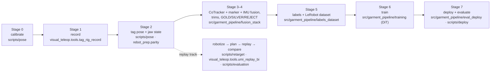

# Egocentric Human Demonstrations for Bimanual Garment Manipulation

Human garment-manipulation demonstrations, recorded with hand-worn parallel-jaw grippers, are converted into
robot-feasible end-effector trajectories and training labels, replayed on a two-arm robot (**reBot B601-DM**) as an
end-to-end test of the data, and then used to train policies for T-shirt flattening and folding.

Part of **[egocentric](https://github.com/physical-ai-vla/egocentric)** — the entry point to all egocentric-demonstration projects.

[](.github/workflows/ci.yml)
[](LICENSE)
· **[Technical Report (PDF, 11-01)](report/report_en.pdf)** ([한국어](report/report_ko.pdf)) · [earlier versions](report/archive/)
· [Detailed results](docs/results.md) · [Project details](docs/details.md)
· [한국어 README](README_ko.md) · [Attribution](ATTRIBUTION.md) · status: 2026-11-01

> **Update, 27 October 2026.** The replay stage is finished and the project has moved on to **policy training data**:
> 300 successful T-shirt flattening demonstrations, a new pose source (fixed-camera point tracking anchored by the
> markers), quality grades and Cartesian labels taken *before* inverse kinematics. See
> [From replay to policy training data](#from-replay-to-policy-training-data-october-2627). The open-loop replay track
> (10-08 → 10-22) is kept as the base the new pipeline builds on. Parts of the original pipeline that are no longer used
> are marked ~~struck through~~; their code is in [`legacy/`](legacy/README.md).
>
> **Update, 1 November 2026.** First policies fine-tuned on these demos were run on the robot (the trials were not
> counted): they approached the cloth, stopped short of it and closed the jaws early. Two causes were recorded (the
> policy copied the jaw state from its observation input; the robot wrist cameras sit differently from the hand-worn
> ones), and checking the labels afterwards found three more data problems (a label clamp, demonstration speed, video
> jaw labels); see
> [First policies on the robot](#first-policies-on-the-robot-and-what-they-exposed-in-the-data-october-28--november-1).
> No success rate is reported yet.

> **What is in this repository.** The full project code as it ran: the recorder and robot-side package
> ([`src/visual_teleop/`](src/visual_teleop/README.md)), the tag-rig pose modules ([`src/rebot_prep/`](src/rebot_prep/README.md)),
> calibration, pose, retargeting, evaluation and robot-bridge scripts, the training-data pipeline, the DiT trainer and
> the deploy loop ([`scripts/`](#3-components)), calibration results and robot settings ([`configs/`](configs/README.md)),
> the HandUMI build copy ([`hardware/umihand/`](hardware/umihand/README.md)), superseded code ([`legacy/`](legacy/README.md)),
> the technical reports, detailed notes and media. [`src/egogarment/`](src/egogarment/README.md) is a separate set of
> small standalone re-implementations of the trajectory stages that run on the synthetic data in [`examples/`](examples/README.md).
> The training-data pipeline is the installable package [`src/garment_pipeline/`](src/garment_pipeline/README.md)
> (`python -m garment_pipeline.<stage>.<module>`); its file locations come from [`egogarment.paths`](src/egogarment/paths.py)
> (environment variables `EGO_DATA_ROOT`, `EGO_TRAIN_ROOT`, `EGO_CKPT_ROOT`). What it needs to run is real data:
> raw recordings, trained checkpoints, the reBot vendor plugin and URDF are not included, and some stages need a GPU or
> the robot. The X-VLA fine-tuning code is not in this repository.

**Human demonstration (left) vs. robot replay of the converted trajectory (right).** Same fixed camera, aligned on one
clock, shown at the human's speed; the bar shows the robot jaw commands.


**Contents:** [1. Overview](#1-overview) · [2. System at a glance](#2-system-at-a-glance) ·
[3. Components](#3-components) · [4. Installation](#4-installation) · [5. Pipeline](#5-pipeline) ·
[6. Codebase guide](#6-codebase-guide) · [7. Results](#7-results) ·
[8. Current vs. superseded](#8-current-vs-superseded) · [9. Hardware and attribution](#9-hardware-and-attribution) ·
[10. License, acknowledgements, citation](#10-license-acknowledgements-citation)

---

## 1. Overview

* **Goal.** A robot folds a T-shirt learned from human demonstrations: no teleoperation, no robot data collection.
* **Replay as an end-to-end test of the data.** Converted human motion is replayed open loop on the robot, on one clock
  and in one frame, so errors can be attributed to a stage (conversion vs. planning vs. tracking).
* **One world frame (the robot base), one clock.** The fixed camera is calibrated to the robot and every take starts
  with the grippers at markers whose positions in robot coordinates are known, so no per-take alignment is needed;
  every stream carries host timestamps.
* **Pose from the fixed camera, not wrist SLAM.** Point tracking + AprilTags + depth + IMU. Wrist-camera SLAM lost
  tracking exactly at grasps (MASt3R kept 19–48 % of frames; ORB-SLAM3 scale diverged).
* **Labels are Cartesian targets before IK;** IK and safety checks run online before anything moves; IK never edits or
  masks the label. IK → FK labels had moved the target by p95 ≈ 58 mm at grasps (first 139 demos).
* **Replay result.** Two-arm replay of one 33 s demo is deterministic (≈1 mm between runs) and the jaws close at the
  human's height and time; the robot grasps and drags the cloth, but folding by replay does **not** succeed.
* **Training data.** 300 successful flattening demonstrations are converted into graded, Cartesian-before-IK training
  labels; a Soft-Fold-pretrained DiT runs safely on the robot in dry runs.
* **First policies on the robot.** Fine-tuned DiT and X-VLA policies (10-28 →), observed in robot trials that were not
  counted, approach the cloth but stop short and close the jaws early. Recorded causes: the policy copied the jaw state
  from its observation input (now masked in training and deploy) and the robot wrist cameras sit differently (re-mount
  next); checking the labels found a label clamp, too-fast demonstrations and video jaw labels that disagree with the
  servo (all changed). **No policy success rate yet.**

Long-form write-up (data, training plan, deploy loop, decision log, replay track, open problems):
[docs/details.md](docs/details.md). Metric definitions and full result tables: [docs/results.md](docs/results.md).

### Motivation and research question

Folding a T-shirt is long-horizon, bimanual and contact-rich, and the cloth state changes with every grasp. Teleoperated
robot data for such tasks is slow and expensive to collect. Hand-held and hand-worn grippers in the style of UMI let a
person demonstrate with an end-effector that resembles the robot's, without a robot in the loop, so data collection
scales with people rather than robots.

The difficulty moves into the conversion. Every error in calibration, pose recovery, jaw labelling, timing or
kinematic feasibility ends up in the training labels, and a policy trained on those labels inherits it. Policy success
rates are a late and indirect signal for such errors.

**Main question.** *If a robot simply replays the converted human motion, open loop, does it do what the human did?*

Replay is used as an end-to-end test of the data pipeline before policy learning. It has three useful properties:

1. it exercises every stage at once (calibration, pose, jaw state, robotization, IK, timing, control);
2. human, robot command and measured robot motion can be put on one clock and in one frame, so errors can be attributed
   to a stage (conversion vs. planning vs. tracking);
3. it fails visibly and physically (the jaws close above the cloth, or on the empty table).

Subsidiary questions: Where does the pose come from when the hand hides the markers during a grasp? How much does the
human path have to be changed to become feasible for the robot, and how should that be recorded? Which errors are
invisible to model-based checks?

## 2. System at a glance


*Data flow, as of 27 October. A person demonstrates with two hand-worn grippers; wrist fisheye cameras, wrist IMUs and
a fixed RGB-D camera record on one clock. Points on each gripper are tracked in the fixed-camera video, lifted by depth
and fused with the fiducial markers (anchors) and the IMU (only inside tracking gaps) into the jaw-tip pose in one world
frame, the robot base. Each episode is trimmed and graded; the training label is the Cartesian pose before inverse
kinematics. A policy pretrained on public cloth data is fine-tuned on the best-graded demonstrations and runs on the
robot in a receding-horizon loop with online IK and safety checks. The grey box lists parts of the earlier replay
pipeline that are no longer used.* (Figure generated by [`docs/make_architecture.py`](docs/make_architecture.py).)

The same flow by stage, with the code for each stage:



| unit | role |
|---|---|
| **2× HandUMI** (hand-worn gripper) | demonstration tool; parallel jaws with **four AprilTag markers** (printed square codes whose 3D pose a camera can measure): three 48 mm tags plus, since 10-23, a 30 mm tag on the back of the wrist camera (IDs 220 / 221, rig `umi_tag_rig_v002`; a lone 30 mm tag is accepted only with an IMU check against its pose flip); a wrist fisheye camera (30 Hz), an IMU (motion sensor; Seeed XIAO nRF52840 Sense) and a **jaw servo** (Feetech STS3215) read with torque off as a passive jaw encoder at ≈100 Hz on the host clock (back since 10-29; ~~no jaw motor~~ 10-13 → 10-28) |
| **Orbbec Gemini 336** (fixed RGB-D camera) | colour + aligned depth, fixed above the table (recorded at about 15 Hz), raised to 113 cm (10-25) so both hands stay in view (the 11-01 re-aim changed only the angle; the height was not re-measured); the **pose source** (point tracking + markers + depth); sees both grippers, the two **start markers** and two fixed table tags used to re-calibrate after a camera move (~~the wrist calibration marker~~, first calibration only) |
| **2× reBot B601-DM** | low-cost 6-DoF arms with parallel jaws, driven by our MIT-mode bridge (100 Hz, auto re-enable, USB reconnect, jaw-opening limit enforced); run the policy (earlier: open-loop replay target) |
| **Robot corrections** | measured with tape and camera instead of trusting the robot's CAD model: gripper-tip position (model was 89 mm off), left-arm mounting position (70 mm and 3° off), left arm's 2nd joint zero (−8.4°) |
| **Host computer** | records all streams on one monotonic clock; robot control and online IK |
| **GPUs** | rented RTX 5090 pods (RunPod): point tracking, the jaw model, 3-D solve, some policy training; one run on a rented H100; company RTX 4090 via Ray: the DiT fine-tunes (flattening, pinching); ~~only for the optional visual-SLAM gap filler~~ |

Two principles run through the system:

* **One world frame.** Every pose, human or robot, is expressed in the robot base frame. The fixed camera is calibrated
  to the robot (again after every camera move, from two fixed table markers and the table plane), and every recording
  starts with the grippers placed on start markers whose positions in the robot frame were measured once. No
  per-recording alignment (~~no SLAM map~~, no point-cloud registration) is needed. Details in [§5, Stage 0](#stage-0--one-world-frame-for-human-and-robot).
* **One clock.** Camera frames, IMU samples, the robot's commanded and measured joints all carry host timestamps, so
  human, command and robot can be compared sample by sample and filmed side by side by the same camera without
  synchronization hardware.

## 3. Components

What is in this repository, by pipeline stage (see [§5](#5-pipeline)).

| Component | Path | Stage | Status | Description |
|---|---|---|---|---|
| HandUMI build | [`hardware/umihand/`](hardware/umihand/README.md) | 1 | current | HandUMI build copy + our modified parts, AprilTag sheets, IMU firmware (upstream design by BrikHMP18, Apache-2.0) |
| Configs | [`configs/`](configs/README.md) | 0 | current | calibration results, robot settings and overrides, jaw classifier weights, regression baseline |
| Robot-side package | [`src/visual_teleop/`](src/visual_teleop/README.md) | 1, 2, replay, 7 | current (live teleop parked) | recorder, jaw classifier, reBot IK / limits / safety, bridge start, replay planner |
| Tag-rig modules | [`src/rebot_prep/`](src/rebot_prep/README.md) | 2 | current | shared tag pose / fusion code (`rebot_prep.parity`) |
| Pose + calibration | [`scripts/pose/`](scripts/pose/README.md) | 0, 2 | current | camera ↔ robot, tag rig → jaw tip, tags → jaw-tip path, jaw aperture, jaw state from the servo |
| Training-data pipeline | [`src/garment_pipeline/`](src/garment_pipeline/README.md) | 3–5, 6 (DiT), 7 | current (installable package; needs the recorded data, a GPU for CoTracker / training, the robot for deploy) | CoTracker + marker + IMU fusion, gates, trims, quality grades, labels, LeRobot dataset, DiT trainer, offline eval, deploy |
| Retarget | [`scripts/retarget/`](scripts/retarget/README.md) | replay | current (replay track) | UMI ↔ reBot EEF alignment, robotization of a two-hand demo |
| Evaluation | [`scripts/evaluation/`](scripts/evaluation/README.md) | replay | current (replay track) | human / command / robot parity, side-by-side video, planner regression test |
| Robot bridge | [`scripts/deploy/`](scripts/deploy/README.md) | 7 | current | reBot MIT bridge + gripper / joint zero tools |
| egogarment: io | [`src/egogarment/io/`](src/egogarment/io/) | all | current (standalone re-implementation) | trajectory CSV format helpers (`trajio`) |
| egogarment: pose | [`src/egogarment/pose/`](src/egogarment/pose/) | 3; learning contract | current (generic baseline) | gap filling with per-frame flags (`gap_fill`); relative SE(3) contract and round trip (`relative_se3`) |
| egogarment: retarget | [`src/egogarment/retarget/`](src/egogarment/retarget/) | 5 | current (illustrative defaults) | continuous warps + per-frame displacement / quality (`robotize`) |
| egogarment: evaluation | [`src/egogarment/evaluation/`](src/egogarment/evaluation/) | 9 | current | RMSE / p95 / rotation error between two trajectories with lag search (`parity_metrics`) |
| egogarment: viz | [`src/egogarment/viz/`](src/egogarment/viz/) | 9 | current | figure of a processed trajectory (`plot_example`) |
| egogarment wrappers | [`scripts/*.py`](scripts/) | – | current | thin wrappers: `python scripts/<module>.py` works without installing |
| Examples | [`examples/`](examples/README.md) | – | current | SYNTHETIC bimanual demo + simulated replay (CSV/NPZ) and their generator |
| Technical report | [`report/`](report/README.md) | — | current (11-01) | one report, English + Korean (PDF + LaTeX + figures); v0, v0.1 and the technical note in `report/archive/` with an old → new path map |
| Docs | [`docs/`](docs/) | — | current | [project details](docs/details.md), [results and metric definitions](docs/results.md), [replay-track stage map](docs/pipeline_replay_track.md), [records](docs/records/README.md), data-flow figure and its generator, synthetic example figure |
| Media | [`media/`](media/README.md) | – | current | GIFs, videos and photos of the real setup ([media/README.md](media/README.md)) |
| Tests | [`tests/`](tests/), [`.github/workflows/ci.yml`](.github/workflows/ci.yml) | – | current | egogarment regression on the synthetic example; import / config-path smoke tests and the scripts' synthetic self-tests (run in CI) |
| Legacy | [`legacy/`](legacy/README.md) | — | ~~superseded~~ | MASt3R gap filling and runner (moved 10-27), ORB-SLAM3, UMIalign, stereo VIO, red-tape jaw, bare-hand collector |

Per-module inputs, outputs and entry points: each component folder has its own README; for the re-implementations,
[`src/egogarment/README.md`](src/egogarment/README.md).

## 4. Installation

```bash
python -m pip install -e ".[test]"   # numpy, scipy, matplotlib, pyyaml; packages egogarment, garment_pipeline, visual_teleop,
                                     # rebot_prep (+ vendored helpers) from src/; egogarment-* console commands; pytest (Python >= 3.10)
pip install -e ".[pipeline]"         # + pandas, OpenCV < 5 (garment_pipeline fusion / labels / dataset stages)
pip install -e ".[vision]"           # + OpenCV < 5 (tag pose, video)
pip install -e ".[robot]"            # + Pink / pinocchio IK, HTTP bridge client
pip install -e ".[jaw]"              # + torch / ultralytics / flask (jaw classifier and keypoints)
python -m pytest -q
# or, for the egogarment utilities only, without installing the package:
python -m pip install -r requirements.txt
```

Without installing, put `src/` on the path: `PYTHONPATH=src python -m visual_teleop.tools.<tool>`. Scripts under
`scripts/pose`, `scripts/retarget`, `scripts/evaluation` add `src/` themselves.

Notes:
- The original runs used several interpreters: the repo `.venv` for the recorder (`sudo` for the Orbbec on macOS), an
  X-VLA environment with Pink / pinocchio for IK, bridge start and replay, and a separate ultralytics environment for the
  jaw keypoint scripts. The helper modules the code imported from the project's other working folders (`contracts`,
  `xvla_core`, `umi_to_lerobot`, the used parts of `ego_teleop`, `ego_collector`, `handumi_collector`) are copied into
  `src/` ([provenance + md5](docs/provenance.md)); still outside: the vendor reBot LeRobot plugin, the X-VLA training patch.
- `src/garment_pipeline/` reads and writes the data folders of the original machine by default; set `EGO_DATA_ROOT`
  (recordings, calibration), `EGO_TRAIN_ROOT` (derived trajectories, reports, datasets) and `EGO_CKPT_ROOT`
  (checkpoint archive) to use other locations ([`src/egogarment/paths.py`](src/egogarment/paths.py)). Training and the
  X-VLA server need the LeRobot / X-VLA environments (torch, lerobot, diffusers), not the base install.
- Not included: raw data, trained checkpoints, the reBot vendor plugin and URDF, ORB-SLAM3 source.

## 5. Pipeline

### Stage 0 — One world frame for human and robot


*(a) Start markers on the table (IDs 400 / 401), measured once in robot coordinates. (b) Every take starts with the
grippers there.*

Everything is expressed in the **robot's base coordinates**. This is set up once:

1. **Camera → robot.** First calibration: the robot moves a marker on its wrist through 32 poses in front of the fixed
   Orbbec (18 of them used in the solve; 0.98 px held-out); this gives the camera pose in the robot base frame. Since
   the camera was moved (10-25/26), it is re-solved after every move from two fixed 70 mm table tags with known robot
   coordinates plus the table plane (`robot_cam_v002…v005`). From then on, anything the camera measures is in robot
   coordinates.
2. **Start markers.** Two AprilTags taped on the table are measured once with the calibrated camera (photo a):
   left (225, 166, −4) mm, right (243, −194, 6) mm.
3. **Gripper markers → jaw tip.** A one-time rig calibration relates the four markers on each gripper to its jaw tip
   (1–4 mm), so the camera gives the jaw-tip pose directly in robot coordinates.
4. **Every take starts at the start markers** (photo b), so every demonstration begins at the same known robot
   coordinates. No per-take alignment (~~no SLAM map~~, no point-cloud registration) is needed.

### Stages 1–9 — From human motion to robot motion

The method as conceptual stages (the replay track); the command stages in the next subsection follow the code layout
(0–7) instead.

1. **Record** both hands from a fixed start pose on the start markers, with a spoken protocol marking demo windows.
2. **Reconstruct** the jaw-tip trajectory of each hand in the robot base frame from markers + depth.
3. **Fill gaps** (gyro rotation + interpolation; optional gated SLAM) and flag every filled frame.
4. **Label the jaw** from the wrist video (replay track); demonstrations recorded since 29 October take it from the
   jaw servo's encoder instead (§8).
5. **Robotize** with continuous warps only, never clipping: lateral compression toward each arm's own side with a
   softplus ceiling at the midline, and a softplus floor above the table. Store displacement and quality per frame
   ([`src/egogarment/retarget/robotize.py`](src/egogarment/retarget/robotize.py) shows the idea; the version that ran
   is [`scripts/retarget/umi_robotize_bi.py`](scripts/retarget/umi_robotize_bi.py)).
6. **Plan** with joint-limit-aware differential IK (position prioritised over orientation, bounded joint change per
   frame, wrist-roll relaxation about the tool axis, use of the jaw's 180° symmetry, finger-corner clearance), and issue
   jaw commands early by the measured jaw actuation latency.
7. **Check** before anything moves: IK error, joint limits and speed, TCP and link heights above the table, and the
   minimum distance between the two arms. Plans are always computed offline first.
8. **Replay** open loop and log commanded and measured joints on the host clock.
9. **Compare** three levels: A = human (markers), B = robot command (FK of commanded joints), C = robot (FK of
   encoders), plus a side-by-side video from the same camera
   ([`src/egogarment/evaluation/parity_metrics.py`](src/egogarment/evaluation/parity_metrics.py) shows the metric
   definitions; the scorer that ran is [`scripts/evaluation/replay_parity.py`](scripts/evaluation/replay_parity.py)).

Since 26–27 October the stages after pose reconstruction produce **policy training data** instead of a replay (see
[§8](#from-replay-to-policy-training-data-october-2627)).

### Commands on real data (stages 0–7)

Commands run from the repo root; they need the recorded takes, which are not in this repository. Per-stage detail:
[src/garment_pipeline/README.md](src/garment_pipeline/README.md) (12-stage map of the training-data pipeline, with what each stage needs) and
[docs/pipeline_replay_track.md](docs/pipeline_replay_track.md) (replay track).

**Stage 0 · calibrate** (once, and the camera ↔ robot part after every camera move)
```bash
python scripts/pose/robot_cam_solve.py datasets/tag_rig/<take> datasets/robot_cam/<run> --write      # first camera ↔ robot solve
python scripts/pose/robot_cam_from_anchors.py datasets/tag_rig/<take> --frames 2400:2828:4            # re-solve from the fixed table tags
python scripts/pose/tag_rig_solve.py datasets/tag_rig/<ts>                                           # tag rig; then tag_rig_pivot / tag_rig_touch_tcp
python scripts/retarget/umi_align.py datasets/tag_rig/<align take> --write                           # UMI TCP frame → reBot EEF frame
```

**Stage 1 · record**
```bash
python -m visual_teleop.tools.bridge_start --sides left,right --go          # robot bridge
sudo .venv/bin/python -m visual_teleop.tools.tag_rig_record --proto task --wrist
```

**Stage 2 · tag pose + jaw state**
```bash
python scripts/pose/umi_tcp_traj.py <take> --hand <hand> --depth --imu-fill
python -m visual_teleop.tools.umi_jaw infer <take>/wrist                    # again for <take>/wrist_left
python scripts/pose/jaw_aperture.py <take>/wrist                            # YOLO-pose jaw tips → aperture g
# demos from 10-29: jaw state from the servo instead of the video (same umi_jaw.npz format)
python scripts/pose/jaw_from_motor.py <take>                                # gripper_motor_{left,right}.npz → <take>/<wrist dir>/umi_jaw.npz
```
The recorder (`python -m visual_teleop.tools.tag_rig_record`) logs both jaw servos with torque off (`--no-motor` to skip),
and warns aloud when a servo reads outside its calibrated range. `jaw_from_motor.py` maps motor ticks through a per-hand
calibration (closed … open) to `g_cont`, adds open/close events with hysteresis + dwell, and re-centres each take because a
re-plug or power cycle shifts the whole reading.

**Stage 3 · CoTracker + marker + IMU fusion** (modules of the `garment_pipeline` package, `pip install -e .`)
```bash
python -m garment_pipeline.fusion_stack.orbbec.v2b.new_take_prep <take>                          # arm assignment, idle trim, start seeds
python -m garment_pipeline.fusion_stack.orbbec.v2b.cotrack.make_pack2 <pack> <take>:<demo> ...    # CoTracker query points (40 per rig)
python -m garment_pipeline.fusion_stack.orbbec.v2b.cotrack.run_cotracker <pack>                   # GPU
python -m garment_pipeline.fusion_stack.orbbec.v2b.cotrack.solve2 <pack> && python -m garment_pipeline.fusion_stack.orbbec.v2b.cotrack.gate <pack>
python -m garment_pipeline.fusion_stack.orbbec.v2b.fusion.trajectory_fusion_v1 <pack> Cg --ct solve3
```

**Stage 4 · trims + quality grade**
```bash
python -m garment_pipeline.fusion_stack.orbbec.v2b.tighten_trim <idle_audit.csv> 0.3 && python -m garment_pipeline.fusion_stack.orbbec.v2b.edge_gap_trim <pack> ...
python -m garment_pipeline.fusion_stack.orbbec.v2b.cotrack.episode_quality <quality.csv> <pack> ...   # GOLD / SILVER / REJECT
```

**Stage 5 · labels + dataset**
```bash
python -m garment_pipeline.labels_dataset.robotize_ik <raw take> <derived take> --demos 0,1,... --workers 8   # labels A + B + IK diagnostics
python -m garment_pipeline.labels_dataset.tag_rig_unsplit --label rob --mask-mode stitched --out <dataset> --takes <take> ...
# since 10-29: label F (fused jaw tip in reBot gripper axes, 0.25 s smoothing, no clamp/lift), optionally on the 0.3× time-stretched copy
python -m garment_pipeline.labels_dataset.tag_rig_unsplit --label fused --mask-mode stitched --speed 0.3 --out <dataset> --takes <take> ...
```

**Stage 6 · train** — the DiT trainer (masks, per-episode weights, optional jaw BCE head `GRIP_BCE=1`, jaw-state
masking `GRIP_STATE_MASK=1`, gradient clipping at norm 10 by default, `GRAD_CLIP=0` turns it off; the pinching runs use
BCE and no clipping) and its configs are in `src/garment_pipeline/training/` (added 11-01); the X-VLA fine-tuning code is not in this repository. The plan
(DiT and X-VLA fine-tuned on GOLD) is in [docs/details.md §3.2](docs/details.md#32-training-plan).

**Stage 7 · deploy + evaluate**
```bash
python -m garment_pipeline.eval_deploy.act_tagrig_deploy run --policy dit --secs 30                # dry run; add --go only with a person at the robot
python -m garment_pipeline.eval_deploy.tagrig_offline_eval --ckpt <run>/checkpoints/last --data <val dataset> --out <report dir>   # k16/k32, zero-motion baseline, grasp / free breakdown
```

**Earlier track: open-loop replay** (stages 1–2 as above, then)
```bash
python scripts/retarget/umi_robotize_bi.py <take> --clear 0 --sep 0.06 --min-reach 0                   # robotize
python -m visual_teleop.tools.umi_replay_bi <take> --rep 1 --traj _robot --speed 0.35 --q-smooth 9 --max-ik-mm 15 --tip-clear -0.01 --tip-clear-left-extra 0 --link-margin 0.015 --max-rot-dev 25 --offline   # plan + check
python -m visual_teleop.tools.umi_replay_bi <take> --rep 1 --traj _robot --speed 0.35 --q-smooth 9 --max-ik-mm 15 --tip-clear -0.01 --tip-clear-left-extra 0 --link-margin 0.015 --max-rot-dev 25 --go        # replay
python scripts/evaluation/replay_parity.py <take> <run>/right                                         # compare human / command / robot
```

Full command list, options and safety rules: [Technical Report v0.1](report/archive/report_v0.1_en.pdf) (archived), Appendix A (pre-refactor paths; see the [path map](report/README.md)).

### Reproducible commands (synthetic data)

The standalone re-implementations in `src/egogarment/` run on the synthetic example without any recording or hardware.

| stage | command (wrapper; same as `python -m egogarment.…` or the `egogarment-…` console command) |
|---|---|
| – | `python examples/make_synthetic.py` — regenerate the synthetic data (seed 0) |
| 3 fill gaps | `python scripts/gap_fill.py examples/synthetic_bimanual_demo.csv out/filled.csv --max-gap 1.0` |
| 5 robotize | `python scripts/robotize.py out/filled.csv out/robotized.csv --sep 0.05` |
| 9 compare | `python scripts/parity_metrics.py out/robotized.csv examples/synthetic_robot_replay.csv` |
| learning contract | `python scripts/relative_se3.py out/filled.csv --chunk 1.0` |
| 9 plot | `python scripts/plot_example.py out/robotized.csv out/example.png --robot examples/synthetic_robot_replay.csv` |
| tests | `python -m pytest -q tests` |

```bash
python -m pip install -r requirements.txt
python examples/make_synthetic.py                                     # regenerate the synthetic data (seed 0)
python scripts/gap_fill.py examples/synthetic_bimanual_demo.csv out/filled.csv --max-gap 1.0
python scripts/robotize.py out/filled.csv out/robotized.csv --sep 0.05
python scripts/parity_metrics.py out/robotized.csv examples/synthetic_robot_replay.csv
python scripts/relative_se3.py out/filled.csv --chunk 1.0
python scripts/plot_example.py out/robotized.csv out/example.png --robot examples/synthetic_robot_replay.csv
python -m pytest -q tests
```

Expected parity output on the synthetic data: recovered lag ≈0.2–0.26 s (the generator uses 0.25 s), position RMSE
≈6 mm. Comparing the *unrobotized* human path with the replay instead gives ≈17 mm for the right hand: the difference
is the robotization displacement, the analogue of the "command vs. human" term in the real analysis.


### Pose reconstruction and validation (stages 2–4)

1. **Markers → gripper pose.** In each RGB-D frame the AprilTags are detected and solved individually (planar PnP), and
   the marker distance, the least accurate PnP coordinate at about 1 m, is corrected along the viewing ray by the
   aligned depth. When several tags of one gripper are visible, all their corners are solved jointly for the gripper
   pose. Rotation can additionally be stabilised by the wrist gyroscope anchored to the marker frames.
2. **Gripper → jaw tip in the robot frame.** A one-time rig calibration maps the gripper's markers to its jaw tip; the
   camera-to-robot calibration maps the result into the robot base frame.
3. **Gaps.** Markers disappear exactly when the hand grasps (palm down). Short gaps get the gyro rotation and an
   interpolated position and are flagged as not measured. ~~Wrist-camera SLAM is an *optional* filler, accepted only for
   segments that stay close to the marker path on held-out validation frames.~~ Replaced on 24 October by fixed-camera
   point tracking (§8).
4. **Jaw state.** An ImageNet-pretrained ResNet-18 per hand classifies a crop of the wrist fisheye that shows the jaws,
   with hysteresis on its output. Since 22 October a keypoint model finds the two jaw tips and their distance gives a
   continuous aperture (100 % / 98 % agreement with hand labels on a re-angled take).
5. **Jaw state from the servo (since 29 October).** Each hand-worn gripper again carries its jaw servo, now with torque
   off so it never drives the jaw while a person holds it; it is only read, at ≈100 Hz on the same host clock as the
   cameras. The motor position is mapped through a per-hand calibration (closed … open ticks) to a continuous aperture
   (0 closed … 1 open), then to open/closed events with hysteresis and a minimum dwell. The reading is re-centred per
   recording, because unplugging or power-cycling a servo shifts its whole range; the recorder warns aloud when a servo
   reads outside its calibrated range. The output has the same format as the video labels, so every later stage is
   unchanged. Video- and servo-derived labels are kept apart and never mixed in one comparison.

**Validation is geometric and physical**, not only internal: held-out reprojection for the camera-to-robot calibration,
leave-one-out and an independent pivot test for the jaw-tip rig, a tape measure for the absolute robot jaw position,
and finally the robot itself, filmed by the same camera as the human.

**Reconstructed jaw-tip trajectories** of the same demonstration. Left: the paths projected into the fixed camera, coloured
by the source of each frame: AprilTag markers + depth (green), MASt3R-SLAM gap filler (blue), IMU rotation +
interpolation where markers are hidden (orange). Right: both hands in one world frame (millimetres, offset to the
workspace corner).


## 6. Codebase guide

### The split

* **`src/`** holds importable code:
  * `visual_teleop` — robot-side tools and libraries (recorder, jaw classifier, reBot IK / limits / safety, bridge
    start, replay planner);
  * `rebot_prep.parity` — tag-rig pose modules that several scripts import;
  * `garment_pipeline` — the training-data pipeline (fusion, labels, dataset, DiT trainer, eval / deploy), run with
    `python -m garment_pipeline.<stage>.<module>`; `egogarment.paths` — the data / checkpoint roots it uses;
  * helper modules copied from the project's other working folders so imports resolve (`contracts`, `xvla_core`,
    `umi_to_lerobot`, `umi.common.pose_util`, parts of `ego_teleop` / `ego_collector` / `handumi_collector`;
    [provenance + md5](docs/provenance.md));
  * `egogarment` — standalone re-implementations, one subpackage per trajectory component: `io` (format), `pose` (gap
    filling, relative SE(3)), `retarget` (robotization), `evaluation` (parity metrics), `viz` (plots). Every tool is a
    module with a library API plus a `main()` command; details in [`src/egogarment/README.md`](src/egogarment/README.md).
* **`scripts/<stage>/`** holds the project's entry scripts grouped by pipeline stage (`pose`, `retarget`, `evaluation`,
  `deploy`). The training-data pipeline is the package **`src/garment_pipeline/`** (subpackages `fusion_stack`,
  `fgo_tools`, `labels_dataset`, `training`, `eval_deploy`, absolute imports, run with `python -m`); file locations come
  from `egogarment.paths`. The flat **`scripts/*.py`** files are one thin wrapper per `egogarment` module, so the
  synthetic commands work from a plain checkout.
* **`configs/`** stays at the top level because code addresses it as `<repo root>/configs/...`
  (`Path(__file__).parents[n] / "configs/..."`).
* **`examples/`** — the synthetic data and its deterministic generator; **`tests/`** — checks on that data plus import /
  path smoke tests and the scripts' synthetic self-tests.
* **`docs/`, `report/`, `media/`** — details, results, technical reports, figures and clips of the real setup;
  **`hardware/`** — HandUMI build copy; **`legacy/`** — superseded code.

### The interfaces of the real pipeline

From the code that defines them:

| interface | definition | where |
|---|---|---|
| world frame | reBot base frame B; camera → base `T_B_C` from `configs/calibration/robot_cam_v00N.json` (per take by date) | `src/garment_pipeline/fusion_stack/camcal.py`, `scripts/pose/umi_tcp_traj.py` |
| jaw-tip path per take | `umi_traj_{right,left}.npz`: jaw-tip TCP `p_B`, rig rotation `R_B_tcp`, `ntags` | `scripts/pose/umi_tcp_traj.py` |
| jaw state | `umi_jaw.npz`: `g_cont` 0 = closed … 1 = open, `valid`, `ev_t`; binary `state` 1 = open, 0 = closed; servo-derived files also keep `motor_pos` and set `model = feetech_sts3215_motor` | video: `src/visual_teleop/tools/umi_jaw.py`, `scripts/pose/jaw_aperture.py`; servo (Feetech STS3215, torque-off encoder, 10-29 →): `scripts/pose/jaw_from_motor.py` |
| training label | **F** (10-29 →, `--label fused`) = fused human jaw-tip pose in reBot gripper axes (`R_B_tcp·R_U_E`), 0.25 s smoothing, before IK; no table lift, no clamp; IK changes no value and masks no frame. ~~**A** (`--label rob`) = F + table clearance (tilt toward vertical ≤ 30°, then corner lift)~~. **B** (`--label ikfk`) = IK → FK (QA only) | `src/garment_pipeline/labels_dataset/robotize_ik.py` (`--label rob` / `ikfk` / `fused` in `tag_rig_unsplit.py`) |
| dataset | LeRobot v3, 20 Hz, 3 cameras; `observation.state` 30-D = per-arm pose relative to the episode start (pose9 each), g_L, g_R, left-right relative pose9 + valid flag (jaw entries zeroed when `GRIP_STATE_MASK=1`); `action` 20-D absolute `[L xyz, L rot6d, R xyz, R rot6d, g_L, g_R]` (rot6d = first two rows of R; gripper target = binary jaw state with a 0.1 s ramp, continuous aperture stored separately as `gripper_cont`), with a per-dim `action_mask[20]` | `src/garment_pipeline/labels_dataset/tag_rig_unsplit.py`, `tag_rig_to_lerobot.py`, `src/contracts/` |
| chunk | relative motion `inv(T_t)·T_{t+k}`, k = 1…32 at 20 Hz, built in the training loader; deploy commits the first steps of each plan, then re-plans (DiT 4 by default, ACT 1, X-VLA 8; selectable in the UI; at speed > 1 the DiT commit is capped at 32/speed) | [docs/details.md §3.2–3.3](docs/details.md#33-running-a-trained-policy-on-the-robot) |
| robot model corrections | TCP offset, per-arm joint zero offsets, left base pose: `configs/robot/{tcp_override,joint_offset,base_override}_v001.json` | applied in `src/visual_teleop/robot/ik_pink.py` |
| units | code stores metres and seconds (e.g. tag size 0.048 m); README / report quote mm | — |

### The egogarment interface: trajectory CSV

All `egogarment` tools exchange one wide CSV, defined in [`src/egogarment/io/trajio.py`](src/egogarment/io/trajio.py)
and documented with the example data in [`examples/README.md`](examples/README.md). One row per frame, `t` in seconds,
then per hand (`R_` right, `L_` left):

| column | unit | meaning |
|---|---|---|
| `x, y, z` | m | jaw-tip position in the world (robot base) frame: +x forward, +y left, +z up; table plane z = 0 |
| `qx, qy, qz, qw` | – | jaw-tip orientation, unit quaternion |
| `jaw` | – | 1 = open, 0 = closed |
| `visible` | – | 1 = pose measured (markers seen), 0 = not measured (pose is NaN) |

Columns appended by the tools and carried along unchanged by later ones:

| column | written by | meaning |
|---|---|---|
| `filled` | `pose.gap_fill` | 0 measured / 1 interpolated / 2 unfilled (too long or open-ended) |
| `human_x/y/z` | `retarget.robotize` | the path before robotization |
| `disp_mm` | `retarget.robotize` | per-frame robotization displacement, mm |
| `quality` | `retarget.robotize` | 0 / 1 / 2 (default boundaries 20 / 50 mm) |

### Coordinate representation

* **Storage: absolute poses in the world frame.** Each frame stores the jaw-tip pose `T_B(t) ∈ SE(3)` of each hand in
  the robot base frame `B` (+x forward, +y left, +z up), the jaw state, and flags for whether the pose was measured or
  filled. The jaw-tip TCP is defined the same way for the human gripper and the robot gripper (midpoint between the jaw
  tips), so no tool offset has to be guessed later.
* **Learning contract: relative SE(3).** Learning targets are expressed relative to a reference pose `T_0` (e.g. the
  pose at the start of an action chunk):

  `T_rel(t) = T_0^{-1} T(t)`

  so the target does not depend on where in the workspace the motion happens, and the same contract applies to human
  data and to robot data. Absolute storage keeps the option of re-deriving any relative form, and is what the replay
  uses. A reference implementation of the conversion and its round trip is in
  [`src/egogarment/pose/relative_se3.py`](src/egogarment/pose/relative_se3.py) (chunk horizon `--chunk`, default 1.0 s).
* **Per-frame quality.** Robotization stores, for every frame, how far the robot target was moved from the human path,
  and a coarse quality class derived from it; filled frames are flagged separately. These are intended as label weights.

## 7. Results

Measured in October 2026 on one setup with one demonstrator. Full tables and metric definitions:
[docs/results.md](docs/results.md); what we learned, the replay result videos and the open problems:
[docs/details.md §5–6](docs/details.md#5-what-we-learned-and-replay-results).


*Left: human demonstration with two UMI grippers. Right: the two arms replaying the converted trajectory. Same fixed
camera, aligned on one clock (33 s demo replayed in 94 s; shown at robot speed).*

| milestone | result |
|---|---|
| Calibration | camera ↔ robot: 0.98 px held-out reprojection (≈1.3 mm lateral); UMI marker rig → jaw tip: 1–4 mm static (leave-one-out 1.8–4.8 mm) |
| Single-arm replay parity | 16/18 translation strokes pass; median per-axis RMSE 5.5–11.6 mm; rotation strokes pass, 0.3–1.6° median error; command vs. human ≤ 3.4 mm, so the residual was robot tracking |
| First cloth grasp from human data | the right arm replayed a grasp window of a demonstration and picked up and lifted the T-shirt |
| Full two-arm replay of one 33 s demo (94 s at 0.35× speed) | four runs with one unchanged plan repeat within ≈1 mm; robot within 2–8 mm (xy) of its command at grasps |
| Error vs. the human | whole-demo position RMSE ≈17 mm (right) / ≈30 mm (left) against the replayed (robotized) human path; ≈22 / 32–34 mm against the raw human path |
| Jaw height at grasp | after allowing finger contact, jaws close 14–16 mm (right) / 5–19 mm (left) above the table (human ≈10 mm), within 2–8 mm of the commanded position |
| Folding like the human | **not achieved / not yet.** In the best run the jaws caught the shirt edge and dragged it; no success rate is reported |
| Wrist-camera SLAM as pose source | **rejected.** MASt3R-SLAM kept 19–48 % of frames (0–38 % around grasps); ORB-SLAM3 mono-inertial scale diverged |
| Point tracking (CoTracker) + markers + IMU (10-24/25) | hidden-marker error on held-out takes: median 16 mm (left) / 19 mm (right); markers alone ≈ 42 mm |
| Flattening dataset (10-26/27) | 300 successful demos of 318; of the first 139 graded, 133 GOLD / 5 SILVER / 1 REJECT |
| Labels before vs after IK (10-26) | first 139 demos (≈123k arm-frames): IK → FK moves the target by p95 ≈ 58 mm at grasps (53 mm overall); 20.3 % of frames need a large IK correction, 0.8 % are out of reach |
| Label table clearance (10-29) | lifted 44 % of label frames, median 27 mm (max 65) — removed; label F = fused human jaw tip (gripper axes, 0.25 s smoothing), no lift or clamp |
| Demonstration speed (10-29) | human jaw tip p95 0.93 m/s, 127 °/s — too fast for the arms → 0.3× time-stretched data set |
| Wrist-camera placement (10-29) | robot wrist cameras tilt 11–13° less toward the tool axis and sit 25–44 mm closer than the UMI ones (table-tag PnP) |
| Policy, as of 10-27 | not yet trained on our data; a pretrained-only diffusion policy (Soft-Fold-pretrained DiT) ran on the robot in dry runs without safety violations |
| Policies on the robot (10-28 →) | DiT and X-VLA fine-tuned on the 281 GOLD demos, observed in robot trials that were not counted: approach the cloth, stop short, close the jaws early — **no success rate** |

### How to verify (this repository)

The real-system numbers above come from recorded data that is not in this repository; the method and measurements are
in the [technical report](report/report_en.pdf). What can be checked from the code alone:

```bash
python -m pytest -q                                      # egogarment regression on the synthetic example; imports, config paths,
                                                         # synthetic self-tests (robot_cam_solve skipped without OpenCV)
python scripts/evaluation/replay_parity.py --synthetic   # parity scorer self-test; ends with "합성 시험 PASS"
python scripts/pose/robot_cam_solve.py --synthetic       # camera ↔ robot solver on simulated data (needs OpenCV < 5); ends with "합성 시험 PASS"
python analysis/verify_claims.py                         # every number in the report appears in the in-repo document it was taken from (consistency with the records, not a re-computation from data); "N claims checked, 0 failed"
```

`python -m pytest -q tests` checks every `egogarment` module against outputs recorded before the code was packaged
([`tests/expected_synthetic.json`](tests/expected_synthetic.json)) and that `examples/make_synthetic.py` reproduces the
committed example files; the synthetic numbers are listed in
[docs/results.md §8](docs/results.md#8-synthetic-example-this-repository).

### What was hard, and what I changed

| problem | decision | why |
|---|---|---|
| Wrist-camera SLAM loses tracking at the moment of grasp (close range, white cloth, fast motion) | **Absolute markers + depth from a fixed camera** as the pose source; SLAM only as a gated filler | SLAM was accurate where it tracked (a few mm) but missing exactly where labels matter. Mono-inertial scale diverged because hand accelerations were below the accelerometer bias |
| Earlier label pipeline (SLAM + body tracking + IMU) passed its own quality checks but was 4–6 cm off | **Measure in the world, not in the model** | A stale camera–IMU rotation, a mis-converged lever arm and a wrong anchor were invisible to internal residuals; they were found against the external camera |
| Robot model errors (tool-centre-point and arm mounting) invisible to FK-vs-FK parity | **Tape, camera and cloth as ground truth**; model corrections applied inside the IK model | Relative parity metrics cancel constant offsets; the robot reached the right shape in the wrong place |
| Jaws closed several cm above the cloth | **Fix the conversion, don't add heuristics**: allow the finger corner to touch the table plane, as human fingers do | Heuristics (tilt the tool, close at the lowest nearby point) were tried and rejected; tilting made the IK fail |
| Hands crossing the midline, targets below the table | **Continuous warps + per-frame quality**, never clipping | Clipping creates jumps and hides how much a label was changed |
| Aligning camera, IMU, robot and video | **One host clock** for everything | Enables per-sample comparison and side-by-side video without sync hardware |
| Arm lag during moving segments did not respond to the proportional gain | **Model the controller**: with an integral-only feed-forward and no gravity model, the moving error scales with the rate of gravity-torque change over the integral gain | Tuning the integral gain reduced stroke RMSE from 25–37 mm to 12–14 mm |

### Limitations

* **No success rate.** Replays were judged by measurement and video; no trials were counted.
* **One demonstration** of one take was replayed in full on both arms. The ≈1 mm repeatability shows determinism, not
  generality across demonstrations, demonstrators or garments.
* **Open loop.** The cloth must start where the human's did; in two runs the shirt lay 15–20 cm away and the jaws closed
  on the empty table.
* **Relative parity metrics hide offsets.** They are computed relative to the start of a window with lag removed;
  absolute placement was checked only by tape and video.
* ~~**Tag-hidden phases** are interpolated (about a fifth of the right-hand frames of the full demo); their error at the
  grasps is not measured.~~ Addressed by point tracking (§8); hidden-marker error is now measured on held-out takes.
* **About a fifth of label frames need a large IK correction** (wrist roll, tool flip, one joint at its limit; 20.3 % on
  the first 139 demos). With labels F and A the IK result does not mask or change any frame; it is a QA statistic, and a
  demo is dropped only if IK cannot be run on it at all.
* **Jaw labels** from the wrist video have no held-out accuracy number on the older demonstrations; on recordings that
  also have the servo, the video classifier agrees with it on only about 70–80 % of frames (per frame, recorded in
  `scripts/pose/jaw_motorlike.py`). A model trained to reproduce the servo from the wrist video, for relabelling older
  demonstrations, was evaluated; one candidate dataset was built with it on 10-31 (`flat300_S03_gold187nb_mj`, 187 GOLD
  demos without the black cloth), not used for any reported model.

## 8. Current vs. superseded

Superseded parts are kept in the text and marked ~~struck through~~ rather than deleted; their code and why each item
was dropped: [legacy/README.md](legacy/README.md).

| part | current (11-01) | ~~no longer used~~ |
|---|---|---|
| pose source | CoTracker3 points on the fixed camera + AprilTag anchors + constant bias, IMU acceleration only inside gaps (`src/garment_pipeline/`) | ~~MASt3R wrist SLAM gap filling~~ (breaks at grasps, 10-23) · ~~ORB-SLAM3~~ (scale diverged, 10-21) · tags + IMU fill alone (replay track only) |
| camera ↔ robot | re-solved after every camera move from two fixed table tags + the table plane (`robot_cam_v002…v005`) | wrist-marker 32-pose solve (`v001`, still valid for the old camera position) |
| jaw state | demos from 10-29: Feetech servo reading on the UMI (`scripts/pose/jaw_from_motor.py`); earlier demos (incl. GOLD-281): ResNet18 classifier v003 → YOLO-pose jaw tips → aperture g. The two sources are never mixed in one comparison | ~~red-tape jaw detector~~ (tape removed 10-20) |
| arm assignment | by the gripper's side of the table | ~~by rig label~~ (labels swapped since 10-22) |
| label | **F** = fused human jaw-tip pose in reBot gripper axes, 0.25 s smoothing, before IK; no clamp or lift; IK does not change or mask it (`tag_rig_unsplit.py --label fused`, 10-29); relative motion built in the loader | ~~**A** = F + table clearance~~ (lifted 44 % of frames) · **B** = IK → FK (kept for QA only) |
| data speed | 0.3× time-stretched copy (`--speed 0.3`): pose, jaw events and camera frames on one slower timeline | human speed (p95 0.93 m/s) |
| execution | receding-horizon deploy: FK → compose → limiter → IK → safety, 4 steps per plan for the DiT (default; ACT 1, X-VLA 8) | open-loop whole-demo replay (`umi_replay_bi`, replay track) |
| compute | rented RTX 5090 pods (point tracking, jaw classifier, 3-D solve); company RTX 4090 via Ray for the DiT fine-tunes; one run on a rented H100; everything archived to the SSD | — |

### From replay to policy training data (October 26–27)

Open-loop replay showed that the conversion is geometrically sound, but it also showed what a training label must not
contain. The pipeline was rebuilt for learning, on the same calibration, recorder and robot tools.

**What changed**

| part | now | ~~before~~ |
|---|---|---|
| pose source | point tracking (CoTracker3, Oct 24–25) on the fixed RGB-D camera, lifted by depth, fitted to a rigid gripper model, anchored by the markers; IMU acceleration only inside gaps | markers + IMU interpolation; ~~wrist-camera SLAM filler~~ |
| camera ↔ robot | re-solved after every camera move from two fixed table markers plus the table plane; camera raised so both hands stay in view | one robot-held-marker calibration |
| arm assignment | by the gripper's side of the table | by marker label (the labels were found swapped) |
| episode window | still start and end cut (both hands below 10 cm/s), short one-hand tracking gaps at the edges cut | operator-marked windows |
| label | **Cartesian jaw-tip pose before inverse kinematics**, smoothed; ~~kept above the table~~ (removed Oct 29, see below) | robotized path after IK → FK |
| execution | receding horizon: forward kinematics gives the current pose, the predicted relative motion is composed onto it, then limiter → IK → safety checks, a few steps committed per plan | whole-demo open-loop replay |


*One GOLD flattening demonstration: fused jaw-tip paths coloured by the source of each frame — a gripper marker visible
(green), point tracking only while the markers are hidden (blue), IMU inside a tracking gap (orange). Left: projected
into the fixed camera; right: both hands in the robot base frame. Compare the replay-era figure in §5, where the blue
segments came from wrist-camera SLAM.*

**Data.** 318 flattening demonstrations of a crumpled T-shirt in four colours, **300 successful** (judged on a frame
just before each demo ends). Each demo is graded GOLD / SILVER / REJECT from tracking coverage, gap length, the
fraction of large hidden-marker errors and gaps at grasps; fine-tuning uses GOLD only.

**Why the label is taken before IK.** IK → FK labels contained execution decisions (wrist-roll relaxation, a tool
flip near joint limits, pushes that keep the arms apart) and moved the target most exactly where it matters: at grasps
the IK → FK label differs from the Cartesian one by p95 ≈ 58 mm (53 mm overall; first 139 demos, ≈123k arm-frames). On
the same demos 0.8 % of frames are truly out of reach (hands lifted far above the table). The IK result and its
per-frame diagnostics are kept for QA; IK becomes a checker offline and the executor online. Labels are stored absolute; the policy learns relative
motion inv(T_t)·T_{t+k}.

**Planned training.** (1) A diffusion-transformer policy (DiT) pretrained on a public robot cloth-folding dataset
(Soft-Fold), then fine-tuned on the GOLD demos. (2) A VLA base model (X-VLA) pretrained on an equal mix of that
dataset and two public UMI-style garment datasets (iPhUMI, PrimeBot UMI; one domain prompt per source), then
fine-tuned the same way. The plan was to evaluate both on the robot with counted trials. As run, the DiT fine-tunes
start from a DiT pretrained for 100k steps on a 1 : 1 : 1 mix of Soft-Fold, iPhUMI and PrimeBot UMI. Details:
[docs/details.md §3.2](docs/details.md#32-training-plan).

**Safety lesson.** A bridge restart without the jaw-opening limit let one jaw open to the end of its travel and break
its holder. Deployment now refuses to send commands unless the bridge reports the jaw limits.

### First policies on the robot, and what they exposed in the data (October 28 – November 1)

The DiT (pretrained on a Soft-Fold / iPhUMI / PrimeBot UMI mix) and X-VLA policies were fine-tuned on the 281 GOLD
demos and run on the robot with the receding-horizon deploy. What is known from these runs is qualitative: the arms
approach the cloth but stop short of it and close the jaws early. The trials were not counted, and for the runs of
10-28 → 10-31 the checkpoints, label kinds and speeds were not recorded (the runs of 11-01 are described under
Pinching below); no success rate is reported. Two causes were
recorded from the robot runs (first and last row); three more data problems were found by checking the labels
afterwards (rows 2–4):

| finding | change | code |
|---|---|---|
| The jaw closed early and never re-opened: the policy copied the jaw state from its observation input. | The jaw state in the observation is masked to 0 (`GRIP_STATE_MASK=1`) in training and deploy, so jaw timing must come from vision. | `src/garment_pipeline/training/tagrig_common.py` |
| The "kept above the table" step (table clearance in label A) lifted 44 % of label frames, by 27 mm at the median, so a policy could not learn to go down to the cloth. | Label F: the fused human jaw-tip pose (reBot gripper axes, 0.25 s smoothing) with no clamp, lift or feasibility edit. Limits belong to deployment, not to training labels. | `src/garment_pipeline/labels_dataset/tag_rig_unsplit.py --label fused` |
| Human demonstrations are faster than the robot can follow (p95 ≈ 0.93 m/s, 127 °/s). | A time-stretched copy of the data set (0.3× speed): pose, jaw events and every camera frame are resampled on one common slower timeline; rows stay 20 Hz. | `tag_rig_unsplit.py --speed 0.3` |
| The jaw label came from a model reading the jaw in the wrist video; it disagreed with the true jaw aperture. | From October 29 the hand-worn grippers carry a servo, and the jaw label of new demonstrations is its encoder reading, re-centred per take. Labels from the two sources are kept apart and never mixed in one comparison. | `scripts/pose/jaw_from_motor.py`; relabel attempt for older demos `scripts/pose/jaw_motorlike.py` (not used for any reported model) |
| The robot's wrist cameras look at the jaws from a different place than the hand-worn ones. | Measured with the table markers: the robot cameras are tilted 11–13° less toward the tool axis and sit 25–44 mm closer to it. Next: re-mount them to the hand-worn geometry. | — |

Also added (in progress, **not yet validated on the robot**): per-arm table-height calibration by touching the table
tags (`src/garment_pipeline/eval_deploy/height_calib.py`; added to every committed command when the UI option is on),
real-time chunking blend between plans (`act_tagrig_core.py`; the UI default since 10-29, but whether it was on in a
given robot run was not recorded), X-VLA policy server (`xvla_server.py`). Training code:
`src/garment_pipeline/training/` (DiT trainer with masks and per-episode weights; jaw BCE head and no gradient clipping
are options, used only in the pinching runs; defaults: MSE jaw target, gradient clipping at norm 10).

### In progress (10-30 → 11-01): pinching — can the pipeline teach one grasp?

The flattening policies stop short of the cloth. To separate "the pipeline cannot teach a grasp" from "flattening is too
hard for this amount of data", the first robot feasibility test was reduced to one sub-skill: **pinch one sleeve with
the left hand** (right arm idle in all data; deployed with the left arm only).


*Three GOLD pinching demonstrations from 1 November ([MP4](media/pinching_cg_gold_trajectory_sources.mp4)): Cg-fused
jaw-tip paths coloured by the source of each frame — a gripper marker visible (green), point tracking only while the
markers are hidden (blue), IMU inside a tracking gap (orange). Left: projected into the fixed camera; right: both hands in
the robot base frame. The left hand does the pinch; the right hand rests on its start markers.*

| | |
|---|---|
| pose source / label | trajectory source **Cg** everywhere (CoTracker + marker anchors + constant bias; IMU only inside tracking gaps); label kind F; jaw from the servo encoder; 0.5× time-stretched for the robot. An earlier trajectory source (A′: one xyz bias per demo and arm from the tag frames of the first 2 s) had NaN spans inside some 11-01 demos (IK failed on 4 of them), so all sets were rebuilt from Cg; the two sources are never mixed. |
| training data | 10-30: 53 kept of 74 demonstrations · 11-01: 56 of 60, 33 of 35, 10 of 10 and 48 of 50 kept by the quality gate (147); 3 of them were dropped by the dataset converter (trimmed window shorter than 5 s), so **197 in total** (53 + 144; 62,160 frames). Kept = quality grade GOLD or SILVER. |
| test sets (never trained on) | P20: all 10 demonstrations of the 10-30 test take (not gate-filtered) + 9 of the 10 of the 11-01 test take (19) for arm + gripper; every rejected 11-01 demonstration is kept for gripper timing only (its jaw label is valid, its arm label is not). |
| model | the diffusion-transformer policy fine-tuned on the 10-30 set (source A′) is the starting point and the baseline on P20 (`val_score_mm` 19.89 mm: mean left/right translation deviation over k = 16 and 32); fine-tuning on the 197 demonstrations (with train-time image augmentation) started on 1 November (about 4.7 days planned); no results yet. |
| status | **no robot result yet.** One short, uncounted robot run of the baseline on 1 November (below) is the only robot contact. Robot trials will be reported here with the number of trials and successes, whether the outcome is success or failure. |

**Robot runs of 1 November (qualitative, not counted).** Two DiT checkpoints were run with commit 32 and speed 1
(later 1.5): the flattening fine-tune on GOLD-281 + 48 servo-labelled demos (label F, 0.3×; two runs of about 70 s) and
the pinching baseline (one short run). In both the left jaw was mostly commanded open and the right jaw stayed closed;
in the first run the left wrist had one motor fault and the left arm once lagged its command by more than 20°. No
success or failure was scored ([status note](docs/status_2026-11-01.md)).

Robot-side changes made for this test: per-arm table-height calibration from jaw-tip touches on the table tags, the fixed
camera re-aimed to its earlier view, and a soft stop that brakes without latching an emergency stop.

### Research directions

1. **Egocentric capture.** Wearable demonstration hardware and a recording protocol that yields synchronized wrist
   video, inertial data and an external view of a full garment task.
2. **Metric wrist-pose recovery in a consistent world frame.** Recovering the 6-DoF jaw-tip pose of both hands, with
   metric scale, in the robot's own base frame, including through contact phases where markers or visual tracking are
   lost.
3. **Cross-embodiment trajectory representation and feasibility.** Turning human hand motion into robot end-effector
   targets: what to keep absolute, what to make relative, how to warp an infeasible path without destroying its intent,
   and how to grade each frame.
4. **Long-horizon garment policy learning.** Comparing an end-to-end policy with a stage-conditioned one (grasp, lift,
   fold, release) trained on the converted labels. *End-to-end DiT and X-VLA policies were fine-tuned on the
   converted labels from late October (above); no success rate yet, and the stage-conditioned comparison has not
   started.*

### Open questions

1. Is the remaining ≈2–3 cm trajectory error (not yet measured at the grasp points themselves) a constant bias (calibration) or varying (needs visual correction at the
   grasp)? A per-grasp error table from the video will tell.
2. ~~Can tag-hidden contact phases be recovered well enough by an offline smoother (markers, IMU, depth, gated SLAM) with
   confidence-weighted labels?~~ Largely yes, with fixed-camera point tracking anchored by markers (§8).
3. Does weighting labels by robotization quality matter for policy learning, and in which phases?
4. End-to-end vs. stage-conditioned policies for long-horizon garment tasks, trained on relative SE(3) labels from
   human data.

### Status and next steps

* **Status (Oct 27):** replay runs end to end and is deterministic; grasp height matches the human; folding by replay
  does not succeed. 300 flattening demonstrations are converted into graded, Cartesian-before-IK training labels.
* **Status (Nov 1):** both policies were fine-tuned on the GOLD demos and run on the robot (trials not counted); they
  stop short of the cloth and close early. Recorded causes: jaw-state copying (now masked) and the wrist-camera
  placement (re-mount next); label checks found three more data problems, all changed (§8); no success rate yet.
* **In progress (Nov 1):** a one-sleeve left-hand pinching test with 197 Cg-sourced demonstrations (§8, Pinching); no
  robot result yet.
* **Next:** re-mount the robot wrist cameras and evaluate on the robot, with counted trials, policies trained on the
  corrected labels and the servo-labelled demos (one such flattening fine-tune was run on the robot on 11-01 without
  counted trials; §8, Pinching). ~~Per-grasp error analysis; a cloth-placement reference before each replay; an offline smoother for
  tag-hidden phases~~ — replay-track items, parked.

## 9. Hardware and attribution

> **HandUMI is not our design.** It was designed and published by **BrikHMP18** (murobotics-ai, Apache-2.0):
> [murobotics-ai/handumi-hw](https://github.com/murobotics-ai/handumi-hw). [`hardware/umihand/`](hardware/umihand/README.md)
> is our build copy of the upstream files plus our changes.


*The two hand-worn grippers (left / right), each with three fiducial markers (photo from 10-21, before 23 October;
since then a fourth, smaller 30 mm marker sits on the back of each wrist camera).*

We printed and assembled the upstream parts and made small changes for our use: a wrist IMU instead of VR tracking,
several AprilTags per hand on different faces (so at least one tends to face the external camera; a fourth, smaller one
on the back of the wrist camera since 23 October, whose single-tag planar pose flip is resolved with the IMU), modified
controller-support connector, camera mount and servo cover (`hardware/umihand/mods/`), and, between 13 and 28 October,
removal of the jaw servo (jaw state was inferred from the wrist video). On 29 October the servo was put back as a
torque-off encoder that records the jaw opening (Feetech STS3215; §5, Pose reconstruction, step 5). HandUMI itself
follows the Universal Manipulation Interface (UMI, Chi et al., RSS 2024). See [ATTRIBUTION.md](ATTRIBUTION.md).

The robot is the reBot B601-DM; its vendor LeRobot plugin and URDF are not included.

### Visual observations

| view | what it provides |
|---|---|
| **Wrist fisheye** (one per hand) | the jaws themselves (open / closed, continuous aperture from jaw-tip keypoints), contact, and a close-up of the local cloth; ~~also the input of the optional SLAM filler~~. This is the view a robot with wrist cameras would have, and a policy input. |
| **Fixed external RGB-D** | the pose source: point tracking on the grippers + the fiducial markers + metric depth; global scene context (where the garment lies, both hands at once) and a policy input. It is also the camera that films the robot, so human and robot appear in the same image. |

### Previous work

An earlier project, [egocentric-cube-stacking](https://github.com/physical-ai-vla/egocentric-cube-stacking),
collected 349 bimanual human demonstrations, converted them across embodiments into robot trajectories with relative
Cartesian actions, fine-tuned X-VLA on them, analysed the human-to-robot gap, and deployed on a dual-arm robot.

### Related work and attribution

* **UMI** (Chi et al., RSS 2024): hand-held gripper with wrist fisheye; pose from ORB-SLAM3-based monocular-inertial
  SLAM. We keep the UMI-style gripper but take pose from fixed-camera fiducials + depth, and test data by replay.
* **HandUMI** (BrikHMP18 / murobotics-ai, Apache-2.0): the hand-worn gripper hardware we use. Not our design.
* **DexUMI**, **EgoMimic**: human hands / egocentric video as a data source for robot learning.
* **ALOHA**: low-cost bimanual manipulation (teleoperated); **SpeedFolding**, **FlingBot**: learned cloth primitives.
* **AprilTag** (Olson; Wang & Olson), **IPPE**, **SQPnP**, **OpenCV**: fiducial detection and pose.
* **MASt3R-SLAM**, **ORB-SLAM3** (and Basalt, OpenVINS, AirSLAM in an earlier stereo setup): evaluated as pose sources.
* **CoTracker3**: point tracking on the fixed camera.
* **Pink** on **Pinocchio**: differential IK; **ResNet-18** / **ImageNet**: jaw classifier backbone.

Full references are in the [technical report](report/report_en.pdf); licences and credits in [ATTRIBUTION.md](ATTRIBUTION.md).

## 10. License, acknowledgements, citation

**License.** This is a research project in progress, not a product. Numbers are from one setup, one demonstrator and a
small number of runs, and are reported as measured, including failures. Code, configurations, documentation and media
in this repository are licensed under the **PolyForm Noncommercial License 1.0.0** ([LICENSE](LICENSE)): free for
research, teaching, personal and other noncommercial use; **commercial use is not permitted** without a separate
written agreement with the author. Exception: `hardware/umihand/` keeps the upstream HandUMI Apache-2.0 licence
([LICENSE](hardware/umihand/LICENSE), [NOTICE](hardware/umihand/NOTICE.md)). Third-party designs and methods remain
under their own licences ([ATTRIBUTION.md](ATTRIBUTION.md)).

**Acknowledgements.** The hand-worn gripper is HandUMI by BrikHMP18 ([murobotics-ai/handumi-hw](https://github.com/murobotics-ai/handumi-hw), Apache-2.0),
following UMI (Chi et al., RSS 2024); see [§9](#9-hardware-and-attribution) and [ATTRIBUTION.md](ATTRIBUTION.md).
Pretraining data named in the training plan: Soft-Fold, iPhUMI (MIT), PrimeBot UMI (CC BY-SA 4.0).

**Provenance.** Until 1 November 2026 the full code and detailed notes lived in a separate working repository,
`egocentric-laundry-folding`, and this repository held the public write-up; the two were merged here. The archived technical
reports in `report/archive/` still name that repository and its pre-refactor paths
([path map](report/README.md)).

**Citation.** See [CITATION.cff](CITATION.cff) (GitHub's "Cite this repository").

```bibtex
@misc{lee_egocentric_garment_manipulation,
  author       = {Lee, Jeong Hwan},
  title        = {Egocentric Human Demonstrations for Bimanual Garment Manipulation},
  howpublished = {\url{https://github.com/physical-ai-vla/egocentric-garment-manipulation}}
}
```

**Author.** **Jeong Hwan Lee** — Robotics Engineer, Physical AI / Robot Learning

Interests: learning robot manipulation from human demonstrations; egocentric and wearable data capture;
cross-embodiment action representations; bimanual and deformable-object manipulation; vision-language-action models;
calibration and evaluation methodology for robot-learning data.

GitHub: <https://github.com/physical-ai-vla>
