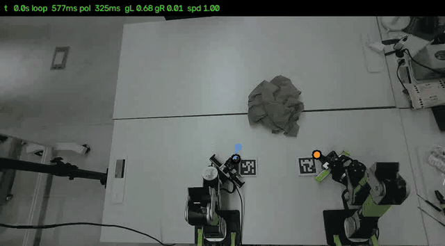
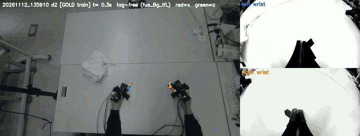
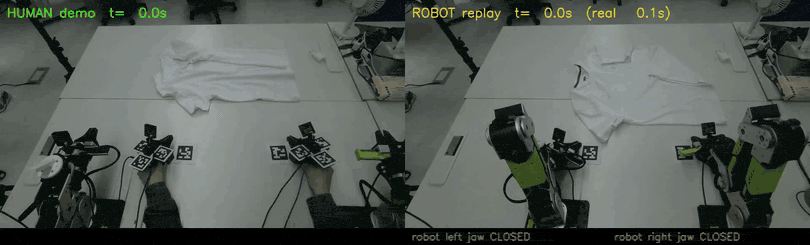
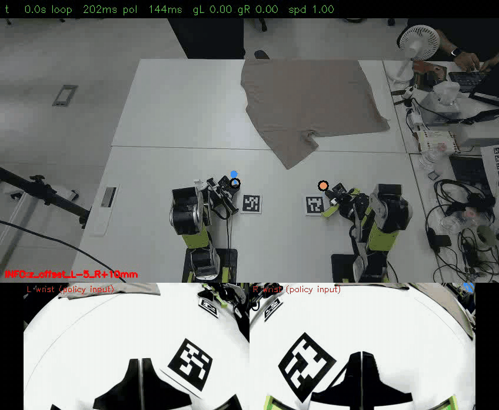
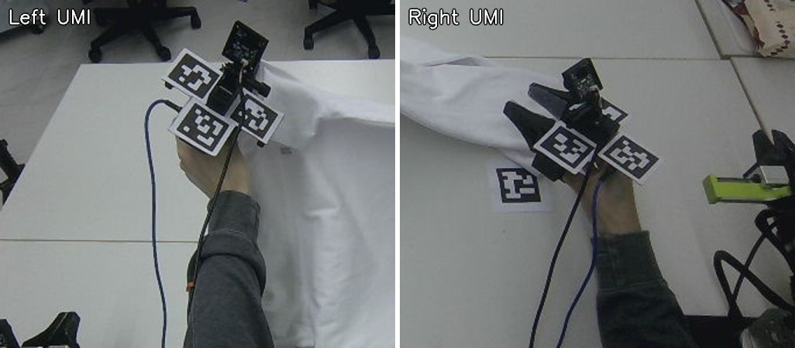

# Egocentric Human Demonstrations for Bimanual Garment Manipulation

Human T-shirt demonstrations, recorded with hand-worn parallel-jaw grippers (HandUMI), are converted into
robot-feasible jaw-tip trajectories and training labels in the base frame of a two-arm robot (**reBot B601-DM**), first
replayed open loop as an end-to-end test of the data and then used to train policies for T-shirt flattening and
folding, so that robot data collection scales with people instead of robots.

Part of **[physical-ai-robot-learning](https://github.com/physical-ai-robot-learning)** — Physical AI / robot learning projects.

[](.github/workflows/ci.yml)
[](LICENSE)
· **[Technical Report (PDF, 11-12)](report/report_en.pdf)** ([한국어, 11-02](report/report_ko.pdf)) · [earlier versions](report/archive/)
· [Detailed results](docs/results.md) · [Project history](docs/history.md) · [Pipeline](docs/pipeline.md)
· [한국어 README](README_ko.md) · [Attribution](ATTRIBUTION.md) · status: 2026-11-12


*Human demonstration (left) vs. robot replay of the converted trajectory (right). Same fixed camera, aligned on one
clock, shown at the human's speed; the bar shows the robot jaw commands.*

## Status (12 November 2026)

> **What works, and how it was measured**
> * **Replay (10-08 → 10-22).** Two-arm replay of one 33 s demo is deterministic (≈1 mm between runs) and the jaws
>   close at the human's height and time; the robot grasps and drags the cloth, but folding by replay does **not**
>   succeed. Measured against the fixed camera, a tape measure and the robot encoders ([results](docs/results.md)).
> * **Training data (10-26/27).** 300 successful flattening demonstrations are converted into graded,
>   Cartesian-before-IK training labels; pose from fixed-camera point tracking anchored by the markers, not wrist SLAM.
> * **First policies on the robot (10-28 → 11-01).** DiT and X-VLA fine-tuned on the 281 GOLD demos approach the cloth,
>   stop short of it and close the jaws early. Recorded causes and the data fixes that followed:
>   [history](docs/history.md#first-policies-on-the-robot-and-what-they-exposed-in-the-data-october-28--november-1).
> * **Pinching (2 November).** In a reduced test (pinch one sleeve with the left hand), a DiT fine-tuned on 197
>   pinching demonstrations (checkpoint at 50 epochs) grasped the sleeve and pulled it. Successful grasps were
>   observed in real-robot trials on 2 November; **trials were not counted**. After a miss the policy grabs elsewhere
>   instead of retrying (the data have no recovery demonstrations).
> * **Flattening after the pinching test (11-02 → 11-05).** FLAT149 (UMI cloth-folding recipe) and, under the camera
>   re-aimed on 3 November, FLAT250 (250 train demos, split by the tracking gaps inside each demo): held-out score
>   72 → 52 mm by epoch 13. Because the jaw servo has no load signal, a wrist-camera classifier estimates per frame
>   whether a closed jaw holds the cloth (p_grasp; 3–5 November). No counted robot trials of these policies yet.
> * **Flattening with p_grasp on the robot (11-05 → 11-07).** FLAT-PGRASP: the FLAT250 recipe on the data of 3–5
>   November (train 301 / val 46 / test 45 demos), p_grasp in the jaw slots of the state. At 0.3× time-stretch the
>   held-out score reached 46.04 / 46.61 mm (val / test, epoch 53). On the robot (6 November) the 0.3× policy looked
>   better than the same recipe at 1.0×, and on 7 November both jaws took the shirt edges and spread it between the arms
>   ([interim report below](#latest-robot-run-interim-report-7-november)); the shirt is not laid flat yet. On the robot,
>   p_grasp comes from the jaw state, not the wrist camera: the human-trained classifier calls the robot's closed empty
>   jaws "held". Robot runs were not counted.
> * **Latency on the robot (11-06).** The robot closed its jaws late. Measured command-to-motion delay: arm 58–64 ms,
>   jaw 171–173 ms; following UMI, commands are now sent ahead by these delays and the state is taken at image capture.
> * **A second policy family: X-VLA on the same data (11-10 →).** Fine-tuned from our SoftFold X-VLA checkpoint (650k) with a new domain id: 5
>   epochs on 2× RTX 4090, then (11-12, running) to epoch 100 on 4× H100 on 330 demos (the 301 above + 29 tag-free). No
>   offline or robot result yet.
> * **Collection without markers (11-11 →).** The policy acts in relative motion, so its labels need a start pose and a
>   heading, not absolute marker poses. All AprilTags were removed (hand units and table start tags); demos start on black
>   L tapes and the pose chain takes its start seed from depth and its heading from the IMU at rest. On a tagged take
>   processed without its tags, the jaw-tip error against the tags is 17 mm (left) and 9–14 mm (right). First sets: 29
>   train demos on 11-11, 16 more on 11-12 so far.
>
> **What is not shown:** no success rate (no robot trials were counted, for replay or for any policy); one setup, one
> demonstrator; flattening is not finished and folding is not achieved. Details of 11-06 → 11-12:
> [status note 11-12](docs/status_2026-11-12.md).

### Latest robot run (interim report, 7 November)



*FLAT-PGRASP at 0.3× (checkpoint at epoch 77) on the robot, run 165051, fixed camera, first 97 s, one frame per control
cycle (~1.3 s), shown at about 6×. Starting from a crumpled shirt, both jaws take an edge within about 25 s, spread the
shirt between the arms and keep it spread; later in the run the shirt bunches up again. This is an interim progress
report, not a result: the clip is the clearest of 27 runs that day, and **the runs were not counted or scored**, so it
shows what the policy can do, not how often it does it. Details: [status note](docs/status_2026-11-07.md).*

### Tag-free conversion (12 November)



*A flattening demonstration recorded after all AprilTags were removed (take 20261112_135910, demo 2, graded GOLD, train
split), converted by the tag-free chain. Left: fixed camera with each jaw-tip pose (blue = left, orange = right; red = x,
green = z axis, 5 cm) and its recent path; right: the two wrist cameras. The start pose comes from the black L tapes and the
resting units in depth, the heading from the IMU at rest. About 2× real time. [MP4](media/tagfree_20261112_135910_d02.mp4) ·
[status note](docs/status_2026-11-12.md) §4.*

**Research question.** *If a robot simply replays the converted human motion, open loop, does it do what the human
did?* Replay exercises every stage at once (calibration, pose, jaw state, robotization, IK, timing, control), puts
human, robot command and measured robot motion on one clock and in one frame so that errors can be attributed to a
stage, and fails visibly. The same converted data then become policy training labels.
Motivation and subsidiary questions: [history](docs/history.md#motivation-and-research-question).

## Repository map

| path | what | read this if… |
|---|---|---|
| [`src/laundry_tracking/`](src/laundry_tracking/) | stages 0, 2–4: camera ↔ robot and tag-rig calibration (`calib/`), CoTracker + marker + IMU fusion (`cotrack/`, `fusion/`), trims, GOLD / SILVER / REJECT grades | you want to see how the jaw-tip pose is recovered in the robot frame |
| [`src/laundry_jaw/`](src/laundry_jaw/) | stage 2: jaw state from the servo (`from_motor`) or from jaw-tip keypoints in the wrist video (`aperture`) | you want to know where the gripper label comes from |
| [`src/laundry_dataset/`](src/laundry_dataset/) | stage 5: labels F / A / B and IK diagnostics (`robotize_ik`), LeRobot dataset builder (`tag_rig_unsplit`), split / audit builds (`builds/`) | you want the label definition and the dataset contract |
| [`src/laundry_grasp/`](src/laundry_grasp/README.md) | stage 5b: held / empty labels of jaw close events from the wrist camera, frozen p_grasp generator, per-frame side files | you want to know how the policy is told whether a closed jaw holds the cloth |
| [`src/laundry_training/`](src/laundry_training/) | stage 6: DiT trainer, loss masks, augmentation, jaw head, switches (`env_options`) | you want the training recipe |
| [`src/laundry_deploy/`](src/laundry_deploy/) | stage 7: receding-horizon deploy (`core/`, `session/`, `ui/`), offline eval and height calibration (`tools/`), reBot MIT bridge (`robot_service/`) | you want to know how a policy runs on the robot and what is checked before anything moves |
| [`src/laundry_shared/`](src/laundry_shared/) | stage 1 and replay: recorder `tag_rig_record`, jaw classifier, reBot IK, replay planner (copies of the HandUMI / teleop modules the pipeline imports) | you want the recorder or the replay planner |
| [`src/laundry_reference/`](src/laundry_reference/README.md) | small standalone re-implementations of the trajectory stages, runnable on synthetic data | you want the core ideas without the lab set-up |
| [`src/laundry_common/`](src/laundry_common/paths.py) | `paths`: every machine-specific root, with environment-variable overrides | you want to run the code on other folders |
| [`scripts/laundry/`](scripts/laundry/) | replay parity and retargeting scripts, cluster / pod jobs (CoTracker, DiT DDP, X-VLA, conversion), X-VLA data converters, the tag-free pose chain (working-code snapshot of 11-12, [`tagfree/`](scripts/laundry/tagfree/README.md)) | you want the operational entry points |
| [`configs/laundry/`](configs/laundry/README.md) | calibration results, robot overrides, jaw models, pinned environments | you want the numbers the code reads |
| [`tests/laundry/`](tests/laundry/), `src/laundry_*/tests/` | smoke tests and per-package characterization tests | you want to check that the code runs |
| [`assets/laundry/examples/`](assets/laundry/examples/README.md) | SYNTHETIC demo + simulated replay | you want data to run the reference code on |
| [`analysis/verify_claims.py`](analysis/verify_claims.py) | checks every number in the report against the document it came from | you want to check the report |
| [`docs/`](docs/) | [pipeline](docs/pipeline.md), [codebase guide](docs/codebase.md), [history](docs/history.md), [details](docs/details.md), [results](docs/results.md), [environments](docs/environments.md), status notes [11-05](docs/status_2026-11-05.md) / [11-07](docs/status_2026-11-07.md) / [11-12](docs/status_2026-11-12.md), [refactor map](docs/refactor_2026-11.md) | you want the long form |
| [`report/`](report/README.md) | technical report (English 11-12, Korean 11-02), LaTeX + PDF | you want the whole method and results in one document |
| [`media/`](media/README.md) | GIFs, videos and photos of the real setup | — |
| [`hardware/umihand/`](hardware/umihand/README.md) | HandUMI build copy (BrikHMP18's design) + our modified parts, IMU firmware | you want to build the gripper |
| [`archive/`](archive/README.md) | superseded code: MASt3R / ORB-SLAM3 pose, UMIalign, stereo VIO, red-tape jaw, bare-hand collector, grasp-label exploration | you want to see what was tried and dropped |

**Start reading here:** [`docs/pipeline.md`](docs/pipeline.md) (world frame and stages),
[`src/laundry_tracking/fusion/trajectory_fusion.py`](src/laundry_tracking/fusion/trajectory_fusion.py) (the pose
source), [`src/laundry_dataset/tag_rig_unsplit.py`](src/laundry_dataset/tag_rig_unsplit.py) (labels → dataset).

## Pipeline

Everything is expressed in the robot base frame on one host clock: the fixed camera is calibrated to the robot, and
every take starts with the grippers on two start markers (IDs 400 / 401) whose robot coordinates were measured once.
Run from the repository root with the package installed (or `PYTHONPATH=src`); the commands need recorded takes, which
are not in this repository. Options, outputs and the replay track: [docs/pipeline.md](docs/pipeline.md).

| stage | module | command |
|---|---|---|
| 0 · calibrate (once; camera ↔ robot after every camera move) | `laundry_tracking.calib` | `python -m laundry_tracking.calib.robot_cam_from_anchors <take> --frames 2400:2828:4` (first solve: `calib.robot_cam_solve`; rig: `calib.tag_rig_solve`) |
| 1 · record | `laundry_shared.visual_teleop.tools.tag_rig_record` | `sudo .venv/bin/python -m laundry_shared.visual_teleop.tools.tag_rig_record --proto task --wrist` |
| 2 · tag pose + jaw state | `laundry_tracking.calib.umi_tcp_traj`, `laundry_jaw.from_motor` | `python -m laundry_tracking.calib.umi_tcp_traj <take> --hand <hand> --depth --imu-fill`; `python -m laundry_jaw.from_motor <take>` |
| 3 · point tracking + marker + IMU fusion | `laundry_tracking` | `python -m laundry_tracking.new_take_prep <take>` → `cotrack.make_pack` → `cotrack.run_cotracker` (GPU) → `cotrack.point_solver` → `cotrack.gate` → `python -m laundry_tracking.fusion.trajectory_fusion <pack> Cg --ct solve3` |
| 4 · trims + quality grade | `laundry_tracking` | `python -m laundry_tracking.tighten_trim <idle_audit.csv> 0.3`; `edge_gap_trim <pack>`; `cotrack.episode_quality <quality.csv> <pack>` |
| 5 · labels + LeRobot dataset | `laundry_dataset` | `python -m laundry_dataset.robotize_ik <take> <derived take> --workers 8`; `python -m laundry_dataset.tag_rig_unsplit --label fused --speed 0.3 --out <dataset> --takes <take> …` |
| 5b · grasp labels (p_grasp) | `laundry_grasp` | `python -m laundry_grasp.generate` (frozen `grasp-v2-W0.4`) → `python -m laundry_grasp.sidefile <set> <pgrasp dir>`; labeling page `python -m laundry_grasp.gold_ui <round dir>` |
| 6 · train | `laundry_training` | `python -m laundry_training.train_dit_tagrig …` (LeRobot fork; cluster job `scripts/laundry/ray_ditddp/run.sh`) |
| 7 · deploy + evaluate | `laundry_deploy` | `python -m laundry_deploy.ui.server` (UI :8770, DRY first); `python -m laundry_deploy.session.cli run --policy dit --secs 30`; `python -m laundry_deploy.tools.offline_eval --ckpt … --data … --out …` |
| replay track (10-08 → 10-22) | `scripts/laundry/retarget`, `umi_replay_bi`, `scripts/laundry/eval` | `python scripts/laundry/retarget/umi_robotize_bi.py <take> …` → `python -m laundry_shared.visual_teleop.tools.umi_replay_bi <take> … --offline` → `python scripts/laundry/eval/replay_parity.py <take> <run>/right` |

### What stages 3 and replay look like

**Arm trajectories from point tracking (CoTracker).** One GOLD flattening demonstration (26 October). Each jaw-tip path is
coloured by where its pose came from: green = AprilTag markers + CoTracker points + depth, blue = CoTracker points alone
while the marker is hidden, orange = IMU rotation inside a CoTracker gap. Left: fixed camera; right: the same paths in
the robot base frame.


**Arm trajectories with MASt3R-SLAM as the gap filler (replay era).** Both hands' jaw-tip paths in one world frame:
green = AprilTag markers + depth, blue = MASt3R-SLAM from the wrist fisheye camera (gated filler), orange = IMU rotation +
interpolation. Left: fixed camera; right: 3-D paths.


**Robot replay of a human demonstration.** The converted two-arm trajectory of a human demonstration (left) executed on
the reBot arms (right), run 200335, same fixed camera, one clock, shown at robot speed (0.35×). The robot follows the
demonstrated motion and its jaws catch the shirt edge and drag it; folding itself was not achieved by replay
(details: [docs/history.md](docs/history.md#overview-as-of-2-november)).



## Install and test

```bash
git clone https://github.com/physical-ai-robot-learning/egocentric-garment-manipulation && cd egocentric-garment-manipulation
uv sync --group vision --group robot && uv run pytest -q   # Python 3.12; the tests need torch (CPU is enough) and Pink IK
# exact test environment of CI (Apple Silicon): pip install -r configs/laundry/envs/requirements-test.txt && pip install -e . --no-deps
python analysis/verify_claims.py                   # every number in the report vs. the document it came from: "227 claims checked, 0 failed."
python scripts/laundry/eval/replay_parity.py --synthetic          # parity scorer self-test; ends with "합성 시험 PASS"
python -m laundry_tracking.calib.robot_cam_solve --synthetic      # camera ↔ robot solver on simulated data; ends with "합성 시험 PASS"
```

The tests are characterization tests of every package (outputs recorded before the code was restructured, on synthetic
recordings, fake IK and golden files), layout / import smoke tests and the reference regression on the synthetic
example: 598 pass and 5 skip with torch, Pink IK and Flask installed (lerobot not installed, reBot URDF not included;
2026-11-12, fresh pinned environment; there `test_robotize_bi_take`, one of the two optimizer goldens CI skips, also
fails). A base install (2026-11-05) (`uv sync` or `pip install -e ".[test]"` alone) runs everything else: 425 pass, 41 skip (the
tests that need torch, Pink or Flask). CI runs on Apple Silicon with the pinned versions of
`configs/laundry/envs/requirements-test.txt`; it skips the IK tests (the reBot URDF is a vendor file, not included) and two
goldens of iterative optimizers whose outputs differ by up to ~1e-4 on another machine. Dependency groups: `vision`, `robot`, `train`, `collector` ([codebase guide](docs/codebase.md#installation-details)).

**Not reproducible from this repository:** the real-system numbers come from recorded data that is not included (raw
takes, trained checkpoints); the reBot vendor plugin and URDF, the robot-PC driver stack and the X-VLA training patch are
not included; CoTracker and training need a GPU, deploy needs the robot. The claims check tests consistency with the
records, not a re-computation from data. Environments that produced the results: [docs/environments.md](docs/environments.md).

## Results

Measured in October and November 2026 on one setup with one demonstrator. Full tables and metric definitions:
[docs/results.md](docs/results.md) and the [technical report](report/report_en.pdf) (to 12 November); the 11-05 and
11-07 numbers: status notes [11-05](docs/status_2026-11-05.md), [11-07](docs/status_2026-11-07.md); after the report:
[11-12](docs/status_2026-11-12.md).

| milestone | result |
|---|---|
| Calibration | camera ↔ robot: 0.98 px held-out reprojection (≈1.3 mm lateral); UMI marker rig → jaw tip: 1–4 mm static (leave-one-out 1.8–4.8 mm) |
| Single-arm replay parity | 16/18 translation strokes pass; median per-axis RMSE 5.5–11.6 mm; rotation strokes pass, 0.3–1.6° median error; command vs. human ≤ 3.4 mm, so the residual was robot tracking |
| First cloth grasp from human data | the right arm replayed a grasp window of a demonstration and picked up and lifted the T-shirt |
| Full two-arm replay of one 33 s demo (94 s at 0.35× speed) | four runs with one unchanged plan repeat within ≈1 mm; robot within 2–8 mm (xy) of its command at grasps |
| Error vs. the human | whole-demo position RMSE ≈17 mm (right) / ≈30 mm (left) against the replayed (robotized) human path; ≈22 / 32–34 mm against the raw human path |
| Jaw height at grasp | after allowing finger contact, jaws close 14–16 mm (right) / 5–19 mm (left) above the table (human ≈10 mm), within 2–8 mm of the commanded position |
| Folding like the human | **not achieved / not yet.** In the best run the jaws caught the shirt edge and dragged it; no success rate is reported |
| Wrist-camera SLAM as pose source | **rejected.** MASt3R-SLAM kept 19–48 % of frames (0–38 % around grasps); ORB-SLAM3 mono-inertial scale diverged |
| Point tracking (CoTracker) + markers + IMU (10-24/25) | hidden-marker error on held-out takes: median 16 mm (left) / 19 mm (right); markers alone ≈ 42 mm |
| Flattening dataset (10-26/27) | 300 successful demos of 318; of the first 139 graded, 133 GOLD / 5 SILVER / 1 REJECT |
| Labels before vs after IK (10-26) | first 139 demos (≈123k arm-frames): IK → FK moves the target by p95 ≈ 58 mm at grasps (53 mm overall); 20.3 % of frames need a large IK correction, 0.8 % are out of reach |
| Label table clearance (10-29) | lifted 44 % of label frames, median 27 mm (max 65) — removed; label F = fused human jaw tip (gripper axes, 0.25 s smoothing), no lift or clamp |
| Demonstration speed (10-29) | human jaw tip p95 0.93 m/s, 127 °/s — too fast for the arms → 0.3× time-stretched data set |
| Wrist-camera placement (10-29) | robot wrist cameras tilt 11–13° less toward the tool axis and sit 25–44 mm closer than the UMI ones (table-tag PnP) |
| Policy, as of 10-27 | not yet trained on our data; a pretrained-only diffusion policy (Soft-Fold-pretrained DiT) ran on the robot in dry runs without safety violations |
| Policies on the robot (10-28 →) | DiT and X-VLA fine-tuned on the 281 GOLD demos, observed in robot trials that were not counted: approach the cloth, stop short, close the jaws early — **no success rate** |
| Pinching one sleeve, left hand (11-02) | DiT fine-tuned on 197 pinching demos (50-epoch checkpoint): successful grasps observed in real-robot trials on 2 November; trials were not counted — **no success rate**. After a miss it grabs elsewhere instead of retrying |
| Flattening, FLAT250 (11-04/05) | val / test `val_score_mm` 71.67 / 72.27 (initial) → **52.56 / 52.32** (epoch 13, best); no counted robot result |
| Grasp held / empty (11-05) | wrist-camera classifier, take-grouped 5-fold CV per event: F1 held 0.90, empty 0.78 |
| Flattening, FLAT-PGRASP 0.3× (11-05 → 11-07) | train 301 / val 46 / test 45 demos; val / test `val_score_mm` 75.88 / 76.08 (epoch 1) → **46.04 / 46.61** (epoch 53, best); not comparable with FLAT250 (different held-out sets) |
| Deploy latency (11-06) | measured command-to-motion delay: arm 58 / 64 ms, jaw 173 / 171 ms (left / right); cameras: fixed 1.4 ms, wrist 38 / 61 ms — matched in the deploy |
| X-VLA on the flattening data (11-10 →) | from our SoftFold checkpoint (650k), domain 22: 5 epochs (train loss 0.6 → 0.07), then to epoch 100 on 330 demos (running 11-12); no offline or robot result yet |
| Tag-free pose (11-11/12) | tagged take processed without tags vs its tag measurements: jaw-tip error left 17 mm, right 9–14 mm; 11-12 camera re-aim corrected by depth-scene ICP (`robot_cam_v007`; uncorrected 6–27 mm) |
| Flattening on the robot (11-06/07) | 0.3× looked better than 1.0× on the robot (6 November); on 7 November both jaws took the shirt edges and spread it, then it bunched up again; the shirt was not laid flat. 27 runs, not counted or scored — **no success rate** |



*Real-robot pinching run of 2 November 2026, 11:37 (one of two runs the operator judged successful; trials were not
counted). Top: fixed camera with the policy's next jaw targets; bottom: the two wrist-camera inputs. About 2.8× real
time. More: [history](docs/history.md#pinching-10-30--11-02-first-real-robot-grasps-trials-not-counted).*

**Limitations.** No success rate: replays were judged by measurement and video, and the policy runs, including the
pinching grasps of 2 November, are observations from uncounted trials. One demonstration was replayed in full on both
arms; the ≈1 mm repeatability shows determinism, not generality. Replay is open loop (the cloth must start where the
human's did). Relative parity metrics hide constant offsets; absolute placement was checked by tape and video. Full
list: [history](docs/history.md#limitations).

## What changed and why (short decision log)

| date | finding | change |
|---|---|---|
| 10-21/23 | wrist-camera SLAM (MASt3R, ORB-SLAM3) loses tracking exactly at grasps | absolute markers + depth from the fixed camera, then fixed-camera point tracking, become the pose source |
| 10-24 | markers fix the absolute error; adding IMU acceleration made it worse | fusion variant Cg: CoTracker + markers, IMU acceleration only inside gaps |
| 10-26 | IK → FK labels move the target most at grasps | the label is the Cartesian pose before IK; IK is a checker offline and the executor online |
| 10-29 | the table-clearance step lifted 44 % of label frames | label F: fused human jaw tip, no clamp or lift; limits belong to deployment |
| 10-29 | human demonstrations are faster than the arms can follow | time-stretched copies of the data set |
| 10-29 | video jaw labels disagree with the jaw | the jaw servo is back on the UMI as a torque-off encoder (`laundry_jaw.from_motor`) |
| 10-30 | the policy copied the jaw state from its observation | jaw state masked in training and deploy (`GRIP_STATE_MASK=1`) |
| 11-04 | point-tracking gaps inside demos | split by the longest gap inside the trimmed window, gated loss masks |
| 11-05 | a closed jaw does not say whether cloth is held | wrist-camera grasp labels → p_grasp in the jaw slots of the state (`PGRASP`) |
| 11-06 | the human-trained grasp classifier calls the robot's closed empty jaws "held" (0.97 / 0.94) | on the robot, p_grasp = jaw state (closed → 1) until a robot-domain classifier exists |
| 11-06 | on the robot the 0.3× policy looked better than the 1.0× one (uncounted) | keep the 0.3× time-stretch for flattening |
| 11-06 | the robot jaw closed late (jaw ~110 ms slower than the arm) | UMI-style latency matching in the deploy |
| 11-07 | IK pinned at a joint limit sent an arm to a twisted closest pose | that arm holds its last joints instead |
| 11-10 | a second policy family on the same data | X-VLA from our SoftFold checkpoint, then a daily continual schedule |
| 11-11 | relative actions and the task-anchor state do not need absolute marker poses | all tags removed; L-tape start marks, IMU heading at rest, start seed from depth |

Earlier decisions (robot model corrections, controller model, continuous warps instead of clipping) and the reasons:
[history](docs/history.md#what-was-hard-and-what-i-changed); dated narrative from replay to flattening:
[docs/history.md](docs/history.md).

## Hardware and attribution

> **HandUMI is not our design.** It was designed and published by **BrikHMP18** (murobotics-ai, Apache-2.0):
> [murobotics-ai/handumi-hw](https://github.com/murobotics-ai/handumi-hw). [`hardware/umihand/`](hardware/umihand/README.md)
> is our build copy of the upstream files plus our changes.



*The two hand-worn grippers (left / right), each with three fiducial markers (photo from 10-21, before 23 October;
since then a fourth, smaller 30 mm marker sits on the back of each wrist camera).*

We printed and assembled the upstream parts and made small changes for our use: a wrist IMU instead of VR tracking,
several AprilTags per hand on different faces (so at least one tends to face the external camera; a fourth, smaller one
on the back of the wrist camera since 23 October, whose single-tag planar pose flip is resolved with the IMU), modified
controller-support connector, camera mount and servo cover (`hardware/umihand/mods/`), and, between 13 and 28 October,
removal of the jaw servo (jaw state was inferred from the wrist video). On 29 October the servo was put back as a
torque-off encoder that records the jaw opening (Feetech STS3215; [pipeline](docs/pipeline.md#pose-reconstruction-and-validation-stages-24), step 5).
HandUMI itself follows the Universal Manipulation Interface (UMI, Chi et al., RSS 2024). See [ATTRIBUTION.md](ATTRIBUTION.md).

The robot is the reBot B601-DM (two 6-DoF arms with parallel jaws, driven by our MIT-mode bridge); its vendor LeRobot
plugin and URDF are not included. The fixed camera is an Orbbec Gemini 336 RGB-D above the table (113 cm). Full unit
list: [pipeline](docs/pipeline.md#system-at-a-glance). Previous work:
[egocentric-cube-stacking](https://github.com/physical-ai-robot-learning/egocentric-cube-stacking); related work:
[history](docs/history.md#previous-and-related-work).

## License, acknowledgements, citation

**License.** This is a research project in progress, not a product. Numbers are from one setup, one demonstrator and a
small number of runs, and are reported as measured, including failures. Code, configurations, documentation and media
in this repository are licensed under the **PolyForm Noncommercial License 1.0.0** ([LICENSE](LICENSE)): free for
research, teaching, personal and other noncommercial use; **commercial use is not permitted** without a separate
written agreement with the author. Exception: `hardware/umihand/` keeps the upstream HandUMI Apache-2.0 licence
([LICENSE](hardware/umihand/LICENSE), [NOTICE](hardware/umihand/NOTICE.md)). Third-party designs and methods remain
under their own licences ([ATTRIBUTION.md](ATTRIBUTION.md)).

**Acknowledgements.** The hand-worn gripper is HandUMI by BrikHMP18 ([murobotics-ai/handumi-hw](https://github.com/murobotics-ai/handumi-hw), Apache-2.0),
following UMI (Chi et al., RSS 2024); see [Hardware and attribution](#hardware-and-attribution) and [ATTRIBUTION.md](ATTRIBUTION.md).
Pretraining data named in the training plan: Soft-Fold, iPhUMI (MIT), PrimeBot UMI (CC BY-SA 4.0).

**Provenance.** Until 1 November 2026 the full code and detailed notes lived in a separate working repository,
`egocentric-laundry-folding`, and this repository held the public write-up; the two were merged here. On 5 November
the code tree was replaced by the maintained codebase in its current layout (same behaviour; old → new paths in
[docs/refactor_2026-11.md](docs/refactor_2026-11.md)). The archived technical reports in `report/archive/` and the dated
status notes name the paths of their date.

**Citation.** See [CITATION.cff](CITATION.cff) (GitHub's "Cite this repository").

```bibtex
@misc{lee_egocentric_garment_manipulation,
  author       = {Lee, Jeong Hwan},
  title        = {Egocentric Human Demonstrations for Bimanual Garment Manipulation},
  howpublished = {\url{https://github.com/physical-ai-robot-learning/egocentric-garment-manipulation}}
}
```

**Author.** **Jeong Hwan Lee** — Robotics Engineer, Physical AI / Robot Learning

Interests: learning robot manipulation from human demonstrations; egocentric and wearable data capture;
cross-embodiment action representations; bimanual and deformable-object manipulation; vision-language-action models;
calibration and evaluation methodology for robot-learning data.

GitHub: <https://github.com/physical-ai-robot-learning>
