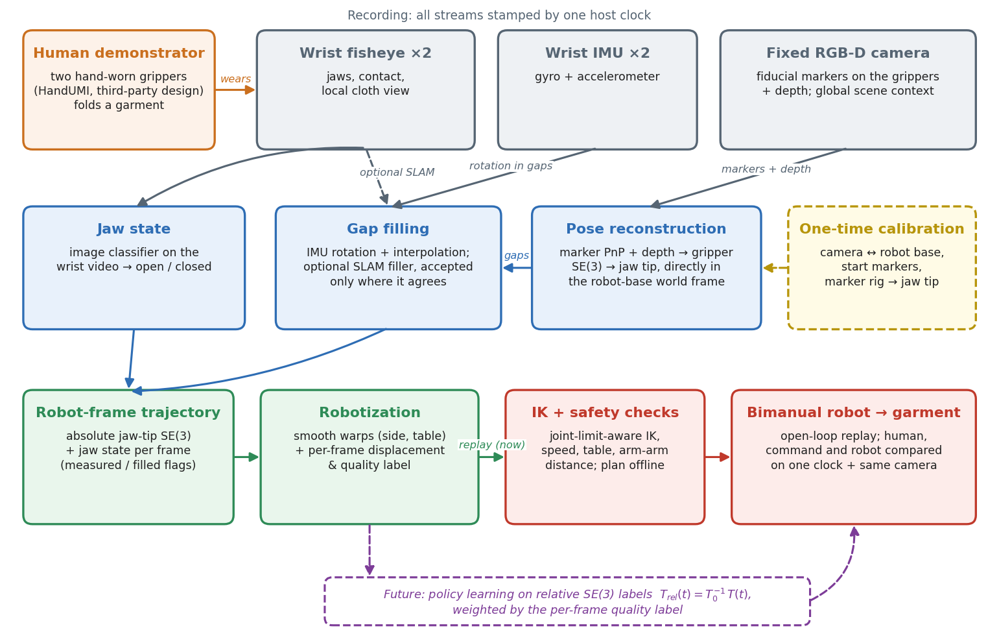
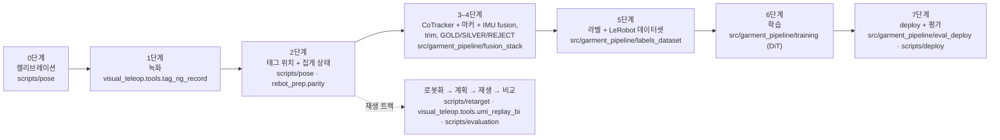
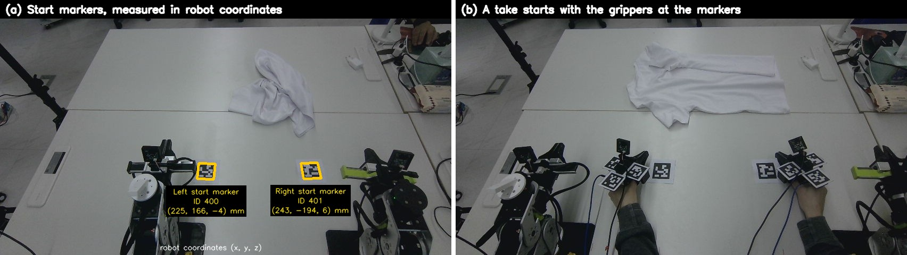
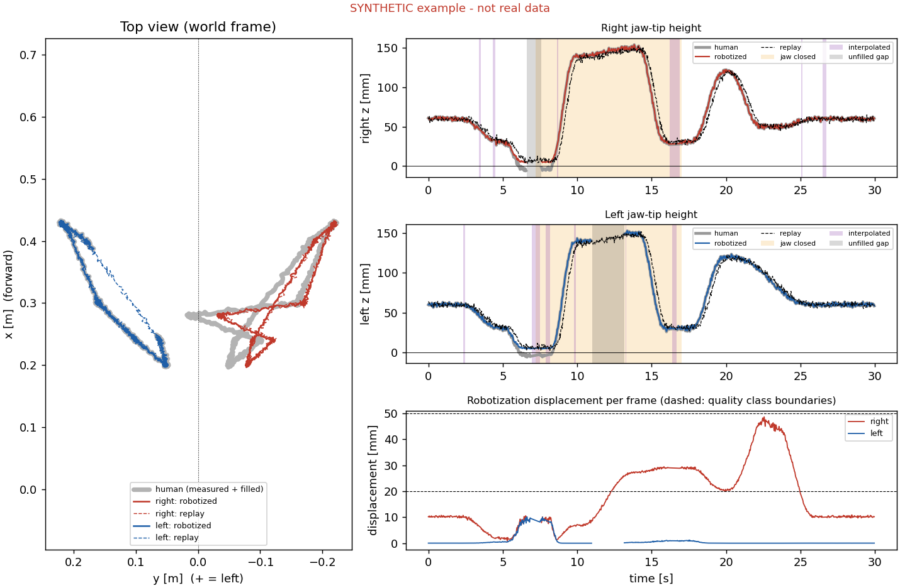
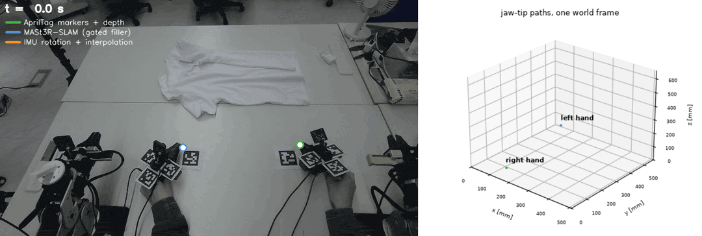
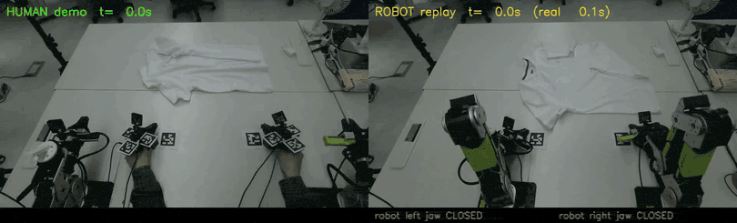
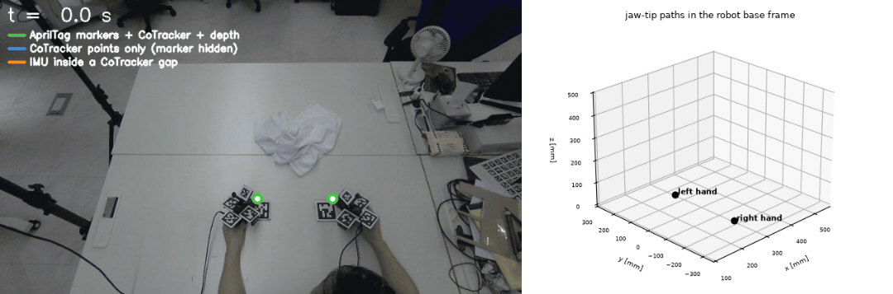
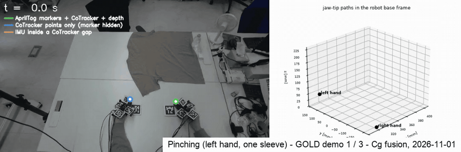
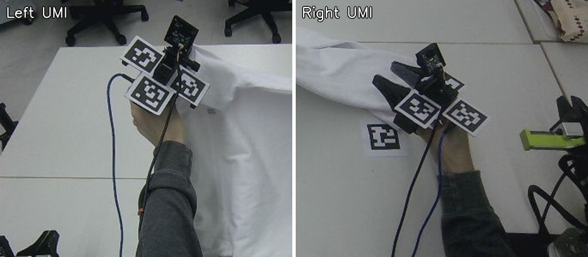

# 양손 옷 다루기를 위한 egocentric 사람 시연

손에 끼는 평행 집게로 녹화한 사람의 옷 다루기 시연을 로봇이 할 수 있는 엔드이펙터 궤적과 학습 라벨로 변환하고, 데이터 전체를
끝까지 시험하기 위해 양팔 로봇(**reBot B601-DM**)으로 재생한 뒤, 티셔츠 펴기·접기 정책을 학습하는 데 씁니다.

모든 egocentric 시연 프로젝트의 입구인 **[egocentric](https://github.com/physical-ai-vla/egocentric)**의 일부입니다.

[](.github/workflows/ci.yml)
[](LICENSE)
· **[Technical Report v0.1 (PDF)](report/report_v0.1_en.pdf)** · [v0 (10-21)](report/report_v0_en.pdf)
· [Technical note (PDF)](report/technical_note.pdf) · [자세한 결과](docs/results.md) · [세부 내용](docs/details_ko.md)
· [English README](README.md) · [출처](ATTRIBUTION.md) · 기준일: 2026-11-01

> **2026-10-27 업데이트.** 재생 단계는 끝났고 프로젝트는 **정책 학습 데이터**로 넘어갔습니다. 티셔츠 펴기 성공 시연 300개,
> 새 위치 추정 소스(마커를 기준점으로 쓰는 고정 카메라 점 추적), 품질 등급, IK *이전*의 Cartesian 라벨입니다.
> [재생에서 정책 학습 데이터로](#재생에서-정책-학습-데이터로-10-2627) 참고. open-loop 재생 트랙(10-08 → 10-22)은 새 파이프라인의
> 바탕으로 남겨 두었습니다. 더 이상 쓰지 않는 부분은 ~~취소선~~으로 표시했고, 그 코드는 [`legacy/`](legacy/README.md)에 있습니다.
>
> **2026-11-01 업데이트.** 이 시연으로 파인튜닝한 첫 정책을 로봇에서 돌렸습니다. 팔이 천 쪽으로 가지만 닿기 전에 멈추고 집게를
> 일찍 닫습니다. 원인 네 가지를 데이터에서 찾았습니다(라벨 clamp, 시연 속도, 집게 라벨, 손목 카메라 위치).
> [로봇에서 돌린 첫 정책](#로봇에서-돌린-첫-정책과-데이터에서-드러난-것-10-28--11-01) 참고. 성공률은 아직 보고하지 않습니다.

> **이 저장소에 있는 것.** 실제로 돌린 프로젝트 코드 전체입니다. 녹화기와 로봇 쪽 패키지([`src/visual_teleop/`](src/visual_teleop/README.md)),
> 태그 리그 위치 모듈([`src/rebot_prep/`](src/rebot_prep/README.md)), 캘리브레이션·위치·리타깃·평가·로봇 브리지 script, 학습 데이터
> 파이프라인, DiT 학습기와 deploy 루프([`scripts/`](#3-구성-요소)), 캘리브레이션 결과와 로봇 설정([`configs/`](configs/README.md)),
> HandUMI 제작 사본([`hardware/umihand/`](hardware/umihand/README.md)), 더 이상 안 쓰는 코드([`legacy/`](legacy/README.md)),
> 테크니컬 리포트, 세부 문서와 미디어. [`src/egogarment/`](src/egogarment/README.md)는 따로 만든 작은 독립 재구현으로, 궤적 단계를
> [`examples/`](examples/README.md)의 합성 데이터로 돌립니다. 학습 데이터 파이프라인은 설치 가능한 패키지
> [`src/garment_pipeline/`](src/garment_pipeline/README.md)입니다(`python -m garment_pipeline.<단계>.<모듈>`). 파일 위치는
> [`egogarment.paths`](src/egogarment/paths.py)에서 옵니다(환경 변수 `EGO_DATA_ROOT`, `EGO_TRAIN_ROOT`, `EGO_CKPT_ROOT`).
> 실행에는 실제 데이터가 필요합니다: 원본 녹화, 학습된 checkpoint, reBot 제조사 플러그인과 URDF는 포함하지 않았고, 일부 단계는
> GPU나 로봇이 필요합니다. X-VLA 파인튜닝 코드는 이 저장소에 없습니다.

**사람 시연(왼쪽) vs 변환한 궤적의 로봇 재생(오른쪽).** 같은 고정 카메라, 하나의 시계로 맞췄고 사람 속도로 보여 줍니다. 막대는
로봇 집게 명령입니다.


**목차:** [1. 개요](#1-개요) · [2. 시스템 한눈에 보기](#2-시스템-한눈에-보기) · [3. 구성 요소](#3-구성-요소) ·
[4. 설치](#4-설치) · [5. 파이프라인](#5-파이프라인) · [6. 코드 안내](#6-코드-안내) · [7. 결과](#7-결과) ·
[8. 지금 쓰는 것과 안 쓰는 것](#8-지금-쓰는-것과-안-쓰는-것) · [9. 하드웨어와 출처](#9-하드웨어와-출처) ·
[10. 라이선스 · 감사의 말 · 인용](#10-라이선스--감사의-말--인용)

---

## 1. 개요

* **목표.** 사람 시연에서 배워 로봇이 티셔츠를 접게 하는 것입니다. 원격 조종이나 로봇 데이터 수집은 쓰지 않습니다.
* **재생으로 데이터를 끝까지 시험.** 변환한 사람 동작을 하나의 시계, 하나의 좌표에서 로봇으로 open-loop 재생하므로, 오차가
  어느 단계에서 생겼는지(변환 vs 계획 vs 추종) 가를 수 있습니다.
* **하나의 월드 좌표(로봇 베이스), 하나의 시계.** 고정 카메라를 로봇에 캘리브레이션하고, 매 테이크를 로봇 좌표로 위치를 아는
  마커에 집게를 두고 시작하므로 테이크마다 따로 맞출 필요가 없습니다. 모든 스트림에 호스트 시각이 붙습니다.
* **위치는 손목 SLAM이 아니라 고정 카메라로:** 점 추적 + AprilTag + 깊이 + IMU. 손목 카메라 SLAM은 집는 순간에 추적을
  놓쳤습니다(MASt3R는 19–48 % 프레임만 사용 가능, ORB-SLAM3는 스케일 발산).
* **라벨은 IK 이전 Cartesian 목표이고,** 로봇이 움직이기 전에 IK와 안전 검사를 실시간으로 거칩니다. IK → FK 라벨은 집는 순간
  목표를 p95 약 58 mm 옮겼습니다.
* **재생 결과.** 33초 데모 하나의 양팔 재생은 결정적이고(실행 사이 약 1 mm), 집게가 사람과 같은 높이·시점에 닫힙니다. 천을 집어
  끌지만 재생으로 접기는 **성공하지 못합니다**.
* **학습 데이터.** 펴기 성공 시연 300개를 등급을 매긴 IK 이전 Cartesian 학습 라벨로 바꿨고, Soft-Fold로 pretrain한 DiT가 로봇
  dry run에서 안전하게 돕니다.
* **로봇에서 돌린 첫 정책.** 파인튜닝한 DiT·X-VLA 정책(10-28 →)은 천 쪽으로 가지만 닿기 전에 멈춥니다. 원인은 데이터에
  있었습니다(라벨 clamp, 시연 속도, 집게 라벨, 손목 카메라 위치). 앞의 세 가지는 바꿨고 카메라 재장착이 다음입니다.
  **정책 성공률은 아직 없습니다.**

긴 설명(데이터, 학습 계획, deploy 루프, 결정 기록, 재생 트랙, 남은 문제): [docs/details_ko.md](docs/details_ko.md).
지표 정의와 전체 결과 표: [docs/results.md](docs/results.md)(영어).

### 동기와 연구 질문

티셔츠 접기는 길고, 양손을 쓰고, 접촉이 많으며, 집을 때마다 천의 상태가 바뀝니다. 이런 작업의 원격 조종 로봇 데이터는 모으기
느리고 비쌉니다. UMI 방식의 손에 드는·손에 끼는 집게를 쓰면 사람이 로봇과 비슷한 엔드이펙터로 로봇 없이 시연할 수 있어,
데이터 수집이 로봇 수가 아니라 사람 수에 따라 늘어납니다.

어려움은 변환으로 옮겨 갑니다. 캘리브레이션, 위치 복원, 집게 라벨, 시간, 운동학적 도달성의 모든 오차가 학습 라벨에 들어가고,
그 라벨로 학습한 정책은 오차를 그대로 물려받습니다. 정책 성공률은 이런 오차를 늦게, 간접적으로만 알려 줍니다.

**주 질문.** *로봇이 변환된 사람 동작을 open-loop로 그대로 재생하면, 사람이 한 일을 하는가?*

재생은 정책 학습 전에 데이터 파이프라인을 끝까지 시험하는 방법으로 씁니다. 쓸모 있는 성질이 세 가지 있습니다.

1. 모든 단계를 한꺼번에 거칩니다(캘리브레이션, 위치, 집게 상태, 로봇화, IK, 시간, 제어).
2. 사람, 로봇 명령, 측정한 로봇 동작을 하나의 시계와 하나의 좌표에 둘 수 있어, 오차가 어느 단계(변환 vs 계획 vs 추종)에서
   생겼는지 가를 수 있습니다.
3. 실패가 눈에 보이고 물리적으로 드러납니다(집게가 천 위 허공에서, 또는 빈 테이블에서 닫힘).

부수 질문: 집는 동안 손이 마커를 가리면 위치는 어디서 얻는가? 사람 궤적을 로봇이 할 수 있게 하려면 얼마나 바꿔야 하고, 그것을
어떻게 기록해야 하는가? 모델 기반 검사로는 보이지 않는 오차는 무엇인가?

## 2. 시스템 한눈에 보기



*10-27 기준 데이터 흐름. 사람이 손에 끼는 집게 두 개로 시연하고, 손목 어안 카메라, 손목 IMU, 고정 RGB-D 카메라가 하나의
시계로 녹화합니다. 각 집게의 점을 고정 카메라 영상에서 추적하고, 깊이로 3D로 올린 뒤, 기준점인 fiducial 마커와 IMU(추적이 끊긴
구간 안에서만)와 합쳐 하나의 월드 좌표(로봇 베이스)에서 집게 끝 포즈를 얻습니다. 에피소드마다 trim하고 등급을 매기며, 학습 라벨은
IK 이전 Cartesian 포즈입니다. 공개 천 데이터로 pretrain한 정책을 가장 좋은 등급의 시연으로 파인튜닝하고, 실시간 IK와 안전 검사가
있는 receding-horizon 루프로 로봇에서 돌립니다. 회색 상자는 더 이상 쓰지 않는 이전 재생 파이프라인 부분입니다.*
(그림 생성: [`docs/make_architecture.py`](docs/make_architecture.py))

같은 흐름을 단계와 코드 위치로:



| 장치 | 역할 |
|---|---|
| **HandUMI 2개** (손에 끼는 집게) | 시연 도구인 평행 집게입니다. 각각 **AprilTag 마커 4장**(카메라가 3D 위치·방향을 잴 수 있는 인쇄된 사각 코드): 48 mm 태그 3장 + 10-23부터 손목 카메라 뒷면의 30 mm 태그 1장(ID 220 / 221, 리그 `umi_tag_rig_v002`, 30 mm 태그 하나만 보일 때는 자세 뒤집힘을 IMU로 확인한 경우에만 사용), 손목 어안 카메라(30 Hz), 작은 IMU(움직임 센서), **집게 서보**(Feetech STS3215, 토크를 끄고 집게 엔코더로만 읽음, 호스트 시계 기준 약 100 Hz)가 달려 있습니다. 서보는 10-29에 다시 달았습니다(~~집게 모터 없음~~ 10-13 → 10-28). |
| **Orbbec Gemini 336** (고정 RGB-D 카메라) | 테이블 위에 고정한 컬러 + 정렬된 깊이 카메라(15 Hz)입니다. 양손이 화면 안에 있도록 113 cm로 올렸고(10-25), **위치 추정의 주 소스**(점 추적 + 마커 + 깊이)입니다. 양손 집게, 테이블의 **시작점 마커** 2장, 카메라를 옮긴 뒤 다시 캘리브레이션할 때 쓰는 테이블 고정 태그 2장을 봅니다(~~로봇 손목 캘리브레이션 마커~~는 첫 캘리브레이션에만 사용). |
| **reBot B601-DM 2대** | 평행 집게가 달린 저가 6축 팔입니다. 우리 MIT 브리지로 구동합니다(100 Hz, 모터 자동 재활성화, USB 재연결, 집게 열림 제한). 학습한 정책을 실행합니다(이전에는 open-loop 재생 대상). |
| **로봇 보정** | 로봇 CAD 모델 값을 믿지 않고 줄자와 카메라로 직접 쟀습니다. 집게 끝 위치(모델이 89 mm 어긋남), 왼팔 설치 위치(70 mm, 3° 어긋남), 왼팔 2번 관절 영점(−8.4°)을 보정했습니다. |
| **호스트 컴퓨터** | 모든 스트림을 하나의 단조 시계로 녹화, 로봇 제어와 실시간 IK |
| **임대 GPU** | RTX 5090 pod: 점 추적, 집게 모델, 3D 계산, 정책 학습. ~~선택적 시각 SLAM 끊김 보완용으로만~~ |

시스템 전체에 두 원칙이 있습니다.

* **하나의 월드 좌표.** 사람이든 로봇이든 모든 포즈를 로봇 베이스 좌표로 표현합니다. 고정 카메라를 로봇에 캘리브레이션하고(카메라를
  옮길 때마다 테이블 고정 마커 2장과 테이블 평면으로 다시), 모든 녹화는 로봇 좌표로 한 번 측정해 둔 시작점 마커에 집게를 두고
  시작합니다. 녹화마다 따로 맞추는 과정(~~SLAM 지도~~, 점군 정합)은 필요 없습니다. 자세한 내용은 [5절, 0단계](#0단계--사람과-로봇이-같은-월드-좌표를-쓰는-방법).
* **하나의 시계.** 카메라 프레임, IMU 샘플, 로봇의 명령·측정 관절값에 모두 호스트 시각이 붙으므로, 동기화 하드웨어 없이 사람·명령·로봇을
  샘플 단위로 비교하고 같은 카메라로 나란히 찍을 수 있습니다.

## 3. 구성 요소

이 저장소에 있는 것을 파이프라인 단계별로 정리했습니다([5절](#5-파이프라인) 참고).

| 구성 요소 | 경로 | 단계 | 상태 | 설명 |
|---|---|---|---|---|
| HandUMI 제작본 | [`hardware/umihand/`](hardware/umihand/README.md) | 1 | 현재 | HandUMI 제작 사본 + 우리 변경 부품, AprilTag 시트, IMU 펌웨어 (원 설계: BrikHMP18, Apache-2.0) |
| 설정 | [`configs/`](configs/README.md) | 0 | 현재 | 캘리브레이션 결과, 로봇 설정과 보정값, 집게 분류기 가중치, 회귀 기준값 |
| 로봇 쪽 패키지 | [`src/visual_teleop/`](src/visual_teleop/README.md) | 1, 2, 재생, 7 | 현재 (실시간 teleop은 보류) | 녹화기, 집게 분류기, reBot IK·제한·안전, 브리지 시작, 재생 계획 |
| 태그 리그 모듈 | [`src/rebot_prep/`](src/rebot_prep/README.md) | 2 | 현재 | 여러 script가 같이 쓰는 태그 위치·fusion 코드 (`rebot_prep.parity`) |
| 위치 + 캘리브레이션 | [`scripts/pose/`](scripts/pose/README.md) | 0, 2 | 현재 | 카메라 ↔ 로봇, 태그 리그 → 집게 끝, 태그 → 집게 끝 궤적, 집게 열림 정도, 서보로 집게 상태 |
| 학습 데이터 파이프라인 | [`src/garment_pipeline/`](src/garment_pipeline/README.md) | 3–5, 6 (DiT), 7 | 현재 (설치 가능한 패키지. 녹화 데이터, CoTracker·학습용 GPU, deploy용 로봇 필요) | CoTracker + 마커 + IMU fusion, gate, trim, 품질 등급, 라벨, LeRobot 데이터셋, DiT 학습기, 오프라인 평가, deploy |
| 리타깃 | [`scripts/retarget/`](scripts/retarget/README.md) | 재생 | 현재 (재생 트랙) | UMI ↔ reBot EEF 정렬, 양손 시연의 로봇화 |
| 평가 | [`scripts/evaluation/`](scripts/evaluation/README.md) | 재생 | 현재 (재생 트랙) | 사람·명령·로봇 비교, 나란히 보기 영상, 계획 회귀 검사 |
| 로봇 브리지 | [`scripts/deploy/`](scripts/deploy/README.md) | 7 | 현재 | reBot MIT 브리지 + 집게/관절 영점 도구 |
| egogarment: io | [`src/egogarment/io/`](src/egogarment/io/) | 전체 | 현재 (독립 재구현) | 궤적 CSV 형식 도우미 (`trajio`) |
| egogarment: pose | [`src/egogarment/pose/`](src/egogarment/pose/) | 3, 학습 계약 | 현재 (일반 기준 구현) | 프레임별 표시를 남기는 끊김 보완(`gap_fill`), relative SE(3) 계약과 왕복 검사(`relative_se3`) |
| egogarment: retarget | [`src/egogarment/retarget/`](src/egogarment/retarget/) | 5 | 현재 (예시 기본값) | 연속 변형 + 프레임별 변위·품질 (`robotize`) |
| egogarment: evaluation | [`src/egogarment/evaluation/`](src/egogarment/evaluation/) | 9 | 현재 | 지연 탐색을 포함한 두 궤적 사이 RMSE / p95 / 회전 오차 (`parity_metrics`) |
| egogarment: viz | [`src/egogarment/viz/`](src/egogarment/viz/) | 9 | 현재 | 처리한 궤적의 그림 (`plot_example`) |
| egogarment wrapper | [`scripts/*.py`](scripts/) | – | 현재 | 얇은 wrapper: 설치 없이 `python scripts/<module>.py` |
| 예제 | [`examples/`](examples/README.md) | – | 현재 | 합성(SYNTHETIC) 양손 시연 + 시뮬레이션 재생(CSV/NPZ)과 생성기 |
| 테크니컬 리포트 | [`report/`](report/README.md) | — | 현재 (v0.1) | PDF + LaTeX + 그림, 리포트에 적힌 옛 경로 → 새 경로 표 |
| 테크니컬 노트 | [`report/`](report/) | – | 현재 | 짧은 테크니컬 노트 (LaTeX 소스 + PDF) |
| 문서 | [`docs/`](docs/) | — | 현재 | [세부 내용](docs/details_ko.md), [결과와 지표 정의](docs/results.md), [재생 트랙 단계 표](docs/pipeline_replay_track.md), [기록](docs/records/README.md), 데이터 흐름 그림과 생성기, 합성 예제 그림 |
| 미디어 | [`media/`](media/README.md) | – | 현재 | 실제 장치의 GIF, 영상, 사진 ([media/README.md](media/README.md)) |
| 테스트 | [`tests/`](tests/), [`.github/workflows/ci.yml`](.github/workflows/ci.yml) | – | 현재 | 합성 예제에 대한 egogarment 회귀 검사, import·설정 경로 smoke test와 script의 합성 자체 시험 (CI에서 실행) |
| 레거시 | [`legacy/`](legacy/README.md) | — | ~~더 이상 안 씀~~ | MASt3R 끊김 보완과 러너(10-27 이동), ORB-SLAM3, UMIalign, 스테레오 VIO, 빨간 테이프 집게, 맨손 수집기 |

모듈별 입력·출력·실행 위치: 구성 요소 폴더마다 README가 있고, 재구현은 [`src/egogarment/README.md`](src/egogarment/README.md)에 있습니다.

## 4. 설치

```bash
python -m pip install -e ".[test]"   # numpy, scipy, matplotlib, pyyaml; src/의 egogarment, garment_pipeline, visual_teleop,
                                     # rebot_prep 패키지(+ 복사해 온 보조 모듈), egogarment-* 콘솔 명령, pytest (Python >= 3.10)
pip install -e ".[pipeline]"         # + pandas, OpenCV < 5 (garment_pipeline의 fusion / 라벨 / 데이터셋 단계)
pip install -e ".[vision]"           # + OpenCV < 5 (태그 위치, 영상)
pip install -e ".[robot]"            # + Pink / pinocchio IK, HTTP 브리지 클라이언트
pip install -e ".[jaw]"              # + torch / ultralytics / flask (집게 분류기와 keypoint)
python -m pytest -q
# egogarment 도구만 쓸 때는 패키지를 설치하지 않고:
python -m pip install -r requirements.txt
```

설치하지 않을 때는 `src/`를 경로에 넣습니다: `PYTHONPATH=src python -m visual_teleop.tools.<tool>`.
`scripts/pose`, `scripts/retarget`, `scripts/evaluation`의 script는 `src/`를 스스로 경로에 넣습니다.

참고:
- 원래 실행은 여러 인터프리터로 했습니다: 녹화기는 저장소 `.venv`(macOS에서 Orbbec 때문에 `sudo`), IK·브리지 시작·재생은
  Pink / pinocchio가 있는 X-VLA 환경, 집게 keypoint script는 별도 ultralytics 환경. 코드가 프로젝트의 다른 작업 폴더에서
  import하던 보조 모듈(`contracts`, `xvla_core`, `umi_to_lerobot`, `ego_teleop`·`ego_collector`·`handumi_collector` 중 쓰는 부분)은
  `src/`에 복사해 두었습니다([출처 + md5](docs/provenance.md)). 아직 밖에 있는 것: reBot 제조사 LeRobot 플러그인, X-VLA 학습 패치.
- `src/garment_pipeline/`는 기본값으로 원래 machine의 데이터 폴더를 읽고 씁니다. 다른 위치를 쓰려면 `EGO_DATA_ROOT`(녹화,
  캘리브레이션), `EGO_TRAIN_ROOT`(파생 궤적, 리포트, 데이터셋), `EGO_CKPT_ROOT`(checkpoint 보관)를 설정합니다
  ([`src/egogarment/paths.py`](src/egogarment/paths.py)). 학습과 X-VLA 서버는 기본 설치가 아니라 LeRobot / X-VLA 환경(torch,
  lerobot, diffusers)이 필요합니다.
- 포함하지 않은 것: 원본 데이터, 학습된 checkpoint, reBot 제조사 플러그인과 URDF, ORB-SLAM3 소스.

## 5. 파이프라인

### 0단계 — 사람과 로봇이 같은 월드 좌표를 쓰는 방법



*(a) 테이블의 시작점 마커(ID 400 / 401), 로봇 좌표로 한 번 측정. (b) 매 테이크는 집게를 여기에 두고 시작.*

모든 데이터는 **로봇 베이스 좌표**로 표현합니다. 이 좌표는 한 번만 맞춥니다.

1. **카메라 → 로봇.** 첫 캘리브레이션은 로봇이 손목 마커를 고정된 Orbbec 앞에서 32자세로 움직여 구했습니다(풀이에 18자세 사용,
   검증 0.98 px). 이것으로 로봇 베이스 좌표에서 카메라 포즈를 얻습니다. 카메라를 옮긴 뒤(10-25/26)에는 로봇 좌표를 아는 테이블
   고정 70 mm 태그 2장과 테이블 평면으로 옮길 때마다 다시 풉니다(`robot_cam_v002…v005`). 그 뒤로는 카메라로 잰 모든 것이 로봇
   좌표입니다.
2. **시작점 마커.** 테이블에 붙인 AprilTag 2장을 캘리브레이션된 카메라로 한 번 측정합니다(사진 a). 왼쪽 (225, 166, −4) mm,
   오른쪽 (243, −194, 6) mm입니다.
3. **집게 마커 → 집게 끝.** 집게마다 마커 4장과 집게 끝의 관계를 한 번 구합니다(1–4 mm). 그래서 카메라가 집게 끝 포즈를 바로
   로봇 좌표로 줍니다.
4. **매 테이크는 시작점 마커에서 시작합니다**(사진 b). 그래서 모든 시연이 로봇 좌표로 알려진 같은 위치에서 시작합니다. 테이크마다
   따로 맞추는 과정(~~SLAM 지도~~, 점군 정합)은 필요 없습니다.

### 1–9단계 — 사람 동작에서 로봇 동작으로

방법을 개념 단계로 적은 것입니다(재생 트랙). 다음 절의 명령 단계는 코드 구조(0–7단계)를 따릅니다.

1. **녹화**: 시작점 마커 위 고정 시작 자세에서 양손을 녹화하고, 말로 하는 프로토콜로 데모 구간을 표시합니다.
2. **복원**: 마커 + 깊이로 손마다 로봇 베이스 좌표의 집게 끝 궤적을 구합니다.
3. **끊김 보완**: 자이로 회전 + 보간(선택적으로 gate를 거친 SLAM), 보완한 프레임은 모두 표시합니다.
4. **집게 라벨**: 손목 영상에서(재생 트랙). 10-29 이후 녹화한 시연은 집게 서보 엔코더에서 얻습니다(8절).
5. **로봇화**: 연속 변형만 쓰고 자르지(clipping) 않습니다. 팔마다 자기 쪽으로 옆 방향 압축(중앙선에 softplus 천장), 테이블 위에
   softplus 바닥. 변위와 품질을 프레임마다 저장합니다([`src/egogarment/retarget/robotize.py`](src/egogarment/retarget/robotize.py)는
   아이디어를 보여 주고, 실제로 돌린 것은 [`scripts/retarget/umi_robotize_bi.py`](scripts/retarget/umi_robotize_bi.py)).
6. **계획**: 관절 한계를 고려한 미분 IK(방향보다 위치 우선, 프레임당 관절 변화 제한, 공구 축 주위 손목 roll 완화, 집게의 180°
   대칭 활용, 손가락 모서리 여유), 측정한 집게 동작 지연만큼 집게 명령을 일찍 보냅니다.
7. **검사**: 움직이기 전에 IK 오차, 관절 한계와 속도, 테이블 위 TCP·링크 높이, 두 팔 사이 최소 거리를 봅니다. 계획은 항상 먼저
   오프라인으로 계산합니다.
8. **재생**: open-loop로 재생하고 명령·측정 관절값을 호스트 시계로 기록합니다.
9. **비교**: 세 수준. A = 사람(마커), B = 로봇 명령(명령 관절의 FK), C = 로봇(엔코더의 FK), 그리고 같은 카메라의 나란히 보기
   영상([`src/egogarment/evaluation/parity_metrics.py`](src/egogarment/evaluation/parity_metrics.py)는 지표 정의를 보여 주고, 실제로
   돌린 채점기는 [`scripts/evaluation/replay_parity.py`](scripts/evaluation/replay_parity.py)).

10-26–27부터 위치 복원 이후 단계는 재생 대신 **정책 학습 데이터**를 만듭니다([8절](#재생에서-정책-학습-데이터로-10-2627) 참고).

### 실제 데이터 명령 (0–7단계)

명령은 저장소 루트에서 실행하며, 이 저장소에 없는 녹화 take가 필요합니다. 단계별 자세한 표:
[src/garment_pipeline/README.md](src/garment_pipeline/README.md)(학습 데이터 파이프라인 12단계와 단계별 필요한 것)와
[docs/pipeline_replay_track.md](docs/pipeline_replay_track.md)(재생 트랙).

**0단계 · 캘리브레이션** (한 번, 카메라 ↔ 로봇은 카메라를 옮길 때마다)
```bash
python scripts/pose/robot_cam_solve.py datasets/tag_rig/<take> datasets/robot_cam/<run> --write      # 첫 카메라 ↔ 로봇 풀이
python scripts/pose/robot_cam_from_anchors.py datasets/tag_rig/<take> --frames 2400:2828:4            # 테이블 고정 태그로 다시 풀이
python scripts/pose/tag_rig_solve.py datasets/tag_rig/<ts>                                           # 태그 리그, 이어서 tag_rig_pivot / tag_rig_touch_tcp
python scripts/retarget/umi_align.py datasets/tag_rig/<align take> --write                           # UMI TCP 좌표 → reBot EEF 좌표
```

**1단계 · 녹화**
```bash
python -m visual_teleop.tools.bridge_start --sides left,right --go          # 로봇 브리지
sudo .venv/bin/python -m visual_teleop.tools.tag_rig_record --proto task --wrist
```

**2단계 · 태그 위치 + 집게 상태**
```bash
python scripts/pose/umi_tcp_traj.py <take> --hand <hand> --depth --imu-fill
python -m visual_teleop.tools.umi_jaw infer <take>/wrist                    # <take>/wrist_left 도 한 번 더
python scripts/pose/jaw_aperture.py <take>/wrist                            # YOLO-pose 집게 끝 → 열림 정도 g
# 10-29 이후 시연: 영상 대신 서보로 집게 상태 (같은 umi_jaw.npz 형식)
python scripts/pose/jaw_from_motor.py <take>                                # gripper_motor_{left,right}.npz → <take>/<wrist dir>/umi_jaw.npz
```
녹화기(`python -m visual_teleop.tools.tag_rig_record`)는 두 집게 서보를 토크를 끈 채로 기록하고(`--no-motor`로 끔), 서보 값이
캘리브레이션 범위를 벗어나면 음성으로 알립니다. `jaw_from_motor.py`는 손별 캘리브레이션(닫힘 … 열림 tick)으로 `g_cont`를 만들고,
히스테리시스 + 최소 유지 시간으로 열림/닫힘 이벤트를 붙이며, 다시 꽂거나 전원을 껐다 켜면 값 전체가 밀리기 때문에 take마다 재중심합니다.

**3단계 · CoTracker + 마커 + IMU fusion** (`garment_pipeline` 패키지의 모듈, `pip install -e .`)
```bash
python -m garment_pipeline.fusion_stack.orbbec.v2b.new_take_prep <take>                          # 팔 배정, 정지 trim, 시작 seed
python -m garment_pipeline.fusion_stack.orbbec.v2b.cotrack.make_pack2 <pack> <take>:<demo> ...    # CoTracker 질의 점 (리그마다 40개)
python -m garment_pipeline.fusion_stack.orbbec.v2b.cotrack.run_cotracker <pack>                   # GPU
python -m garment_pipeline.fusion_stack.orbbec.v2b.cotrack.solve2 <pack> && python -m garment_pipeline.fusion_stack.orbbec.v2b.cotrack.gate <pack>
python -m garment_pipeline.fusion_stack.orbbec.v2b.fusion.trajectory_fusion_v1 <pack> Cg --ct solve3
```

**4단계 · trim + 품질 등급**
```bash
python -m garment_pipeline.fusion_stack.orbbec.v2b.tighten_trim <idle_audit.csv> 0.3 && python -m garment_pipeline.fusion_stack.orbbec.v2b.edge_gap_trim <pack> ...
python -m garment_pipeline.fusion_stack.orbbec.v2b.cotrack.episode_quality <quality.csv> <pack> ...   # GOLD / SILVER / REJECT
```

**5단계 · 라벨 + 데이터셋**
```bash
python -m garment_pipeline.labels_dataset.robotize_ik <raw take> <derived take> --demos 0,1,... --workers 8   # 라벨 A + B + IK 진단
python -m garment_pipeline.labels_dataset.tag_rig_unsplit --label rob --mask-mode stitched --out <dataset> --takes <take> ...
# 10-29부터: 라벨 F (측정한 집게 끝, clamp·들어올림 없음), 필요하면 0.3배속으로 늘린 복사본
python -m garment_pipeline.labels_dataset.tag_rig_unsplit --label fused --mask-mode stitched --speed 0.3 --out <dataset> --takes <take> ...
```

**6단계 · 학습** — DiT 학습기(집게 BCE head, mask, 에피소드별 가중치, gradient clipping 끔)와 설정은
`src/garment_pipeline/training/`에 있습니다(11-01 추가). X-VLA 파인튜닝 코드는 이 저장소에 없습니다. 계획(GOLD로 DiT, X-VLA
파인튜닝)은 [docs/details_ko.md 3.2절](docs/details_ko.md#32-학습-계획)에 있습니다.

**7단계 · deploy + 평가**
```bash
python -m garment_pipeline.eval_deploy.act_tagrig_deploy run --policy dit --secs 30                # dry run. --go는 로봇 옆에 사람이 있을 때만
python -m garment_pipeline.eval_deploy.tagrig_offline_eval --ckpt <run>/checkpoints/last --data <val dataset> --out <report dir>   # k16/k32, 움직임 0 기준선, 집기/자유 구간별
```

**이전 트랙: open-loop 재생** (1–2단계는 위와 같고, 그다음)
```bash
python scripts/retarget/umi_robotize_bi.py <take> --clear 0 --sep 0.06 --min-reach 0                   # 로봇화
python -m visual_teleop.tools.umi_replay_bi <take> --rep 1 --traj _robot --speed 0.35 --q-smooth 9 --max-ik-mm 15 --tip-clear -0.01 --tip-clear-left-extra 0 --link-margin 0.015 --max-rot-dev 25 --offline   # 계획 + 검사
python -m visual_teleop.tools.umi_replay_bi <take> --rep 1 --traj _robot --speed 0.35 --q-smooth 9 --max-ik-mm 15 --tip-clear -0.01 --tip-clear-left-extra 0 --link-margin 0.015 --max-rot-dev 25 --go        # 재생
python scripts/evaluation/replay_parity.py <take> <run>/right                                         # 사람·명령·로봇 비교
```

전체 명령, 옵션, 안전 규칙은 테크니컬 리포트 v0.1 부록 A에 있습니다.

### 재현 가능한 명령 (합성 데이터)

`src/egogarment/`의 독립 재구현은 녹화나 하드웨어 없이 합성 예제로 돌아갑니다.

| 단계 | 명령 (wrapper. `python -m egogarment.…` 또는 `egogarment-…` 콘솔 명령과 같음) |
|---|---|
| – | `python examples/make_synthetic.py` — 합성 데이터 다시 생성 (seed 0) |
| 3 끊김 보완 | `python scripts/gap_fill.py examples/synthetic_bimanual_demo.csv out/filled.csv --max-gap 1.0` |
| 5 로봇화 | `python scripts/robotize.py out/filled.csv out/robotized.csv --sep 0.05` |
| 9 비교 | `python scripts/parity_metrics.py out/robotized.csv examples/synthetic_robot_replay.csv` |
| 학습 계약 | `python scripts/relative_se3.py out/filled.csv --chunk 1.0` |
| 9 그림 | `python scripts/plot_example.py out/robotized.csv out/example.png --robot examples/synthetic_robot_replay.csv` |
| 테스트 | `python -m pytest -q tests` |

```bash
python -m pip install -r requirements.txt
python examples/make_synthetic.py                                     # 합성 데이터 다시 생성 (seed 0)
python scripts/gap_fill.py examples/synthetic_bimanual_demo.csv out/filled.csv --max-gap 1.0
python scripts/robotize.py out/filled.csv out/robotized.csv --sep 0.05
python scripts/parity_metrics.py out/robotized.csv examples/synthetic_robot_replay.csv
python scripts/relative_se3.py out/filled.csv --chunk 1.0
python scripts/plot_example.py out/robotized.csv out/example.png --robot examples/synthetic_robot_replay.csv
python -m pytest -q tests
```

합성 데이터에서 기대하는 비교 출력: 찾은 지연 약 0.2–0.26초(생성기는 0.25초 사용), 위치 RMSE 약 6 mm. 대신 *로봇화하지 않은*
사람 궤적을 재생과 비교하면 오른손이 약 17 mm입니다. 그 차이가 로봇화 변위이며, 실제 분석의 "명령 vs 사람" 항에 해당합니다.



### 위치 복원과 검증 (2–4단계)

1. **마커 → 집게 포즈.** RGB-D 프레임마다 AprilTag를 찾아 하나씩 풀고(평면 PnP), 약 1 m에서 PnP 좌표 중 가장 부정확한 마커
   거리를 정렬된 깊이로 시선 방향을 따라 고칩니다. 한 집게의 태그가 여러 장 보이면 모든 모서리를 함께 풀어 집게 포즈를 구합니다.
   회전은 마커 프레임에 맞춘 손목 자이로로 추가로 안정화할 수 있습니다.
2. **집게 → 로봇 좌표의 집게 끝.** 한 번의 리그 캘리브레이션이 집게 마커를 집게 끝으로, 카메라-로봇 캘리브레이션이 그 결과를
   로봇 베이스 좌표로 옮깁니다.
3. **끊김.** 손이 집을 때(손바닥이 아래로) 정확히 마커가 사라집니다. 짧은 끊김에는 자이로 회전과 보간한 위치를 넣고 측정되지
   않았다고 표시합니다. ~~손목 카메라 SLAM은 *선택적* 보완이며, held-out 검증 프레임에서 마커 궤적과 가깝게 남는 구간만 받아들입니다.~~
   10-24에 고정 카메라 점 추적으로 바꿨습니다(8절).
4. **집게 상태.** 손마다 ImageNet으로 pretrain한 ResNet-18이 손목 어안 영상에서 집게가 보이는 부분을 잘라 분류하고, 출력에
   히스테리시스를 둡니다. 10-22부터는 keypoint 모델이 두 집게 끝을 찾아 그 거리로 연속 열림 정도를 줍니다(각도를 바꾼 take에서
   손 라벨과 100 % / 98 % 일치).
5. **서보로 집게 상태 (10-29부터).** 손에 끼는 집게마다 집게 서보를 다시 달았고, 사람이 쥐는 동안 집게를 움직이지 않도록 토크를
   껐습니다. 카메라와 같은 호스트 시계로 약 100 Hz로 읽기만 합니다. 모터 위치를 손별 캘리브레이션(닫힘 … 열림 tick)으로 연속 열림
   정도(0 닫힘 … 1 열림)로 바꾸고, 히스테리시스와 최소 유지 시간으로 열림/닫힘 이벤트를 만듭니다. 서보를 뽑거나 전원을 껐다 켜면 범위
   전체가 밀리므로 녹화마다 재중심하고, 서보 값이 캘리브레이션 범위를 벗어나면 녹화기가 음성으로 알립니다. 출력 형식이 영상 라벨과
   같아서 이후 단계는 바뀌지 않습니다. 영상 라벨과 서보 라벨은 따로 두고 한 비교 안에서 섞지 않습니다.

**검증은 내부 지표만이 아니라 기하적·물리적으로** 합니다. 카메라-로봇 캘리브레이션은 held-out 재투영, 집게 끝 리그는
leave-one-out과 독립 pivot 시험, 로봇 집게의 절대 위치는 줄자, 마지막으로 사람과 같은 카메라로 찍은 로봇 자체입니다.

**복원한 집게 끝 궤적**(같은 시연). 왼쪽: 고정 카메라에 투영한 궤적, 프레임마다 출처별 색: AprilTag 마커 + 깊이(초록),
MASt3R-SLAM 끊김 보완(파랑), 마커가 가려진 구간의 IMU 회전 + 보간(주황). 오른쪽: 하나의 월드 좌표에서 양손(mm, 작업 공간 모서리
기준 오프셋).



## 6. 코드 안내

### 나눈 방식

* **`src/`**에는 import하는 코드가 있습니다.
  * `visual_teleop` — 로봇 쪽 도구와 라이브러리(녹화기, 집게 분류기, reBot IK·제한·안전, 브리지 시작, 재생 계획)
  * `rebot_prep.parity` — 여러 script가 import하는 태그 리그 위치 모듈
  * `garment_pipeline` — 학습 데이터 파이프라인(fusion, 라벨, 데이터셋, DiT 학습기, 평가·deploy), `python -m garment_pipeline.<단계>.<모듈>`로
    실행. `egogarment.paths` — 파이프라인이 쓰는 데이터·checkpoint 루트
  * import가 풀리도록 프로젝트의 다른 작업 폴더에서 복사해 온 보조 모듈(`contracts`, `xvla_core`, `umi_to_lerobot`,
    `umi.common.pose_util`, `ego_teleop` / `ego_collector` / `handumi_collector`의 일부, [출처 + md5](docs/provenance.md))
  * `egogarment` — 독립 재구현, 궤적 구성 요소마다 하위 패키지 하나: `io`(형식), `pose`(끊김 보완, relative SE(3)), `retarget`
    (로봇화), `evaluation`(비교 지표), `viz`(그림). 모든 도구는 라이브러리 API와 `main()` 명령이 있는 모듈입니다.
    자세한 내용: [`src/egogarment/README.md`](src/egogarment/README.md)
* **`scripts/<단계>/`**에는 파이프라인 단계별 실행 script가 있습니다(`pose`, `retarget`, `evaluation`, `deploy`). 학습 데이터
  파이프라인은 패키지 **`src/garment_pipeline/`**입니다(하위 패키지 `fusion_stack`, `fgo_tools`, `labels_dataset`, `training`,
  `eval_deploy`, 절대 import, `python -m`으로 실행). 파일 위치는 `egogarment.paths`에서 옵니다. 최상위 **`scripts/*.py`**는 `egogarment`
  모듈마다 하나씩 있는 얇은 wrapper로, 합성 명령이 설치 없이 돌아가게 합니다.
* 코드가 `<저장소 루트>/configs/...`로 읽기 때문에 **`configs/`**는 최상위에 둡니다(`Path(__file__).parents[n] / "configs/..."`).
* **`examples/`** — 합성 데이터와 결정적 생성기. **`tests/`** — 그 데이터에 대한 검사, import·경로 smoke test, script의 합성 자체 시험.
* **`docs/`, `report/`, `media/`** — 세부 내용, 결과, 테크니컬 리포트, 그림과 실제 장치 영상. **`hardware/`** — HandUMI 제작 사본.
  **`legacy/`** — 더 이상 안 쓰는 코드.

### 실제 파이프라인의 인터페이스

정의한 코드 기준:

| 인터페이스 | 정의 | 위치 |
|---|---|---|
| 월드 좌표 | reBot 베이스 좌표 B. 카메라 → 베이스 `T_B_C`는 `configs/calibration/robot_cam_v00N.json` (take 날짜로 고름) | `src/garment_pipeline/fusion_stack/camcal.py`, `scripts/pose/umi_tcp_traj.py` |
| take별 집게 끝 궤적 | `umi_traj_{right,left}.npz`: 집게 끝 TCP `p_B`, 리그 회전 `R_B_tcp`, `ntags` | `scripts/pose/umi_tcp_traj.py` |
| 집게 상태 | `umi_jaw.npz`: `g_cont` 0 = 닫힘 … 1 = 열림, `valid`, `ev_t`. 이진 `state`는 1 = 열림, 0 = 닫힘. 서보에서 만든 파일은 `motor_pos`를 함께 두고 `model = feetech_sts3215_motor` | 영상: `src/visual_teleop/tools/umi_jaw.py`, `scripts/pose/jaw_aperture.py`, 서보(Feetech STS3215, 토크 끈 엔코더, 10-29 →): `scripts/pose/jaw_from_motor.py` |
| 학습 라벨 | **F**(10-29 →) = IK 이전, 측정한 사람 집게 끝 포즈 그대로, clamp·들어올림 없음(`--label fused`). ~~**A** = IK 이전, reBot 집게 축의 Cartesian 집게 끝 포즈(0.25초 smoothing + 테이블 clearance)~~. **B** = IK → FK(QA용) | `src/garment_pipeline/labels_dataset/robotize_ik.py` (`tag_rig_unsplit.py`의 `--label rob` / `ikfk` / `fused`) |
| 데이터셋 | LeRobot v3, 20 Hz, 카메라 3대, `observation.state` 30차원, `action` 20차원 absolute = 팔마다 xyz + rot6d + 집게, 차원별 `action_mask[20]` | `src/garment_pipeline/labels_dataset/tag_rig_unsplit.py`, `tag_rig_to_lerobot.py` |
| chunk | relative 동작 `inv(T_t)·T_{t+k}`, k = 1…32, 20 Hz, 학습 loader에서 만듦. deploy는 앞 4 step만 실행하고 다시 계획 | [docs/details_ko.md 3.2–3.3절](docs/details_ko.md#33-학습한-정책을-로봇에서-실행하기) |
| 로봇 모델 보정 | TCP 오프셋, 팔별 관절 영점 오프셋, 왼팔 베이스 자세: `configs/robot/{tcp_override,joint_offset,base_override}_v001.json` | `src/visual_teleop/robot/ik_pink.py`에서 적용 |
| 단위 | 코드는 미터와 초로 저장(예: 태그 크기 0.048 m). README와 리포트는 mm로 적음 | — |

### egogarment 인터페이스: 궤적 CSV

`egogarment` 도구는 모두 넓은 CSV 하나를 주고받습니다. 정의는 [`src/egogarment/io/trajio.py`](src/egogarment/io/trajio.py), 예제
데이터와 함께 [`examples/README.md`](examples/README.md)에 설명이 있습니다. 프레임마다 한 행, `t`는 초, 이어서 손마다(`R_` 오른쪽,
`L_` 왼쪽):

| 열 | 단위 | 뜻 |
|---|---|---|
| `x, y, z` | m | 월드(로봇 베이스) 좌표의 집게 끝 위치: +x 앞, +y 왼쪽, +z 위, 테이블 평면 z = 0 |
| `qx, qy, qz, qw` | – | 집게 끝 방향, 단위 quaternion |
| `jaw` | – | 1 = 열림, 0 = 닫힘 |
| `visible` | – | 1 = 포즈 측정됨(마커 보임), 0 = 측정 안 됨(포즈는 NaN) |

도구가 덧붙이고 이후 도구가 그대로 넘기는 열:

| 열 | 쓰는 곳 | 뜻 |
|---|---|---|
| `filled` | `pose.gap_fill` | 0 측정 / 1 보간 / 2 보완 안 함(너무 길거나 끝이 열림) |
| `human_x/y/z` | `retarget.robotize` | 로봇화 이전 궤적 |
| `disp_mm` | `retarget.robotize` | 프레임별 로봇화 변위, mm |
| `quality` | `retarget.robotize` | 0 / 1 / 2 (기본 경계 20 / 50 mm) |

### 좌표 표현

* **저장: 월드 좌표의 absolute 포즈.** 프레임마다 손별 로봇 베이스 좌표 `B`(+x 앞, +y 왼쪽, +z 위)의 집게 끝 포즈
  `T_B(t) ∈ SE(3)`, 집게 상태, 포즈를 측정했는지 보완했는지 표시를 저장합니다. 집게 끝 TCP는 사람 집게와 로봇 집게에서 같은
  방식(두 집게 끝의 중점)으로 정의하므로 나중에 공구 오프셋을 추측할 필요가 없습니다.
* **학습 계약: relative SE(3).** 학습 목표는 기준 포즈 `T_0`(예: action chunk 시작 포즈)에 대한 상대값으로 표현합니다.

  `T_rel(t) = T_0^{-1} T(t)`

  그래서 목표가 작업 공간 어디에서 움직였는지에 의존하지 않고, 같은 계약이 사람 데이터와 로봇 데이터에 똑같이 적용됩니다.
  absolute로 저장해 두면 어떤 relative 형태든 다시 만들 수 있고, 재생도 absolute를 씁니다. 변환과 왕복 검사의 기준 구현:
  [`src/egogarment/pose/relative_se3.py`](src/egogarment/pose/relative_se3.py) (chunk 길이 `--chunk`, 기본 1.0초).
* **프레임별 품질.** 로봇화는 프레임마다 로봇 목표를 사람 궤적에서 얼마나 옮겼는지와 거기서 나온 대략적 품질 등급을 저장하고,
  보완한 프레임은 따로 표시합니다. 라벨 가중치로 쓰려는 것입니다.

## 7. 결과

2026년 10월, 장치 하나와 시연자 한 명으로 측정했습니다. 전체 표와 지표 정의: [docs/results.md](docs/results.md)(영어). 배운 것,
재생 결과 영상, 남은 문제: [docs/details_ko.md 5–6절](docs/details_ko.md#5-배운-것과-재생-결과).



*왼쪽은 UMI 집게 2개로 한 사람 시연, 오른쪽은 변환된 궤적을 재생하는 양팔입니다. 같은 고정 카메라로 찍었고 하나의 시계로
맞췄습니다(33초 데모를 94초에 재생, 로봇 속도로 표시).*

| 단계 | 결과 |
|---|---|
| 캘리브레이션 | 카메라 ↔ 로봇 검증 재투영 0.98 px(옆 방향 약 1.3 mm), UMI 마커 리그 → 집게 끝 정지 1–4 mm(leave-one-out 1.8–4.8 mm) |
| 단일 팔 재현 | 이동 스트로크 16/18 통과, 축별 RMSE 중앙값 5.5–11.6 mm, 회전 스트로크 통과(오차 중앙값 0.3–1.6°), 명령 vs 사람 ≤ 3.4 mm이므로 남은 오차는 로봇 추종 |
| 사람 데이터로 첫 천 집기 | 오른팔이 시연의 집기 구간을 재생해 티셔츠를 집어 들어 올림 |
| 33초 데모의 양팔 전체 재생 (0.35배속, 94초) | 같은 계획으로 4회 실행의 반복 오차 약 1 mm, 집는 순간 명령 대비 2–8 mm(xy) |
| 사람 대비 오차 | 데모 전체 위치 RMSE: 재생한(로봇화된) 사람 궤적 대비 약 17 mm(오른팔) / 30 mm(왼팔), 원래 사람 궤적 대비 약 22 / 32–34 mm |
| 집는 높이 | 손가락 접촉을 허용한 뒤 집게가 테이블 위 14–16 mm(오른팔), 5–19 mm(왼팔)에서 닫힘(사람 약 10 mm), 명령 위치 대비 2–8 mm |
| 사람처럼 접기 | **아직 못 함.** 가장 좋은 실행에서 집게가 셔츠 가장자리를 잡아 끌었음. 성공률은 보고하지 않음 |
| 손목 카메라 SLAM을 위치 소스로 | **기각.** MASt3R-SLAM은 19–48 % 프레임만 유지(집는 순간 주변 0–38 %), ORB-SLAM3 mono-inertial은 스케일 발산 |
| CoTracker 점 추적 + 마커 + IMU (10-24/25) | held-out take에서 가린 마커 오차 중앙값 16 mm(왼) / 19 mm(오른), 마커만 쓰면 약 42 mm |
| 펴기 데이터셋 (10-26/27) | 성공 300 / 녹화 318, 앞 139개 등급 GOLD 133 / SILVER 5 / REJECT 1 |
| IK 이전 vs 이후 라벨 (10-26) | 집는 순간 IK → FK가 목표를 p95 약 58 mm(전체 53 mm) 옮김. 정말 도달 불가능한 프레임은 약 1–2 %(10-27 정리에서는 약 1 %) |
| 라벨의 테이블 여유 (10-29) | 라벨 프레임 44 %를 중앙값 27 mm(최대 65) 들어 올림 → 제거, 이제 라벨은 측정한 사람 집게 끝 그대로 |
| 시연 속도 (10-29) | 사람 집게 끝 p95 0.93 m/s, 127 °/s — 로봇에 너무 빠름 → 0.3배속으로 늘린 데이터셋 |
| 손목 카메라 위치 (10-29) | 로봇 손목 카메라가 UMI보다 공구 축 쪽으로 11–13° 덜 기울고 25–44 mm 더 가까움 (테이블 태그 PnP) |
| 정책, 10-27 기준 | 아직 우리 데이터로 학습하지 않음. pretrain만 한 diffusion 정책(Soft-Fold pretrain DiT)이 로봇 dry run에서 안전 위반 없이 돎 |
| 로봇에서 돌린 정책 (10-28 →) | GOLD 데모 281개로 파인튜닝한 DiT·X-VLA가 천 쪽으로 가다가 닿기 전에 멈추고 일찍 닫음 — **성공률 아직 없음** |

### 확인 방법 (이 저장소)

위 숫자는 이 저장소에 없는 녹화 데이터에서 나왔고, 방법과 측정은 [테크니컬 리포트](report/report_v0.1_en.pdf)에
있습니다. 코드만으로 확인할 수 있는 것:

```bash
python -m pytest -q                                      # 합성 예제에 대한 egogarment 회귀 검사, import, 설정 경로,
                                                         # 합성 자체 시험 (OpenCV가 없으면 robot_cam_solve는 건너뜀)
python scripts/evaluation/replay_parity.py --synthetic   # 비교 채점기 자체 시험, 마지막 줄 "합성 시험 PASS"
python scripts/pose/robot_cam_solve.py --synthetic       # 시뮬레이션 데이터로 카메라 ↔ 로봇 풀이 (OpenCV < 5 필요), 마지막 줄 "합성 시험 PASS"
```

`python -m pytest -q tests`는 모든 `egogarment` 모듈을 패키지로 묶기 전에 기록한 출력([`tests/expected_synthetic.json`](tests/expected_synthetic.json))과
비교하고, `examples/make_synthetic.py`가 커밋된 예제 파일을 그대로 다시 만드는지 검사합니다. 합성 데이터의 숫자는
[docs/results.md 8절](docs/results.md#8-synthetic-example-this-repository)에 있습니다.

### 어려웠던 점과 바꾼 것

| 문제 | 결정 | 이유 |
|---|---|---|
| 손목 카메라 SLAM이 집는 순간 추적을 놓침(가까운 거리, 흰 천, 빠른 움직임) | 위치 소스로 **고정 카메라의 absolute 마커 + 깊이**, SLAM은 gate를 거친 보완으로만 | SLAM은 추적하는 곳에서는 정확했지만(몇 mm) 라벨이 중요한 바로 그곳에서 빠졌음. 손 가속도가 가속도계 bias보다 작아 mono-inertial 스케일이 발산 |
| 이전 라벨 파이프라인(SLAM + 몸통 추적 + IMU)이 자체 품질 검사는 통과했지만 4–6 cm 어긋남 | **모델이 아니라 현실에서 잰다** | 오래된 카메라–IMU 회전, 잘못 수렴한 lever arm, 틀린 기준점이 내부 잔차로는 보이지 않았고, 외부 카메라와 비교해서 찾았음 |
| FK-vs-FK 비교로는 보이지 않는 로봇 모델 오차(TCP와 팔 설치 위치) | **줄자, 카메라, 천을 정답으로**, 보정은 IK 모델 안에 적용 | 상대 비교 지표는 상수 오프셋을 지움. 로봇이 맞는 모양을 틀린 위치에서 그렸음 |
| 집게가 천보다 몇 cm 위에서 닫힘 | **휴리스틱을 더하지 말고 변환을 고친다**: 사람 손가락처럼 손가락 모서리가 테이블 평면에 닿는 것을 허용 | 휴리스틱(공구 기울이기, 근처 가장 낮은 점에서 닫기)을 시도하고 버렸음. 기울이면 IK가 실패 |
| 손이 중앙선을 넘음, 테이블 아래 목표 | **연속 변형 + 프레임별 품질**, 자르지 않음 | 자르면 점프가 생기고 라벨을 얼마나 바꿨는지 숨겨짐 |
| 카메라, IMU, 로봇, 영상 맞추기 | 모두 **하나의 호스트 시계** | 동기화 하드웨어 없이 샘플 단위 비교와 나란히 보기 영상 |
| 움직이는 구간의 팔 지연이 비례 이득에 반응하지 않음 | **제어기를 모델링**: 적분만 있는 feed-forward에 중력 모델이 없으면, 움직이는 동안의 오차는 중력 토크 변화율을 적분 이득으로 나눈 값에 비례 | 적분 이득을 조정해 스트로크 RMSE를 25–37 mm에서 12–14 mm로 줄임 |

### 한계

* **성공률 없음.** 재생은 측정과 영상으로 판단했고, 시행 횟수를 세지 않았습니다.
* **시연 하나**의 take 하나만 양팔로 전체 재생했습니다. 약 1 mm 반복성은 결정성을 보여 줄 뿐, 다른 시연·시연자·옷으로의 일반화는
  아닙니다.
* **open loop.** 천이 사람 시연 때와 같은 곳에서 시작해야 합니다. 두 번의 실행에서 셔츠가 15–20 cm 떨어져 있어 집게가 빈
  테이블에서 닫혔습니다.
* **상대 비교 지표는 오프셋을 숨깁니다.** 지연을 뺀 뒤 구간 시작 기준으로 계산하므로, 절대 위치는 줄자와 영상으로만 확인했습니다.
* ~~**태그가 가려진 구간**은 보간합니다(전체 데모 오른손 프레임의 약 5분의 1). 집는 순간의 오차는 측정하지 않았습니다.~~
  점 추적으로 해결(8절). 가린 마커 오차를 이제 held-out take에서 잽니다.
* **라벨 프레임의 약 5분의 1은 IK 보정이 큽니다**(손목 roll, 공구 뒤집힘, 관절 하나가 한계). 원인별로 보고하지만 아직 mask하지
  않습니다.
* **집게 라벨**: 손목 영상 라벨은 예전 시연에서 held-out 정확도 숫자가 없습니다. 서보도 있는 녹화에서는 영상 분류기가 서보와 약
  70–80 % 프레임에서만 일치합니다. 예전 시연을 다시 라벨링하려고 손목 영상으로 서보 값을 재현하도록 학습한 모델은 평가 중이며
  적용하지 않았습니다.

## 8. 지금 쓰는 것과 안 쓰는 것

안 쓰게 된 부분은 지우지 않고 ~~취소선~~으로 남깁니다. 그 코드와 각각을 그만둔 이유: [legacy/README.md](legacy/README.md).

| 부분 | 현재 (11-01) | ~~더 이상 안 씀~~ |
|---|---|---|
| 위치 추정 | 고정 카메라의 CoTracker3 점 + AprilTag 기준점 + 상수 bias, IMU 가속도는 끊긴 구간 안에서만 (`src/garment_pipeline/`) | ~~MASt3R 손목 SLAM 끊김 보완~~ (집는 순간 끊김, 10-23) · ~~ORB-SLAM3~~ (스케일 발산, 10-21) · 태그 + IMU만 (재생 트랙에서만) |
| 카메라 ↔ 로봇 | 카메라를 옮길 때마다 테이블 고정 태그 2장 + 테이블 평면으로 다시 풂 (`robot_cam_v002…v005`) | 손목 마커 32자세 풀이 (`v001`, 예전 카메라 위치에서는 유효) |
| 집게 상태 | 10-29 이후 시연: UMI의 Feetech 서보 값 (`scripts/pose/jaw_from_motor.py`), 그 전 시연(GOLD-281 포함): ResNet18 분류기 v003 → YOLO-pose 집게 끝 → 열림 정도 g. 두 출처는 한 비교 안에서 섞지 않음 | ~~빨간 테이프 집게 검출~~ (10-20 테이프 제거) |
| 팔 배정 | 집게가 테이블의 어느 쪽에 있는지로 | ~~리그 라벨로~~ (10-22부터 라벨이 바뀌어 있음) |
| 라벨 | **F** = IK 이전, 측정한 사람 집게 끝 포즈 그대로(clamp·들어올림 없음, `tag_rig_unsplit.py --label fused`, 10-29), relative는 loader에서 만듦 | ~~**A** = 같은 것 + 테이블 여유~~ (프레임 44 % 들어 올림) · **B** = IK → FK (QA용으로만 보관) |
| 데이터 속도 | 0.3배속으로 늘린 복사본(`--speed 0.3`): 포즈·집게 이벤트·카메라 프레임을 하나의 느린 시간축에 | 사람 속도 (p95 0.93 m/s) |
| 실행 | receding-horizon deploy: FK → 합성 → 제한 → IK → 안전, 계획마다 4 step | 데모 전체 open-loop 재생 (`umi_replay_bi`, 재생 트랙) |
| 연산 | 임대 RTX 5090 pod (점 추적, 집게 분류기, 3D 계산), 모든 결과는 SSD에 보관 | 회사 4090 (다른 사람이 사용 중) |

### 재생에서 정책 학습 데이터로 (10-26/27)

open-loop 재생은 변환이 기하적으로 맞다는 것을 보여 줬지만, 학습 라벨에 무엇이 들어가면 안 되는지도 보여 줬습니다. 같은
캘리브레이션, 녹화기, 로봇 도구 위에서 파이프라인을 학습용으로 다시 만들었습니다.

**바뀐 것**

| 부분 | 지금 | ~~이전~~ |
|---|---|---|
| 위치 추정 | 고정 RGB-D 카메라의 점 추적(CoTracker3, 10-24–25), 깊이로 3D, 단단한 집게 모델에 맞춤, 마커가 기준점. IMU 가속도는 끊긴 구간 안에서만 | 마커 + IMU 보간, ~~손목 카메라 SLAM 보완~~ |
| 카메라 ↔ 로봇 | 카메라를 옮길 때마다 테이블 고정 마커 2장 + 테이블 평면으로 다시 풂, 양손이 화면에 있도록 카메라를 올림 | 로봇이 든 마커로 한 번 캘리브레이션 |
| 팔 배정 | 집게가 테이블의 어느 쪽에 있는지로 | 마커 라벨로(라벨이 바뀌어 있었음) |
| 에피소드 구간 | 시작과 끝의 정지 구간을 자름(양손 10 cm/s 미만), 가장자리의 짧은 한 손 추적 끊김도 자름 | 운영자가 표시한 구간 |
| 라벨 | **IK 이전 Cartesian 집게 끝 포즈**, smoothing, ~~테이블 위로 유지~~(10-29 제거, 아래 참고) | IK → FK 이후 로봇화 궤적 |
| 실행 | receding horizon: FK로 현재 포즈를 얻고, 예측한 relative 동작을 그 위에 합성한 뒤 제한 → IK → 안전 검사, 계획마다 몇 step만 실행 | 데모 전체 open-loop 재생 |



*GOLD 펴기 시연 하나: 합친 집게 끝 궤적을 프레임마다 출처별 색으로 — 집게 마커가 보임(초록), 마커가 가려진 동안 점 추적만
(파랑), 추적이 끊긴 구간의 IMU(주황). 왼쪽: 고정 카메라에 투영, 오른쪽: 로봇 베이스 좌표의 양손. 파란 구간이 손목 카메라 SLAM에서
왔던 5절의 재생 시기 그림과 비교해 보세요.*

**데이터.** 구겨진 티셔츠(색 네 가지) 펴기 시연 318개 중 **성공 300개**(데모가 끝나기 직전 프레임으로 판단). 데모마다 추적
범위, 끊김 길이, 가린 마커 오차가 큰 비율, 집는 순간의 끊김으로 GOLD / SILVER / REJECT 등급을 매기고, 파인튜닝은 GOLD만 씁니다.

**라벨을 IK 이전에서 가져오는 이유.** IK → FK 라벨에는 실행 결정(손목 roll 완화, 관절 한계 근처 공구 뒤집기, 두 팔을 떨어뜨리는
밀기)이 들어 있고, 하필 중요한 곳에서 목표를 가장 많이 옮겼습니다. 집는 순간 IK → FK 라벨은 Cartesian 라벨과 p95 약 58 mm
다릅니다. 정말 도달할 수 없는 프레임은 약 1–2 %뿐입니다(손을 테이블 위로 높이 든 경우, 10-27 정리에서는 약 1 %). IK 결과와 프레임별
진단은 QA용으로 남기고, IK는 오프라인에서는 검사기, 온라인에서는 실행기가 됩니다. 라벨은 absolute로 저장하고, 정책은 relative 동작
inv(T_t)·T_{t+k}를 배웁니다.

**학습 계획.** (1) 공개 로봇 천 접기 데이터셋(Soft-Fold)으로 pretrain한 diffusion transformer 정책(DiT)을 GOLD 시연으로 파인튜닝.
(2) 그 데이터셋과 공개 UMI 방식 옷 데이터셋 두 개(iPhUMI, PrimeBot UMI)를 같은 비율로 섞어(소스마다 domain prompt 하나)
pretrain한 VLA 기반 모델(X-VLA)을 같은 방식으로 파인튜닝. 둘 다 시행 횟수를 세며 로봇에서 평가합니다. 자세한 내용:
[docs/details_ko.md 3.2절](docs/details_ko.md#32-학습-계획).

**안전 교훈.** 집게 열림 제한 없이 브리지를 다시 시작했다가 집게 하나가 끝까지 열려 홀더가 부러졌습니다. 이제 deploy는 브리지가
집게 제한을 보고하지 않으면 명령을 보내지 않습니다.

### 로봇에서 돌린 첫 정책과 데이터에서 드러난 것 (10-28 → 11-01)

GOLD 데모 281개로 파인튜닝한 DiT(Soft-Fold pretrain)와 X-VLA 정책을 receding-horizon deploy로 로봇에서 돌렸습니다. 성공률은 아직
보고하지 않습니다. 팔이 천 쪽으로 가지만 닿기 전에 멈추고 집게를 일찍 닫습니다. 원인은 모델이 아니라 데이터에 있었습니다.

| 찾은 것 | 바꾼 것 | 코드 |
|---|---|---|
| "테이블 위로 유지" 단계(라벨 A의 테이블 여유)가 라벨 프레임 44 %를 중앙값 27 mm 들어 올림 — 정책이 천까지 내려가는 법을 배우지 못함 | 라벨 F: 측정한 사람 집게 끝 그대로, clamp·들어올림·도달성 수정 없음. 제한은 학습 라벨이 아니라 deploy에서만 | `src/garment_pipeline/labels_dataset/tag_rig_unsplit.py --label fused` |
| 사람 시연이 로봇이 따라가기에 너무 빠름 (p95 약 0.93 m/s, 127 °/s) | 0.3배속으로 늘린 데이터셋 복사본: 포즈, 집게 이벤트, 모든 카메라 프레임을 하나의 느린 시간축에 다시 샘플링, 행은 20 Hz 유지 | `tag_rig_unsplit.py --speed 0.3` |
| 집게 라벨이 손목 영상에서 집게를 읽는 모델에서 나왔고, 실제 집게 열림과 달랐음 | 10-29부터 손에 끼는 집게에 서보가 있고, 새 시연의 집게 라벨 = 엔코더 값(take마다 재중심). 두 출처의 라벨은 따로 두고 한 비교 안에서 섞지 않음 | `scripts/pose/jaw_from_motor.py`, 예전 시연 재라벨 시도 `scripts/pose/jaw_motorlike.py` (적용 안 함) |
| 로봇 손목 카메라가 손에 끼는 집게와 다른 위치에서 집게를 봄 | 테이블 마커로 측정: 로봇 카메라가 공구 축 쪽으로 11–13° 덜 기울고 25–44 mm 더 가까움. 다음은 손에 끼는 집게 형상에 맞춰 재장착 | — |

함께 추가(진행 중, **로봇에서 아직 검증 안 됨**): 테이블 태그를 집게로 찍어 팔별 높이 평면을 맞추는 캘리브레이션
(`src/garment_pipeline/eval_deploy/height_calib.py`), 계획 사이 real-time chunking blend(`act_tagrig_core.py`, 오프라인 시험만),
X-VLA 정책 서버(`xvla_server.py`). 학습 코드: `src/garment_pipeline/training/` (집게 BCE head, mask, 에피소드별 가중치가 있는 DiT
학습기, gradient clipping 끔).

### 진행 중 (10-30 → 11-01): 핀칭 — 이 파이프라인이 집기 하나를 가르칠 수 있는가?

펴기 정책은 천에 닿기 전에 멈춥니다. "파이프라인이 집기 자체를 못 가르친다"와 "이 데이터 양으로는 펴기가 너무 어렵다"를 나누기 위해,
첫 로봇 가능성 시험을 하위 기술 하나로 줄였습니다: **왼손으로 소매 하나를 집기**(모든 데이터에서 오른팔은 가만히 있고, 로봇도 왼팔만 씁니다).



*11월 1일 GOLD 핀칭 시연 3개([MP4](media/pinching_cg_gold_trajectory_sources.mp4)): Cg로 합친 집게 끝 경로를 프레임마다 측정 출처로
색칠했습니다 — 집게 마커가 보임(초록), 마커가 가려져 점 추적만(파랑), 추적이 끊긴 구간의 IMU(주황). 왼쪽은 고정 카메라에 투영,
오른쪽은 로봇 베이스 좌표의 두 손. 왼손이 집고, 오른손은 시작 마커 위에 그대로 있습니다.*

| | |
|---|---|
| 라벨 | 전부 **Cg**(CoTracker + 마커 기준점 + 상수 bias, IMU는 추적이 끊긴 구간 안에서만), 집게는 서보 엔코더, 로봇용 0.5배속. 이전 라벨 변형은 데모 시작에 빈 구간을 남겨서 모든 세트를 Cg로 다시 만들었고, 둘은 섞지 않습니다. |
| 학습 데이터 | 10-30: 74개 중 53개 · 11-01: 60개 중 56, 35개 중 33, 10개 중 10, 그리고 아직 변환 중인 50개 take (모두 합쳐 약 200개). 남김 = 품질 등급 GOLD 또는 SILVER. |
| 테스트 세트 (학습에 쓰지 않음) | 학습에서 뺀 take 두 개(10-30, 11-01)의 시연 19개로 팔 + 집게 평가. 11-01에 reject된 시연은 모두 집게 타이밍 평가에만 씀(집게 라벨은 유효, 팔 라벨은 아님). |
| 모델 | 10-30 세트로 파인튜닝한 diffusion-transformer 정책이 출발점이자 테스트 19개의 기준선입니다. 약 200개 시연으로 학습 중 이미지 augmentation을 더해 파인튜닝을 11월 1일 시작합니다. |
| 상태 | **로봇 결과는 아직 없습니다.** 로봇 시도는 성공이든 실패든 시도 횟수와 성공 횟수를 함께 여기에 적습니다. |

이 시험을 위해 로봇 쪽에서 바꾼 것: 테이블 태그를 집게 끝으로 찍어 팔별 테이블 높이를 맞추는 캘리브레이션, 고정 카메라를 예전 시점으로
다시 맞춤, E-STOP을 걸지 않고 부드럽게 멈추는 정지.

### 연구 방향

1. **egocentric 수집.** 손목 영상, 관성 데이터, 옷 작업 전체의 외부 시점을 동기화해 주는 착용형 시연 하드웨어와 녹화 프로토콜.
2. **일관된 월드 좌표에서 미터 단위 손목 포즈 복원.** 마커나 시각 추적이 끊기는 접촉 구간을 포함해, 양손 집게 끝의 6자유도 포즈를
   미터 스케일로 로봇 자신의 베이스 좌표에서 복원하기.
3. **embodiment를 넘는 궤적 표현과 도달성.** 사람 손 동작을 로봇 엔드이펙터 목표로 바꾸기: 무엇을 absolute로 두고 무엇을 relative로
   만들지, 도달할 수 없는 궤적을 의도를 해치지 않고 어떻게 변형할지, 프레임마다 어떻게 등급을 매길지.
4. **긴 옷 작업의 정책 학습.** 변환한 라벨로 학습한 end-to-end 정책과 단계 조건 정책(집기, 들기, 접기, 놓기) 비교. *정책 학습은
   10-28에 시작했고(end-to-end DiT와 X-VLA, 위 참고), 성공률은 아직 없으며 단계 조건 비교는 시작하지 않았습니다.*

### 남은 질문

1. 남은 약 2–3 cm 궤적 오차(집는 점 자체에서는 아직 측정하지 않음)는 상수 bias(캘리브레이션)인가, 변하는 값(집는 순간 시각 보정
   필요)인가? 영상으로 만든 집기별 오차 표가 답을 줄 것입니다.
2. ~~태그가 가려진 접촉 구간을 오프라인 smoother(마커, IMU, 깊이, gate를 거친 SLAM)와 신뢰도 가중 라벨로 충분히 복원할 수 있는가?~~
   대체로 그렇다. 마커를 기준점으로 쓰는 고정 카메라 점 추적으로(8절).
3. 로봇화 품질로 라벨에 가중치를 주는 것이 정책 학습에 중요한가, 어느 단계에서 중요한가?
4. 사람 데이터의 relative SE(3) 라벨로 학습한, 긴 옷 작업용 end-to-end 정책 vs 단계 조건 정책.

### 현재 상태와 다음 단계

* **상태 (10-27):** 재생이 끝까지 돌고 결정적입니다. 집는 높이가 사람과 맞습니다. 재생으로 접기는 성공하지 못합니다. 펴기 시연
  300개를 등급을 매긴 IK 이전 Cartesian 학습 라벨로 바꿨습니다.
* **상태 (11-01):** 두 정책 모두 GOLD 데모로 파인튜닝해 로봇에서 돌립니다. 천에 닿기 전에 멈추고 일찍 닫습니다. 원인 네 가지를
  데이터에서 찾았고, 세 가지는 바꿨으며 손목 카메라 재장착이 다음입니다(8절). 성공률은 아직 없습니다.
* **진행 중 (11-01):** Cg 라벨 시연 약 200개로 왼손 소매 하나 집기 시험(8절, 핀칭). 로봇 결과는 아직 없습니다.
* **다음:** 로봇 손목 카메라를 재장착하고, 고친 라벨과 서보 라벨 시연으로 다시 학습한 뒤, 시행 횟수를 세며 로봇에서 평가합니다.
  ~~집기별 오차 분석, 재생 전 천 위치 기준, 태그가 가려진 구간용 오프라인 smoother~~ — 재생 트랙 항목, 보류.

## 9. 하드웨어와 출처

> **HandUMI는 우리 설계가 아닙니다.** BrikHMP18(murobotics-ai)이 설계·공개했습니다(Apache-2.0):
> [murobotics-ai/handumi-hw](https://github.com/murobotics-ai/handumi-hw). [`hardware/umihand/`](hardware/umihand/README.md)는
> 원본 파일의 우리 제작 사본과 우리 변경분입니다.



*손에 끼는 집게 두 개(왼쪽 / 오른쪽), 각각 fiducial 마커 3장(10-21 사진, 10-23 이전. 그 뒤로 손목 카메라 뒷면에 더 작은 30 mm
마커가 하나씩 더 있습니다).*

원본 부품을 출력·조립하고 우리 용도에 맞게 조금 바꿨습니다. VR 추적 대신 손목 IMU, 손마다 서로 다른 면에 AprilTag 여러 장(적어도
한 장은 외부 카메라를 향하도록, 10-23부터 손목 카메라 뒷면에 더 작은 네 번째 태그, 그 태그 하나의 평면 포즈 뒤집힘은 IMU로 해결),
controller-support 연결부·카메라 마운트·서보 커버 수정(`hardware/umihand/mods/`), 그리고 10-13부터 10-28까지 집게 서보 제거(집게
상태는 손목 영상으로 추정). 10-29에 서보를 집게 열림을 기록하는 토크 끈 엔코더로 다시 달았습니다(Feetech STS3215, 5절 위치 복원 5번).
HandUMI 자체는 Universal Manipulation Interface(UMI, Chi et al., RSS 2024)를 따릅니다. [ATTRIBUTION.md](ATTRIBUTION.md) 참고.

로봇은 reBot B601-DM이고, 제조사 LeRobot 플러그인과 URDF는 포함하지 않았습니다.

### 시각 관측

| 시점 | 주는 것 |
|---|---|
| **손목 어안** (손마다 하나) | 집게 자체(열림 / 닫힘, 집게 끝 keypoint로 연속 열림 정도), 접촉, 가까운 천의 모습. ~~선택적 SLAM 보완의 입력이기도 함~~. 손목 카메라가 있는 로봇이 갖게 될 시점이고 정책 입력입니다. |
| **고정 외부 RGB-D** | 위치 소스: 집게의 점 추적 + fiducial 마커 + 미터 단위 깊이. 전체 장면(옷이 어디 있는지, 양손을 한 번에)이고 정책 입력입니다. 로봇을 찍는 카메라이기도 해서 사람과 로봇이 같은 화면에 나옵니다. |

### 이전 작업

이전 프로젝트 [egocentric-cube-stacking](https://github.com/physical-ai-vla/egocentric-cube-stacking)은 양손 사람 시연 349개를
모아, embodiment를 넘어 relative Cartesian action의 로봇 궤적으로 변환하고, X-VLA를 파인튜닝하고, 사람-로봇 차이를 분석하고,
양팔 로봇에 배포했습니다.

### 관련 연구와 출처

* **UMI** (Chi et al., RSS 2024): 손목 어안이 달린 손에 드는 집게, 포즈는 ORB-SLAM3 기반 monocular-inertial SLAM. 우리는 UMI 방식
  집게는 유지하되 포즈는 고정 카메라 fiducial + 깊이로 얻고, 데이터를 재생으로 시험합니다.
* **HandUMI** (BrikHMP18 / murobotics-ai, Apache-2.0): 우리가 쓰는 손에 끼는 집게 하드웨어. 우리 설계가 아님.
* **DexUMI**, **EgoMimic**: 로봇 학습의 데이터 소스로서 사람 손 / egocentric 영상.
* **ALOHA**: 저가 양팔 조작(원격 조종). **SpeedFolding**, **FlingBot**: 학습된 천 다루기 동작.
* **AprilTag** (Olson; Wang & Olson), **IPPE**, **SQPnP**, **OpenCV**: fiducial 검출과 포즈.
* **MASt3R-SLAM**, **ORB-SLAM3** (그리고 이전 스테레오 장치에서 Basalt, OpenVINS, AirSLAM): 위치 소스로 평가.
* **CoTracker3**: 고정 카메라의 점 추적.
* **Pink** on **Pinocchio**: 미분 IK. **ResNet-18** / **ImageNet**: 집게 분류기 backbone.

전체 참고 문헌은 [테크니컬 노트](report/technical_note.pdf)와 [테크니컬 리포트](report/report_v0.1_en.pdf)에,
라이선스와 출처는 [ATTRIBUTION.md](ATTRIBUTION.md)에 있습니다.

## 10. 라이선스 · 감사의 말 · 인용

**라이선스.** 제품이 아니라 진행 중인 연구 프로젝트입니다. 숫자는 장치 하나, 시연자 한 명, 적은 실행 횟수에서 나왔고, 실패를
포함해 측정한 그대로 보고합니다. 이 저장소의 코드, 설정, 문서, 미디어는 **PolyForm Noncommercial License 1.0.0**([LICENSE](LICENSE))을
따릅니다. 연구, 교육, 개인 및 기타 비상업적 용도로는 자유롭게 쓸 수 있고, **상업적 사용은** 저자와 별도의 서면 합의 없이는
**허용되지 않습니다**. 예외: `hardware/umihand/`는 원본 HandUMI의 Apache-2.0 라이선스를 그대로 따릅니다
([LICENSE](hardware/umihand/LICENSE), [NOTICE](hardware/umihand/NOTICE.md)). 제3자의 설계와 방법은 각자의 라이선스를 따릅니다
([ATTRIBUTION.md](ATTRIBUTION.md)).

**감사의 말.** 손에 끼는 집게는 BrikHMP18의 HandUMI([murobotics-ai/handumi-hw](https://github.com/murobotics-ai/handumi-hw),
Apache-2.0)이고 UMI(Chi et al., RSS 2024)를 따릅니다. [9절](#9-하드웨어와-출처)과 [ATTRIBUTION.md](ATTRIBUTION.md) 참고.
학습 계획에 적힌 pretrain 데이터: Soft-Fold, iPhUMI(MIT), PrimeBot UMI(CC BY-SA 4.0).

**출처 이력.** 2026-11-01까지 전체 코드와 세부 문서는 별도 작업 저장소 `egocentric-laundry-folding`에 있었고, 이 저장소는 공개용
정리본이었습니다. 두 저장소를 여기로 합쳤습니다. `report/`의 테크니컬 리포트는 여전히 그 저장소 이름과 정리 이전
경로를 적고 있습니다([경로 표](report/README.md)).

**인용.** [CITATION.cff](CITATION.cff)를 보세요(GitHub의 "Cite this repository").

```bibtex
@misc{lee_egocentric_garment_manipulation,
  author       = {Lee, Jeong Hwan},
  title        = {Egocentric Human Demonstrations for Bimanual Garment Manipulation},
  howpublished = {\url{https://github.com/physical-ai-vla/egocentric-garment-manipulation}}
}
```

**저자.** **이정환 (Jeong Hwan Lee)** — Robotics Engineer, Physical AI / Robot Learning

관심 분야: 사람 시연으로 로봇 조작 학습, egocentric·착용형 데이터 수집, embodiment를 넘는 action 표현, 양손·변형 물체 조작,
vision-language-action 모델, 로봇 학습 데이터의 캘리브레이션과 평가 방법론.

GitHub: <https://github.com/physical-ai-vla>
