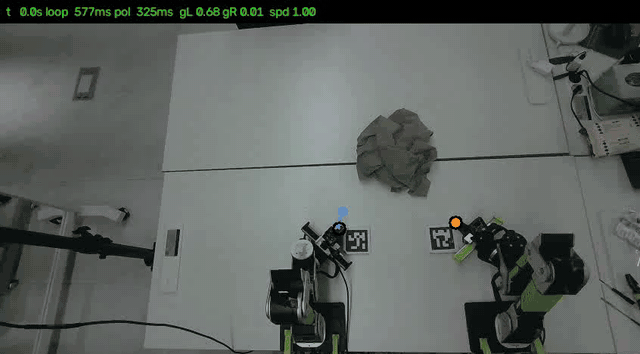
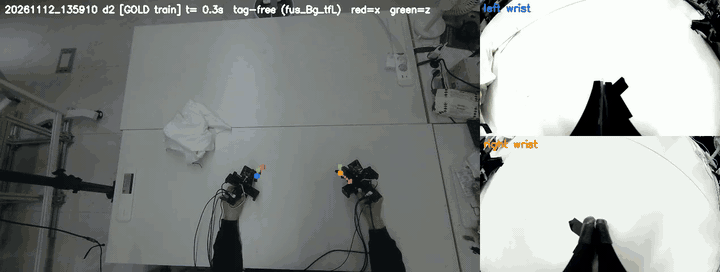
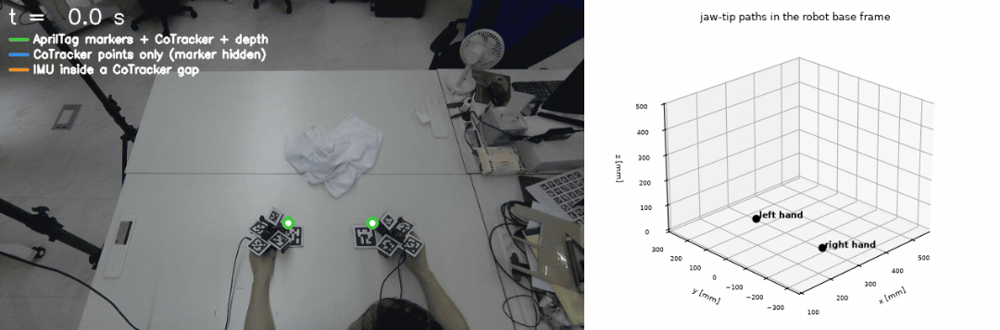
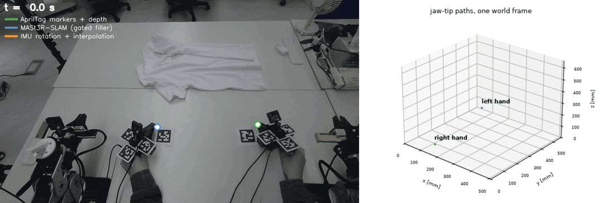
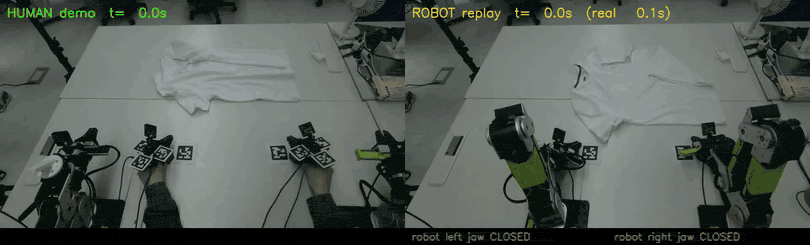
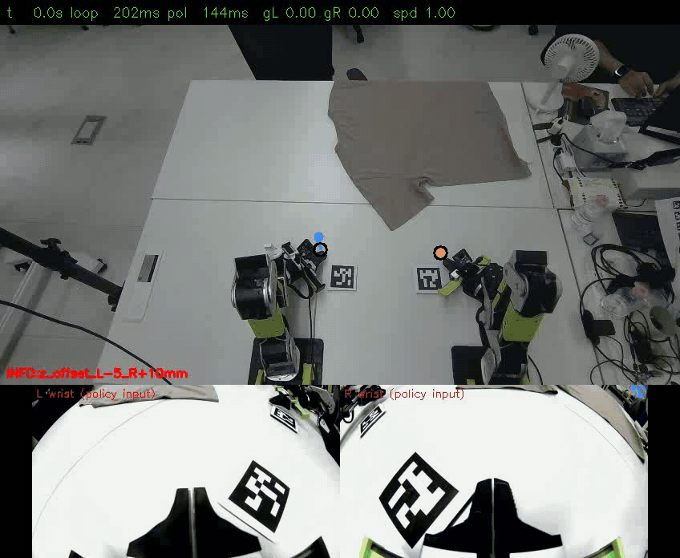
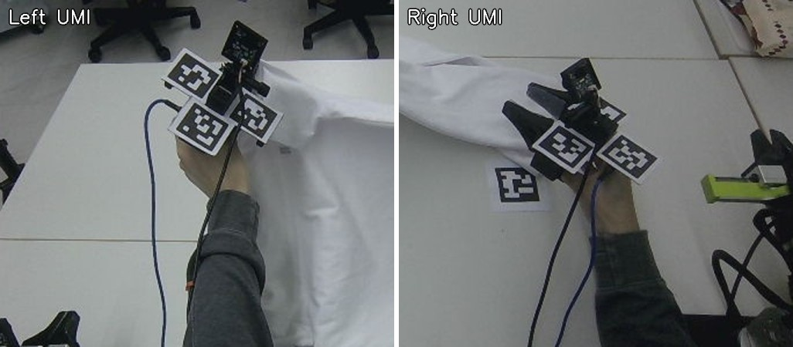

# 양손 옷 다루기를 위한 egocentric 사람 시연

손에 끼는 평행 집게(HandUMI)로 녹화한 사람의 티셔츠 시연을 양팔 로봇(**reBot B601-DM**)의 베이스 좌표에서 로봇이 할 수 있는
집게 끝 궤적과 학습 라벨로 변환합니다. 먼저 데이터 전체를 끝까지 시험하기 위해 open-loop로 재생하고, 그다음 티셔츠 펴기·접기
정책 학습에 씁니다. 로봇 데이터 수집이 로봇 수가 아니라 사람 수에 따라 늘어나게 하려는 것입니다.

**[physical-ai-robot-learning](https://github.com/physical-ai-robot-learning)**의 Physical AI / 로봇 학습 프로젝트 중 하나입니다.

[](LICENSE)
· **[테크니컬 리포트 (PDF, 영문 11-18)](report/report_en.pdf)** ([한국어 11-02](report/report_ko.pdf)) · [이전 버전](report/archive/)
· [자세한 결과](docs/results.md) · [프로젝트 이력](docs/history_ko.md) · [파이프라인](docs/pipeline_ko.md)
· [English README](README.md) · [출처](ATTRIBUTION.md) · [코드 공개](#코드-공개) · 기준일: 2026-11-18


*사람 시연(왼쪽) vs 변환한 궤적의 로봇 재생(오른쪽). 같은 고정 카메라, 하나의 시계로 맞췄고 사람 속도로 보여 줍니다. 막대는
로봇 집게 명령입니다.*

## 현재 상태 (2026년 11월 16일)

> **되는 것과 측정 방법**
> * **재생 (10-08 → 10-22).** 33초 데모 하나의 양팔 재생은 결정적이고(실행 사이 약 1 mm), 집게가 사람과 같은 높이·시점에
>   닫힙니다. 천을 집어 끌지만 재생으로 접기는 **성공하지 못합니다**. 고정 카메라, 줄자, 로봇 엔코더로 측정했습니다([결과](docs/results.md)).
> * **학습 데이터 (10-26/27).** 펴기 성공 시연 300개를 등급을 매긴 IK 이전 Cartesian 학습 라벨로 바꿨습니다. 위치는 손목 SLAM이
>   아니라 마커를 기준점으로 쓰는 고정 카메라 점 추적에서 얻습니다.
> * **로봇에서 돌린 첫 정책 (10-28 → 11-01).** GOLD 데모 281개로 파인튜닝한 DiT·X-VLA가 천 쪽으로 가지만 닿기 전에 멈추고 집게를
>   일찍 닫습니다. 기록된 원인과 그 뒤 데이터 수정:
>   [이력](docs/history_ko.md#로봇에서-돌린-첫-정책과-데이터에서-드러난-것-10-28--11-01).
> * **핀칭 (11월 2일).** 범위를 줄인 시험(왼손으로 소매 하나 집기)에서 핀칭 시연 197개로 파인튜닝한 DiT(50 에포크 checkpoint)가
>   소매를 집어 당겼습니다. 11월 2일 실제 로봇 시행에서 집기 성공을 관찰했고, **시행 횟수는 세지 않았습니다**. 놓친 뒤에는 다시
>   시도하지 않고 다른 곳을 잡습니다(데이터에 복구 시연이 없음).
> * **핀칭 뒤의 펴기 (11-02 → 11-05).** FLAT149(UMI 천 접기 레시피), 그리고 11월 3일 방향을 바꾼 카메라 아래의 FLAT250(train
>   시연 250개, 시연 안의 추적 gap으로 split): 13 에포크까지 held-out 점수 72 → 52 mm. 집게 서보에는 부하 신호가 없어서, 닫힌
>   집게가 천을 잡았는지를 손목 카메라 분류기가 프레임마다 추정합니다(p_grasp, 11월 3–5일). 이 정책들의 시행 횟수를 센 로봇 시험은
>   아직 없습니다.
> * **p_grasp를 넣은 펴기, 로봇에서 (11-05 → 11-07).** FLAT-PGRASP: FLAT250 레시피를 11월 3–5일 데이터(train 301 / val 46 /
>   test 45 시연)에 쓰고, 상태의 집게 칸에 p_grasp를 넣었습니다. 0.3배로 늘린 데이터에서 held-out 점수는 46.04 / 46.61 mm(val /
>   test, 53 에포크). 로봇에서는(11월 6일) 0.3배 정책이 같은 레시피의 1.0배보다 나아 보였고, 11월 7일에는 두 집게가 셔츠
>   가장자리를 잡아 두 팔 사이로 폈습니다([아래 중간 보고](#최근-로봇-실행-중간-보고-11월-7일)). 셔츠를 평평하게 내려놓는 데까지는
>   아직 못 갑니다. 로봇에서 p_grasp는 손목 카메라가 아니라 집게 상태에서 얻습니다. 사람 데이터로 학습한 분류기가 로봇의 닫힌 빈
>   집게를 '잡음'으로 보기 때문입니다. 로봇 시행 횟수는 세지 않았습니다.
> * **로봇의 지연 (11-06).** 로봇 집게가 늦게 닫혔습니다. 명령→동작 지연을 재 보니 팔 58–64 ms, 집게 171–173 ms였고, UMI처럼
>   이 지연만큼 명령을 앞당겨 보내고 상태는 영상을 찍은 시각 기준으로 잡습니다.
> * **두 번째 정책 계열: 같은 데이터로 X-VLA (11-10 →).** 우리 SoftFold X-VLA 체크포인트(650k)에서 새 domain id로 파인튜닝했고, train 시연은
>   398개에서 416개로 늘었습니다(마커 없이 찍은 날 포함). DiT와 같은 held-out 앵커에서 16행 뒤 집게 끝 오차가 첫 학습에서는
>   49.0 / 48.8 mm(val / test, 학습률이 거의 0이 된 뒤 멈춤)였고, 데이터를 늘려 스케줄을 다시 시작하자 **36.7 / 36.3 mm**가
>   됐습니다. DiT는 38.5 / 36.8 mm, 가만히 있기는 54.6 / 54.9 mm입니다. 32행 뒤는 64.9 / 65.6 대 72.6 / 68.3 mm입니다(11-16).
> * **오프라인 오차가 로봇 결과를 예측하지 못함 (11-16 → 11-18).** 오프라인 최고 X-VLA 체크포인트는 로봇에서 사람 동작을 하지
>   않았습니다(왼팔이 사람 오른손의 여는 동작을 함). 왼·오른 손목 영상을 바꿔 넣어도 예측이 0–1 mm만 바뀌고, 회색으로 지우면
>   18–62 mm 바뀝니다. 손목 영상을 쓰지만 어느 팔 것인지 구분하지 못합니다. DiT는 같은 시험에서 80–109 mm 바뀝니다. 이어서
>   일부러 실패하고 복구하는 시연 50개를 찍고 전체 데이터를 0.5배로 다시 만들어(train 537개), **손목 중심 flow 정책**(손목
>   카메라마다 자기 팔에 묶음, 고정 카메라는 게이트를 거쳐 학습 샘플 절반에서 뺌, 학습 때만 쓰는 보조 헤드가 앞으로의 손목 영상
>   특징을 예측)을 학습했습니다. 32행 오차 52.4 / 52.0 mm(val / test), 가만히 있기 83.1 / 81.7 mm. 로봇에서는(11-18, 횟수 세지
>   않음) 집게가 천을 잡았지만, 창밖 빛이 줄면서 손이 뒤로 밀렸고(손목 영상 밝기 −37 %, 실행마다 이득을 고정하자 오프라인에서
>   해결), 오른쪽 집게는 거의 열리지 않았습니다. 정책이 집게 상태를 손목 영상에서 읽는데 로봇 집게가 닫혀 보이기 때문입니다.
>   [상태 노트 11-18](docs/status_2026-11-18.md)(영문).
> * **마커 없는 수집 (11-11 →).** 정책은 상대 동작으로 움직이므로 라벨에 필요한 것은 마커의 절대 위치가 아니라 시작 자세와
>   방향입니다. AprilTag를 모두 뗐습니다(손 장치, 테이블 시작 태그). 시연은 검은 L 테이프에서 시작하고, 위치
>   체인은 시작 시드를 depth에서, 방향을 정지 때의 IMU에서 얻습니다. 태그가 있는 take를 태그 없이 처리해 태그와 비교하면 집게 끝
>   오차가 왼쪽 17 mm, 오른쪽 9–14 mm입니다. 마커 없이 찍은 train 시연: 11-11 43개, 11-12 52개, 11-13 18개.
>
> **보여 주지 않는 것:** 성공률 없음(재생이든 어떤 정책이든 로봇 시행 횟수를 세지 않았음), 장치 하나·시연자 한 명, 펴기는 아직
> 끝까지 못 하고 접기는 못 함. 자세한 내용: 상태 노트 [11-12](docs/status_2026-11-12.md)(11-06 → 11-12), [11-16](docs/status_2026-11-16.md)(X-VLA, 11-13 데이터), [11-18](docs/status_2026-11-18.md)(11-16–18 로봇 실행, 손목 중심 정책)(영문).

### 최근 로봇 실행 (중간 보고, 11월 7일)



*0.3배 FLAT-PGRASP(77 에포크 checkpoint)를 로봇에서 돌린 run 165051, 고정 카메라, 처음 97초, 제어 주기(약 1.3초)마다 한
프레임, 약 6배속. 구겨진 셔츠에서 시작해 약 25초 안에 두 집게가 가장자리를 하나씩 잡고 두 팔 사이로 셔츠를 펴서 그 상태를
유지합니다. 더 지나면 셔츠가 다시 뭉칩니다. 결과가 아니라 진행 상황을 알리는 중간 보고입니다. 이날 돌린 27번 중 가장 잘 된 것을
골랐고, **시행 횟수를 세거나 채점하지 않았으므로** 정책이 할 수 있는 동작을 보여 줄 뿐, 얼마나 자주 되는지는 보여 주지 않습니다.
자세한 내용: [상태 노트](docs/status_2026-11-07.md)(영문).*

### 태그 없는 변환 (11월 12일)



*AprilTag를 모두 뗀 뒤 녹화한 펴기 시연(take 20261112_135910, demo 2, GOLD, train)을 태그 없는 체인으로 변환한 결과. 왼쪽:
고정 카메라 위에 집게 끝 자세(파랑 = 왼쪽, 주황 = 오른쪽; 빨강 = x, 초록 = z 축, 5 cm)와 최근 궤적. 오른쪽: 손목 카메라 두 대.
시작 자세는 검은 L 테이프와 정지한 장치의 depth에서, 방향은 정지 때의 IMU에서 얻습니다. 약 2배속. [MP4](media/tagfree_20261112_135910_d02.mp4) ·
[상태 노트](docs/status_2026-11-12.md) §4(영문).*

**연구 질문.** *로봇이 변환된 사람 동작을 open-loop로 그대로 재생하면, 사람이 한 일을 하는가?* 재생은 모든 단계(캘리브레이션,
위치, 집게 상태, 로봇화, IK, 시간, 제어)를 한꺼번에 거치고, 사람·로봇 명령·측정한 로봇 동작을 하나의 시계와 하나의 좌표에 두어
오차가 어느 단계에서 생겼는지 가를 수 있게 하며, 실패가 눈에 보입니다. 같은 변환 데이터가 그다음 정책 학습 라벨이 됩니다.
동기와 부수 질문: [이력](docs/history_ko.md#동기와-연구-질문).

## 이 저장소에 있는 것

이 공개판에는 프로젝트의 문서, 테크니컬 리포트, 미디어만 있습니다. 소스 코드는 여기 공개하지 않습니다([코드 공개](#코드-공개) 참고).

| 경로 | 내용 |
|---|---|
| `README.md`, `README_ko.md` | 상태, 파이프라인, 결과, 결정 기록, 하드웨어와 출처 |
| [`report/`](report/README.md) | 테크니컬 리포트(영문 11월 16일, 한국어 11월 2일)와 이전 버전, PDF |
| [`docs/`](docs/) | [파이프라인](docs/pipeline_ko.md), [이력](docs/history_ko.md), [세부 내용](docs/details_ko.md), [결과](docs/results.md)(영어), [출처 이력](docs/provenance.md), 상태 노트 [11-05](docs/status_2026-11-05.md) / [11-07](docs/status_2026-11-07.md) / [11-12](docs/status_2026-11-12.md) / [11-16](docs/status_2026-11-16.md) / [11-18](docs/status_2026-11-18.md)(영문) |
| [`media/`](media/README.md) | 실제 장치, 변환한 데이터, 로봇의 GIF·영상·사진 |
| [`hardware/umihand/`](hardware/umihand/README.md) | HandUMI 빌드 사본(BrikHMP18의 설계, Apache-2.0)과 우리가 고친 부품 |

## 코드 공개

소스 코드는 공개하지 않습니다. 연구 목적의 접근은 합리적인 요청이 있으면 검토할 수 있습니다(이 저장소에 issue를 열어 주세요). 코드에는 녹화기와 캘리브레이션, 위치 파이프라인(고정 카메라 점
추적, 마커, IMU, 태그 없는 모드), 서보 인코더 집게 라벨, 잡음 확률 라벨러, 라벨·데이터셋 빌더, DiT·X-VLA 학습, receding-horizon
로봇 deploy, characterization 테스트, 테크니컬 리포트의 모든 숫자를 출처 기록과 대조하는 스크립트(11월 18일 기준 282개 확인, 실패
0)가 들어 있습니다. 이 README와 문서에 나오는 코드 경로는 그 코드를 가리킵니다.

실제 시스템의 숫자는 공개하지 않은 녹화 데이터(원본 take, 데이터셋, 학습한 체크포인트)에서 나왔습니다. reBot 제조사 플러그인과
URDF, 로봇 PC 드라이버는 제3자 것이라 어느 판에도 넣지 않았습니다.

## 파이프라인

모든 것을 하나의 호스트 시계로, 로봇 베이스 좌표에서 표현합니다. 고정 카메라를 로봇에 캘리브레이션하고, 매 테이크는 로봇 좌표를
한 번 측정해 둔 시작점 마커 두 장(ID 400 / 401)에 집게를 두고 시작했습니다(11월 11일부터는 마커 없이 검은 L 테이프와 IMU 방향).
자세한 내용과 재생 트랙: [docs/pipeline_ko.md](docs/pipeline_ko.md).

| 단계 | 하는 일 |
|---|---|
| 0 · 캘리브레이션 | 카메라 ↔ 로봇(카메라를 옮길 때마다 다시), 마커 리그 → 집게 끝 |
| 1 · 녹화 | 고정 RGB-D 카메라, 손목 카메라 2대, 손목 IMU, 집게 서보를 하나의 호스트 시계로 |
| 2 · 위치 시드 + 집게 상태 | 집게마다 마커 자세, 인코더로 쓰는 서보에서 집게 열림 |
| 3 · 점 추적 + 융합 | 고정 카메라의 CoTracker3 점을 마커(마커가 없으면 시작 자세와 IMU 방향)에 고정, IMU는 끊긴 구간에서만 |
| 4 · 트림 + 품질 등급 | 처음·끝 정지 구간 자르기, 추적 끊김으로 시연마다 GOLD / SILVER / REJECT |
| 5 · 라벨 + 데이터셋 | IK 전 데카르트 집게 끝 라벨, IK 가능 여부 진단, LeRobot 데이터셋, 0.3배 시간 늘이기 |
| 5b · 잡음 라벨 | 손목 카메라로 잡음 / 빈 집게 라벨 → 프레임마다 인과적 잡음 확률(p_grasp) |
| 6 · 학습 | 추적이 끊긴 구간을 loss mask로 가린 DiT(UMI 옷 레시피)와 X-VLA 파인튜닝 |
| 7 · deploy + 평가 | 로봇에서 receding-horizon 실행(먼저 DRY, 지연 맞추기), held-out 시연으로 오프라인 평가 |
| 재생 트랙 (10-08 → 10-22) | 로봇화한 사람 궤적을 open loop로 재생해 같은 시계에서 사람과 비교 |

### 3단계와 리플레이 결과 보기

**점 추적(CoTracker)으로 얻은 팔 궤적.** GOLD 펴기 시연 하나(10월 26일). 집게 끝 궤적은 자세를 어디서 얻었는지에
따라 색이 다르다: 초록 = AprilTag 마커 + CoTracker 점 + 깊이, 파랑 = 마커가 가려진 동안 CoTracker 점만, 주황 =
CoTracker 공백 구간의 IMU 회전. 왼쪽은 고정 카메라, 오른쪽은 같은 궤적을 로봇 base 좌표계에 그린 것이다.



**MASt3R-SLAM으로 공백을 채운 팔 궤적 (리플레이 시기).** 두 손의 집게 끝 궤적을 하나의 world 좌표계에 그렸다:
초록 = AprilTag 마커 + 깊이, 파랑 = 손목 어안 카메라의 MASt3R-SLAM(게이트를 통과한 구간만 채움), 주황 = IMU 회전 +
보간. 왼쪽은 고정 카메라, 오른쪽은 3D 궤적.



**사람 시연의 로봇 리플레이.** 사람 시연(왼쪽)을 변환한 양팔 궤적을 reBot 팔에서 실행한 장면(오른쪽), run 200335,
같은 고정 카메라, 하나의 시계, 로봇 속도(0.35배)로 재생. 로봇이 시연 동작을 따라가고 집게가 셔츠 가장자리를 잡아
끈다. 리플레이만으로 접기까지 되지는 않았다([이력](docs/history_ko.md#개요-11월-2일-기준)).



## 결과

2026년 10월과 11월, 장치 하나와 시연자 한 명으로 측정했습니다. 전체 표와 지표 정의: [docs/results.md](docs/results.md)(영어)와
[테크니컬 리포트](report/report_ko.pdf). 11-05·11-07 숫자: 상태 노트 [11-05](docs/status_2026-11-05.md), [11-07](docs/status_2026-11-07.md)(영문). 리포트 뒤: [11-12](docs/status_2026-11-12.md), [11-16](docs/status_2026-11-16.md), [11-18](docs/status_2026-11-18.md).

| 단계 | 결과 |
|---|---|
| 캘리브레이션 | 카메라 ↔ 로봇 검증 재투영 0.98 px(옆 방향 약 1.3 mm), UMI 마커 리그 → 집게 끝 정지 1–4 mm(leave-one-out 1.8–4.8 mm) |
| 단일 팔 재현 | 이동 스트로크 16/18 통과, 축별 RMSE 중앙값 5.5–11.6 mm, 회전 스트로크 통과(오차 중앙값 0.3–1.6°), 명령 vs 사람 ≤ 3.4 mm이므로 남은 오차는 로봇 추종 |
| 사람 데이터로 첫 천 집기 | 오른팔이 시연의 집기 구간을 재생해 티셔츠를 집어 들어 올림 |
| 33초 데모의 양팔 전체 재생 (0.35배속, 94초) | 같은 계획으로 4회 실행의 반복 오차 약 1 mm, 집는 순간 명령 대비 2–8 mm(xy) |
| 사람 대비 오차 | 데모 전체 위치 RMSE: 재생한(로봇화된) 사람 궤적 대비 약 17 mm(오른팔) / 30 mm(왼팔), 원래 사람 궤적 대비 약 22 / 32–34 mm |
| 집는 높이 | 손가락 접촉을 허용한 뒤 집게가 테이블 위 14–16 mm(오른팔), 5–19 mm(왼팔)에서 닫힘(사람 약 10 mm), 명령 위치 대비 2–8 mm |
| 사람처럼 접기 | **아직 못 함.** 가장 좋은 실행에서 집게가 셔츠 가장자리를 잡아 끌었음. 성공률은 보고하지 않음 |
| 손목 카메라 SLAM을 위치 소스로 | **기각.** MASt3R-SLAM은 19–48 % 프레임만 유지(집는 순간 주변 0–38 %), ORB-SLAM3 mono-inertial은 스케일 발산 |
| CoTracker 점 추적 + 마커 + IMU (10-24/25) | held-out take에서 가린 마커 오차 중앙값 16 mm(왼) / 19 mm(오른), 마커만 쓰면 약 42 mm |
| 펴기 데이터셋 (10-26/27) | 성공 300 / 녹화 318, 앞 139개 등급 GOLD 133 / SILVER 5 / REJECT 1 |
| IK 이전 vs 이후 라벨 (10-26) | 앞 139개 시연(팔-프레임 약 123k): 집는 순간 IK → FK가 목표를 p95 약 58 mm(전체 53 mm) 옮김. IK 보정이 큰 프레임 20.3 %, 도달 불가능 0.8 % |
| 라벨의 테이블 여유 (10-29) | 라벨 프레임 44 %를 중앙값 27 mm(최대 65) 들어 올림 → 제거, 라벨 F = fusion 사람 집게 끝(집게 축, 0.25초 smoothing), 들어올림·clamp 없음 |
| 시연 속도 (10-29) | 사람 집게 끝 p95 0.93 m/s, 127 °/s — 로봇에 너무 빠름 → 0.3배속으로 늘린 데이터셋 |
| 손목 카메라 위치 (10-29) | 로봇 손목 카메라가 UMI보다 공구 축 쪽으로 11–13° 덜 기울고 25–44 mm 더 가까움 (테이블 태그 PnP) |
| 정책, 10-27 기준 | 아직 우리 데이터로 학습하지 않음. pretrain만 한 diffusion 정책(Soft-Fold pretrain DiT)이 로봇 dry run에서 안전 위반 없이 돎 |
| 로봇에서 돌린 정책 (10-28 →) | GOLD 데모 281개로 파인튜닝한 DiT·X-VLA를 시행 횟수를 세지 않은 로봇 시도에서 관찰: 천 쪽으로 가다가 닿기 전에 멈추고 일찍 닫음 — **성공률 없음** |
| 왼손 소매 하나 핀칭 (11-02) | 핀칭 시연 197개로 파인튜닝한 DiT(50 에포크 checkpoint): 11월 2일 실제 로봇 시행에서 집기 성공 관찰. 시행 횟수는 세지 않음 — **성공률 없음**. 놓친 뒤에는 다시 시도하지 않고 다른 곳을 잡음 |
| 펴기, FLAT250 (11-04/05) | val / test `val_score_mm` 71.67 / 72.27(시작) → **52.56 / 52.32**(13 에포크, 최고). 센 로봇 결과 없음 |
| 잡음 / 빈손 (11-05) | 손목 카메라 분류기, take 단위 5-fold CV, 이벤트별 F1 잡음 0.90, 빈손 0.78 |
| 펴기, FLAT-PGRASP 0.3배 (11-05 → 11-07) | train 301 / val 46 / test 45 시연; val / test `val_score_mm` 75.88 / 76.08(1 에포크) → **46.04 / 46.61**(53 에포크, 최고); held-out 셋이 달라 FLAT250과 비교할 수 없음 |
| 배포 지연 (11-06) | 측정한 명령→동작 지연: 팔 58 / 64 ms, 집게 173 / 171 ms(왼쪽 / 오른쪽). 카메라: 고정 1.4 ms, 손목 38 / 61 ms — 배포에서 맞춤 |
| 펴기 데이터로 X-VLA (11-10 →) | 우리 SoftFold 체크포인트(650k), domain 22, train 시연 416개: 같은 앵커에서 16행 뒤 집게 끝 오차 36.7 / 36.3 mm(val / test), DiT 38.5 / 36.8 mm, 가만히 있기 54.6 / 54.9 mm(11-16). 로봇에서는(11-16, 횟수 세지 않음) 팔이 엉뚱하게 움직임: 좌우 손목 영상 교환에 출력 변화 0–1 mm |
| 손목 중심 flow 정책 (11-17 →) | 0.5배 데이터, train 537개(복구 포함 177), val 42 / test 43: 32행 집게 끝 오차 52.4 / 52.0 mm, 가만히 있기 83.1 / 81.7 mm. 로봇에서는(11-18, 횟수 세지 않음) 천을 잡지만 손목 카메라 조명 때문에 뒤로 밀리고 오른쪽 집게가 거의 안 열림 — **성공률 없음** |
| 태그 없는 위치 (11-11/12) | 태그 있는 take를 태그 없이 처리해 태그 측정과 비교: 집게 끝 오차 왼쪽 17 mm, 오른쪽 9–14 mm. 11-12 카메라 재조준은 depth 장면 ICP로 보정(`robot_cam_v007`, 보정 안 하면 6–27 mm) |
| 로봇에서 펴기 (11-06/07) | 로봇에서 0.3배가 1.0배보다 나아 보임(11월 6일). 11월 7일 두 집게가 셔츠 가장자리를 잡아 폈다가 다시 뭉침, 평평하게 내려놓지는 못함. 27번, 횟수를 세거나 채점하지 않음 — **성공률 없음** |



*2026년 11월 2일 11:37 실제 로봇 핀칭 실행(운영자가 성공으로 판단한 두 실행 중 하나, 시행 횟수는 세지 않음). 위: 고정 카메라와
정책의 다음 집게 목표, 아래: 두 손목 카메라 입력. 실제 시간의 약 2.8배 속도. 더 보기:
[이력](docs/history_ko.md#핀칭-10-30--11-02-로봇에서-첫-집기-성공-관찰-시행-횟수-세지-않음).*

**한계.** 성공률 없음: 재생은 측정과 영상으로 판단했고, 11월 2일 핀칭 집기를 포함한 정책 실행은 시행 횟수를 세지 않은 시행에서의
관찰입니다. 시연 하나만 양팔로 전체 재생했고, 약 1 mm 반복성은 결정성을 보여 줄 뿐 일반화는 아닙니다. 재생은 open loop입니다(천이
사람 시연 때와 같은 곳에서 시작해야 함). 상대 비교 지표는 상수 오프셋을 숨기므로 절대 위치는 줄자와 영상으로 확인했습니다. 전체
목록: [이력](docs/history_ko.md#한계).

## 바꾼 것과 이유 (짧은 결정 기록)

| 날짜 | 찾은 것 | 바꾼 것 |
|---|---|---|
| 10-21/23 | 손목 카메라 SLAM(MASt3R, ORB-SLAM3)이 하필 집는 순간 추적을 놓침 | 고정 카메라의 absolute 마커 + 깊이, 이어서 고정 카메라 점 추적이 위치 소스 |
| 10-24 | 마커가 절대 오차를 줄임. IMU 가속도를 넣으면 오히려 나빠짐 | fusion 변형 Cg: CoTracker + 마커, IMU 가속도는 끊긴 구간 안에서만 |
| 10-26 | IK → FK 라벨은 집는 순간 목표를 가장 많이 옮김 | 라벨은 IK 이전 Cartesian 포즈. IK는 오프라인에서는 검사기, 온라인에서는 실행기 |
| 10-29 | 테이블 여유 단계가 라벨 프레임 44 %를 들어 올림 | 라벨 F: fusion 사람 집게 끝, clamp·들어올림 없음. 제한은 deploy의 몫 |
| 10-29 | 사람 시연이 팔이 따라가기에 너무 빠름 | 시간을 늘인 데이터셋 복사본 |
| 10-29 | 영상 집게 라벨이 실제 집게와 다름 | UMI에 집게 서보를 토크 끈 엔코더로 다시 닮(`laundry_jaw.from_motor`) |
| 10-30 | 정책이 관측의 집게 상태를 그대로 따라 함 | 학습과 deploy에서 집게 상태를 가림(`GRIP_STATE_MASK=1`) |
| 11-04 | 시연 안의 점 추적 gap | trim 구간 안 가장 긴 gap으로 split, gated loss mask |
| 11-05 | 닫힌 집게만으로는 천을 잡았는지 모름 | 손목 카메라 잡음 라벨 → 상태의 집게 칸에 p_grasp(`PGRASP`) |
| 11-06 | 사람 데이터로 학습한 잡음 분류기가 로봇의 닫힌 빈 집게를 '잡음'으로 봄(0.97 / 0.94) | 로봇에서는 p_grasp = 집게 상태(닫힘 → 1), 로봇용 분류기가 생길 때까지 |
| 11-06 | 로봇에서 0.3배 정책이 1.0배보다 나아 보임(횟수 안 셈) | 펴기는 0.3배로 늘린 데이터 유지 |
| 11-06 | 로봇 집게가 늦게 닫힘(집게가 팔보다 약 110 ms 느림) | 배포에 UMI식 지연 맞추기 |
| 11-07 | IK가 관절 한계에 걸리면 팔이 비틀린 가장 가까운 자세로 감 | 그 팔은 마지막 관절값 유지 |
| 11-10 | 같은 데이터로 두 번째 정책 계열 | 우리 SoftFold 체크포인트의 X-VLA, 이어서 매일 데이터를 더하는 continual 학습 |
| 11-11 | 상대 action과 task-anchor 상태는 마커의 절대 위치가 필요 없음 | 태그 전부 제거. L 테이프 시작 표시, 정지 때의 IMU 방향, depth로 시작 시드 |
| 11-13 | 예전 take별 변환 때문에 11-12 validation 세트에 train 시연이 섞임 | 세트를 다시 만들고 X-VLA 학습을 다시 시작. p_grasp는 상태의 별도 칸으로 |
| 11-15 | 학습률이 거의 0이 되자 X-VLA가 49–50 mm에서 멈춤 | 데이터를 늘려 스케줄을 다시 시작: 36.7 mm |

그 전의 결정(로봇 모델 보정, 제어기 모델, 자르지 않고 연속 변형)과 이유: [이력](docs/history_ko.md#어려웠던-점과-바꾼-것).
재생에서 펴기까지 날짜순 설명: [docs/history_ko.md](docs/history_ko.md).

## 하드웨어와 출처

> **HandUMI는 우리 설계가 아닙니다.** BrikHMP18(murobotics-ai)이 설계·공개했습니다(Apache-2.0):
> [murobotics-ai/handumi-hw](https://github.com/murobotics-ai/handumi-hw). [`hardware/umihand/`](hardware/umihand/README.md)는
> 원본 파일의 우리 제작 사본과 우리 변경분입니다.



*손에 끼는 집게 두 개(왼쪽 / 오른쪽), 각각 fiducial 마커 3장(10-21 사진, 10-23 이전. 그 뒤로 손목 카메라 뒷면에 더 작은 30 mm
마커가 하나씩 더 있습니다).*

원본 부품을 출력·조립하고 우리 용도에 맞게 조금 바꿨습니다. VR 추적 대신 손목 IMU, 손마다 서로 다른 면에 AprilTag 여러 장(적어도
한 장은 외부 카메라를 향하도록, 10-23부터 손목 카메라 뒷면에 더 작은 네 번째 태그, 그 태그 하나의 평면 포즈 뒤집힘은 IMU로 해결),
controller-support 연결부·카메라 마운트·서보 커버 수정(`hardware/umihand/mods/`), 그리고 10-13부터 10-28까지 집게 서보 제거(집게
상태는 손목 영상으로 추정). 10-29에 서보를 집게 열림을 기록하는 토크 끈 엔코더로 다시 달았습니다(Feetech STS3215,
[파이프라인](docs/pipeline_ko.md#위치-복원과-검증-24단계) 5번). HandUMI 자체는 Universal Manipulation Interface(UMI, Chi et al.,
RSS 2024)를 따릅니다. [ATTRIBUTION.md](ATTRIBUTION.md) 참고.

로봇은 reBot B601-DM(평행 집게가 달린 6축 팔 두 대, 우리 MIT 브리지로 구동)이고, 제조사 LeRobot 플러그인과 URDF는 포함하지
않았습니다. 고정 카메라는 테이블 위(113 cm)의 Orbbec Gemini 336 RGB-D입니다. 전체 장치 목록: [파이프라인](docs/pipeline_ko.md#시스템-한눈에-보기).
이전 작업: [egocentric-cube-stacking](https://github.com/physical-ai-robot-learning/egocentric-cube-stacking), 관련 연구:
[이력](docs/history_ko.md#이전-작업과-관련-연구).

## 라이선스 · 감사의 말 · 인용

**라이선스.** 제품이 아니라 진행 중인 연구 프로젝트입니다. 숫자는 장치 하나, 시연자 한 명, 적은 실행 횟수에서 나왔고, 실패를
포함해 측정한 그대로 보고합니다. 이 저장소의 문서, 리포트, 미디어는 **PolyForm Noncommercial License 1.0.0**([LICENSE](LICENSE))을
따릅니다. 연구, 교육, 개인 및 기타 비상업적 용도로는 자유롭게 쓸 수 있고, **상업적 사용은** 저자와 별도의 서면 합의 없이는
**허용되지 않습니다**. 예외: `hardware/umihand/`는 원본 HandUMI의 Apache-2.0 라이선스를 그대로 따릅니다
([LICENSE](hardware/umihand/LICENSE), [NOTICE](hardware/umihand/NOTICE.md)). 제3자의 설계와 방법은 각자의 라이선스를 따릅니다
([ATTRIBUTION.md](ATTRIBUTION.md)).

**감사의 말.** 손에 끼는 집게는 BrikHMP18의 HandUMI([murobotics-ai/handumi-hw](https://github.com/murobotics-ai/handumi-hw),
Apache-2.0)이고 UMI(Chi et al., RSS 2024)를 따릅니다. [하드웨어와 출처](#하드웨어와-출처)와 [ATTRIBUTION.md](ATTRIBUTION.md) 참고.
학습 계획에 적힌 pretrain 데이터: Soft-Fold, iPhUMI(MIT), PrimeBot UMI(CC BY-SA 4.0).

**출처 이력.** 2026-11-01까지 전체 코드와 세부 문서는 별도 작업 저장소 `egocentric-laundry-folding`에 있었고, 이 저장소는 공개용
정리본이었습니다. 두 저장소를 여기로 합쳤습니다. 11월 5일 코드를 지금 구조로 정리했습니다. 11월 16일 이 공개판을 문서, 테크니컬 리포트, 미디어만
남기도록 줄였고, 코드는 공개하지 않습니다. `report/archive/`에 보관한 테크니컬 리포트와 날짜별 상태 노트는 그 날짜의 코드 경로를
적고 있습니다.

**인용.** [CITATION.cff](CITATION.cff)를 보세요(GitHub의 "Cite this repository").

```bibtex
@misc{lee_egocentric_garment_manipulation,
  author       = {Lee, Jeong Hwan},
  title        = {Egocentric Human Demonstrations for Bimanual Garment Manipulation},
  howpublished = {\url{https://github.com/physical-ai-robot-learning/egocentric-garment-manipulation}}
}
```

**저자.** **이정환 (Jeong Hwan Lee)** — Robotics Engineer, Physical AI / Robot Learning

관심 분야: 사람 시연으로 로봇 조작 학습, egocentric·착용형 데이터 수집, embodiment를 넘는 action 표현, 양손·변형 물체 조작,
vision-language-action 모델, 로봇 학습 데이터의 캘리브레이션과 평가 방법론.

GitHub: <https://github.com/physical-ai-robot-learning>
