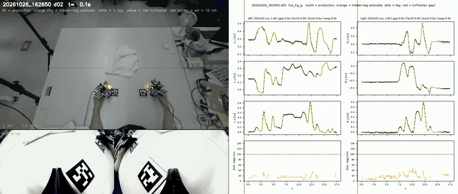
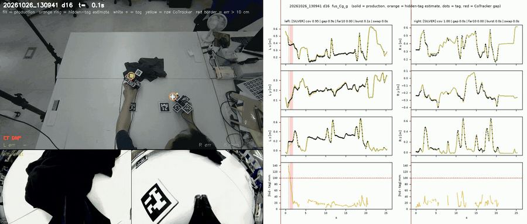
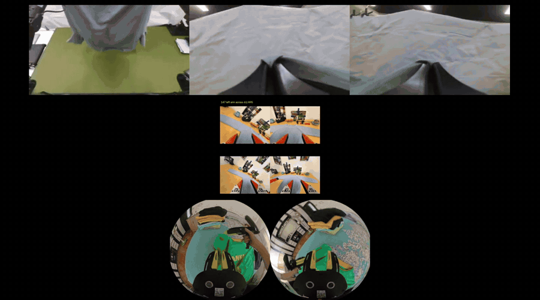
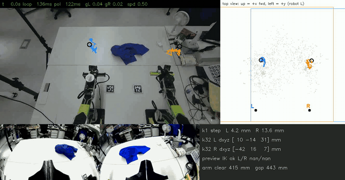
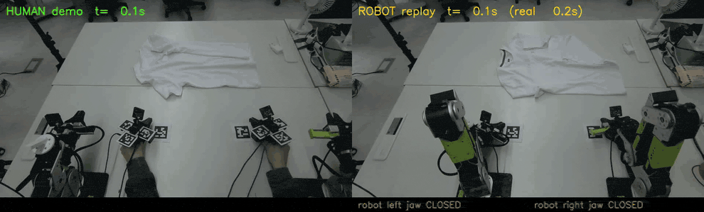

# Project details

*Long-form sections moved out of the top-level [README](../README.md) in the 11-01 layout refactor (text unchanged, only paths updated). Section numbers follow the old README so the § references inside the text still match.*

## 1. Overview

| | |
|---|---|
| **Goal** | A robot folds a T-shirt learned from human demonstrations: no teleoperation, no robot data collection |
| **Input** | A human folds the shirt wearing two HandUMI grippers with AprilTags; a fixed RGB-D camera, wrist cameras and IMUs record it |
| **Output** | Two reBot B601-DM arms: first by replaying the converted motion (done), now by running a policy trained on it |
| **Key idea** | **One world frame** (the robot base): the camera is calibrated to the robot and every take starts with the grippers at markers whose positions in robot coordinates are known. Pose from the fixed camera (**point tracking + AprilTags + depth + IMU**), not wrist SLAM. Labels are Cartesian targets before IK; IK and safety checks run online before anything moves. |
| **Where we are** | Replay: both arms replay reliably and the jaws close at the human's height and time; the robot grasps and drags the cloth but does not fold. Policy: 300 successful flattening demos recorded (10-26/27) and converted into training labels; a Soft-Fold-pretrained DiT runs safely on the robot in dry runs; fine-tuning on our GOLD demos is next. **No policy success rate yet.** |

## 3. Current pipeline: policy training data (2026-10-26 / 27)

For learning a policy (not open-loop replay) the pose source and the labels were rebuilt on top of the replay track's
calibration, recorder and robot tools. Code and the 12-stage map: [src/garment_pipeline/README.md](../src/garment_pipeline/README.md).

### 3.1 Data: 300 flattening demonstrations

**Collection.** 318 demonstrations of *flattening* a crumpled T-shirt, **300 successful** (beige 72 · black 92 · white 82 · blue 54).
Success is judged on the frame 0.5 s before each demo ends. The Orbbec was raised to 113 cm so both hands stay in view;
each camera move got its own camera ↔ robot calibration (`robot_cam_v002…v005`), re-solved from two fixed 70 mm table
tags plus the table plane (`scripts/pose/robot_cam_from_anchors.py`).

**Pose = markers + point tracking + IMU.** Markers alone drop out whenever the cloth or the other hand covers them.
1. **CoTracker3** follows 40 points on each gripper through the fixed-camera video; depth lifts them to 3-D and a rigid
   gripper model gives the position.
2. **Gates** reject bad tracking: track acceleration disagreeing with the IMU, the two hands closer than 8 cm, or tracks
   more than 10 cm from a visible marker.
3. **Fusion** (one least-squares problem per demo): point tracks + markers as anchors + a constant bias; IMU acceleration
   only inside gaps. Rotation comes from the markers and the gyro.
4. Accuracy is measured by hiding markers that were actually visible: median **16 mm (left) / 19 mm (right)** on
   held-out takes (markers alone: ≈ 42 mm).

*A GOLD demo (white shirt, take 133656 demo 4, 1.5× speed): fused jaw-tip paths, coloured by the source of each frame —
a gripper marker visible (green), CoTracker points only while the markers are hidden (blue), IMU inside a CoTracker gap
(orange). Left: projected into the fixed camera; right: both hands in the robot base frame. In this demo the left hand
had markers in 48 % of frames, CoTracker only in 49 % and IMU in 3 %; the right hand 77 / 23 / 0 %. Compare the
replay-track GIF in §4, where the blue segments were MASt3R-SLAM.*

*Per-demo QA video (GOLD, white shirt, 1.5× speed). Top left: fixed camera with the fused jaw tips (filled dots), the
estimate made with that marker hidden (orange ring), the marker itself (white +) and raw CoTracker points (yellow).
Bottom: both wrist cameras. Right: x / y / z of each hand over time and the hidden-marker error (bottom row, red line =
10 cm).*

*A SILVER demo (black shirt): the frame turns red while the hidden-marker estimate is more than 10 cm off, and "CT GAP"
marks frames where CoTracker lost the hand. These demos are kept out of fine-tuning.*

**Clean episodes.** The waiting start and the still end are cut (both hands slower than 10 cm/s, 0.3 s margin), and a
one-hand tracking gap that touches the start or end is cut instead of downgrading the demo. Each demo is graded
**GOLD / SILVER / REJECT** from coverage, gap length, large-error fraction and gaps at grasps (first 139 demos:
133 / 5 / 1). **Fine-tuning uses GOLD only.**

**Labels: Cartesian before IK.** The training target **A** is the fused jaw-tip pose in reBot gripper axes after 0.25 s
smoothing and table clearance — *before* inverse kinematics. The old label (**B**, IK → FK) baked execution choices into
the data (wrist-roll relaxation, a 180° tool flip, arm-separation pushes) and moved the target most exactly at grasps
(p95 ≈ 58 mm at grasps, 53 mm overall). B and all IK diagnostics are kept for QA; only ≈ 1–2 % of frames are truly unreachable (hands lifted
45–75 cm above the table). The policy learns relative motion `inv(T_t)·T_{t+k}`, k = 1…32 at 20 Hz; at run time the
current TCP comes from forward kinematics, the predicted motion is composed onto it and an online IK executes it.

**Compute.** Point tracking, the jaw classifier (11 s per wrist camera instead of 35 min on the laptop) and the
CPU-heavy 3-D solve run on rented RTX 5090 pods; results come back to the laptop and to an SSD archive.

### 3.2 Training plan

No policy result is reported yet. Two experiments run first, both fine-tuned on **our GOLD demos only** with label A:

| | pretrain | fine-tune | checkpoints |
|---|---|---|---|
| **Exp 1** | DiT (CLIP text, 2 obs frames, 33-step horizon) on Soft-Fold, 300k steps (done; dry-run on the robot without violations) | GOLD, 300k budget | 25k / 50k / 75k / 100k / 150k / 200k / 250k / 300k; chosen by validation and grasp-phase error, not train loss |
| **Exp 3** | X-VLA base on a 1 : 1 : 1 mix (by training windows) of Soft-Fold (domain 18), iPhUMI, all 1,572 episodes (19), PrimeBot UMI, 400 whole episodes (20) | GOLD on domain 21 (cold start) | same; a 1k-step smoke test on a 5090 checks action scale, rot6d, left/right order, gripper polarity and camera order first |

Afterwards: real-robot evaluation; the absolute-label policy and label B are later ablations.

*Pretraining sources, one episode each. Top: Soft-Fold (AgileX robot; global + two wrist cameras). Middle: iPhUMI sweater
folding (four 224 px wrist views per pair of grippers; MIT). Bottom: PrimeBot UMI (circular 960 px fisheye per hand;
CC BY-SA 4.0). None of them has a fixed global camera like ours, so that input is blank for the UMI sets; each set gets
its own X-VLA domain prompt (18 / 19 / 20, ours 21).*

### 3.3 Running a trained policy on the robot

*Dry run of a DiT checkpoint in the deploy UI (no command sent). Fixed camera with the predicted 32-step jaw-tip paths
(left blue, right orange), top view in robot coordinates, both robot wrist cameras and live checks (IK, arm clearance,
gap).*

- **Loop:** fresh images + measured joints → FK gives the current TCP → the policy predicts 32 relative steps → the newest
  TCP re-anchors the chunk (latency) → limiter (speed, table floor) → IK → safety (workspace, link-to-link capsules,
  table, joint limits) → only the first 4 steps are committed, then re-plan (≈ 7 Hz).
- **Gripper safety (10-27):** after a restart without the left-jaw opening limit, the left jaw opened to the end of its
  travel and broke the holder. Deploy now refuses GO unless the bridge limits each jaw (left ≤ 0.5 of −270°), and a
  jaw-only re-zero tool fixes a jaw that reads −43° while closed (`scripts/deploy/robot_bridge/`).

### 3.4 Decisions, 10-22 → 10-27

| date | finding | decision |
|---|---|---|
| 10-21 | The smooth old replay came from the data (marker gaps ≤ 1.3 s) plus strong replay low-pass; executed vs markers was 28–35 mm | separate smoothness from accuracy; keep 0.25 s smoothing on the label only |
| 10-22 | Gripper labels on the 10-22 takes were swapped against the wrist cameras | assign arms by the gripper's side of the table, not by its label |
| 10-23 | Wrist-camera SLAM (MASt3R) breaks at grasps; a gyro-bias check missed a 3.8°/s bias (rotation 5–10° off) | fixed-camera point tracking + markers become the pose source; SLAM only if long gaps remain |
| 10-24 | Markers fix the absolute error (42 → 12 mm); adding IMU acceleration made it worse | fusion variant Cg: CoTracker + markers, IMU acceleration only inside gaps; held-out with a strict hidden-marker leakage guard |
| 10-25 | 33 of 41 "in view" old-camera demos still had hands leaving the frame | raise the camera (96 → 105 → 113 cm) and re-record; zero edge exits at 105/113 cm |
| 10-26 | IK → FK labels bend the target at grasps (p95 ≈ 58 mm at grasps, 53 mm overall) | train on Cartesian-before-IK (A); IK is a checker offline and the executor online |
| 10-26/27 | Still frames at the start / end and short tracking gaps at the edges | tight trim (10 cm/s) + edge-gap trim; fine-tune on GOLD only |

## 4. Earlier track: open-loop replay (10-08 → 10-22)

Demonstrations converted into one robot trajectory and replayed as a whole. This track produced the calibration,
recorder, jaw model and robot safety tools reused above; its pose and label steps are replaced for training ([README, *Current vs superseded*](../README.md#8-current-vs-superseded)).

1. **Record** — both grippers start at the start markers; Orbbec RGB-D, wrist fisheyes and IMUs record on one clock.
2. **Pose** — AprilTags + depth → gripper pose → jaw tip, directly in robot coordinates.
3. **Fill gaps + jaw state** — IMU bridges frames where the markers are hidden (~~optional MASt3R-SLAM~~, moved to `legacy/` 10-27). Jaw state: a YOLO-pose model finds the two jaw tips in the wrist video; their distance gives a continuous aperture g (0 = closed, 1 = open), checked against hand labels at 100 % (left) / 98 % (right) on a re-angled take (10-22). The earlier binary ResNet classifier is kept as a fallback. **Since 10-29** the jaw state of new demos comes from the jaw servo on each UMI instead (Feetech STS3215, torque off, read ≈100 Hz on the host clock → `scripts/pose/jaw_from_motor.py`, same `umi_jaw.npz` format); on those takes the video classifier agrees with the servo on only ~70–80 % of frames. Video- and servo-derived labels are never mixed in one comparison.
4. **Robotize** — smooth warps keep each hand on its side and above the table; every frame gets a quality label.
5. **Plan + check** — joint-limit-aware IK; IK error, speed, table and arm-distance checks must pass offline.
6. **Replay + compare** — both arms execute; human, command and robot are compared on one clock and filmed by the same camera.

*Reconstructed jaw-tip paths of the replay track, coloured by source: markers + depth (green), MASt3R-SLAM (blue, no longer used), IMU while markers are hidden (orange).*

Details: [Technical Report v0.1](../report/report_v0.1_en.pdf) · code per stage: [pipeline_replay_track.md](pipeline_replay_track.md).

## 5. What we learned and replay results

**What we learned**

1. **Tags + depth beat SLAM for grasping.** Wrist-camera SLAM loses tracking exactly at grasps.
   - MASt3R kept 19–48 % of frames.
   - ORB-SLAM3 scale diverged, because hand acceleration is below the IMU bias.
2. **Measure in the real world.** The gripper-tip and arm-mount errors were invisible to checks computed from the robot model alone.
3. **Fix the conversion, don't add heuristics.** Allowing finger contact brought the jaws down to the cloth.
4. **Open-loop replay needs the same scene.** The cloth must start where the human's did.

**Replay results** (take 171057 demo 2, run 195745; left: human, right: robot; same camera, human speed). In this run the
shirt lay 15–20 cm farther away than in the demo, so the jaws closed on the empty table; in run 200335 (robot-speed GIF in [README §7](../README.md#7-results)) they
caught the shirt edge and dragged it.

## 6. Status and next steps

| open problem | next step |
|---|---|
| 17–30 mm RMSE vs the replayed human path over the demo; the error at the grasp itself is not yet measured | per-grasp xy error table: a constant bias means calibration; a varying one needs visual correction at the grasp |
| cloth position differs from the demo | placement reference before each replay |
| ~~tag-hidden grasp phases~~ | ~~offline smoother (tags + IMU + depth + gated MASt3R)~~ → solved by CoTracker + marker fusion (10-24, §3.1) |
| no policy yet | Exp 1 (DiT) and Exp 3 (X-VLA mixture) fine-tuned on GOLD (§3.2), then real-robot evaluation |
| ≈ 18–24 % of label frames need a large IK correction (wrist roll, tool flip, right j4 at its limit) | report per cause, no mask for now; check how often the online IK hits them during deploy |
| replay-track items above (grasp error, cloth placement) | parked; open-loop replay is no longer the main path |
