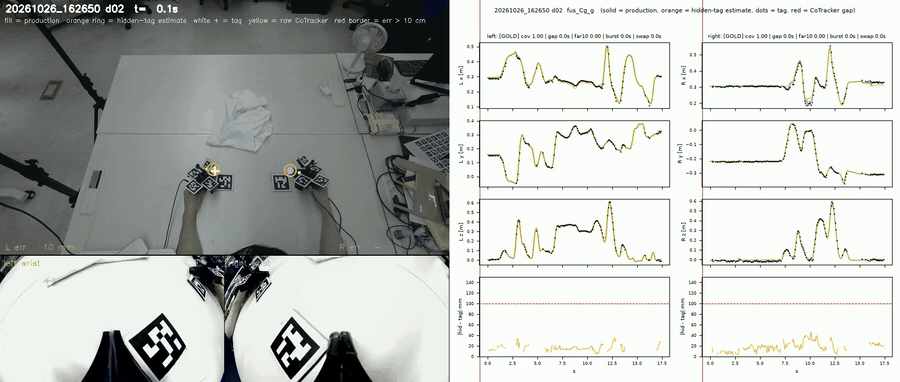
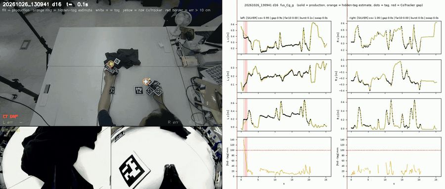
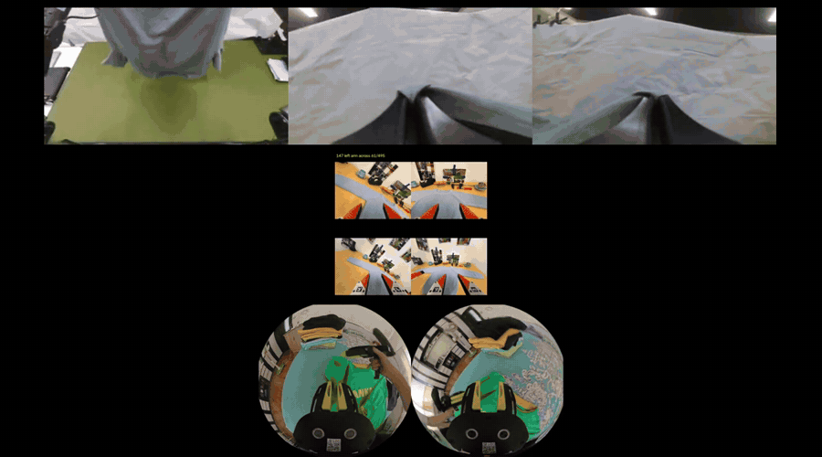
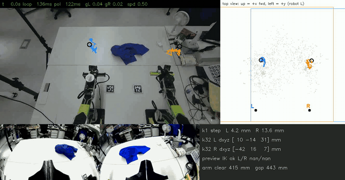
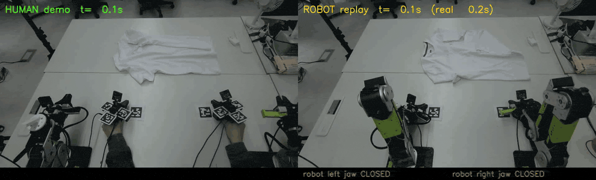

# 프로젝트 세부 내용

*11-01 저장소 구조 정리 때 최상위 [README](../README_ko.md)에서 옮긴 긴 절들입니다(본문은 그대로, 경로만 고침). 절 번호는 예전 README를 따르므로 본문 안의 절 참조가 그대로 맞습니다.*

## 1. 개요

| | |
|---|---|
| **목표** | 사람 시연에서 배워 로봇이 티셔츠를 접게 하는 것입니다. 원격 조종이나 로봇 데이터 수집은 쓰지 않습니다. |
| **입력** | 사람이 AprilTag를 붙인 HandUMI 집게 2개를 끼고 접습니다. 고정 RGB-D 카메라, 손목 카메라, IMU로 녹화합니다. |
| **출력** | reBot B601-DM 양팔. 처음에는 변환한 움직임을 그대로 재생했고(완료), 지금은 그 데이터로 학습한 정책을 실행합니다. |
| **핵심 아이디어** | **하나의 월드 좌표**(로봇 베이스)를 씁니다. 카메라를 로봇에 캘리브레이션하고, 매 테이크를 로봇 좌표로 위치를 아는 테이블 마커에 집게를 두고 시작합니다. 위치는 손목 SLAM이 아니라 고정 카메라(**점 추적 + AprilTag + 깊이 + IMU**)로 구합니다. 라벨은 IK 이전 Cartesian 목표이고, 로봇이 움직이기 전에 IK와 안전 검사를 실시간으로 거칩니다. |
| **현재** | 재생: 양팔 재생이 안정적이고 집게가 사람과 같은 높이·시점에 닫힙니다. 천을 집어 끌지만 접지는 못합니다. 정책: 펴기 성공 시연 300개를 녹화(10-26/27)해 학습 라벨로 바꿨고, Soft-Fold로 pretrain한 DiT가 로봇 dry run에서 안전하게 돕니다. 다음은 우리 GOLD 시연으로 fine-tuning입니다. **정책 성공률은 아직 없습니다.** |

## 3. 현재 파이프라인: 정책 학습 데이터 (2026-10-26 / 27)

open-loop 재생이 아니라 정책 학습을 위해, 재생 트랙의 캘리브레이션·녹화기·로봇 도구 위에 위치 추정과 라벨을 다시 만들었습니다.
코드와 12단계 표: [src/garment_pipeline/README.md](../src/garment_pipeline/README.md)

### 3.1 데이터: 펴기 시연 300개

**수집.** 구겨진 티셔츠 *펴기* 시연 318개 중 **300개 성공**입니다(베이지 72 · 검정 92 · 흰색 82 · 파랑 54).
성공 여부는 demo가 끝나기 0.5초 전 프레임으로 판단합니다. 양손이 화면 안에 있도록 Orbbec을 113 cm로 올렸고,
카메라를 옮길 때마다 카메라 ↔ 로봇 캘리브레이션(`robot_cam_v002…v005`)을 다시 구했습니다. 테이블의 70 mm 고정 태그
두 장과 테이블 평면을 함께 씁니다(`scripts/pose/robot_cam_from_anchors.py`).

**위치 = 마커 + 점 추적 + IMU.** 마커만으로는 천이나 다른 손에 가려지면 끊깁니다.
1. **CoTracker3**가 고정 카메라 영상에서 집게마다 점 40개를 따라갑니다. 깊이로 3D로 올리고 집게 강체 모델에 맞춰 위치를 구합니다.
2. **gate**가 잘못된 추적을 거릅니다: 추적 가속도가 IMU와 안 맞을 때, 두 손이 8 cm 안으로 붙을 때, 보이는 마커와 10 cm 넘게 어긋날 때.
3. **fusion**(demo마다 하나의 최소제곱 문제): 점 추적 + 기준점이 되는 마커 + 상수 bias. IMU 가속도는 끊긴 구간 안에서만 씁니다. 회전은 마커와 자이로로 구합니다.
4. 실제로 보이던 마커를 일부러 가리고 비교한 정확도는 held-out take 기준 중앙값 **왼손 16 mm / 오른손 19 mm**입니다(마커만 썼을 때 약 42 mm).

*GOLD demo(흰 셔츠, take 133656 demo 4, 1.5배속). fusion으로 구한 집게 끝 궤적을 프레임마다 출처별로 색칠했습니다: 집게 마커가
보임(초록), 마커가 가려져 CoTracker 점만 씀(파랑), CoTracker가 끊긴 구간의 IMU(주황). 왼쪽: 고정 카메라에 투영, 오른쪽: 로봇
베이스 좌표의 양손. 이 demo에서 왼손은 마커 48 %, CoTracker만 49 %, IMU 3 %, 오른손은 77 / 23 / 0 %입니다. 4절의 재생 트랙
GIF에서는 파랑이 MASt3R-SLAM이었습니다.*

*demo별 QA 영상(GOLD, 흰 셔츠, 1.5배속). 왼쪽 위: 고정 카메라 화면 위에 fusion으로 구한 집게 끝(채운 점), 해당 마커를 가리고
추정한 위치(주황 고리), 마커 자체(흰 +), CoTracker 원본 점(노랑)을 그렸습니다. 아래: 양손 손목 카메라. 오른쪽: 시간에 따른
양손 x / y / z와 마커를 가렸을 때의 오차(맨 아래, 빨간 선 = 10 cm).*

*SILVER demo(검정 셔츠). 마커를 가리고 추정한 위치가 10 cm 넘게 어긋나는 동안 화면 테두리가 빨갛게 되고, CoTracker가 손을
놓친 프레임에는 "CT GAP"이 뜹니다. 이런 demo는 fine-tuning에서 뺍니다.*

**깨끗한 episode.** 시작 대기와 끝의 정지 구간을 자릅니다(양손 모두 10 cm/s 미만, 앞뒤 0.3초 여유). 시작이나 끝에 붙은
한 손 추적 끊김은 demo 등급을 낮추는 대신 잘라냅니다. demo마다 추적 비율, 끊김 길이, 큰 오차 비율, 집는 순간의 끊김으로
**GOLD / SILVER / REJECT** 등급을 매깁니다(먼저 끝난 139개: 133 / 5 / 1). **fine-tuning에는 GOLD만 씁니다.**

**라벨: IK 이전 Cartesian.** 학습 정답 **A**는 fusion으로 구한 집게 끝 포즈를 reBot 집게 축으로 바꾸고 0.25초 smoothing과
테이블 clearance만 적용한 것입니다(IK 이전). 예전 라벨 **B**(IK → FK)에는 실행 단계의 결정(손목 roll 완화, 180° 공구 뒤집기,
양팔 간격 밀어내기)이 섞여 있었고, 하필 집는 순간에 정답을 가장 많이 바꿨습니다(집는 순간 p95 약 58 mm, 전체 53 mm). B와 IK 진단값은 QA용으로
남겨 둡니다. 실제로 도달 불가능한 프레임은 약 1–2%뿐입니다(손을 테이블 위 45–75 cm로 든 구간). 정책은 relative 동작
`inv(T_t)·T_{t+k}`(k = 1…32, 20 Hz)를 배우고, 실행할 때는 현재 TCP를 FK로 구해 예측을 합성한 뒤 online IK로 움직입니다.

**연산.** 점 추적, 집게 분류기(손목 카메라 하나에 11초, 노트북에서는 35분), CPU를 많이 쓰는 3D 계산은 임대한 RTX 5090
pod에서 돌리고, 결과는 노트북과 SSD 보관소로 가져옵니다.

### 3.2 학습 계획

아직 정책 결과는 없습니다. 먼저 두 실험을 돌리고, 둘 다 **우리 GOLD 시연만**으로 라벨 A를 써서 fine-tuning합니다.

| | pretrain | fine-tuning | 체크포인트 |
|---|---|---|---|
| **실험 1** | DiT(CLIP 텍스트, 관측 2프레임, 33 step horizon)를 Soft-Fold로 300k step (완료, 로봇 dry run에서 위반 없음) | GOLD, 300k 예산 | 25k / 50k / 75k / 100k / 150k / 200k / 250k / 300k. train loss가 아니라 검증·집기 구간 오차로 고름 |
| **실험 3** | X-VLA base를 Soft-Fold(domain 18), iPhUMI 전체 1,572 episode(19), PrimeBot UMI 400 episode 통째(20)를 학습 window 기준 1 : 1 : 1로 섞어 | GOLD, domain 21 (새로 시작) | 같음. 먼저 5090에서 1k step smoke test로 action 스케일, rot6d, 좌우 순서, 집게 극성, 카메라 순서를 확인 |

그다음 실제 로봇 평가. absolute 라벨 정책과 라벨 B는 나중의 비교 실험입니다.

*pretrain에 쓰는 데이터, 각각 episode 하나. 위: Soft-Fold(AgileX 로봇, 전역 + 손목 카메라 2대). 가운데: iPhUMI 스웨터 접기
(집게 한 쌍마다 224 px 손목 화면 4개, MIT 라이선스). 아래: PrimeBot UMI(손마다 원형 960 px 어안, CC BY-SA 4.0). 우리 같은 고정
전역 카메라는 어디에도 없어서 UMI 데이터에서는 그 입력을 빈 화면으로 둡니다. 데이터셋마다 X-VLA domain prompt를 따로 씁니다
(18 / 19 / 20, 우리 데이터 21).*

### 3.3 학습한 정책을 로봇에서 실행하기

*deploy UI에서 DiT 체크포인트를 dry-run한 화면(명령은 보내지 않음). 고정 카메라 화면 위에 예측한 32 step 집게 끝 경로(왼쪽 파랑,
오른쪽 주황), 로봇 좌표계 위에서 본 화면, 로봇 손목 카메라 2대, 실시간 검사값(IK, 팔 사이 거리, 간격)이 나옵니다.*

- **루프:** 새 영상 + 측정한 관절값 → FK로 현재 TCP → 정책이 relative 32 step 예측 → 지연만큼 가장 최근 TCP에 다시 붙임 →
  제한(속도, 테이블 바닥) → IK → 안전 검사(작업공간, 링크 간 캡슐 충돌, 테이블, 관절 한계) → 앞의 4 step만 실행하고 다시 계획(약 7 Hz).
- **집게 안전(10-27):** 왼쪽 집게 열림 제한 없이 bridge를 다시 띄웠다가 왼쪽 집게가 끝까지 열려 홀더가 부러졌습니다. 이제 deploy는
  bridge가 집게 열림을 제한하고 있을 때만(왼쪽 −270°의 0.5 이하) GO를 허용합니다. 닫힌 상태에서 −43°로 읽히는 집게는 집게만 영점을
  다시 쓰는 도구로 고칩니다(`scripts/deploy/robot_bridge/`).

### 3.4 결정 기록, 10-22 → 10-27

| 날짜 | 알게 된 것 | 결정 |
|---|---|---|
| 10-21 | 예전 재생이 부드러웠던 건 데이터(마커 끊김 ≤ 1.3초)와 재생 단계의 강한 저역통과 때문이었고, 실제 실행은 마커 대비 28–35 mm였음 | 부드러움과 정확도를 따로 봄. 0.25초 smoothing은 라벨에만 둠 |
| 10-22 | 10-22 take의 집게 라벨이 손목 카메라와 좌우 반대 | 라벨이 아니라 테이블의 어느 쪽에 있는지로 팔을 정함 |
| 10-23 | 손목 카메라 SLAM(MASt3R)은 집는 순간 끊김. 자이로 bias 검사가 3.8°/s bias를 놓쳐 회전이 5–10° 틀어짐 | 고정 카메라 점 추적 + 마커를 위치의 주 소스로. SLAM은 긴 끊김이 남을 때만 |
| 10-24 | 마커가 절대 오차를 줄임(42 → 12 mm). IMU 가속도를 넣으면 오히려 나빠짐 | fusion Cg: CoTracker + 마커, IMU 가속도는 끊긴 구간 안에서만. 가린 마커 정보가 새지 않게 막고 held-out으로 검증 |
| 10-25 | 예전 카메라에서 "화면 안"이던 demo 41개 중 33개도 손이 화면 밖으로 나감 | 카메라를 올림(96 → 105 → 113 cm)하고 다시 녹화. 105/113 cm에서는 화면 밖으로 나간 경우 0 |
| 10-26 | IK → FK 라벨이 집는 순간 정답을 휘게 함(집는 순간 p95 약 58 mm, 전체 53 mm) | IK 이전 Cartesian(A)으로 학습. IK는 오프라인에서는 검사기, 실행 때는 실행기 |
| 10-26/27 | 시작·끝의 정지 프레임과 가장자리의 짧은 추적 끊김 | 정지 trim(10 cm/s) + 가장자리 끊김 trim. fine-tuning은 GOLD만 |

## 4. 이전 트랙: open-loop 재생 (10-08 → 10-22)

시연을 하나의 로봇 궤적으로 바꿔 통째로 재생하는 트랙입니다. 여기서 만든 캘리브레이션, 녹화기, 집게 모델, 로봇 안전 도구를
위에서 그대로 씁니다. 위치와 라벨 단계는 학습용으로는 바뀌었습니다([README의 *지금 쓰는 것과 안 쓰는 것*](../README_ko.md#8-지금-쓰는-것과-안-쓰는-것)).

1. **녹화** — 양손 집게를 시작점 마커에서 시작합니다. Orbbec RGB-D, 손목 어안, IMU를 하나의 시계로 녹화합니다.
2. **위치** — AprilTag + 깊이 → 집게 자세 → 집게 끝을 바로 로봇 좌표로 구합니다.
3. **끊김 보완 + 집게 상태** — 마커가 가려진 구간은 IMU로 잇습니다(~~선택적 MASt3R-SLAM~~, 10-27 `legacy/`로 이동). 집게는 손목 영상에서 YOLO-pose로 두 집게 끝을 찾고, 그 간격으로 연속 열림 정도 g(0=닫힘, 1=열림)를 냅니다. 카메라 각도를 바꾼 10-22 테이크에서 직접 표시한 정답과 비교해 왼손 100 %, 오른손 98 %였습니다. 예전 ResNet 열림/닫힘 분류기는 보조로 남겨 두었습니다. **10-29부터** 새 시연의 집게 상태는 각 UMI의 집게 서보에서 가져옵니다(Feetech STS3215, 토크 끔, 호스트 시계로 약 100 Hz → `scripts/pose/jaw_from_motor.py`, 같은 `umi_jaw.npz` 형식). 서보가 있는 테이크에서 영상 분류기는 서보와 프레임의 약 70–80 %만 일치합니다. 영상 라벨과 서보 라벨은 한 비교 안에서 섞지 않습니다.
4. **로봇화** — 각 손을 자기 쪽, 테이블 위에 있게 부드럽게 다듬고, 프레임마다 품질을 남깁니다.
5. **계획 + 검사** — 관절 한계를 반영한 IK를 풀고, IK 오차·속도·테이블·양팔 거리 검사를 오프라인에서 통과해야 합니다.
6. **재생 + 비교** — 양팔이 실행하고, 사람·명령·로봇을 하나의 시계로 비교하며 같은 카메라로 찍습니다.

*재생 트랙의 출처별 복원 궤적: 마커 + 깊이(초록), MASt3R-SLAM(파랑, 지금은 안 씀), 마커가 가려진 동안의 IMU(주황).*

자세한 내용: [테크니컬 리포트](../report/report_ko.pdf) (재생 트랙 전체: [v0.1, 보관본](../report/archive/report_v0.1_en.pdf)) · 단계별 코드: [pipeline_replay_track.md](pipeline_replay_track.md)

## 5. 배운 것과 재생 결과

**배운 것**

1. **집기에는 SLAM보다 태그 + 깊이가 낫습니다.** 손목 카메라 SLAM은 손이 집는 순간에 추적을 놓칩니다.
   - MASt3R는 19–48 % 프레임만 쓸 수 있었습니다.
   - ORB-SLAM3는 손 가속도가 IMU 바이어스보다 작아서 스케일이 발산했습니다.
2. **실제 세계에서 재야 합니다.** 집게 끝과 팔 설치 위치 오차는 로봇 모델만으로 계산한 검사로는 보이지 않았습니다.
3. **편법 대신 변환을 고칩니다.** 손가락 접촉을 허용하자 집게가 천 높이까지 내려왔습니다.
4. **오픈 루프 재생은 같은 장면이 필요합니다.** 천을 시연 때와 같은 위치에 놓아야 합니다.

**재생 결과** (테이크 171057 데모 2, 실행 195745, 왼쪽 사람 · 오른쪽 로봇, 같은 카메라, 사람 속도). 이 실행에서는 티셔츠가
시연 때보다 15–20 cm 멀리 놓여 있어서 집게가 빈 테이블에서 닫혔습니다. 실행 200335([README 7절](../README_ko.md#7-결과)의 로봇 속도 GIF)에서는 셔츠 가장자리를 잡아 끌었습니다.

## 6. 현재 상태와 다음 단계

| 남은 문제 | 다음 단계 |
|---|---|
| 데모 전체에서 재생한 사람 궤적 대비 RMSE 17–30 mm (집는 지점 자체의 오차는 아직 재지 않음) | 집는 순간별 xy 오차 표를 만듭니다. 오차가 일정하면 캘리브레이션, 매번 다르면 집는 순간에 영상으로 보정합니다. |
| 천 위치가 시연과 다름 | 재생 전에 천 배치 기준을 맞춥니다. |
| ~~태그가 가려지는 집기 구간~~ | ~~오프라인 스무더(태그 + IMU + 깊이 + 검증된 MASt3R)~~ → CoTracker + 마커 fusion으로 해결(10-24, 3.1절) |
| 아직 정책이 없음 | 실험 1(DiT)과 실험 3(X-VLA 혼합)을 GOLD로 fine-tuning(3.2절)한 뒤 실제 로봇 평가 |
| 라벨 프레임의 약 18–24 %는 IK 보정이 큼(손목 roll, 공구 뒤집기, 오른팔 j4 한계) | 원인별로 보고하고 지금은 mask하지 않음. deploy 중 online IK가 얼마나 자주 걸리는지 확인 |
| 위의 재생 트랙 문제(집는 지점 오차, 천 배치) | 보류. open-loop 재생은 더 이상 주 경로가 아님 |
