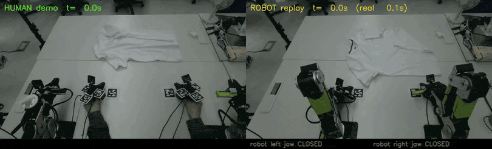
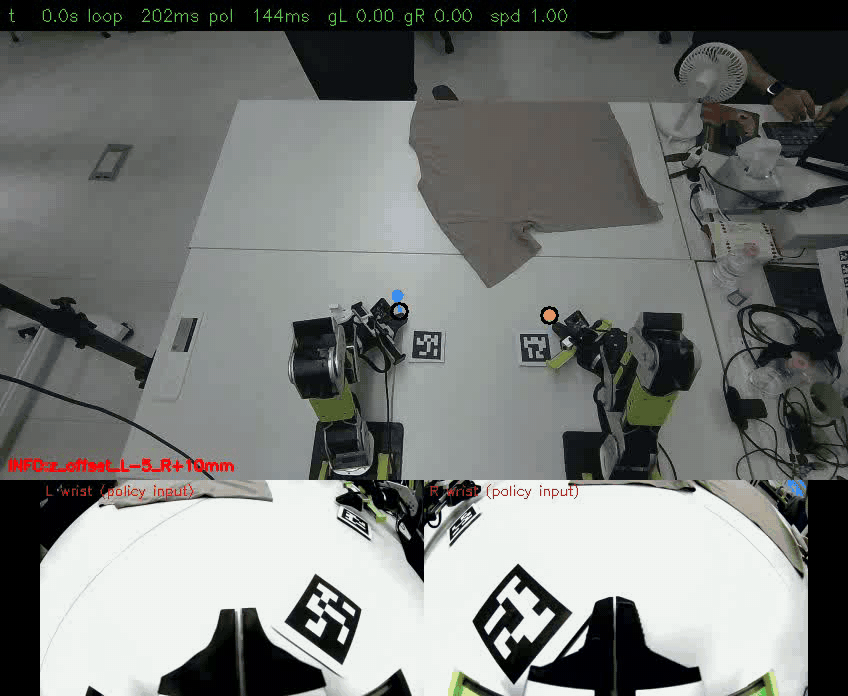
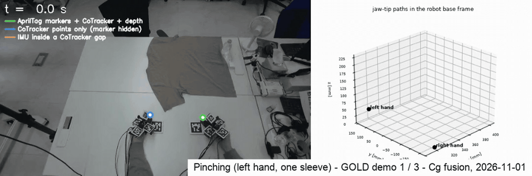
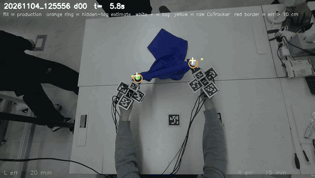
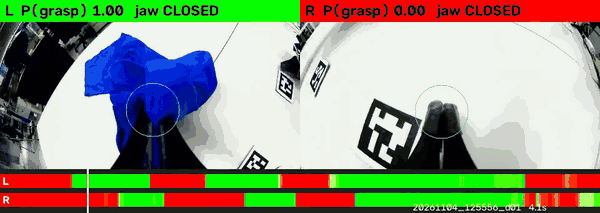

# Project history: updates, current vs. superseded, open questions

*Moved from the README on 2026-11-05 when the README became a short front page; the text is unchanged except code paths, which name the current layout ([refactor map](refactor_2026-11.md)).*

Contents: [Dated updates](#dated-updates) · [Overview as of 2 November](#overview-as-of-2-november) · [Motivation and research question](#motivation-and-research-question) · [What was hard, and what I changed](#what-was-hard-and-what-i-changed) · [Limitations](#limitations) · [Current vs. superseded](#current-vs-superseded) · [Previous and related work](#previous-and-related-work)

## Dated updates

> **Update, 27 October 2026.** The replay stage is finished and the project has moved on to **policy training data**:
> 300 successful T-shirt flattening demonstrations, a new pose source (fixed-camera point tracking anchored by the
> markers), quality grades and Cartesian labels taken *before* inverse kinematics. See
> [From replay to policy training data](#from-replay-to-policy-training-data-october-2627). The open-loop replay track
> (10-08 → 10-22) is kept as the base the new pipeline builds on. Parts of the original pipeline that are no longer used
> are marked ~~struck through~~; their code is in [`archive/`](../archive/README.md).
>
> **Update, 1 November 2026.** First policies fine-tuned on these demos were run on the robot (the trials were not
> counted): they approached the cloth, stopped short of it and closed the jaws early. Two causes were recorded (the
> policy copied the jaw state from its observation input; the robot wrist cameras sit differently from the hand-worn
> ones), and checking the labels afterwards found three more data problems (a label clamp, demonstration speed, video
> jaw labels); see
> [First policies on the robot](#first-policies-on-the-robot-and-what-they-exposed-in-the-data-october-28--november-1).
> No success rate is reported yet.
>
> **Update, 2 November 2026.** First real-robot success in the reduced **pinching** test (pinch one sleeve with the
> left hand): a DiT fine-tuned on 197 pinching demonstrations (checkpoint at 50 epochs) grasped the sleeve and pulled
> it. Successful grasps were observed in real-robot trials on 2 November; **trials were not counted**, so there is
> still no success rate. After a miss the policy grabs elsewhere instead of retrying (the data have no recovery
> demonstrations). See [Pinching](#pinching-10-30--11-02-first-real-robot-grasps-trials-not-counted).
>
> **Update, 5 November 2026.** Back to **flattening** with both hands. The fixed camera was re-aimed on 3 November and a
> new set was collected under it; demos are now split by the point-tracking gaps inside them. A DiT trained with the
> cloth-folding recipe of UMI on **250** of them improves its held-out score from epoch to epoch (72 → 52 mm by epoch 13).
> Because the jaw servo has no load signal, a wrist-camera classifier now estimates, frame by frame, whether a closed jaw
> actually holds the cloth (p_grasp). No counted robot trials yet. See
> [Flattening after the pinching test](#flattening-after-the-pinching-test-11-02--11-05).

## Overview as of 2 November

* **Goal.** A robot folds a T-shirt learned from human demonstrations: no teleoperation, no robot data collection.
* **Replay as an end-to-end test of the data.** Converted human motion is replayed open loop on the robot, on one clock
  and in one frame, so errors can be attributed to a stage (conversion vs. planning vs. tracking).
* **One world frame (the robot base), one clock.** The fixed camera is calibrated to the robot and every take starts
  with the grippers at markers whose positions in robot coordinates are known, so no per-take alignment is needed;
  every stream carries host timestamps.
* **Pose from the fixed camera, not wrist SLAM.** Point tracking + AprilTags + depth + IMU. Wrist-camera SLAM lost
  tracking exactly at grasps (MASt3R kept 19–48 % of frames; ORB-SLAM3 scale diverged).
* **Labels are Cartesian targets before IK;** IK and safety checks run online before anything moves; IK never edits or
  masks the label. IK → FK labels had moved the target by p95 ≈ 58 mm at grasps (first 139 demos).
* **Replay result.** Two-arm replay of one 33 s demo is deterministic (≈1 mm between runs) and the jaws close at the
  human's height and time; the robot grasps and drags the cloth, but folding by replay does **not** succeed.
* **Training data.** 300 successful flattening demonstrations are converted into graded, Cartesian-before-IK training
  labels; a Soft-Fold-pretrained DiT runs safely on the robot in dry runs.
* **First policies on the robot.** Fine-tuned DiT and X-VLA policies (10-28 →), observed in robot trials that were not
  counted, approach the cloth but stop short and close the jaws early. Recorded causes: the policy copied the jaw state
  from its observation input (now masked in training and deploy) and the robot wrist cameras sit differently (re-mount
  next); checking the labels found a label clamp, too-fast demonstrations and video jaw labels that disagree with the
  servo (all changed). **No policy success rate yet.**
* **Pinching: first real-robot grasps (11-02).** In a reduced test (one sleeve, left hand), a DiT fine-tuned on 197
  pinching demonstrations grasped and pulled the sleeve; successful grasps were observed in real-robot trials that were
  not counted. After a miss it grabs elsewhere instead of retrying; recovery demonstrations are the data fix.

*Left: human demonstration with two UMI grippers. Right: the two arms replaying the converted trajectory. Same fixed
camera, aligned on one clock (33 s demo replayed in 94 s; shown at robot speed).*

Long-form write-up (data, training plan, deploy loop, decision log, replay track, open problems):
[docs/details.md](details.md). Metric definitions and full result tables: [docs/results.md](results.md).

## Motivation and research question

Folding a T-shirt is long-horizon, bimanual and contact-rich, and the cloth state changes with every grasp. Teleoperated
robot data for such tasks is slow and expensive to collect. Hand-held and hand-worn grippers in the style of UMI let a
person demonstrate with an end-effector that resembles the robot's, without a robot in the loop, so data collection
scales with people rather than robots.

The difficulty moves into the conversion. Every error in calibration, pose recovery, jaw labelling, timing or
kinematic feasibility ends up in the training labels, and a policy trained on those labels inherits it. Policy success
rates are a late and indirect signal for such errors.

**Main question.** *If a robot simply replays the converted human motion, open loop, does it do what the human did?*

Replay is used as an end-to-end test of the data pipeline before policy learning. It has three useful properties:

1. it exercises every stage at once (calibration, pose, jaw state, robotization, IK, timing, control);
2. human, robot command and measured robot motion can be put on one clock and in one frame, so errors can be attributed
   to a stage (conversion vs. planning vs. tracking);
3. it fails visibly and physically (the jaws close above the cloth, or on the empty table).

Subsidiary questions: Where does the pose come from when the hand hides the markers during a grasp? How much does the
human path have to be changed to become feasible for the robot, and how should that be recorded? Which errors are
invisible to model-based checks?

## What was hard, and what I changed

| problem | decision | why |
|---|---|---|
| Wrist-camera SLAM loses tracking at the moment of grasp (close range, white cloth, fast motion) | **Absolute markers + depth from a fixed camera** as the pose source; SLAM only as a gated filler | SLAM was accurate where it tracked (a few mm) but missing exactly where labels matter. Mono-inertial scale diverged because hand accelerations were below the accelerometer bias |
| Earlier label pipeline (SLAM + body tracking + IMU) passed its own quality checks but was 4–6 cm off | **Measure in the world, not in the model** | A stale camera–IMU rotation, a mis-converged lever arm and a wrong anchor were invisible to internal residuals; they were found against the external camera |
| Robot model errors (tool-centre-point and arm mounting) invisible to FK-vs-FK parity | **Tape, camera and cloth as ground truth**; model corrections applied inside the IK model | Relative parity metrics cancel constant offsets; the robot reached the right shape in the wrong place |
| Jaws closed several cm above the cloth | **Fix the conversion, don't add heuristics**: allow the finger corner to touch the table plane, as human fingers do | Heuristics (tilt the tool, close at the lowest nearby point) were tried and rejected; tilting made the IK fail |
| Hands crossing the midline, targets below the table | **Continuous warps + per-frame quality**, never clipping | Clipping creates jumps and hides how much a label was changed |
| Aligning camera, IMU, robot and video | **One host clock** for everything | Enables per-sample comparison and side-by-side video without sync hardware |
| Arm lag during moving segments did not respond to the proportional gain | **Model the controller**: with an integral-only feed-forward and no gravity model, the moving error scales with the rate of gravity-torque change over the integral gain | Tuning the integral gain reduced stroke RMSE from 25–37 mm to 12–14 mm |

## Limitations

* **No success rate.** Replays were judged by measurement and video; no trials were counted. The pinching grasps of
  2 November are an observation from uncounted trials, not a rate.
* **One demonstration** of one take was replayed in full on both arms. The ≈1 mm repeatability shows determinism, not
  generality across demonstrations, demonstrators or garments.
* **Open loop.** The cloth must start where the human's did; in two runs the shirt lay 15–20 cm away and the jaws closed
  on the empty table.
* **Relative parity metrics hide offsets.** They are computed relative to the start of a window with lag removed;
  absolute placement was checked only by tape and video.
* ~~**Tag-hidden phases** are interpolated (about a fifth of the right-hand frames of the full demo); their error at the
  grasps is not measured.~~ Addressed by point tracking ([Current vs. superseded](#current-vs-superseded)); hidden-marker error is now measured on held-out takes.
* **About a fifth of label frames need a large IK correction** (wrist roll, tool flip, one joint at its limit; 20.3 % on
  the first 139 demos). With labels F and A the IK result does not mask or change any frame; it is a QA statistic, and a
  demo is dropped only if IK cannot be run on it at all.
* **Jaw labels** from the wrist video have no held-out accuracy number on the older demonstrations; on recordings that
  also have the servo, the video classifier agrees with it on only about 70–80 % of frames (per frame, recorded in
  `src/laundry_jaw/motorlike.py`). A model trained to reproduce the servo from the wrist video, for relabelling older
  demonstrations, was evaluated; one candidate dataset was built with it on 10-31 (`flat300_S03_gold187nb_mj`, 187 GOLD
  demos without the black cloth), not used for any reported model.

## Current vs. superseded

Superseded parts are kept in the text and marked ~~struck through~~ rather than deleted; their code and why each item
was dropped: [archive/README.md](../archive/README.md).

| part | current (11-01) | ~~no longer used~~ |
|---|---|---|
| pose source | CoTracker3 points on the fixed camera + AprilTag anchors + constant bias, IMU acceleration only inside gaps (`src/laundry_tracking/`) | ~~MASt3R wrist SLAM gap filling~~ (breaks at grasps, 10-23) · ~~ORB-SLAM3~~ (scale diverged, 10-21) · tags + IMU fill alone (replay track only) |
| camera ↔ robot | re-solved after every camera move from two fixed table tags + the table plane (`robot_cam_v002…v005`) | wrist-marker 32-pose solve (`v001`, still valid for the old camera position) |
| jaw state | demos from 10-29: Feetech servo reading on the UMI (`src/laundry_jaw/from_motor.py`); earlier demos (incl. GOLD-281): ResNet18 classifier v003 → YOLO-pose jaw tips → aperture g. The two sources are never mixed in one comparison | ~~red-tape jaw detector~~ (tape removed 10-20) |
| arm assignment | by the gripper's side of the table | ~~by rig label~~ (labels swapped since 10-22) |
| label | **F** = fused human jaw-tip pose in reBot gripper axes, 0.25 s smoothing, before IK; no clamp or lift; IK does not change or mask it (`laundry_dataset.tag_rig_unsplit --label fused`, 10-29); relative motion built in the loader | ~~**A** = F + table clearance~~ (lifted 44 % of frames) · **B** = IK → FK (kept for QA only) |
| data speed | 0.3× time-stretched copy (`--speed 0.3`): pose, jaw events and camera frames on one slower timeline | human speed (p95 0.93 m/s) |
| execution | receding-horizon deploy: FK → compose → limiter → IK → safety, 4 steps per plan for the DiT (default; ACT 1, X-VLA 8) | open-loop whole-demo replay (`umi_replay_bi`, replay track) |
| compute | rented RTX 5090 pods (point tracking, jaw classifier, 3-D solve); company RTX 4090 via Ray for the DiT fine-tunes; one run on a rented H100; everything archived to the SSD | — |

### From replay to policy training data (October 26–27)

Open-loop replay showed that the conversion is geometrically sound, but it also showed what a training label must not
contain. The pipeline was rebuilt for learning, on the same calibration, recorder and robot tools.

**What changed**

| part | now | ~~before~~ |
|---|---|---|
| pose source | point tracking (CoTracker3, Oct 24–25) on the fixed RGB-D camera, lifted by depth, fitted to a rigid gripper model, anchored by the markers; IMU acceleration only inside gaps | markers + IMU interpolation; ~~wrist-camera SLAM filler~~ |
| camera ↔ robot | re-solved after every camera move from two fixed table markers plus the table plane; camera raised so both hands stay in view | one robot-held-marker calibration |
| arm assignment | by the gripper's side of the table | by marker label (the labels were found swapped) |
| episode window | still start and end cut (both hands below 10 cm/s), short one-hand tracking gaps at the edges cut | operator-marked windows |
| label | **Cartesian jaw-tip pose before inverse kinematics**, smoothed; ~~kept above the table~~ (removed Oct 29, see below) | robotized path after IK → FK |
| execution | receding horizon: forward kinematics gives the current pose, the predicted relative motion is composed onto it, then limiter → IK → safety checks, a few steps committed per plan | whole-demo open-loop replay |

*One GOLD flattening demonstration: fused jaw-tip paths coloured by the source of each frame — a gripper marker visible
(green), point tracking only while the markers are hidden (blue), IMU inside a tracking gap (orange). Left: projected
into the fixed camera; right: both hands in the robot base frame. Compare the replay-era figure in [pipeline.md](pipeline.md#pose-reconstruction-and-validation-stages-24), where the blue
segments came from wrist-camera SLAM.*

**Data.** 318 flattening demonstrations of a crumpled T-shirt in four colours, **300 successful** (judged on a frame
just before each demo ends). Each demo is graded GOLD / SILVER / REJECT from tracking coverage, gap length, the
fraction of large hidden-marker errors and gaps at grasps; fine-tuning uses GOLD only.

**Why the label is taken before IK.** IK → FK labels contained execution decisions (wrist-roll relaxation, a tool
flip near joint limits, pushes that keep the arms apart) and moved the target most exactly where it matters: at grasps
the IK → FK label differs from the Cartesian one by p95 ≈ 58 mm (53 mm overall; first 139 demos, ≈123k arm-frames). On
the same demos 0.8 % of frames are truly out of reach (hands lifted far above the table). The IK result and its
per-frame diagnostics are kept for QA; IK becomes a checker offline and the executor online. Labels are stored absolute; the policy learns relative
motion inv(T_t)·T_{t+k}.

**Planned training.** (1) A diffusion-transformer policy (DiT) pretrained on a public robot cloth-folding dataset
(Soft-Fold), then fine-tuned on the GOLD demos. (2) A VLA base model (X-VLA) pretrained on an equal mix of that
dataset and two public UMI-style garment datasets (iPhUMI, PrimeBot UMI; one domain prompt per source), then
fine-tuned the same way. The plan was to evaluate both on the robot with counted trials. As run, the DiT fine-tunes
start from a DiT pretrained for 100k steps on a 1 : 1 : 1 mix of Soft-Fold, iPhUMI and PrimeBot UMI. Details:
[details.md §3.2](details.md#32-training-plan).

**Safety lesson.** A bridge restart without the jaw-opening limit let one jaw open to the end of its travel and break
its holder. Deployment now refuses to send commands unless the bridge reports the jaw limits.

### First policies on the robot, and what they exposed in the data (October 28 – November 1)

The DiT (pretrained on a Soft-Fold / iPhUMI / PrimeBot UMI mix) and X-VLA policies were fine-tuned on the 281 GOLD
demos and run on the robot with the receding-horizon deploy. What is known from these runs is qualitative: the arms
approach the cloth but stop short of it and close the jaws early. The trials were not counted, and for the runs of
10-28 → 10-31 the checkpoints, label kinds and speeds were not recorded (the runs of 11-01 are described under
Pinching below); no success rate is reported. Two causes were
recorded from the robot runs (first and last row); three more data problems were found by checking the labels
afterwards (rows 2–4):

| finding | change | code |
|---|---|---|
| The jaw closed early and never re-opened: the policy copied the jaw state from its observation input. | The jaw state in the observation is masked to 0 (`GRIP_STATE_MASK=1`) in training and deploy, so jaw timing must come from vision. | `src/laundry_training/env_options.py` |
| The "kept above the table" step (table clearance in label A) lifted 44 % of label frames, by 27 mm at the median, so a policy could not learn to go down to the cloth. | Label F: the fused human jaw-tip pose (reBot gripper axes, 0.25 s smoothing) with no clamp, lift or feasibility edit. Limits belong to deployment, not to training labels. | `src/laundry_dataset/tag_rig_unsplit.py --label fused` |
| Human demonstrations are faster than the robot can follow (p95 ≈ 0.93 m/s, 127 °/s). | A time-stretched copy of the data set (0.3× speed): pose, jaw events and every camera frame are resampled on one common slower timeline; rows stay 20 Hz. | `laundry_dataset.tag_rig_unsplit --speed 0.3` |
| The jaw label came from a model reading the jaw in the wrist video; it disagreed with the true jaw aperture. | From October 29 the hand-worn grippers carry a servo, and the jaw label of new demonstrations is its encoder reading, re-centred per take. Labels from the two sources are kept apart and never mixed in one comparison. | `src/laundry_jaw/from_motor.py`; relabel attempt for older demos `src/laundry_jaw/motorlike.py` (not used for any reported model) |
| The robot's wrist cameras look at the jaws from a different place than the hand-worn ones. | Measured with the table markers: the robot cameras are tilted 11–13° less toward the tool axis and sit 25–44 mm closer to it. Next: re-mount them to the hand-worn geometry. | — |

Also added (in progress, **not yet validated on the robot**): per-arm table-height calibration by touching the table
tags (`src/laundry_deploy/core/height_calib.py`; added to every committed command when the UI option is on; it was on
in the pinching runs of 11-02),
real-time chunking blend between plans (`laundry_deploy.core.chunk`; the UI default since 10-29, but whether it was on in a
given robot run was not recorded), X-VLA policy server (`laundry_deploy.xvla_server`). Training code:
`src/laundry_training/` (DiT trainer with masks and per-episode weights; jaw BCE head and no gradient clipping
are options, used only in the pinching runs; defaults: MSE jaw target, gradient clipping at norm 10).

### Pinching (10-30 → 11-02): first real-robot grasps, trials not counted

The flattening policies stop short of the cloth. To separate "the pipeline cannot teach a grasp" from "flattening is too
hard for this amount of data", the first robot feasibility test was reduced to one sub-skill: **pinch one sleeve with
the left hand** (right arm idle in all data; in the robot runs of 11-02 both arms were under policy control and the
right arm stayed at its start pose).

*Real-robot run of 2 November 2026, 11:37 (one of two runs the operator judged successful; trials were not counted, so
there is no success rate). Checkpoint: the DiT fine-tune on the 197 Cg pinching demos at 50 epochs. Top: fixed camera
with the policy's next jaw targets (blue = left, orange = right); bottom: the left and right wrist-camera inputs. One
frame per plan cycle (1.4 s), shown at about 2.8× real time. Full UI videos at the same speed:
[11:37 run](../media/pinching_robot_20261102_113704.mp4), [11:48 run](../media/pinching_robot_20261102_114857.mp4).*

*Three GOLD pinching demonstrations from 1 November ([MP4](../media/pinching_cg_gold_trajectory_sources.mp4)): Cg-fused
jaw-tip paths coloured by the source of each frame — a gripper marker visible (green), point tracking only while the
markers are hidden (blue), IMU inside a tracking gap (orange). Left: projected into the fixed camera; right: both hands in
the robot base frame. The left hand does the pinch; the right hand rests on its start markers.*

| | |
|---|---|
| pose source / label | trajectory source **Cg** everywhere (CoTracker + marker anchors + constant bias; IMU only inside tracking gaps); label kind F; jaw from the servo encoder; 0.5× time-stretched for the robot. An earlier trajectory source (A′: one xyz bias per demo and arm from the tag frames of the first 2 s) had NaN spans inside some 11-01 demos (IK failed on 4 of them), so all sets were rebuilt from Cg; the two sources are never mixed. |
| training data | 10-30: 53 kept of 74 demonstrations · 11-01: 56 of 60, 33 of 35, 10 of 10 and 48 of 50 kept by the quality gate (147); 3 of them were dropped by the dataset converter (trimmed window shorter than 5 s), so **197 in total** (53 + 144; 62,160 frames). Kept = quality grade GOLD or SILVER. |
| test sets (never trained on) | P20: all 10 demonstrations of the 10-30 test take (not gate-filtered) + 9 of the 10 of the 11-01 test take (19) for arm + gripper; every rejected 11-01 demonstration is kept for gripper timing only (its jaw label is valid, its arm label is not). |
| model | the diffusion-transformer policy fine-tuned on the 10-30 set (source A′) is the starting point and the baseline on P20 (`val_score_mm` 19.89 mm: mean left/right translation deviation over k = 16 and 32); fine-tuning on the 197 demonstrations (with train-time image augmentation) started on 1 November (about 4.7 days planned). Offline on P20: 25 epochs **17.29 mm**, 50 epochs **18.89 mm** (baseline 19.89); the 50-epoch checkpoint (step 048564) is the one that grasped on the robot, so the offline score did not pick the robot checkpoint. |
| status | **first real-robot success observed on 11-02** with the 50-epoch checkpoint: successful grasps observed in real-robot trials on 2 November; trials were not counted, so **no success rate**. Robot trials will be reported here with the number of trials and successes, whether the outcome is success or failure. |
| deploy settings (11-02) | DiT, 32 steps committed per plan, speed 1.0, real-time-chunking look-ahead off, DDIM 10 sampling steps, per-arm height calibration on, soft stop. |
| known limitation | after a miss the policy grabs elsewhere instead of retrying: the data have no recovery demonstrations, so post-failure states are out of distribution. Retry = back to START → GO. Fix on the data side: record recovery demonstrations. |

**Robot runs of 1 November (qualitative, not counted).** Two DiT checkpoints were run with commit 32 and speed 1
(later 1.5): the flattening fine-tune on GOLD-281 + 48 servo-labelled demos (label F, 0.3×; two runs of about 70 s) and
the pinching baseline (one short run). In both the left jaw was mostly commanded open and the right jaw stayed closed;
in the first run the left wrist had one motor fault and the left arm once lagged its command by more than 20°. No
success or failure was scored ([status note](status_2026-11-01.md)).

Robot-side changes made for this test: per-arm table-height calibration from jaw-tip touches on the table tags, the fixed
camera re-aimed to its earlier view, and a soft stop that brakes without latching an emergency stop.

**Robot runs of 2 November (first grasps, not counted).** The 50-epoch checkpoint of the 197-demo fine-tune, with the
deploy settings in the table, approached the sleeve end with the left jaw open, closed on the sleeve and pulled it.
Changes made that day ([status note](status_2026-11-02.md)): the bridge's left/right USB locations had swapped after
re-cabling (fixed in the launch configuration, not code); the left jaw has mechanical slack and now closes 25° past
zero, with the squeeze ramped in over the last 30° ([robot bridge](../src/laundry_deploy/robot_service/)); the START
move now closes both jaws (a parked jaw relaxes open); a robot wrist camera stalled once and the UI was restarted.

### Flattening after the pinching test (11-02 → 11-05)

Numbers: [status note 11-05](status_2026-11-05.md); report Section XII.

*A GOLD flattening demo under the re-aimed camera (4 November, train split): fixed camera with the point tracks and the
fused jaw tips of both hands.*

| step | what was done | result |
|---|---|---|
| **FLAT149** (11-02/03) | 149 flattening demos (10-30 48 + 11-02 101), 0.5×, continuous jaw; the UMI cloth-folding recipe item by item (100 epochs, LR 3e-4, DDIM 50/16, crop / rotation / colour jitter incl. hue as a YIQ chroma rotation), 4×H100 | best val epoch 80 (`val_score_mm` 60.89), best test epoch 90 (64.36); no counted robot result |
| **Deploy** (11-03) | `amp` (motion-amplitude scale about the current pose), `start_root` (medoid start of any dataset), camera-alignment check against a reference day | — |
| **Camera re-aimed** (11-03) | new calibration from the two table anchor tags + table plane (all IPPE solutions tried: the coplanar tags flipped the camera below the table); data before / after kept apart | 3 Nov: 7 takes, 100 demos; collection continued 4 and 5 Nov |
| **Split by tracking gaps** (11-04) | trim idle ends (both arms < 3 cm/s for 0.5 s); **train** = GOLD whose longest tracking gap inside the trimmed window is < 0.25 s, longer-gap GOLD alternates val / test, gap-free SILVER → train, other SILVER and REJECT separate; gaps ≥ 0.3 s masked in the loss, and the rest of a predicted chunk after a masked step too | `src/laundry_dataset/builds/` |
| **FLAT250** (11-04/05) | train 250 (444217 frames), val 39, test 38; FLAT149 recipe, batch 1024, 100 epochs on 2×RTX 4090 (DDP), a checkpoint and an offline eval every epoch | val / test 71.67 / 72.27 (initial) → 102.36 / 101.78 (epoch 1) → 60.74 / 59.85 (8) → **52.56 / 52.32** (13, best; stopped there for the next run); epochs 8, 10–13 copied to the robot as rollout candidates, no counted result |
| **Grasp held / empty** (11-05) | the servo is read torque-off (no load / current), so a closed jaw does not say whether cloth is held → wrist-camera labels: 343 demos' close events, 585 gold labels by the user (543 mapped: 372 held, 171 empty), ResNet-18 on a jaw-tip crop | take-grouped 5-fold CV, per event: F1 held 0.90, empty 0.78; causal p_grasp(t) (15 Hz, last 0.4 s): median 0.99 on held, 0.03 on empty events |
| **FLAT-PGRASP** (11-05) | the same recipe, but the (otherwise masked) jaw slots of the observation state carry p_grasp of each hand; data of 11-03 + 11-04 + 11-05: train 301, val 46, test 45 | val / test 68.79 / 68.43 after 2 epochs (other held-out sets than FLAT250), training; a 0.3× vs 1.0× time-stretch comparison being set up; the deploy loop does not compute p_grasp yet |

*The same demo through both wrist cameras with the causal grasp probability (green = held, red = not held; bars = whole
demo, white line = now). A review render made before the window length was frozen at 0.4 s.*

### Research directions

1. **Egocentric capture.** Wearable demonstration hardware and a recording protocol that yields synchronized wrist
   video, inertial data and an external view of a full garment task.
2. **Metric wrist-pose recovery in a consistent world frame.** Recovering the 6-DoF jaw-tip pose of both hands, with
   metric scale, in the robot's own base frame, including through contact phases where markers or visual tracking are
   lost.
3. **Cross-embodiment trajectory representation and feasibility.** Turning human hand motion into robot end-effector
   targets: what to keep absolute, what to make relative, how to warp an infeasible path without destroying its intent,
   and how to grade each frame.
4. **Long-horizon garment policy learning.** Comparing an end-to-end policy with a stage-conditioned one (grasp, lift,
   fold, release) trained on the converted labels. *End-to-end DiT and X-VLA policies were fine-tuned on the
   converted labels from late October (above); no success rate yet, and the stage-conditioned comparison has not
   started.*

### Open questions

1. Is the remaining ≈2–3 cm trajectory error (not yet measured at the grasp points themselves) a constant bias (calibration) or varying (needs visual correction at the
   grasp)? A per-grasp error table from the video will tell.
2. ~~Can tag-hidden contact phases be recovered well enough by an offline smoother (markers, IMU, depth, gated SLAM) with
   confidence-weighted labels?~~ Largely yes, with fixed-camera point tracking anchored by markers ([Current vs. superseded](#current-vs-superseded)).
3. Does weighting labels by robotization quality matter for policy learning, and in which phases?
4. End-to-end vs. stage-conditioned policies for long-horizon garment tasks, trained on relative SE(3) labels from
   human data.

### Status and next steps

* **Status (Oct 27):** replay runs end to end and is deterministic; grasp height matches the human; folding by replay
  does not succeed. 300 flattening demonstrations are converted into graded, Cartesian-before-IK training labels.
* **Status (Nov 1):** both policies were fine-tuned on the GOLD demos and run on the robot (trials not counted); they
  stop short of the cloth and close early. Recorded causes: jaw-state copying (now masked) and the wrist-camera
  placement (re-mount next); label checks found three more data problems, all changed ([First policies](#first-policies-on-the-robot-and-what-they-exposed-in-the-data-october-28--november-1)); no success rate yet.
* **Status (Nov 2):** one-sleeve left-hand pinching test with 197 Cg-sourced demonstrations ([Pinching](#pinching-10-30--11-02-first-real-robot-grasps-trials-not-counted)): first
  real-robot grasps observed (50-epoch checkpoint); trials were not counted, so no success rate. After a miss the
  policy grabs elsewhere instead of retrying.
* **Status (Nov 5):** flattening under the re-aimed camera: FLAT250 (250 train demos, gap-based split) trains with the
  UMI recipe, held-out score 72 → 52 mm by epoch 13; wrist-camera grasp labels and p_grasp; a p_grasp-conditioned run on 301
  demos (incl. 11-05) is training. No counted robot trials yet.
* **Next:** counted robot trials of the FLAT250 checkpoints; p_grasp in the deploy loop; record recovery demonstrations for the pinching test (re-grasp after a miss) and run counted pinching
  trials; re-mount the robot wrist cameras and evaluate on the robot, with counted trials, policies trained on the
  corrected labels and the servo-labelled demos (one such flattening fine-tune was run on the robot on 11-01 without
  counted trials; [Pinching](#pinching-10-30--11-02-first-real-robot-grasps-trials-not-counted)). ~~Per-grasp error analysis; a cloth-placement reference before each replay; an offline smoother for
  tag-hidden phases~~ — replay-track items, parked.

## Previous and related work

### Previous work

An earlier project, [egocentric-cube-stacking](https://github.com/physical-ai-robot-learning/egocentric-cube-stacking),
collected 349 bimanual human demonstrations, converted them across embodiments into robot trajectories with relative
Cartesian actions, fine-tuned X-VLA on them, analysed the human-to-robot gap, and deployed on a dual-arm robot.

### Related work and attribution

* **UMI** (Chi et al., RSS 2024): hand-held gripper with wrist fisheye; pose from ORB-SLAM3-based monocular-inertial
  SLAM. We keep the UMI-style gripper but take pose from fixed-camera fiducials + depth, and test data by replay.
* **HandUMI** (BrikHMP18 / murobotics-ai, Apache-2.0): the hand-worn gripper hardware we use. Not our design.
* **DexUMI**, **EgoMimic**: human hands / egocentric video as a data source for robot learning.
* **ALOHA**: low-cost bimanual manipulation (teleoperated); **SpeedFolding**, **FlingBot**: learned cloth primitives.
* **AprilTag** (Olson; Wang & Olson), **IPPE**, **SQPnP**, **OpenCV**: fiducial detection and pose.
* **MASt3R-SLAM**, **ORB-SLAM3** (and Basalt, OpenVINS, AirSLAM in an earlier stereo setup): evaluated as pose sources.
* **CoTracker3**: point tracking on the fixed camera.
* **Pink** on **Pinocchio**: differential IK; **ResNet-18** / **ImageNet**: jaw classifier backbone.

Full references are in the [technical report](../report/report_en.pdf); licences and credits in [ATTRIBUTION.md](../ATTRIBUTION.md).
