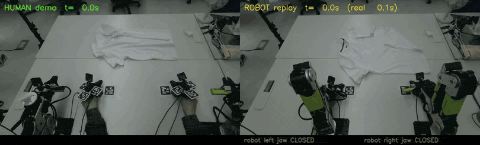
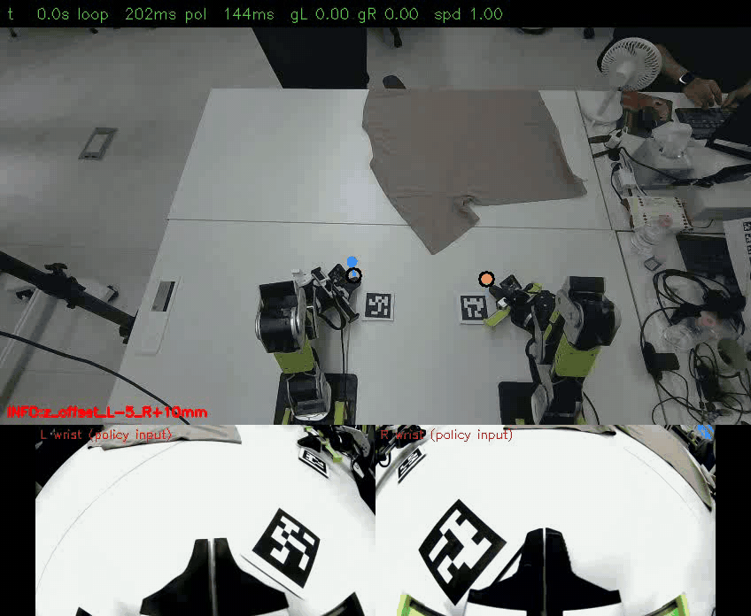
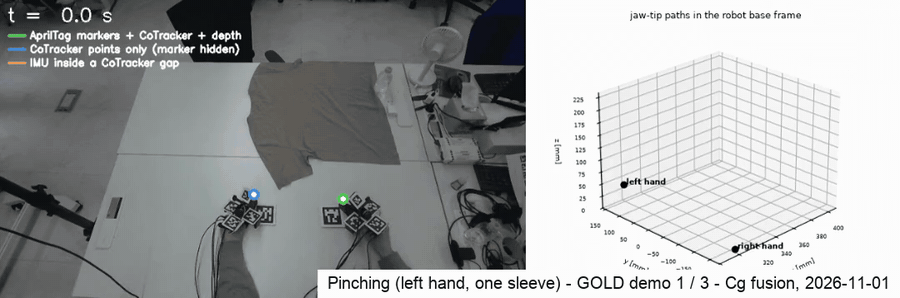
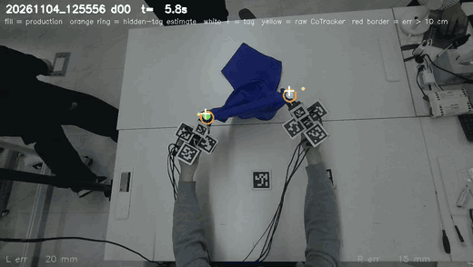
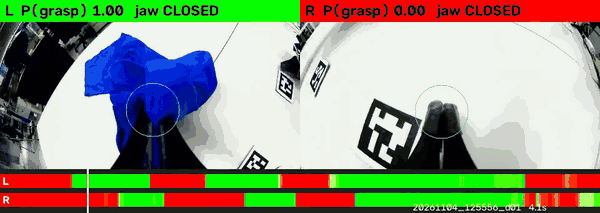

# 프로젝트 이력: 업데이트, 지금 쓰는 것과 안 쓰는 것, 남은 질문

*2026-11-05에 README를 짧은 첫 페이지로 줄이면서 README에서 옮겨 온 내용입니다. 본문은 그대로이고 코드 경로만 지금 구조에 맞게 고쳤습니다([경로 대응표, 영문](refactor_2026-11.md)).*

목차: [날짜별 업데이트](#날짜별-업데이트) · [개요 (11월 2일 기준)](#개요-11월-2일-기준) · [동기와 연구 질문](#동기와-연구-질문) · [어려웠던 점과 바꾼 것](#어려웠던-점과-바꾼-것) · [한계](#한계) · [지금 쓰는 것과 안 쓰는 것](#지금-쓰는-것과-안-쓰는-것) · [이전 작업과 관련 연구](#이전-작업과-관련-연구)

## 날짜별 업데이트

> **2026-10-27 업데이트.** 재생 단계는 끝났고 프로젝트는 **정책 학습 데이터**로 넘어갔습니다. 티셔츠 펴기 성공 시연 300개,
> 새 위치 추정 소스(마커를 기준점으로 쓰는 고정 카메라 점 추적), 품질 등급, IK *이전*의 Cartesian 라벨입니다.
> [재생에서 정책 학습 데이터로](#재생에서-정책-학습-데이터로-10-2627) 참고. open-loop 재생 트랙(10-08 → 10-22)은 새 파이프라인의
> 바탕으로 남겨 두었습니다. 더 이상 쓰지 않는 부분은 ~~취소선~~으로 표시했고, 그 코드는 [`archive/`](../archive/README.md)에 있습니다.
>
> **2026-11-01 업데이트.** 이 시연으로 파인튜닝한 첫 정책을 로봇에서 돌렸습니다(시행 횟수는 세지 않았습니다). 팔이 천 쪽으로
> 가지만 닿기 전에 멈추고 집게를 일찍 닫았습니다. 기록된 원인은 두 가지입니다(정책이 관측 입력의 집게 상태를 그대로 따라 함,
> 로봇 손목 카메라 위치가 손에 끼는 집게와 다름). 그 뒤 라벨을 점검해 데이터 문제 세 가지를 더 찾았습니다(라벨 clamp, 시연 속도,
> 영상 집게 라벨).
> [로봇에서 돌린 첫 정책](#로봇에서-돌린-첫-정책과-데이터에서-드러난-것-10-28--11-01) 참고. 성공률은 아직 보고하지 않습니다.
>
> **2026-11-02 업데이트.** 범위를 줄인 **핀칭** 시험(왼손으로 소매 하나 집기)에서 처음으로 실제 로봇이 성공했습니다. 핀칭 시연
> 197개로 파인튜닝한 DiT(50 에포크 checkpoint)가 소매를 집어 당겼습니다. 11월 2일 실제 로봇 시행에서 집기 성공이 관찰되었지만
> **시행 횟수는 세지 않았으므로** 성공률은 여전히 없습니다. 놓친 뒤에는 다시 시도하지 않고 다른 곳을 잡습니다(데이터에 복구 시연이
> 없음). [핀칭](#핀칭-10-30--11-02-로봇에서-첫-집기-성공-관찰-시행-횟수-세지-않음) 참고.
>
> **2026-11-05 업데이트.** 양손 **펴기**로 돌아왔습니다. 11월 3일 고정 카메라 방향을 바꿨고 그 아래에서 새 세트를 모았습니다.
> 시연은 그 안의 point-tracking gap 길이로 나눕니다. UMI의 천 접기 레시피로 그중 **250개**를 학습한 DiT는 에포크마다 held-out
> 점수가 좋아집니다(13 에포크까지 72 → 52 mm). 집게 서보에는 부하 신호가 없어서, 닫힌 집게가 실제로 천을 잡았는지를 손목 카메라
> 분류기가 프레임마다 추정합니다(p_grasp). 시행 횟수를 센 로봇 시험은 아직 없습니다.
> [핀칭 뒤의 펴기](#핀칭-뒤의-펴기-11-02--11-05) 참고.

## 개요 (11월 2일 기준)

* **목표.** 사람 시연에서 배워 로봇이 티셔츠를 접게 하는 것입니다. 원격 조종이나 로봇 데이터 수집은 쓰지 않습니다.
* **재생으로 데이터를 끝까지 시험.** 변환한 사람 동작을 하나의 시계, 하나의 좌표에서 로봇으로 open-loop 재생하므로, 오차가
  어느 단계에서 생겼는지(변환 vs 계획 vs 추종) 가를 수 있습니다.
* **하나의 월드 좌표(로봇 베이스), 하나의 시계.** 고정 카메라를 로봇에 캘리브레이션하고, 매 테이크를 로봇 좌표로 위치를 아는
  마커에 집게를 두고 시작하므로 테이크마다 따로 맞출 필요가 없습니다. 모든 스트림에 호스트 시각이 붙습니다.
* **위치는 손목 SLAM이 아니라 고정 카메라로:** 점 추적 + AprilTag + 깊이 + IMU. 손목 카메라 SLAM은 집는 순간에 추적을
  놓쳤습니다(MASt3R는 19–48 % 프레임만 사용 가능, ORB-SLAM3는 스케일 발산).
* **라벨은 IK 이전 Cartesian 목표이고,** 로봇이 움직이기 전에 IK와 안전 검사를 실시간으로 거칩니다. IK는 라벨을 바꾸지도
  mask하지도 않습니다. IK → FK 라벨은 집는 순간 목표를 p95 약 58 mm 옮겼습니다(앞 139개 시연).
* **재생 결과.** 33초 데모 하나의 양팔 재생은 결정적이고(실행 사이 약 1 mm), 집게가 사람과 같은 높이·시점에 닫힙니다. 천을 집어
  끌지만 재생으로 접기는 **성공하지 못합니다**.
* **학습 데이터.** 펴기 성공 시연 300개를 등급을 매긴 IK 이전 Cartesian 학습 라벨로 바꿨고, Soft-Fold로 pretrain한 DiT가 로봇
  dry run에서 안전하게 돕니다.
* **로봇에서 돌린 첫 정책.** 파인튜닝한 DiT·X-VLA 정책(10-28 →)을 시행 횟수를 세지 않은 로봇 시도에서 관찰했습니다. 천 쪽으로
  가지만 닿기 전에 멈추고 집게를 일찍 닫습니다. 기록된 원인: 정책이 관측 입력의 집게 상태를 따라 함(이제 학습·deploy에서 가림),
  로봇 손목 카메라 위치가 다름(재장착이 다음). 라벨 점검에서 라벨 clamp, 너무 빠른 시연, 서보와 어긋나는 영상 집게 라벨을 찾아
  모두 바꿨습니다. **정책 성공률은 아직 없습니다.**
* **핀칭: 실제 로봇 첫 집기 (11-02).** 범위를 줄인 시험(소매 하나, 왼손)에서 핀칭 시연 197개로 파인튜닝한 DiT가 소매를 집어
  당겼습니다. 시행 횟수를 세지 않은 실제 로봇 시행에서 집기 성공을 관찰했습니다. 놓친 뒤에는 다시 시도하지 않고 다른 곳을 잡으며,
  데이터 쪽 해결책은 복구 시연입니다.

*왼쪽은 UMI 집게 2개로 한 사람 시연, 오른쪽은 변환된 궤적을 재생하는 양팔입니다. 같은 고정 카메라로 찍었고 하나의 시계로
맞췄습니다(33초 데모를 94초에 재생, 로봇 속도로 표시).*

긴 설명(데이터, 학습 계획, deploy 루프, 결정 기록, 재생 트랙, 남은 문제): [docs/details_ko.md](details_ko.md).
지표 정의와 전체 결과 표: [docs/results.md](results.md)(영어).

## 동기와 연구 질문

티셔츠 접기는 길고, 양손을 쓰고, 접촉이 많으며, 집을 때마다 천의 상태가 바뀝니다. 이런 작업의 원격 조종 로봇 데이터는 모으기
느리고 비쌉니다. UMI 방식의 손에 드는·손에 끼는 집게를 쓰면 사람이 로봇과 비슷한 엔드이펙터로 로봇 없이 시연할 수 있어,
데이터 수집이 로봇 수가 아니라 사람 수에 따라 늘어납니다.

어려움은 변환으로 옮겨 갑니다. 캘리브레이션, 위치 복원, 집게 라벨, 시간, 운동학적 도달성의 모든 오차가 학습 라벨에 들어가고,
그 라벨로 학습한 정책은 오차를 그대로 물려받습니다. 정책 성공률은 이런 오차를 늦게, 간접적으로만 알려 줍니다.

**주 질문.** *로봇이 변환된 사람 동작을 open-loop로 그대로 재생하면, 사람이 한 일을 하는가?*

재생은 정책 학습 전에 데이터 파이프라인을 끝까지 시험하는 방법으로 씁니다. 쓸모 있는 성질이 세 가지 있습니다.

1. 모든 단계를 한꺼번에 거칩니다(캘리브레이션, 위치, 집게 상태, 로봇화, IK, 시간, 제어).
2. 사람, 로봇 명령, 측정한 로봇 동작을 하나의 시계와 하나의 좌표에 둘 수 있어, 오차가 어느 단계(변환 vs 계획 vs 추종)에서
   생겼는지 가를 수 있습니다.
3. 실패가 눈에 보이고 물리적으로 드러납니다(집게가 천 위 허공에서, 또는 빈 테이블에서 닫힘).

부수 질문: 집는 동안 손이 마커를 가리면 위치는 어디서 얻는가? 사람 궤적을 로봇이 할 수 있게 하려면 얼마나 바꿔야 하고, 그것을
어떻게 기록해야 하는가? 모델 기반 검사로는 보이지 않는 오차는 무엇인가?

## 어려웠던 점과 바꾼 것

| 문제 | 결정 | 이유 |
|---|---|---|
| 손목 카메라 SLAM이 집는 순간 추적을 놓침(가까운 거리, 흰 천, 빠른 움직임) | 위치 소스로 **고정 카메라의 absolute 마커 + 깊이**, SLAM은 gate를 거친 보완으로만 | SLAM은 추적하는 곳에서는 정확했지만(몇 mm) 라벨이 중요한 바로 그곳에서 빠졌음. 손 가속도가 가속도계 bias보다 작아 mono-inertial 스케일이 발산 |
| 이전 라벨 파이프라인(SLAM + 몸통 추적 + IMU)이 자체 품질 검사는 통과했지만 4–6 cm 어긋남 | **모델이 아니라 현실에서 잰다** | 오래된 카메라–IMU 회전, 잘못 수렴한 lever arm, 틀린 기준점이 내부 잔차로는 보이지 않았고, 외부 카메라와 비교해서 찾았음 |
| FK-vs-FK 비교로는 보이지 않는 로봇 모델 오차(TCP와 팔 설치 위치) | **줄자, 카메라, 천을 정답으로**, 보정은 IK 모델 안에 적용 | 상대 비교 지표는 상수 오프셋을 지움. 로봇이 맞는 모양을 틀린 위치에서 그렸음 |
| 집게가 천보다 몇 cm 위에서 닫힘 | **휴리스틱을 더하지 말고 변환을 고친다**: 사람 손가락처럼 손가락 모서리가 테이블 평면에 닿는 것을 허용 | 휴리스틱(공구 기울이기, 근처 가장 낮은 점에서 닫기)을 시도하고 버렸음. 기울이면 IK가 실패 |
| 손이 중앙선을 넘음, 테이블 아래 목표 | **연속 변형 + 프레임별 품질**, 자르지 않음 | 자르면 점프가 생기고 라벨을 얼마나 바꿨는지 숨겨짐 |
| 카메라, IMU, 로봇, 영상 맞추기 | 모두 **하나의 호스트 시계** | 동기화 하드웨어 없이 샘플 단위 비교와 나란히 보기 영상 |
| 움직이는 구간의 팔 지연이 비례 이득에 반응하지 않음 | **제어기를 모델링**: 적분만 있는 feed-forward에 중력 모델이 없으면, 움직이는 동안의 오차는 중력 토크 변화율을 적분 이득으로 나눈 값에 비례 | 적분 이득을 조정해 스트로크 RMSE를 25–37 mm에서 12–14 mm로 줄임 |

## 한계

* **성공률 없음.** 재생은 측정과 영상으로 판단했고, 시행 횟수를 세지 않았습니다. 11월 2일 핀칭 집기도 횟수를 세지 않은
  시행에서의 관찰이며 비율이 아닙니다.
* **시연 하나**의 take 하나만 양팔로 전체 재생했습니다. 약 1 mm 반복성은 결정성을 보여 줄 뿐, 다른 시연·시연자·옷으로의 일반화는
  아닙니다.
* **open loop.** 천이 사람 시연 때와 같은 곳에서 시작해야 합니다. 두 번의 실행에서 셔츠가 15–20 cm 떨어져 있어 집게가 빈
  테이블에서 닫혔습니다.
* **상대 비교 지표는 오프셋을 숨깁니다.** 지연을 뺀 뒤 구간 시작 기준으로 계산하므로, 절대 위치는 줄자와 영상으로만 확인했습니다.
* ~~**태그가 가려진 구간**은 보간합니다(전체 데모 오른손 프레임의 약 5분의 1). 집는 순간의 오차는 측정하지 않았습니다.~~
  점 추적으로 해결([지금 쓰는 것과 안 쓰는 것](#지금-쓰는-것과-안-쓰는-것)). 가린 마커 오차를 이제 held-out take에서 잽니다.
* **라벨 프레임의 약 5분의 1은 IK 보정이 큽니다**(손목 roll, 공구 뒤집힘, 관절 하나가 한계. 앞 139개 시연에서 20.3 %). 라벨 F와
  A에서는 IK 결과가 어떤 프레임도 mask하거나 바꾸지 않으며 QA 통계로만 남습니다. IK를 아예 돌릴 수 없는 시연만 빠집니다.
* **집게 라벨**: 손목 영상 라벨은 예전 시연에서 held-out 정확도 숫자가 없습니다. 서보도 있는 녹화에서는 영상 분류기가 서보와 약
  70–80 % 프레임에서만 일치합니다(프레임 단위, `src/laundry_jaw/motorlike.py`에 기록). 예전 시연을 다시 라벨링하려고 손목 영상으로
  서보 값을 재현하도록 학습한 모델은 평가했고, 10-31에 그것으로 후보 데이터셋 하나를 만들었지만(`flat300_S03_gold187nb_mj`, 검은 천을
  뺀 GOLD 시연 187개) 보고한 어떤 모델에도 쓰지 않았습니다.

## 지금 쓰는 것과 안 쓰는 것

안 쓰게 된 부분은 지우지 않고 ~~취소선~~으로 남깁니다. 그 코드와 각각을 그만둔 이유: [archive/README.md](../archive/README.md).

| 부분 | 현재 (11-01) | ~~더 이상 안 씀~~ |
|---|---|---|
| 위치 추정 | 고정 카메라의 CoTracker3 점 + AprilTag 기준점 + 상수 bias, IMU 가속도는 끊긴 구간 안에서만 (`src/laundry_tracking/`) | ~~MASt3R 손목 SLAM 끊김 보완~~ (집는 순간 끊김, 10-23) · ~~ORB-SLAM3~~ (스케일 발산, 10-21) · 태그 + IMU만 (재생 트랙에서만) |
| 카메라 ↔ 로봇 | 카메라를 옮길 때마다 테이블 고정 태그 2장 + 테이블 평면으로 다시 풂 (`robot_cam_v002…v005`) | 손목 마커 32자세 풀이 (`v001`, 예전 카메라 위치에서는 유효) |
| 집게 상태 | 10-29 이후 시연: UMI의 Feetech 서보 값 (`src/laundry_jaw/from_motor.py`), 그 전 시연(GOLD-281 포함): ResNet18 분류기 v003 → YOLO-pose 집게 끝 → 열림 정도 g. 두 출처는 한 비교 안에서 섞지 않음 | ~~빨간 테이프 집게 검출~~ (10-20 테이프 제거) |
| 팔 배정 | 집게가 테이블의 어느 쪽에 있는지로 | ~~리그 라벨로~~ (10-22부터 라벨이 바뀌어 있음) |
| 라벨 | **F** = IK 이전, reBot 집게 축의 fusion 사람 집게 끝 포즈(0.25초 smoothing), clamp·들어올림 없음, IK는 바꾸지도 mask하지도 않음(`laundry_dataset.tag_rig_unsplit --label fused`, 10-29), relative는 loader에서 만듦 | ~~**A** = F + 테이블 여유~~ (프레임 44 % 들어 올림) · **B** = IK → FK (QA용으로만 보관) |
| 데이터 속도 | 0.3배속으로 늘린 복사본(`--speed 0.3`): 포즈·집게 이벤트·카메라 프레임을 하나의 느린 시간축에 | 사람 속도 (p95 0.93 m/s) |
| 실행 | receding-horizon deploy: FK → 합성 → 제한 → IK → 안전, DiT는 계획마다 4 step(기본값, ACT 1, X-VLA 8) | 데모 전체 open-loop 재생 (`umi_replay_bi`, 재생 트랙) |
| 연산 | 임대 RTX 5090 pod (점 추적, 집게 분류기, 3D 계산), DiT 파인튜닝은 회사 RTX 4090(Ray 경유), 임대 H100에서 한 번 학습, 모든 결과는 SSD에 보관 | — |

### 재생에서 정책 학습 데이터로 (10-26/27)

open-loop 재생은 변환이 기하적으로 맞다는 것을 보여 줬지만, 학습 라벨에 무엇이 들어가면 안 되는지도 보여 줬습니다. 같은
캘리브레이션, 녹화기, 로봇 도구 위에서 파이프라인을 학습용으로 다시 만들었습니다.

**바뀐 것**

| 부분 | 지금 | ~~이전~~ |
|---|---|---|
| 위치 추정 | 고정 RGB-D 카메라의 점 추적(CoTracker3, 10-24–25), 깊이로 3D, 단단한 집게 모델에 맞춤, 마커가 기준점. IMU 가속도는 끊긴 구간 안에서만 | 마커 + IMU 보간, ~~손목 카메라 SLAM 보완~~ |
| 카메라 ↔ 로봇 | 카메라를 옮길 때마다 테이블 고정 마커 2장 + 테이블 평면으로 다시 풂, 양손이 화면에 있도록 카메라를 올림 | 로봇이 든 마커로 한 번 캘리브레이션 |
| 팔 배정 | 집게가 테이블의 어느 쪽에 있는지로 | 마커 라벨로(라벨이 바뀌어 있었음) |
| 에피소드 구간 | 시작과 끝의 정지 구간을 자름(양손 10 cm/s 미만), 가장자리의 짧은 한 손 추적 끊김도 자름 | 운영자가 표시한 구간 |
| 라벨 | **IK 이전 Cartesian 집게 끝 포즈**, smoothing, ~~테이블 위로 유지~~(10-29 제거, 아래 참고) | IK → FK 이후 로봇화 궤적 |
| 실행 | receding horizon: FK로 현재 포즈를 얻고, 예측한 relative 동작을 그 위에 합성한 뒤 제한 → IK → 안전 검사, 계획마다 몇 step만 실행 | 데모 전체 open-loop 재생 |

*GOLD 펴기 시연 하나: 합친 집게 끝 궤적을 프레임마다 출처별 색으로 — 집게 마커가 보임(초록), 마커가 가려진 동안 점 추적만
(파랑), 추적이 끊긴 구간의 IMU(주황). 왼쪽: 고정 카메라에 투영, 오른쪽: 로봇 베이스 좌표의 양손. 파란 구간이 손목 카메라 SLAM에서
왔던 [파이프라인 문서](pipeline_ko.md#위치-복원과-검증-24단계)의 재생 시기 그림과 비교해 보세요.*

**데이터.** 구겨진 티셔츠(색 네 가지) 펴기 시연 318개 중 **성공 300개**(데모가 끝나기 직전 프레임으로 판단). 데모마다 추적
범위, 끊김 길이, 가린 마커 오차가 큰 비율, 집는 순간의 끊김으로 GOLD / SILVER / REJECT 등급을 매기고, 파인튜닝은 GOLD만 씁니다.

**라벨을 IK 이전에서 가져오는 이유.** IK → FK 라벨에는 실행 결정(손목 roll 완화, 관절 한계 근처 공구 뒤집기, 두 팔을 떨어뜨리는
밀기)이 들어 있고, 하필 중요한 곳에서 목표를 가장 많이 옮겼습니다. 집는 순간 IK → FK 라벨은 Cartesian 라벨과 p95 약 58 mm
다릅니다(전체 53 mm, 앞 139개 시연, 팔-프레임 약 123k). 같은 시연에서 정말 도달할 수 없는 프레임은 0.8 %입니다(손을 테이블 위로 높이 든 경우). IK 결과와 프레임별
진단은 QA용으로 남기고, IK는 오프라인에서는 검사기, 온라인에서는 실행기가 됩니다. 라벨은 absolute로 저장하고, 정책은 relative 동작
inv(T_t)·T_{t+k}를 배웁니다.

**학습 계획.** (1) 공개 로봇 천 접기 데이터셋(Soft-Fold)으로 pretrain한 diffusion transformer 정책(DiT)을 GOLD 시연으로 파인튜닝.
(2) 그 데이터셋과 공개 UMI 방식 옷 데이터셋 두 개(iPhUMI, PrimeBot UMI)를 같은 비율로 섞어(소스마다 domain prompt 하나)
pretrain한 VLA 기반 모델(X-VLA)을 같은 방식으로 파인튜닝. 계획은 둘 다 시행 횟수를 세며 로봇에서 평가하는 것이었습니다. 실제로
DiT 파인튜닝은 Soft-Fold·iPhUMI·PrimeBot UMI를 1 : 1 : 1로 섞어 100k step pretrain한 DiT에서 시작했습니다. 자세한 내용:
[details_ko.md 3.2절](details_ko.md#32-학습-계획).

**안전 교훈.** 집게 열림 제한 없이 브리지를 다시 시작했다가 집게 하나가 끝까지 열려 홀더가 부러졌습니다. 이제 deploy는 브리지가
집게 제한을 보고하지 않으면 명령을 보내지 않습니다.

### 로봇에서 돌린 첫 정책과 데이터에서 드러난 것 (10-28 → 11-01)

GOLD 데모 281개로 파인튜닝한 DiT(Soft-Fold / iPhUMI / PrimeBot UMI 혼합 pretrain)와 X-VLA 정책을 receding-horizon deploy로
로봇에서 돌렸습니다. 이 실행에서 알려진 것은 정성적인 관찰뿐입니다. 팔이 천 쪽으로 가지만 닿기 전에 멈추고 집게를 일찍 닫았습니다.
시행 횟수는 세지 않았고, 10-28 → 10-31 실행의 checkpoint·라벨 종류·속도는 기록되지 않았으며(11-01 실행은 아래 핀칭 절 참고),
성공률은 보고하지 않습니다. 로봇 실행에서
기록된 원인은 두 가지(첫 행과 마지막 행)이고, 나머지 세 가지 데이터 문제는 그 뒤 라벨을 점검해 찾았습니다(2–4행).

| 찾은 것 | 바꾼 것 | 코드 |
|---|---|---|
| 집게가 일찍 닫히고 다시 열리지 않음: 정책이 관측 입력의 집게 상태를 그대로 따라 함 | 학습과 deploy에서 관측의 집게 상태를 0으로 가림(`GRIP_STATE_MASK=1`), 집게 타이밍은 영상에서 나와야 함 | `src/laundry_training/env_options.py` |
| "테이블 위로 유지" 단계(라벨 A의 테이블 여유)가 라벨 프레임 44 %를 중앙값 27 mm 들어 올림 — 정책이 천까지 내려가는 법을 배울 수 없었음 | 라벨 F: fusion 사람 집게 끝(reBot 집게 축, 0.25초 smoothing), clamp·들어올림·도달성 수정 없음. 제한은 학습 라벨이 아니라 deploy에서만 | `src/laundry_dataset/tag_rig_unsplit.py --label fused` |
| 사람 시연이 로봇이 따라가기에 너무 빠름 (p95 약 0.93 m/s, 127 °/s) | 0.3배속으로 늘린 데이터셋 복사본: 포즈, 집게 이벤트, 모든 카메라 프레임을 하나의 느린 시간축에 다시 샘플링, 행은 20 Hz 유지 | `laundry_dataset.tag_rig_unsplit --speed 0.3` |
| 집게 라벨이 손목 영상에서 집게를 읽는 모델에서 나왔고, 실제 집게 열림과 달랐음 | 10-29부터 손에 끼는 집게에 서보가 있고, 새 시연의 집게 라벨 = 엔코더 값(take마다 재중심). 두 출처의 라벨은 따로 두고 한 비교 안에서 섞지 않음 | `src/laundry_jaw/from_motor.py`, 예전 시연 재라벨 시도 `src/laundry_jaw/motorlike.py` (보고한 모델에는 쓰지 않음) |
| 로봇 손목 카메라가 손에 끼는 집게와 다른 위치에서 집게를 봄 | 테이블 마커로 측정: 로봇 카메라가 공구 축 쪽으로 11–13° 덜 기울고 25–44 mm 더 가까움. 다음은 손에 끼는 집게 형상에 맞춰 재장착 | — |

함께 추가(진행 중, **로봇에서 아직 검증 안 됨**): 테이블 태그를 집게로 찍어 팔별 높이 평면을 맞추는 캘리브레이션
(`src/laundry_deploy/core/height_calib.py`, UI 옵션을 켜면 실행하는 모든 명령에 더함. 11-02 핀칭 실행에서는 켜 둠), 계획 사이 real-time chunking
blend(`laundry_deploy.core.chunk`, 10-29부터 UI 기본값이지만 각 로봇 실행에서 켜져 있었는지는 기록되지 않음), X-VLA 정책 서버(`laundry_deploy.xvla_server`).
학습 코드: `src/laundry_training/` (mask, 에피소드별 가중치가 있는 DiT 학습기. 집게 BCE head와 gradient clipping 끔은 선택
사항이고 핀칭 학습에서만 씀. 기본값은 MSE 집게 목표, gradient clipping norm 10).

### 핀칭 (10-30 → 11-02): 로봇에서 첫 집기 성공 관찰, 시행 횟수 세지 않음

펴기 정책은 천에 닿기 전에 멈춥니다. "파이프라인이 집기 자체를 못 가르친다"와 "이 데이터 양으로는 펴기가 너무 어렵다"를 나누기 위해,
첫 로봇 가능성 시험을 하위 기술 하나로 줄였습니다: **왼손으로 소매 하나를 집기**(모든 데이터에서 오른팔은 가만히 있습니다. 11-02 로봇 실행에서는 두 팔 모두 정책이 제어했고
오른팔은 시작 자세에 머물렀습니다).

*2026년 11월 2일 11:37 실제 로봇 실행(운영자가 성공으로 판단한 두 실행 중 하나. 시행 횟수는 세지 않았으므로 성공률은 없습니다).
Checkpoint: Cg 핀칭 시연 197개로 파인튜닝한 DiT의 50 에포크. 위: 고정 카메라와 정책의 다음 집게 목표(파랑 = 왼쪽, 주황 = 오른쪽),
아래: 왼쪽·오른쪽 손목 카메라 입력. 계획 주기(1.4초)마다 한 프레임, 실제 시간의 약 2.8배 속도. 같은 속도의 전체 UI 영상:
[11:37 실행](../media/pinching_robot_20261102_113704.mp4), [11:48 실행](../media/pinching_robot_20261102_114857.mp4).*

*11월 1일 GOLD 핀칭 시연 3개([MP4](../media/pinching_cg_gold_trajectory_sources.mp4)): Cg로 합친 집게 끝 경로를 프레임마다 측정 출처로
색칠했습니다 — 집게 마커가 보임(초록), 마커가 가려져 점 추적만(파랑), 추적이 끊긴 구간의 IMU(주황). 왼쪽은 고정 카메라에 투영,
오른쪽은 로봇 베이스 좌표의 두 손. 왼손이 집고, 오른손은 시작 마커 위에 그대로 있습니다.*

| | |
|---|---|
| 위치 소스 / 라벨 | 궤적 소스는 전부 **Cg**(CoTracker + 마커 기준점 + 상수 bias, IMU는 추적이 끊긴 구간 안에서만), 라벨 종류는 F, 집게는 서보 엔코더, 로봇용 0.5배속. 이전 궤적 소스 A′(시연·팔마다 첫 2초 태그 프레임에서 구한 xyz bias 하나)는 일부 11-01 시연 안쪽에 NaN 구간이 있어(그중 4개 시연은 IK 실패) 모든 세트를 Cg로 다시 만들었고, 두 소스는 섞지 않습니다. |
| 학습 데이터 | 10-30: 74개 중 53개 · 11-01: 품질 gate 통과 60개 중 56, 35개 중 33, 10개 중 10, 50개 중 48 (147개). 이 중 3개는 데이터셋 변환에서 빠져(trim 후 구간 5초 미만) **모두 197개**(53 + 144, 62,160 프레임). 남김 = 품질 등급 GOLD 또는 SILVER. |
| 테스트 세트 (학습에 쓰지 않음) | P20: 10-30 테스트 take의 시연 10개 전부(gate로 거르지 않음) + 11-01 테스트 take의 10개 중 9개(19개)로 팔 + 집게 평가. 11-01에 reject된 시연은 모두 집게 타이밍 평가에만 씀(집게 라벨은 유효, 팔 라벨은 아님). |
| 모델 | 10-30 세트(소스 A′)로 파인튜닝한 diffusion-transformer 정책이 출발점이자 P20 기준선입니다(`val_score_mm` 19.89 mm: k = 16, 32에서 좌우 팔 이동 편차의 평균). 197개 시연으로 학습 중 이미지 augmentation을 더한 파인튜닝은 11월 1일 시작했습니다(약 4.7일 예정). P20 오프라인: 25 에포크 **17.29 mm**, 50 에포크 **18.89 mm**(기준선 19.89). 로봇에서 집은 것은 50 에포크 checkpoint(step 048564)이므로, 오프라인 점수가 로봇용 checkpoint를 골라 주지는 못했습니다. |
| 상태 | **11-02 실제 로봇 첫 성공 관찰** (50 에포크 checkpoint): 11월 2일 실제 로봇 시행에서 집기 성공을 관찰했습니다. 시행 횟수는 세지 않았으므로 **성공률은 없습니다**. 로봇 시도는 성공이든 실패든 시도 횟수와 성공 횟수를 함께 여기에 적습니다. |
| 배포 설정 (11-02) | DiT, 계획당 32 스텝 commit, 속도 1.0, real-time chunking look-ahead 끔, DDIM 10 스텝, 팔별 높이 캘리브레이션 켬, 부드러운 정지. |
| 알려진 한계 | 놓친 뒤 정책은 다시 시도하지 않고 다른 곳을 잡습니다. 데이터에 복구 시연이 없어 실패 이후 상태가 분포 밖이기 때문입니다. 다시 하려면 START → GO. 데이터 쪽 해결책: 복구 시연 녹화. |

**11월 1일 로봇 실행 (정성 관찰, 시행 횟수 세지 않음).** DiT checkpoint 두 개를 commit 32, 속도 1(나중에 1.5)로 돌렸습니다.
GOLD-281 + 서보 라벨 시연 48개로 파인튜닝한 펴기 정책(라벨 F, 0.3배속, 약 70초 실행 두 번)과 핀칭 기준선(짧은 실행 한 번)입니다.
둘 다 왼쪽 집게는 대부분 열림 명령이었고 오른쪽 집게는 닫힌 채였습니다. 첫 실행에서 왼쪽 손목 모터 오류가 한 번, 왼팔 명령과
측정의 차이가 20°를 넘은 적이 한 번 있었습니다. 성공·실패는 매기지 않았습니다([상태 노트](status_2026-11-01.md)).

이 시험을 위해 로봇 쪽에서 바꾼 것: 테이블 태그를 집게 끝으로 찍어 팔별 테이블 높이를 맞추는 캘리브레이션, 고정 카메라를 예전 시점으로
다시 맞춤, E-STOP을 걸지 않고 부드럽게 멈추는 정지.

**11월 2일 로봇 실행 (첫 집기, 시행 횟수 세지 않음).** 197개 시연 파인튜닝의 50 에포크 checkpoint를 표의 배포 설정으로 돌렸고,
왼쪽 집게를 연 채 소매 끝으로 가서 소매에서 닫고 당겼습니다. 그날 바꾼 것([상태 노트](status_2026-11-02.md)): 재배선 뒤 브리지의
왼쪽/오른쪽 USB 위치가 뒤바뀌어 실행 설정에서 고침(코드 아님); 왼쪽 집게에 기계적 유격이 생겨 이제 영점보다 25° 더 닫고, 추가로
조이는 양은 마지막 30° 구간에서만 점차 더함([로봇 브리지](../src/laundry_deploy/robot_service/)); START 이동에서 두 집게를 모두
닫음(토크를 끈 집게는 저절로 벌어짐); 로봇 손목 카메라가 한 번 멈춰 UI를 다시 시작함.

### 핀칭 뒤의 펴기 (11-02 → 11-05)

수치: [11-05 상태 노트](status_2026-11-05.md)(영문), 리포트 XII절.

*바뀐 카메라 아래의 GOLD 펴기 시연(11월 4일, train split): 고정 카메라 화면에 point track과 두 손의 융합 집게 끝 위치.*

| 단계 | 한 일 | 결과 |
|---|---|---|
| **FLAT149** (11-02/03) | 펴기 시연 149개(10-30 48 + 11-02 101), 0.5×, 연속 집게 값. UMI 천 접기 레시피를 항목별로 그대로(100 에포크, LR 3e-4, DDIM 50/16, crop / 회전 / 색 jitter, hue는 YIQ chroma 회전), H100 4장 | val 최고 80 에포크(`val_score_mm` 60.89), test 최고 90 에포크(64.36). 센 로봇 결과 없음 |
| **배포** (11-03) | `amp`(현재 자세 기준 동작 크기 배율), `start_root`(아무 데이터셋의 medoid 시작 자세), 기준일 대비 카메라 정렬 확인 | — |
| **카메라 방향 변경** (11-03) | 테이블 anchor 태그 두 개 + 테이블 평면으로 새 캘리브레이션(같은 평면의 태그 두 개라 카메라가 테이블 아래로 뒤집혀서 IPPE 해를 모두 시도). 변경 전후 데이터는 섞지 않음 | 11월 3일 take 7개, 시연 100개. 4·5일에도 수집 |
| **tracking gap으로 split** (11-04) | 양 끝의 정지 구간 trim(두 팔 모두 0.5초 동안 3 cm/s 미만). **train** = trim 구간 안 가장 긴 gap이 0.25초 미만인 GOLD, 더 긴 gap의 GOLD는 val / test 번갈아, gap 없는 SILVER는 train, 나머지 SILVER·REJECT는 따로. 0.3초 이상 gap은 loss에서 가리고, 예측 chunk에서 가려진 step 뒤도 가림 | `src/laundry_dataset/builds/` |
| **FLAT250** (11-04/05) | train 250(444217 프레임), val 39, test 38. FLAT149 레시피, batch 1024, 100 에포크, RTX 4090 2장(DDP), 에포크마다 체크포인트와 오프라인 평가 | val / test 71.67 / 72.27(시작) → 102.36 / 101.78(1) → 60.74 / 59.85(8) → **52.56 / 52.32**(13, 최고. 다음 학습을 위해 여기서 멈춤). 8, 10–13 에포크를 로봇 후보로 복사, 센 결과 없음 |
| **잡음 / 빈손** (11-05) | 서보는 토크를 끈 채 위치만 읽어서(부하·전류 없음) 닫힌 집게만으로는 천을 잡았는지 모름 → 손목 카메라 라벨: 시연 343개의 닫힘 이벤트, 사용자 gold 585개(543개 매핑: 잡음 372, 빈손 171), 집게 끝 crop의 ResNet-18 | take 단위 5-fold CV, 이벤트별 F1 잡음 0.90, 빈손 0.78. 인과 p_grasp(t)(15 Hz, 최근 0.4초): 잡음 이벤트 중앙값 0.99, 빈손 0.03 |
| **FLAT-PGRASP** (11-05) | 같은 레시피인데 관측 상태의 (원래 가리는) 집게 칸에 각 손의 p_grasp를 넣음. 11-03 + 11-04 + 11-05 데이터: train 301, val 46, test 45 | 2 에포크 뒤 val / test 68.79 / 68.43(FLAT250과 다른 held-out 세트), 학습 중. 0.3× 대 1.0× 시간 늘이기 비교 준비 중. 배포 루프는 아직 p_grasp를 계산하지 않음 |

*같은 시연의 두 손목 카메라와 인과 grasp 확률(초록 = 잡음, 빨강 = 안 잡음, 막대 = 시연 전체, 흰 선 = 현재). 창 길이를 0.4초로
고정하기 전에 만든 검토용 영상입니다.*

### 연구 방향

1. **egocentric 수집.** 손목 영상, 관성 데이터, 옷 작업 전체의 외부 시점을 동기화해 주는 착용형 시연 하드웨어와 녹화 프로토콜.
2. **일관된 월드 좌표에서 미터 단위 손목 포즈 복원.** 마커나 시각 추적이 끊기는 접촉 구간을 포함해, 양손 집게 끝의 6자유도 포즈를
   미터 스케일로 로봇 자신의 베이스 좌표에서 복원하기.
3. **embodiment를 넘는 궤적 표현과 도달성.** 사람 손 동작을 로봇 엔드이펙터 목표로 바꾸기: 무엇을 absolute로 두고 무엇을 relative로
   만들지, 도달할 수 없는 궤적을 의도를 해치지 않고 어떻게 변형할지, 프레임마다 어떻게 등급을 매길지.
4. **긴 옷 작업의 정책 학습.** 변환한 라벨로 학습한 end-to-end 정책과 단계 조건 정책(집기, 들기, 접기, 놓기) 비교. *end-to-end
   DiT와 X-VLA 정책은 10월 말부터 변환한 라벨로 파인튜닝했고(위 참고), 성공률은 아직 없으며 단계 조건 비교는 시작하지 않았습니다.*

### 남은 질문

1. 남은 약 2–3 cm 궤적 오차(집는 점 자체에서는 아직 측정하지 않음)는 상수 bias(캘리브레이션)인가, 변하는 값(집는 순간 시각 보정
   필요)인가? 영상으로 만든 집기별 오차 표가 답을 줄 것입니다.
2. ~~태그가 가려진 접촉 구간을 오프라인 smoother(마커, IMU, 깊이, gate를 거친 SLAM)와 신뢰도 가중 라벨로 충분히 복원할 수 있는가?~~
   대체로 그렇다. 마커를 기준점으로 쓰는 고정 카메라 점 추적으로([지금 쓰는 것과 안 쓰는 것](#지금-쓰는-것과-안-쓰는-것)).
3. 로봇화 품질로 라벨에 가중치를 주는 것이 정책 학습에 중요한가, 어느 단계에서 중요한가?
4. 사람 데이터의 relative SE(3) 라벨로 학습한, 긴 옷 작업용 end-to-end 정책 vs 단계 조건 정책.

### 현재 상태와 다음 단계

* **상태 (10-27):** 재생이 끝까지 돌고 결정적입니다. 집는 높이가 사람과 맞습니다. 재생으로 접기는 성공하지 못합니다. 펴기 시연
  300개를 등급을 매긴 IK 이전 Cartesian 학습 라벨로 바꿨습니다.
* **상태 (11-01):** 두 정책 모두 GOLD 데모로 파인튜닝해 로봇에서 돌렸습니다(시행 횟수는 세지 않음). 천에 닿기 전에 멈추고 일찍
  닫습니다. 기록된 원인은 집게 상태 따라 하기(이제 가림)와 손목 카메라 위치(재장착이 다음)이고, 라벨 점검에서 데이터 문제 세 가지를
  더 찾아 모두 바꿨습니다([첫 정책](#로봇에서-돌린-첫-정책과-데이터에서-드러난-것-10-28--11-01)). 성공률은 아직 없습니다.
* **상태 (11-02):** Cg 소스 시연 197개로 왼손 소매 하나 집기 시험([핀칭](#핀칭-10-30--11-02-로봇에서-첫-집기-성공-관찰-시행-횟수-세지-않음)): 실제 로봇에서 첫 집기 성공 관찰(50 에포크
  checkpoint). 시행 횟수는 세지 않았으므로 성공률은 없습니다. 놓친 뒤에는 다시 시도하지 않고 다른 곳을 잡습니다.
* **상태 (11-05):** 바뀐 카메라 아래의 펴기: FLAT250(train 250개, gap 기반 split)을 UMI 레시피로 학습 중이고 held-out 점수가
  13 에포크까지 72 → 52 mm. 손목 카메라 잡음 라벨과 p_grasp, p_grasp를 넣은 학습(11-05 포함 301개) 진행 중. 센 로봇 시험은 아직 없습니다.
* **다음:** FLAT250 체크포인트의 시행 횟수를 센 로봇 시험, 배포 루프에 p_grasp 넣기, 핀칭 시험용 복구 시연(놓친 뒤 다시 집기)을 녹화하고 시행 횟수를 센 핀칭 시험을 합니다. 로봇 손목 카메라를 재장착하고, 고친 라벨과 서보 라벨 시연으로 학습한 정책을 시행 횟수를 세며 로봇에서 평가합니다
  (그런 펴기 파인튜닝 하나를 11-01에 시행 횟수 없이 로봇에서 돌렸습니다. [핀칭](#핀칭-10-30--11-02-로봇에서-첫-집기-성공-관찰-시행-횟수-세지-않음)).
  ~~집기별 오차 분석, 재생 전 천 위치 기준, 태그가 가려진 구간용 오프라인 smoother~~ — 재생 트랙 항목, 보류.

## 이전 작업과 관련 연구

### 이전 작업

이전 프로젝트 [egocentric-cube-stacking](https://github.com/physical-ai-robot-learning/egocentric-cube-stacking)은 양손 사람 시연 349개를
모아, embodiment를 넘어 relative Cartesian action의 로봇 궤적으로 변환하고, X-VLA를 파인튜닝하고, 사람-로봇 차이를 분석하고,
양팔 로봇에 배포했습니다.

### 관련 연구와 출처

* **UMI** (Chi et al., RSS 2024): 손목 어안이 달린 손에 드는 집게, 포즈는 ORB-SLAM3 기반 monocular-inertial SLAM. 우리는 UMI 방식
  집게는 유지하되 포즈는 고정 카메라 fiducial + 깊이로 얻고, 데이터를 재생으로 시험합니다.
* **HandUMI** (BrikHMP18 / murobotics-ai, Apache-2.0): 우리가 쓰는 손에 끼는 집게 하드웨어. 우리 설계가 아님.
* **DexUMI**, **EgoMimic**: 로봇 학습의 데이터 소스로서 사람 손 / egocentric 영상.
* **ALOHA**: 저가 양팔 조작(원격 조종). **SpeedFolding**, **FlingBot**: 학습된 천 다루기 동작.
* **AprilTag** (Olson; Wang & Olson), **IPPE**, **SQPnP**, **OpenCV**: fiducial 검출과 포즈.
* **MASt3R-SLAM**, **ORB-SLAM3** (그리고 이전 스테레오 장치에서 Basalt, OpenVINS, AirSLAM): 위치 소스로 평가.
* **CoTracker3**: 고정 카메라의 점 추적.
* **Pink** on **Pinocchio**: 미분 IK. **ResNet-18** / **ImageNet**: 집게 분류기 backbone.

전체 참고 문헌은 [테크니컬 리포트](../report/report_ko.pdf)에,
라이선스와 출처는 [ATTRIBUTION.md](../ATTRIBUTION.md)에 있습니다.
