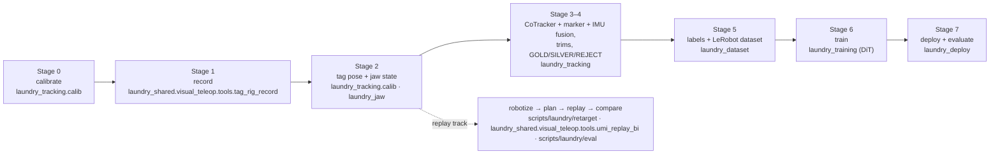
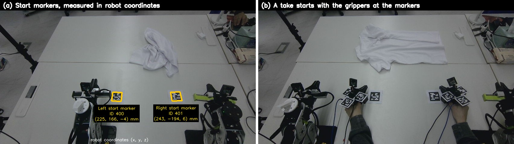
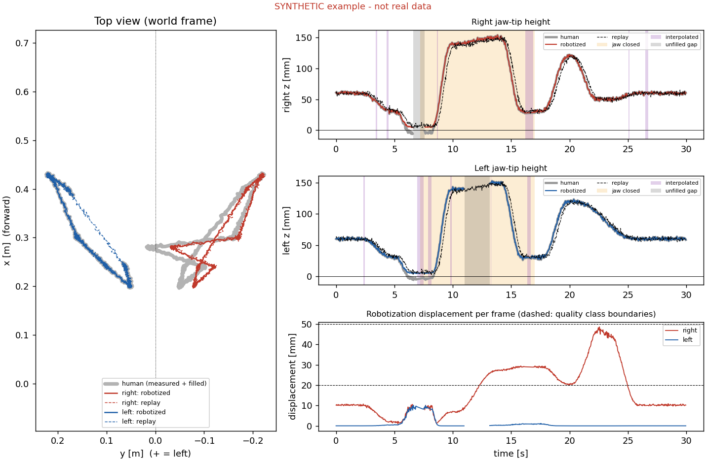

# Pipeline: world frame, stages, commands, pose reconstruction

*Moved from the README on 2026-11-05 when the README became a short front page; the text is unchanged except code paths, which name the current layout ([refactor map](refactor_2026-11.md)).*

Contents: [System at a glance](#system-at-a-glance) · [Stage 0](#stage-0--one-world-frame-for-human-and-robot) · [Stages 1–9](#stages-19--from-human-motion-to-robot-motion) · [Commands on real data](#commands-on-real-data-stages-07) · [Reproducible commands (synthetic data)](#reproducible-commands-synthetic-data) · [Pose reconstruction and validation](#pose-reconstruction-and-validation-stages-24) · [Visual observations](#visual-observations)

## System at a glance


*Data flow, as of 27 October. A person demonstrates with two hand-worn grippers; wrist fisheye cameras, wrist IMUs and
a fixed RGB-D camera record on one clock. Points on each gripper are tracked in the fixed-camera video, lifted by depth
and fused with the fiducial markers (anchors) and the IMU (only inside tracking gaps) into the jaw-tip pose in one world
frame, the robot base. Each episode is trimmed and graded; the training label is the Cartesian pose before inverse
kinematics. A policy pretrained on public cloth data is fine-tuned on the best-graded demonstrations and runs on the
robot in a receding-horizon loop with online IK and safety checks. The grey box lists parts of the earlier replay
pipeline that are no longer used.* (Figure generated by [`docs/make_architecture.py`](make_architecture.py).) The figure shows the stage names; the package of each stage is in the diagram below.

The same flow by stage, with the code for each stage:



| unit | role |
|---|---|
| **2× HandUMI** (hand-worn gripper) | demonstration tool; parallel jaws with **four AprilTag markers** (printed square codes whose 3D pose a camera can measure): three 48 mm tags plus, since 10-23, a 30 mm tag on the back of the wrist camera (IDs 220 / 221, rig `umi_tag_rig_v002`; a lone 30 mm tag is accepted only with an IMU check against its pose flip); a wrist fisheye camera (30 Hz), an IMU (motion sensor; Seeed XIAO nRF52840 Sense) and a **jaw servo** (Feetech STS3215) read with torque off as a passive jaw encoder at ≈100 Hz on the host clock (back since 10-29; ~~no jaw motor~~ 10-13 → 10-28) |
| **Orbbec Gemini 336** (fixed RGB-D camera) | colour + aligned depth, fixed above the table (recorded at about 15 Hz), raised to 113 cm (10-25) so both hands stay in view (the 11-01 re-aim changed only the angle; the height was not re-measured); the **pose source** (point tracking + markers + depth); sees both grippers, the two **start markers** and two fixed table tags used to re-calibrate after a camera move (~~the wrist calibration marker~~, first calibration only) |
| **2× reBot B601-DM** | low-cost 6-DoF arms with parallel jaws, driven by our MIT-mode bridge (100 Hz, auto re-enable, USB reconnect, jaw-opening limit enforced); run the policy (earlier: open-loop replay target) |
| **Robot corrections** | measured with tape and camera instead of trusting the robot's CAD model: gripper-tip position (model was 89 mm off), left-arm mounting position (70 mm and 3° off), left arm's 2nd joint zero (−8.4°) |
| **Host computer** | records all streams on one monotonic clock; robot control and online IK |
| **GPUs** | rented RTX 5090 pods (RunPod): point tracking, the jaw model, 3-D solve, some policy training; one run on a rented H100; company RTX 4090 via Ray: the DiT fine-tunes (flattening, pinching); ~~only for the optional visual-SLAM gap filler~~ |

Two principles run through the system:

* **One world frame.** Every pose, human or robot, is expressed in the robot base frame. The fixed camera is calibrated
  to the robot (again after every camera move, from two fixed table markers and the table plane), and every recording
  starts with the grippers placed on start markers whose positions in the robot frame were measured once. No
  per-recording alignment (~~no SLAM map~~, no point-cloud registration) is needed. Details in [Stage 0](#stage-0--one-world-frame-for-human-and-robot).
* **One clock.** Camera frames, IMU samples, the robot's commanded and measured joints all carry host timestamps, so
  human, command and robot can be compared sample by sample and filmed side by side by the same camera without
  synchronization hardware.

## Stage 0 — One world frame for human and robot



*(a) Start markers on the table (IDs 400 / 401), measured once in robot coordinates. (b) Every take starts with the
grippers there.*

Everything is expressed in the **robot's base coordinates**. This is set up once:

1. **Camera → robot.** First calibration: the robot moves a marker on its wrist through 32 poses in front of the fixed
   Orbbec (18 of them used in the solve; 0.98 px held-out); this gives the camera pose in the robot base frame. Since
   the camera was moved (10-25/26), it is re-solved after every move from two fixed 70 mm table tags with known robot
   coordinates plus the table plane (`robot_cam_v002…v005`). From then on, anything the camera measures is in robot
   coordinates.
2. **Start markers.** Two AprilTags taped on the table are measured once with the calibrated camera (photo a):
   left (225, 166, −4) mm, right (243, −194, 6) mm.
3. **Gripper markers → jaw tip.** A one-time rig calibration relates the four markers on each gripper to its jaw tip
   (1–4 mm), so the camera gives the jaw-tip pose directly in robot coordinates.
4. **Every take starts at the start markers** (photo b), so every demonstration begins at the same known robot
   coordinates. No per-take alignment (~~no SLAM map~~, no point-cloud registration) is needed.

## Stages 1–9 — From human motion to robot motion

The method as conceptual stages (the replay track); the command stages in the next subsection follow the code layout
(0–7) instead.

1. **Record** both hands from a fixed start pose on the start markers, with a spoken protocol marking demo windows.
2. **Reconstruct** the jaw-tip trajectory of each hand in the robot base frame from markers + depth.
3. **Fill gaps** (gyro rotation + interpolation; optional gated SLAM) and flag every filled frame.
4. **Label the jaw** from the wrist video (replay track); demonstrations recorded since 29 October take it from the
   jaw servo's encoder instead ([history](history.md#first-policies-on-the-robot-and-what-they-exposed-in-the-data-october-28--november-1)).
5. **Robotize** with continuous warps only, never clipping: lateral compression toward each arm's own side with a
   softplus ceiling at the midline, and a softplus floor above the table. Store displacement and quality per frame
   ([`src/laundry_reference/robotize.py`](../src/laundry_reference/robotize.py) shows the idea; the version that ran
   is [`scripts/laundry/retarget/umi_robotize_bi.py`](../scripts/laundry/retarget/umi_robotize_bi.py)).
6. **Plan** with joint-limit-aware differential IK (position prioritised over orientation, bounded joint change per
   frame, wrist-roll relaxation about the tool axis, use of the jaw's 180° symmetry, finger-corner clearance), and issue
   jaw commands early by the measured jaw actuation latency.
7. **Check** before anything moves: IK error, joint limits and speed, TCP and link heights above the table, and the
   minimum distance between the two arms. Plans are always computed offline first.
8. **Replay** open loop and log commanded and measured joints on the host clock.
9. **Compare** three levels: A = human (markers), B = robot command (FK of commanded joints), C = robot (FK of
   encoders), plus a side-by-side video from the same camera
   ([`src/laundry_reference/parity_metrics.py`](../src/laundry_reference/parity_metrics.py) shows the metric
   definitions; the scorer that ran is [`scripts/laundry/eval/replay_parity.py`](../scripts/laundry/eval/replay_parity.py)).

Since 26–27 October the stages after pose reconstruction produce **policy training data** instead of a replay (see
[history](history.md#from-replay-to-policy-training-data-october-2627)).

## Commands on real data (stages 0–7)

Commands run from the repo root with the package installed (`uv sync` or `pip install -e .`; without installing,
prefix `PYTHONPATH=src`). They need the recorded takes, which are not in this repository; data, checkpoint and work
folders come from `laundry_common.paths` (environment variables `EGO_DATA_ROOT`, `EGO_FUSION_WORK`, `EGO_TRAIN_ROOT`,
`EGO_CKPT_ROOT`, `TAGRIG_STATE_DIR`). Replay-track scripts: [pipeline_replay_track.md](pipeline_replay_track.md).
Package by package: [codebase.md](codebase.md).

**Stage 0 · calibrate** (once, and the camera ↔ robot part after every camera move)
```bash
python -m laundry_tracking.calib.robot_cam_solve datasets/tag_rig/<take> datasets/robot_cam/<run> --write      # first camera ↔ robot solve
python -m laundry_tracking.calib.robot_cam_from_anchors datasets/tag_rig/<take> --frames 2400:2828:4            # re-solve from the fixed table tags
python -m laundry_tracking.calib.tag_rig_solve datasets/tag_rig/<ts>                                           # tag rig; then calib.tag_rig_pivot / calib.tag_rig_touch_tcp
python scripts/laundry/retarget/umi_align.py datasets/tag_rig/<align take> --write                             # UMI TCP frame → reBot EEF frame
```

**Stage 1 · record**
```bash
python -m laundry_deploy.robot_service.mit_bridge                                                              # robot bridge (robot computer only)
sudo .venv/bin/python -m laundry_shared.visual_teleop.tools.tag_rig_record --proto task --wrist
```

**Stage 2 · tag pose + jaw state**
```bash
python -m laundry_tracking.calib.umi_tcp_traj <take> --hand <hand> --depth --imu-fill
python -m laundry_shared.visual_teleop.tools.umi_jaw infer <take>/wrist                    # again for <take>/wrist_left
python -m laundry_jaw.aperture <take>/wrist                                                # YOLO-pose jaw tips → aperture g
# demos from 10-29: jaw state from the servo instead of the video (same umi_jaw.npz format)
python -m laundry_jaw.from_motor <take>                                                    # gripper_motor_{left,right}.npz → <take>/<wrist dir>/umi_jaw.npz
```
The recorder (`python -m laundry_shared.visual_teleop.tools.tag_rig_record`) logs both jaw servos with torque off (`--no-motor` to skip),
and warns aloud when a servo reads outside its calibrated range. `laundry_jaw.from_motor` maps motor ticks through a per-hand
calibration (closed … open) to `g_cont`, adds open/close events with hysteresis + dwell, and re-centres each take because a
re-plug or power cycle shifts the whole reading.

**Stage 3 · CoTracker + marker + IMU fusion** (package `laundry_tracking`)
```bash
python -m laundry_tracking.new_take_prep <take>                                  # arm assignment, idle trim, start seeds
python -m laundry_tracking.cotrack.make_pack <pack> <take>:<demo> ...            # CoTracker query points (40 per rig)
python -m laundry_tracking.cotrack.run_cotracker <pack>                          # GPU (cluster job: scripts/laundry/ray_cotracker/)
python -m laundry_tracking.cotrack.point_solver <pack> && python -m laundry_tracking.cotrack.gate <pack>
python -m laundry_tracking.fusion.trajectory_fusion <pack> Cg --ct solve3
python -m laundry_tracking.fusion.make_derived <pack>                            # fused paths → derived take for the dataset stage
```

**Stage 4 · trims + quality grade**
```bash
python -m laundry_tracking.tighten_trim <idle_audit.csv> 0.3 && python -m laundry_tracking.edge_gap_trim <pack> ...
python -m laundry_tracking.cotrack.episode_quality <quality.csv> <pack> ...      # GOLD / SILVER / REJECT
```

**Stage 5 · labels + dataset** (package `laundry_dataset`)
```bash
python -m laundry_dataset.robotize_ik <raw take> <derived take> --demos 0,1,... --workers 8   # labels A + B + IK diagnostics
python -m laundry_dataset.tag_rig_unsplit --label rob --mask-mode stitched --out <dataset> --takes <take> ...
# since 10-29: label F (fused jaw tip in reBot gripper axes, 0.25 s smoothing, no clamp/lift), optionally on the 0.3× time-stretched copy
python -m laundry_dataset.tag_rig_unsplit --label fused --mask-mode stitched --speed 0.3 --out <dataset> --takes <take> ...
# 11-04 →: gated masks, continuous jaw target and the gap-based split of the flattening sets
FILL_MASK_S=0.3 python -m laundry_dataset.tag_rig_unsplit --label fused --speed 0.3 --mask-mode gated --grip-label cont --out <dataset> --takes <take> ...
python -m laundry_dataset.builds.split_gold_silver_reject <prefix> <derived> <quality> <ctgap> [exclude]
```

**Stage 6 · train** — the DiT trainer (masks, per-episode weights, optional jaw BCE head `GRIP_BCE=1`, jaw-state
masking `GRIP_STATE_MASK=1`, gradient clipping at norm 10 by default, `GRAD_CLIP=0` turns it off; the pinching runs use
BCE and no clipping) and its configs are in `src/laundry_training/` (added 11-01; switches in
`laundry_training.env_options`); the X-VLA fine-tuning code is not in this repository. Entry point
`python -m laundry_training.train_dit_tagrig` (needs the LeRobot fork of the training nodes,
`configs/laundry/envs/requirements-train.txt`); on the cluster `scripts/laundry/ray_ditddp/run.sh`. The plan
(DiT and X-VLA fine-tuned on GOLD) is in [details.md §3.2](details.md#32-training-plan).

**Stage 7 · deploy + evaluate** (package `laundry_deploy`)
```bash
python -m laundry_deploy.ui.server                                               # deploy UI (:8770); DRY first
python -m laundry_deploy.session.cli run --policy dit --secs 30                  # dry run; add --go only with a person at the robot
python -m laundry_deploy.tools.offline_eval --ckpt <run>/checkpoints/last --data <val dataset> --out <report dir>   # k16/k32, zero-motion baseline, grasp / free breakdown
python -m laundry_deploy.tools.height_calib measure                              # per-arm table height
```

**Earlier track: open-loop replay** (stages 1–2 as above, then)
```bash
python scripts/laundry/retarget/umi_robotize_bi.py <take> --clear 0 --sep 0.06 --min-reach 0                   # robotize
python -m laundry_shared.visual_teleop.tools.umi_replay_bi <take> --rep 1 --traj _robot --speed 0.35 --q-smooth 9 --max-ik-mm 15 --tip-clear -0.01 --tip-clear-left-extra 0 --link-margin 0.015 --max-rot-dev 25 --offline   # plan + check
python -m laundry_shared.visual_teleop.tools.umi_replay_bi <take> --rep 1 --traj _robot --speed 0.35 --q-smooth 9 --max-ik-mm 15 --tip-clear -0.01 --tip-clear-left-extra 0 --link-margin 0.015 --max-rot-dev 25 --go        # replay
python scripts/laundry/eval/replay_parity.py <take> <run>/right                                                # compare human / command / robot
```

Full command list, options and safety rules: [Technical Report v0.1](../report/archive/report_v0.1_en.pdf) (archived), Appendix A (pre-refactor paths; see the [path map](refactor_2026-11.md)).

## Reproducible commands (synthetic data)

The standalone re-implementations in `src/laundry_reference/` run on the synthetic example without any recording or hardware.

| stage | command (same as the `laundry-reference-…` console command after installing) |
|---|---|
| – | `python assets/laundry/examples/make_synthetic.py` — regenerate the synthetic data (seed 0) |
| 3 fill gaps | `python -m laundry_reference.gap_fill assets/laundry/examples/synthetic_bimanual_demo.csv out/filled.csv --max-gap 1.0` |
| 5 robotize | `python -m laundry_reference.robotize out/filled.csv out/robotized.csv --sep 0.05` |
| 9 compare | `python -m laundry_reference.parity_metrics out/robotized.csv assets/laundry/examples/synthetic_robot_replay.csv` |
| learning contract | `python -m laundry_reference.relative_se3 out/filled.csv --chunk 1.0` |
| 9 plot | `python -m laundry_reference.plot_example out/robotized.csv out/example.png --robot assets/laundry/examples/synthetic_robot_replay.csv` |
| tests | `python -m pytest -q src/laundry_reference/tests tests/laundry/test_modules.py tests/laundry/test_tools.py` |

```bash
pip install -e ".[test]"                                              # or: uv sync
python assets/laundry/examples/make_synthetic.py                      # regenerate the synthetic data (seed 0)
python -m laundry_reference.gap_fill assets/laundry/examples/synthetic_bimanual_demo.csv out/filled.csv --max-gap 1.0
python -m laundry_reference.robotize out/filled.csv out/robotized.csv --sep 0.05
python -m laundry_reference.parity_metrics out/robotized.csv assets/laundry/examples/synthetic_robot_replay.csv
python -m laundry_reference.relative_se3 out/filled.csv --chunk 1.0
python -m laundry_reference.plot_example out/robotized.csv out/example.png --robot assets/laundry/examples/synthetic_robot_replay.csv
```

Expected parity output on the synthetic data: recovered lag ≈0.2–0.26 s (the generator uses 0.25 s), position RMSE
≈6 mm. Comparing the *unrobotized* human path with the replay instead gives ≈17 mm for the right hand: the difference
is the robotization displacement, the analogue of the "command vs. human" term in the real analysis.



The tests check every `laundry_reference` module against outputs recorded before the code was packaged
([`tests/laundry/expected_synthetic.json`](../tests/laundry/expected_synthetic.json)) and that `assets/laundry/examples/make_synthetic.py`
reproduces the committed example files; the synthetic numbers are listed in
[results.md §8](results.md#8-synthetic-example-this-repository).

## Pose reconstruction and validation (stages 2–4)

1. **Markers → gripper pose.** In each RGB-D frame the AprilTags are detected and solved individually (planar PnP), and
   the marker distance, the least accurate PnP coordinate at about 1 m, is corrected along the viewing ray by the
   aligned depth. When several tags of one gripper are visible, all their corners are solved jointly for the gripper
   pose. Rotation can additionally be stabilised by the wrist gyroscope anchored to the marker frames.
2. **Gripper → jaw tip in the robot frame.** A one-time rig calibration maps the gripper's markers to its jaw tip; the
   camera-to-robot calibration maps the result into the robot base frame.
3. **Gaps.** Markers disappear exactly when the hand grasps (palm down). Short gaps get the gyro rotation and an
   interpolated position and are flagged as not measured. ~~Wrist-camera SLAM is an *optional* filler, accepted only for
   segments that stay close to the marker path on held-out validation frames.~~ Replaced on 24 October by fixed-camera
   point tracking ([history](history.md#current-vs-superseded)).
4. **Jaw state.** An ImageNet-pretrained ResNet-18 per hand classifies a crop of the wrist fisheye that shows the jaws,
   with hysteresis on its output. Since 22 October a keypoint model finds the two jaw tips and their distance gives a
   continuous aperture (100 % / 98 % agreement with hand labels on a re-angled take).
5. **Jaw state from the servo (since 29 October).** Each hand-worn gripper again carries its jaw servo, now with torque
   off so it never drives the jaw while a person holds it; it is only read, at ≈100 Hz on the same host clock as the
   cameras. The motor position is mapped through a per-hand calibration (closed … open ticks) to a continuous aperture
   (0 closed … 1 open), then to open/closed events with hysteresis and a minimum dwell. The reading is re-centred per
   recording, because unplugging or power-cycling a servo shifts its whole range; the recorder warns aloud when a servo
   reads outside its calibrated range. The output has the same format as the video labels, so every later stage is
   unchanged. Video- and servo-derived labels are kept apart and never mixed in one comparison.

**Validation is geometric and physical**, not only internal: held-out reprojection for the camera-to-robot calibration,
leave-one-out and an independent pivot test for the jaw-tip rig, a tape measure for the absolute robot jaw position,
and finally the robot itself, filmed by the same camera as the human.

**Reconstructed jaw-tip trajectories** of the same demonstration. Left: the paths projected into the fixed camera, coloured
by the source of each frame: AprilTag markers + depth (green), MASt3R-SLAM gap filler (blue), IMU rotation +
interpolation where markers are hidden (orange). Right: both hands in one world frame (millimetres, offset to the
workspace corner).


## Visual observations

| view | what it provides |
|---|---|
| **Wrist fisheye** (one per hand) | the jaws themselves (open / closed, continuous aperture from jaw-tip keypoints), contact, and a close-up of the local cloth; ~~also the input of the optional SLAM filler~~. This is the view a robot with wrist cameras would have, and a policy input. |
| **Fixed external RGB-D** | the pose source: point tracking on the grippers + the fiducial markers + metric depth; global scene context (where the garment lies, both hands at once) and a policy input. It is also the camera that films the robot, so human and robot appear in the same image. |
