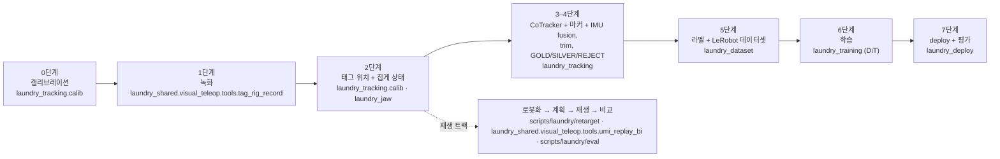
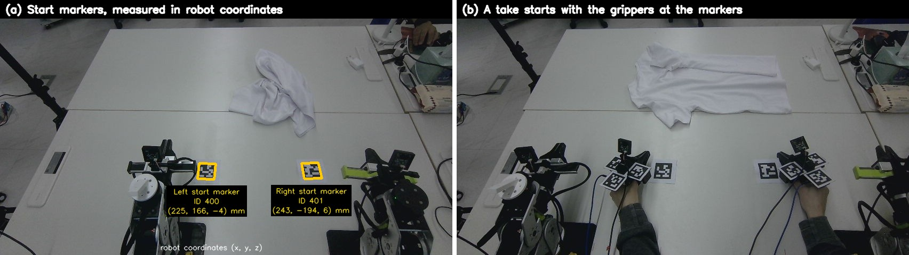
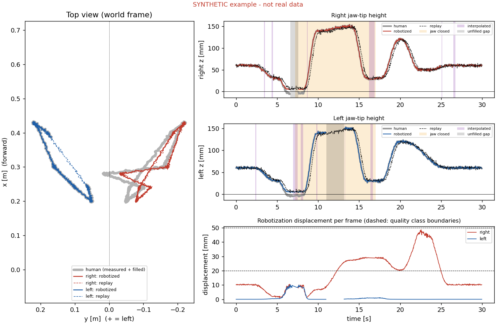

# 파이프라인: 월드 좌표, 단계, 명령, 위치 복원

*2026-11-05에 README를 짧은 첫 페이지로 줄이면서 README에서 옮겨 온 내용입니다. 본문은 그대로이고 코드 경로만 지금 구조에 맞게 고쳤습니다([경로 대응표, 영문](refactor_2026-11.md)).*

목차: [시스템 한눈에 보기](#시스템-한눈에-보기) · [0단계](#0단계--사람과-로봇이-같은-월드-좌표를-쓰는-방법) · [1–9단계](#19단계--사람-동작에서-로봇-동작으로) · [실제 데이터 명령](#실제-데이터-명령-07단계) · [재현 가능한 명령 (합성 데이터)](#재현-가능한-명령-합성-데이터) · [위치 복원과 검증](#위치-복원과-검증-24단계) · [시각 관측](#시각-관측)

## 시스템 한눈에 보기


*10-27 기준 데이터 흐름. 사람이 손에 끼는 집게 두 개로 시연하고, 손목 어안 카메라, 손목 IMU, 고정 RGB-D 카메라가 하나의
시계로 녹화합니다. 각 집게의 점을 고정 카메라 영상에서 추적하고, 깊이로 3D로 올린 뒤, 기준점인 fiducial 마커와 IMU(추적이 끊긴
구간 안에서만)와 합쳐 하나의 월드 좌표(로봇 베이스)에서 집게 끝 포즈를 얻습니다. 에피소드마다 trim하고 등급을 매기며, 학습 라벨은
IK 이전 Cartesian 포즈입니다. 공개 천 데이터로 pretrain한 정책을 가장 좋은 등급의 시연으로 파인튜닝하고, 실시간 IK와 안전 검사가
있는 receding-horizon 루프로 로봇에서 돌립니다. 회색 상자는 더 이상 쓰지 않는 이전 재생 파이프라인 부분입니다.*
(그림 생성: [`docs/make_architecture.py`](make_architecture.py)) 그림은 단계 이름을 보여 주고, 단계별 패키지는 아래 도표에 있습니다.

같은 흐름을 단계와 코드 위치로:



| 장치 | 역할 |
|---|---|
| **HandUMI 2개** (손에 끼는 집게) | 시연 도구인 평행 집게입니다. 각각 **AprilTag 마커 4장**(카메라가 3D 위치·방향을 잴 수 있는 인쇄된 사각 코드): 48 mm 태그 3장 + 10-23부터 손목 카메라 뒷면의 30 mm 태그 1장(ID 220 / 221, 리그 `umi_tag_rig_v002`, 30 mm 태그 하나만 보일 때는 자세 뒤집힘을 IMU로 확인한 경우에만 사용), 손목 어안 카메라(30 Hz), IMU(움직임 센서, Seeed XIAO nRF52840 Sense), **집게 서보**(Feetech STS3215, 토크를 끄고 집게 엔코더로만 읽음, 호스트 시계 기준 약 100 Hz)가 달려 있습니다. 서보는 10-29에 다시 달았습니다(~~집게 모터 없음~~ 10-13 → 10-28). |
| **Orbbec Gemini 336** (고정 RGB-D 카메라) | 테이블 위에 고정한 컬러 + 정렬된 깊이 카메라(녹화 스트림 약 15 Hz)입니다. 양손이 화면 안에 있도록 113 cm로 올렸고(10-25, 11-01 재조준은 각도만 맞췄고 높이는 다시 재지 않음), **위치 추정의 주 소스**(점 추적 + 마커 + 깊이)입니다. 양손 집게, 테이블의 **시작점 마커** 2장, 카메라를 옮긴 뒤 다시 캘리브레이션할 때 쓰는 테이블 고정 태그 2장을 봅니다(~~로봇 손목 캘리브레이션 마커~~는 첫 캘리브레이션에만 사용). |
| **reBot B601-DM 2대** | 평행 집게가 달린 저가 6축 팔입니다. 우리 MIT 브리지로 구동합니다(100 Hz, 모터 자동 재활성화, USB 재연결, 집게 열림 제한). 학습한 정책을 실행합니다(이전에는 open-loop 재생 대상). |
| **로봇 보정** | 로봇 CAD 모델 값을 믿지 않고 줄자와 카메라로 직접 쟀습니다. 집게 끝 위치(모델이 89 mm 어긋남), 왼팔 설치 위치(70 mm, 3° 어긋남), 왼팔 2번 관절 영점(−8.4°)을 보정했습니다. |
| **호스트 컴퓨터** | 모든 스트림을 하나의 단조 시계로 녹화, 로봇 제어와 실시간 IK |
| **GPU** | 임대 RTX 5090 pod(RunPod): 점 추적, 집게 모델, 3D 계산, 일부 정책 학습. 임대 H100에서 한 번 학습. 회사 RTX 4090(Ray 경유): DiT 파인튜닝(펴기, 핀칭). ~~선택적 시각 SLAM 끊김 보완용으로만~~ |

시스템 전체에 두 원칙이 있습니다.

* **하나의 월드 좌표.** 사람이든 로봇이든 모든 포즈를 로봇 베이스 좌표로 표현합니다. 고정 카메라를 로봇에 캘리브레이션하고(카메라를
  옮길 때마다 테이블 고정 마커 2장과 테이블 평면으로 다시), 모든 녹화는 로봇 좌표로 한 번 측정해 둔 시작점 마커에 집게를 두고
  시작합니다. 녹화마다 따로 맞추는 과정(~~SLAM 지도~~, 점군 정합)은 필요 없습니다. 자세한 내용은 [0단계](#0단계--사람과-로봇이-같은-월드-좌표를-쓰는-방법).
* **하나의 시계.** 카메라 프레임, IMU 샘플, 로봇의 명령·측정 관절값에 모두 호스트 시각이 붙으므로, 동기화 하드웨어 없이 사람·명령·로봇을
  샘플 단위로 비교하고 같은 카메라로 나란히 찍을 수 있습니다.

## 0단계 — 사람과 로봇이 같은 월드 좌표를 쓰는 방법



*(a) 테이블의 시작점 마커(ID 400 / 401), 로봇 좌표로 한 번 측정. (b) 매 테이크는 집게를 여기에 두고 시작.*

모든 데이터는 **로봇 베이스 좌표**로 표현합니다. 이 좌표는 한 번만 맞춥니다.

1. **카메라 → 로봇.** 첫 캘리브레이션은 로봇이 손목 마커를 고정된 Orbbec 앞에서 32자세로 움직여 구했습니다(풀이에 18자세 사용,
   검증 0.98 px). 이것으로 로봇 베이스 좌표에서 카메라 포즈를 얻습니다. 카메라를 옮긴 뒤(10-25/26)에는 로봇 좌표를 아는 테이블
   고정 70 mm 태그 2장과 테이블 평면으로 옮길 때마다 다시 풉니다(`robot_cam_v002…v005`). 그 뒤로는 카메라로 잰 모든 것이 로봇
   좌표입니다.
2. **시작점 마커.** 테이블에 붙인 AprilTag 2장을 캘리브레이션된 카메라로 한 번 측정합니다(사진 a). 왼쪽 (225, 166, −4) mm,
   오른쪽 (243, −194, 6) mm입니다.
3. **집게 마커 → 집게 끝.** 집게마다 마커 4장과 집게 끝의 관계를 한 번 구합니다(1–4 mm). 그래서 카메라가 집게 끝 포즈를 바로
   로봇 좌표로 줍니다.
4. **매 테이크는 시작점 마커에서 시작합니다**(사진 b). 그래서 모든 시연이 로봇 좌표로 알려진 같은 위치에서 시작합니다. 테이크마다
   따로 맞추는 과정(~~SLAM 지도~~, 점군 정합)은 필요 없습니다.

## 1–9단계 — 사람 동작에서 로봇 동작으로

방법을 개념 단계로 적은 것입니다(재생 트랙). 다음 절의 명령 단계는 코드 구조(0–7단계)를 따릅니다.

1. **녹화**: 시작점 마커 위 고정 시작 자세에서 양손을 녹화하고, 말로 하는 프로토콜로 데모 구간을 표시합니다.
2. **복원**: 마커 + 깊이로 손마다 로봇 베이스 좌표의 집게 끝 궤적을 구합니다.
3. **끊김 보완**: 자이로 회전 + 보간(선택적으로 gate를 거친 SLAM), 보완한 프레임은 모두 표시합니다.
4. **집게 라벨**: 손목 영상에서(재생 트랙). 10-29 이후 녹화한 시연은 집게 서보 엔코더에서 얻습니다([이력](history_ko.md#로봇에서-돌린-첫-정책과-데이터에서-드러난-것-10-28--11-01)).
5. **로봇화**: 연속 변형만 쓰고 자르지(clipping) 않습니다. 팔마다 자기 쪽으로 옆 방향 압축(중앙선에 softplus 천장), 테이블 위에
   softplus 바닥. 변위와 품질을 프레임마다 저장합니다([`src/laundry_reference/robotize.py`](../src/laundry_reference/robotize.py)는
   아이디어를 보여 주고, 실제로 돌린 것은 [`scripts/laundry/retarget/umi_robotize_bi.py`](../scripts/laundry/retarget/umi_robotize_bi.py)).
6. **계획**: 관절 한계를 고려한 미분 IK(방향보다 위치 우선, 프레임당 관절 변화 제한, 공구 축 주위 손목 roll 완화, 집게의 180°
   대칭 활용, 손가락 모서리 여유), 측정한 집게 동작 지연만큼 집게 명령을 일찍 보냅니다.
7. **검사**: 움직이기 전에 IK 오차, 관절 한계와 속도, 테이블 위 TCP·링크 높이, 두 팔 사이 최소 거리를 봅니다. 계획은 항상 먼저
   오프라인으로 계산합니다.
8. **재생**: open-loop로 재생하고 명령·측정 관절값을 호스트 시계로 기록합니다.
9. **비교**: 세 수준. A = 사람(마커), B = 로봇 명령(명령 관절의 FK), C = 로봇(엔코더의 FK), 그리고 같은 카메라의 나란히 보기
   영상([`src/laundry_reference/parity_metrics.py`](../src/laundry_reference/parity_metrics.py)는 지표 정의를 보여 주고, 실제로
   돌린 채점기는 [`scripts/laundry/eval/replay_parity.py`](../scripts/laundry/eval/replay_parity.py)).

10-26–27부터 위치 복원 이후 단계는 재생 대신 **정책 학습 데이터**를 만듭니다([이력](history_ko.md#재생에서-정책-학습-데이터로-10-2627) 참고).

## 실제 데이터 명령 (0–7단계)

명령은 패키지를 설치한 상태(`uv sync` 또는 `pip install -e .`, 설치하지 않으면 앞에 `PYTHONPATH=src`)로 저장소 루트에서 실행하며,
이 저장소에 없는 녹화 take가 필요합니다. 데이터·checkpoint·작업 폴더는 `laundry_common.paths`에서 옵니다(환경 변수 `EGO_DATA_ROOT`,
`EGO_FUSION_WORK`, `EGO_TRAIN_ROOT`, `EGO_CKPT_ROOT`, `TAGRIG_STATE_DIR`). 재생 트랙 script: [pipeline_replay_track.md](pipeline_replay_track.md).
패키지별 안내: [codebase_ko.md](codebase_ko.md).

**0단계 · 캘리브레이션** (한 번, 카메라 ↔ 로봇은 카메라를 옮길 때마다)
```bash
python -m laundry_tracking.calib.robot_cam_solve datasets/tag_rig/<take> datasets/robot_cam/<run> --write      # 첫 카메라 ↔ 로봇 풀이
python -m laundry_tracking.calib.robot_cam_from_anchors datasets/tag_rig/<take> --frames 2400:2828:4            # 테이블 고정 태그로 다시 풀이
python -m laundry_tracking.calib.tag_rig_solve datasets/tag_rig/<ts>                                           # 태그 리그, 이어서 calib.tag_rig_pivot / calib.tag_rig_touch_tcp
python scripts/laundry/retarget/umi_align.py datasets/tag_rig/<align take> --write                             # UMI TCP 좌표 → reBot EEF 좌표
```

**1단계 · 녹화**
```bash
python -m laundry_deploy.robot_service.mit_bridge                                                              # 로봇 브리지 (로봇 컴퓨터에서만)
sudo .venv/bin/python -m laundry_shared.visual_teleop.tools.tag_rig_record --proto task --wrist
```

**2단계 · 태그 위치 + 집게 상태**
```bash
python -m laundry_tracking.calib.umi_tcp_traj <take> --hand <hand> --depth --imu-fill
python -m laundry_shared.visual_teleop.tools.umi_jaw infer <take>/wrist                    # <take>/wrist_left 도 한 번 더
python -m laundry_jaw.aperture <take>/wrist                                                # YOLO-pose 집게 끝 → 열림 정도 g
# 10-29 이후 시연: 영상 대신 서보로 집게 상태 (같은 umi_jaw.npz 형식)
python -m laundry_jaw.from_motor <take>                                                    # gripper_motor_{left,right}.npz → <take>/<wrist dir>/umi_jaw.npz
```
녹화기(`python -m laundry_shared.visual_teleop.tools.tag_rig_record`)는 두 집게 서보를 토크를 끈 채로 기록하고(`--no-motor`로 끔), 서보 값이
캘리브레이션 범위를 벗어나면 음성으로 알립니다. `laundry_jaw.from_motor`는 손별 캘리브레이션(닫힘 … 열림 tick)으로 `g_cont`를 만들고,
히스테리시스 + 최소 유지 시간으로 열림/닫힘 이벤트를 붙이며, 다시 꽂거나 전원을 껐다 켜면 값 전체가 밀리기 때문에 take마다 재중심합니다.

**3단계 · CoTracker + 마커 + IMU fusion** (패키지 `laundry_tracking`)
```bash
python -m laundry_tracking.new_take_prep <take>                                  # 팔 배정, 정지 trim, 시작 seed
python -m laundry_tracking.cotrack.make_pack <pack> <take>:<demo> ...            # CoTracker 질의 점 (리그마다 40개)
python -m laundry_tracking.cotrack.run_cotracker <pack>                          # GPU (클러스터 작업: scripts/laundry/ray_cotracker/)
python -m laundry_tracking.cotrack.point_solver <pack> && python -m laundry_tracking.cotrack.gate <pack>
python -m laundry_tracking.fusion.trajectory_fusion <pack> Cg --ct solve3
python -m laundry_tracking.fusion.make_derived <pack>                            # 합친 궤적 → 데이터셋 단계용 derived take
```

**4단계 · trim + 품질 등급**
```bash
python -m laundry_tracking.tighten_trim <idle_audit.csv> 0.3 && python -m laundry_tracking.edge_gap_trim <pack> ...
python -m laundry_tracking.cotrack.episode_quality <quality.csv> <pack> ...      # GOLD / SILVER / REJECT
```

**5단계 · 라벨 + 데이터셋** (패키지 `laundry_dataset`)
```bash
python -m laundry_dataset.robotize_ik <raw take> <derived take> --demos 0,1,... --workers 8   # 라벨 A + B + IK 진단
python -m laundry_dataset.tag_rig_unsplit --label rob --mask-mode stitched --out <dataset> --takes <take> ...
# 10-29부터: 라벨 F (reBot 집게 축의 fusion 집게 끝, 0.25초 smoothing, clamp·들어올림 없음), 필요하면 0.3배속으로 늘린 복사본
python -m laundry_dataset.tag_rig_unsplit --label fused --mask-mode stitched --speed 0.3 --out <dataset> --takes <take> ...
# 11-04 →: gated mask, 연속 집게 목표, 펴기 세트의 gap 기반 split
FILL_MASK_S=0.3 python -m laundry_dataset.tag_rig_unsplit --label fused --speed 0.3 --mask-mode gated --grip-label cont --out <dataset> --takes <take> ...
python -m laundry_dataset.builds.split_gold_silver_reject <prefix> <derived> <quality> <ctgap> [exclude]
```

**6단계 · 학습** — DiT 학습기(mask, 에피소드별 가중치, 선택 사항인 집게 BCE head `GRIP_BCE=1`, 집게 상태 가림
`GRIP_STATE_MASK=1`, gradient clipping은 기본 norm 10이고 `GRAD_CLIP=0`이면 끔. 핀칭 학습은 BCE와 clipping 끔을 씀)와 설정은
`src/laundry_training/`에 있습니다(11-01 추가, 스위치는 `laundry_training.env_options`). X-VLA 파인튜닝 코드는 이 저장소에 없습니다.
실행은 `python -m laundry_training.train_dit_tagrig`(학습 노드의 LeRobot 포크 필요, `configs/laundry/envs/requirements-train.txt`),
클러스터에서는 `scripts/laundry/ray_ditddp/run.sh`. 계획(GOLD로 DiT, X-VLA 파인튜닝)은 [details_ko.md 3.2절](details_ko.md#32-학습-계획)에 있습니다.

**7단계 · deploy + 평가** (패키지 `laundry_deploy`)
```bash
python -m laundry_deploy.ui.server                                               # deploy UI (:8770), DRY 먼저
python -m laundry_deploy.session.cli run --policy dit --secs 30                  # dry run. --go는 로봇 옆에 사람이 있을 때만
python -m laundry_deploy.tools.offline_eval --ckpt <run>/checkpoints/last --data <val dataset> --out <report dir>   # k16/k32, 움직임 0 기준선, 집기/자유 구간별
python -m laundry_deploy.tools.height_calib measure                              # 팔별 테이블 높이
```

**이전 트랙: open-loop 재생** (1–2단계는 위와 같고, 그다음)
```bash
python scripts/laundry/retarget/umi_robotize_bi.py <take> --clear 0 --sep 0.06 --min-reach 0                   # 로봇화
python -m laundry_shared.visual_teleop.tools.umi_replay_bi <take> --rep 1 --traj _robot --speed 0.35 --q-smooth 9 --max-ik-mm 15 --tip-clear -0.01 --tip-clear-left-extra 0 --link-margin 0.015 --max-rot-dev 25 --offline   # 계획 + 검사
python -m laundry_shared.visual_teleop.tools.umi_replay_bi <take> --rep 1 --traj _robot --speed 0.35 --q-smooth 9 --max-ik-mm 15 --tip-clear -0.01 --tip-clear-left-extra 0 --link-margin 0.015 --max-rot-dev 25 --go        # 재생
python scripts/laundry/eval/replay_parity.py <take> <run>/right                                                # 사람·명령·로봇 비교
```

전체 명령, 옵션, 안전 규칙은 [테크니컬 리포트 v0.1](../report/archive/report_v0.1_en.pdf)(보관본) 부록 A에 있습니다(리팩터링 이전 경로, [경로 대응표](refactor_2026-11.md) 참고).

## 재현 가능한 명령 (합성 데이터)

`src/laundry_reference/`의 독립 재구현은 녹화나 하드웨어 없이 합성 예제로 돌아갑니다.

| 단계 | 명령 (설치 뒤에는 `laundry-reference-…` 콘솔 명령과 같음) |
|---|---|
| – | `python assets/laundry/examples/make_synthetic.py` — 합성 데이터 다시 생성 (seed 0) |
| 3 끊김 보완 | `python -m laundry_reference.gap_fill assets/laundry/examples/synthetic_bimanual_demo.csv out/filled.csv --max-gap 1.0` |
| 5 로봇화 | `python -m laundry_reference.robotize out/filled.csv out/robotized.csv --sep 0.05` |
| 9 비교 | `python -m laundry_reference.parity_metrics out/robotized.csv assets/laundry/examples/synthetic_robot_replay.csv` |
| 학습 계약 | `python -m laundry_reference.relative_se3 out/filled.csv --chunk 1.0` |
| 9 그림 | `python -m laundry_reference.plot_example out/robotized.csv out/example.png --robot assets/laundry/examples/synthetic_robot_replay.csv` |
| 테스트 | `python -m pytest -q src/laundry_reference/tests tests/laundry/test_modules.py tests/laundry/test_tools.py` |

```bash
pip install -e ".[test]"                                              # 또는: uv sync
python assets/laundry/examples/make_synthetic.py                      # 합성 데이터 다시 생성 (seed 0)
python -m laundry_reference.gap_fill assets/laundry/examples/synthetic_bimanual_demo.csv out/filled.csv --max-gap 1.0
python -m laundry_reference.robotize out/filled.csv out/robotized.csv --sep 0.05
python -m laundry_reference.parity_metrics out/robotized.csv assets/laundry/examples/synthetic_robot_replay.csv
python -m laundry_reference.relative_se3 out/filled.csv --chunk 1.0
python -m laundry_reference.plot_example out/robotized.csv out/example.png --robot assets/laundry/examples/synthetic_robot_replay.csv
```

합성 데이터에서 기대하는 비교 출력: 찾은 지연 약 0.2–0.26초(생성기는 0.25초 사용), 위치 RMSE 약 6 mm. 대신 *로봇화하지 않은*
사람 궤적을 재생과 비교하면 오른손이 약 17 mm입니다. 그 차이가 로봇화 변위이며, 실제 분석의 "명령 vs 사람" 항에 해당합니다.



테스트는 모든 `laundry_reference` 모듈을 패키지로 묶기 전에 기록한 출력([`tests/laundry/expected_synthetic.json`](../tests/laundry/expected_synthetic.json))과
비교하고, `assets/laundry/examples/make_synthetic.py`가 커밋된 예제 파일을 그대로 다시 만드는지 검사합니다. 합성 데이터의 숫자는
[results.md 8절](results.md#8-synthetic-example-this-repository)에 있습니다.

## 위치 복원과 검증 (2–4단계)

1. **마커 → 집게 포즈.** RGB-D 프레임마다 AprilTag를 찾아 하나씩 풀고(평면 PnP), 약 1 m에서 PnP 좌표 중 가장 부정확한 마커
   거리를 정렬된 깊이로 시선 방향을 따라 고칩니다. 한 집게의 태그가 여러 장 보이면 모든 모서리를 함께 풀어 집게 포즈를 구합니다.
   회전은 마커 프레임에 맞춘 손목 자이로로 추가로 안정화할 수 있습니다.
2. **집게 → 로봇 좌표의 집게 끝.** 한 번의 리그 캘리브레이션이 집게 마커를 집게 끝으로, 카메라-로봇 캘리브레이션이 그 결과를
   로봇 베이스 좌표로 옮깁니다.
3. **끊김.** 손이 집을 때(손바닥이 아래로) 정확히 마커가 사라집니다. 짧은 끊김에는 자이로 회전과 보간한 위치를 넣고 측정되지
   않았다고 표시합니다. ~~손목 카메라 SLAM은 *선택적* 보완이며, held-out 검증 프레임에서 마커 궤적과 가깝게 남는 구간만 받아들입니다.~~
   10-24에 고정 카메라 점 추적으로 바꿨습니다([이력](history_ko.md#지금-쓰는-것과-안-쓰는-것)).
4. **집게 상태.** 손마다 ImageNet으로 pretrain한 ResNet-18이 손목 어안 영상에서 집게가 보이는 부분을 잘라 분류하고, 출력에
   히스테리시스를 둡니다. 10-22부터는 keypoint 모델이 두 집게 끝을 찾아 그 거리로 연속 열림 정도를 줍니다(각도를 바꾼 take에서
   손 라벨과 100 % / 98 % 일치).
5. **서보로 집게 상태 (10-29부터).** 손에 끼는 집게마다 집게 서보를 다시 달았고, 사람이 쥐는 동안 집게를 움직이지 않도록 토크를
   껐습니다. 카메라와 같은 호스트 시계로 약 100 Hz로 읽기만 합니다. 모터 위치를 손별 캘리브레이션(닫힘 … 열림 tick)으로 연속 열림
   정도(0 닫힘 … 1 열림)로 바꾸고, 히스테리시스와 최소 유지 시간으로 열림/닫힘 이벤트를 만듭니다. 서보를 뽑거나 전원을 껐다 켜면 범위
   전체가 밀리므로 녹화마다 재중심하고, 서보 값이 캘리브레이션 범위를 벗어나면 녹화기가 음성으로 알립니다. 출력 형식이 영상 라벨과
   같아서 이후 단계는 바뀌지 않습니다. 영상 라벨과 서보 라벨은 따로 두고 한 비교 안에서 섞지 않습니다.

**검증은 내부 지표만이 아니라 기하적·물리적으로** 합니다. 카메라-로봇 캘리브레이션은 held-out 재투영, 집게 끝 리그는
leave-one-out과 독립 pivot 시험, 로봇 집게의 절대 위치는 줄자, 마지막으로 사람과 같은 카메라로 찍은 로봇 자체입니다.

**복원한 집게 끝 궤적**(같은 시연). 왼쪽: 고정 카메라에 투영한 궤적, 프레임마다 출처별 색: AprilTag 마커 + 깊이(초록),
MASt3R-SLAM 끊김 보완(파랑), 마커가 가려진 구간의 IMU 회전 + 보간(주황). 오른쪽: 하나의 월드 좌표에서 양손(mm, 작업 공간 모서리
기준 오프셋).


## 시각 관측

| 시점 | 주는 것 |
|---|---|
| **손목 어안** (손마다 하나) | 집게 자체(열림 / 닫힘, 집게 끝 keypoint로 연속 열림 정도), 접촉, 가까운 천의 모습. ~~선택적 SLAM 보완의 입력이기도 함~~. 손목 카메라가 있는 로봇이 갖게 될 시점이고 정책 입력입니다. |
| **고정 외부 RGB-D** | 위치 소스: 집게의 점 추적 + fiducial 마커 + 미터 단위 깊이. 전체 장면(옷이 어디 있는지, 양손을 한 번에)이고 정책 입력입니다. 로봇을 찍는 카메라이기도 해서 사람과 로봇이 같은 화면에 나옵니다. |
